# Bab 3: Docker Network, Volume, Bind Mount, tmpfs, dan Compose
<div align="center">
  
  <h3 style="text-align: center;">Disusun Oleh : </h3>
  <p style="text-align: center;">
    <strong>Anifa Aulia Abdari (3126640053)</strong><br>
    Tanggal pelaksanaan : 23 September 2026<br>
  </p>
  <h3 style="text-align: center;line-height: 1.5">Politeknik Elektronika Negeri Surabaya<br>Departemen Teknik Informatika Dan Komputer<br>Program Studi Teknik Informatika<br>Kelas B - StrLJ D4 Teknik Informatika<br>2026</h3>
  <hr><hr>
</div>

---

## 1. Tujuan Praktikum

Praktikum Bab 3 bertujuan membangun pemahaman praktis atas tiga mekanisme inti Docker yang saling melengkapi: jaringan (*network*), penyimpanan (*volume*, *bind mount*, *tmpfs*), dan orkestrasi multi-container melalui Compose. Secara rinci, praktikum ini bertujuan untuk:

1. Membuat *user-defined bridge network* dan membuktikan mekanisme *name resolution* antar-container berdasarkan nama, bukan alamat IP.
2. Menguji perilaku *named volume*, khususnya *lifecycle*-nya yang independen dari container, serta melakukan backup datanya ke berkas arsip.
3. Menyusun dan menjalankan arsitektur aplikasi tiga lapis (Nginx sebagai *reverse proxy*, Flask sebagai *backend*, PostgreSQL sebagai *database*) menggunakan Docker Compose.
4. Menerapkan pemisahan network *frontend*/*backend* serta *health check* pada `depends_on` agar urutan *startup* antar-service terkendali.
5. Menerapkan praktik keamanan dasar pada konfigurasi Compose: membatasi publikasi port ke *loopback* (`127.0.0.1`) dan menjalankan container aplikasi sebagai pengguna *non-root*.

---

## 2. Dasar Teori Singkat

Jaringan container pada Docker mengatur container mana yang dapat saling berkomunikasi. *Default bridge network* menyediakan konektivitas dasar, tetapi tidak menyediakan resolusi nama container secara otomatis seperti *user-defined bridge*. Pada *user-defined bridge*, container dapat saling menemukan menggunakan nama container atau nama service melalui DNS internal Docker. Karena alamat IP container dapat berubah ketika container dibuat ulang, penggunaan nama service lebih stabil dan memudahkan komunikasi pada aplikasi multi-container. Network juga dapat dipisahkan sesuai kebutuhan, misalnya network *frontend* untuk komunikasi Nginx dengan Flask dan network *backend* untuk komunikasi Flask dengan PostgreSQL.

Untuk persistensi data, Docker menyediakan tiga mekanisme dengan karakteristik berbeda:

| Mekanisme | Karakteristik | Penggunaan |
| --- | --- | --- |
| Named volume | Dikelola oleh Docker Engine dan tetap tersedia meskipun container dihentikan atau dihapus | Data persisten, seperti data PostgreSQL |
| Bind mount | Memetakan direktori atau file pada host ke dalam container. Secara default dapat memberikan akses tulis ke path host; gunakan opsi `:ro` jika container hanya perlu membaca file | Source code, halaman web, dan file konfigurasi |
| tmpfs | Menyimpan data sementara di memori dan tidak dipertahankan setelah container berhenti | Cache atau data sementara yang tidak perlu disimpan secara permanen |

Docker Compose menyatakan konfigurasi aplikasi multi-container secara deklaratif dalam satu berkas YAML. Di dalamnya dapat didefinisikan *service*, *network*, *volume*, *environment variable*, port, *bind mount*, dan *healthcheck*. `depends_on` biasa mengatur urutan pembuatan atau startup service, tetapi tidak memastikan aplikasi yang menjadi dependency sudah siap menerima koneksi. Untuk service yang bergantung pada kesiapan database, gunakan `depends_on` dengan `condition: service_healthy` dan definisikan `healthcheck` pada service database. Dengan demikian, service aplikasi menunggu sampai pemeriksaan kesehatan database berhasil.

---

## 3. Alat dan Bahan

| No | Komponen | Keterangan |
| --- | --- | --- |
| 1 | Sistem operasi | macOS |
| 2 | Docker Desktop | Docker version 29.7.2 |
| 3 | Docker Compose | v2 (plugin bawaan Docker Desktop) |
| 4 | Image `nginx:alpine` | Web server pada network lab-net dan service `web` |
| 5 | Image `alpine:3.20` | Container uji untuk penulisan dan backup volume |
| 6 | Image `postgres:16-alpine` | Database pada service `db` |
| 7 | Image `python:3.12-slim` | Image dasar untuk service `app` (Flask + gunicorn) |
| 8 | Direktori kerja | `~/docker-lab/bab-3` |
| 9 | Berkas utama | `compose.yaml`, `nginx.conf`, `app/Dockerfile`, `app/requirements.txt`, `app/app.py`, `html/index.html` |

---

## 4. Langkah Praktikum

### 4.1 Menyiapkan Struktur Direktori dan Berkas Pendukung Compose

Struktur direktori praktikum dibuat dengan perintah berikut:


*Gambar 1. Pembuatan struktur direktori bab-3.*

Direktori `bab-3` digunakan sebagai direktori utama praktikum. Folder `app` berisi Dockerfile dan *source code* Flask, sedangkan folder `html` digunakan untuk menyimpan halaman HTML yang akan digunakan oleh Nginx.

### 4.2 Membuat File compose.yaml

File `compose.yaml` dibuat sebagai konfigurasi utama untuk menjalankan seluruh service menggunakan Docker Compose. Mengacu pada cheatsheet, konfigurasi terdiri dari tiga service, yaitu `web`, `app`, dan `db`. Service `web` menggunakan image `nginx:alpine`, memublikasikan port host `127.0.0.1:8080` ke port container 80, serta memasang direktori `html` dan file `nginx.conf` sebagai *read-only* (`:ro`). Service `app` dibangun dari direktori `./app`, menggunakan environment variable untuk konfigurasi koneksi database, dan terhubung ke network `frontend` serta `backend`. Service `db` menggunakan image `postgres:16-alpine`, menyimpan data pada named volume `pg-data` yang dipetakan ke `/var/lib/postgresql/data`, dan hanya terhubung ke network `backend`.

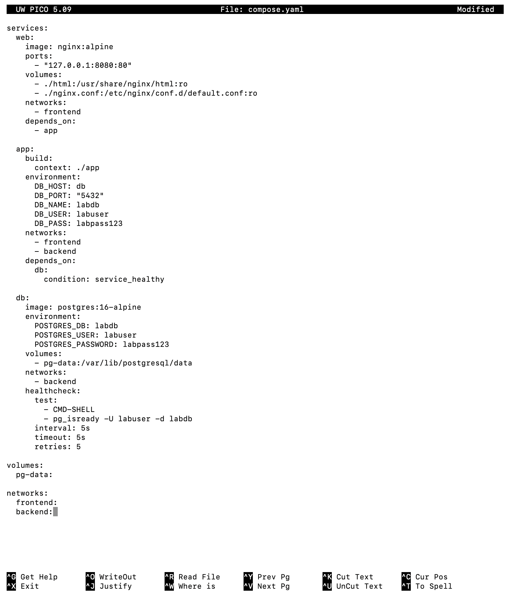

*Gambar 2. Isi file `compose.yaml`.*

Docker Compose digunakan untuk mengatur beberapa container sekaligus. Pada praktikum ini, ketiga service saling terhubung melalui *user-defined bridge network*. Service `web` hanya terhubung ke network `frontend`, service `app` terhubung ke `frontend` dan `backend`, sedangkan service `db` hanya terhubung ke `backend`. Pemisahan tersebut membatasi jalur komunikasi: Nginx dapat mengakses Flask, Flask dapat mengakses PostgreSQL, tetapi Nginx tidak terhubung langsung ke network database. Service dapat ditemukan menggunakan nama service melalui DNS internal Docker.

### 4.3 Membuat Requirements Flask

File `requirements.txt` digunakan untuk menentukan *library* Python yang diperlukan oleh aplikasi Flask.

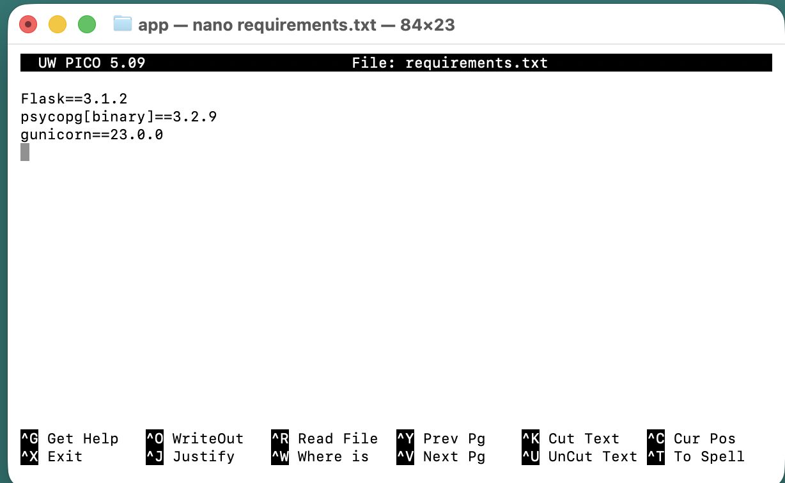

*Gambar 3. Isi file `requirements.txt`.*

Flask digunakan sebagai *framework* aplikasi web, psycopg digunakan agar aplikasi Python dapat berkomunikasi dengan PostgreSQL, sedangkan Gunicorn digunakan sebagai *application server* untuk menjalankan aplikasi Flask di dalam container.

### 4.4 Membuat Source Code Flask

*Source code* aplikasi dibuat pada file `app/app.py`.

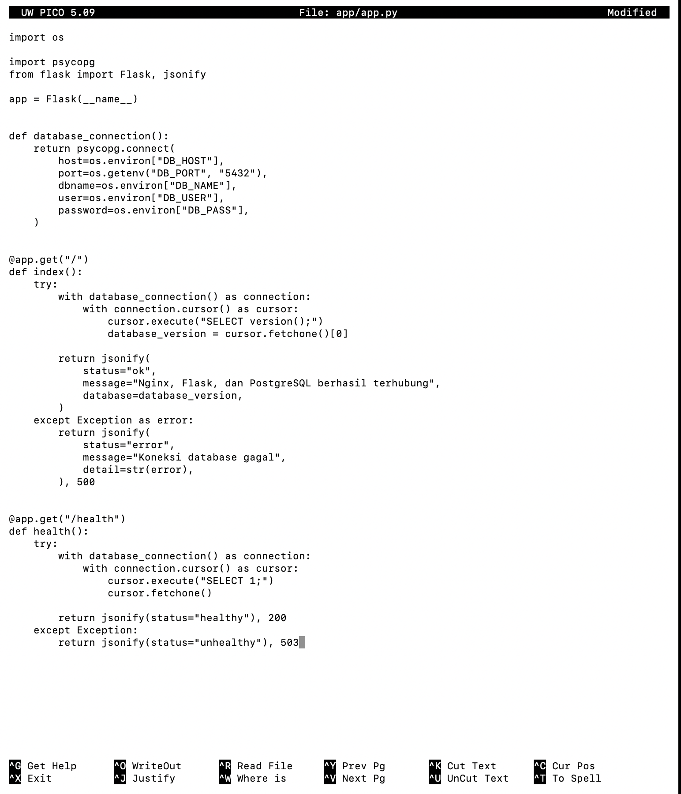

*Gambar 4. Isi file `app/app.py`.*

Pada endpoint `/`, aplikasi melakukan koneksi ke database PostgreSQL menggunakan konfigurasi yang diperoleh dari *environment variable*. Jika koneksi berhasil, aplikasi menampilkan status `ok` dan informasi versi PostgreSQL. Endpoint `/health` digunakan sebagai *health check* aplikasi untuk memastikan database dapat diakses dengan baik.

### 4.5 Membuat Dockerfile

Dockerfile digunakan untuk menentukan bagaimana image aplikasi Flask dibangun.

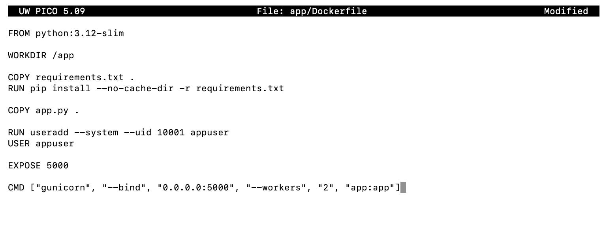

*Gambar 5. Isi file `app/Dockerfile`.*

Konfigurasi Dockerfile menggunakan Python 3.12 sebagai *base image* dan menginstal *dependency* dari `requirements.txt`.

### 4.6 Membuat Konfigurasi Nginx

File `nginx.conf` digunakan untuk mengatur Nginx sebagai *reverse proxy* menuju aplikasi Flask.

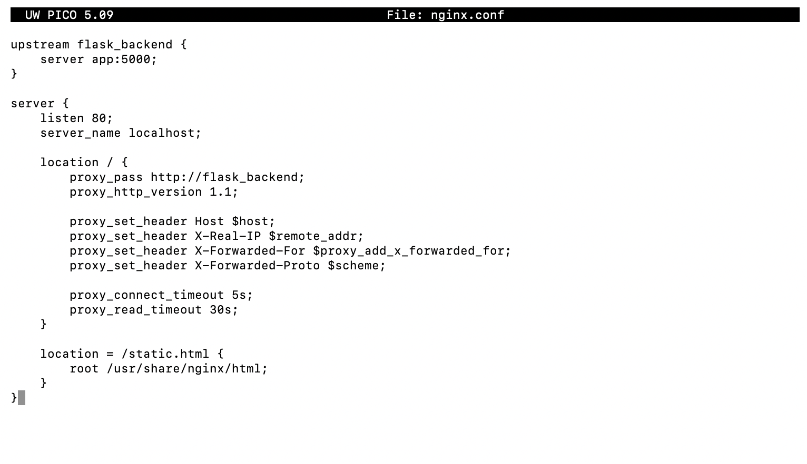

*Gambar 6. Isi file `nginx.conf`.*

Nginx meneruskan *request* yang diterima pada port 80 ke service `app` pada port 5000. Nama `app` merupakan nama service yang didefinisikan pada Docker Compose. Docker menyediakan DNS internal sehingga Nginx dapat menemukan container Flask menggunakan nama service tanpa harus mengetahui alamat IP container secara manual. Selain sebagai *reverse proxy*, Nginx juga digunakan untuk menyediakan halaman statis `static.html`.

### 4.7 Membuat Halaman HTML

Halaman HTML dibuat pada `nano html/index.html`. File ini berisi halaman sederhana untuk menguji penggunaan *bind mount* pada Nginx.

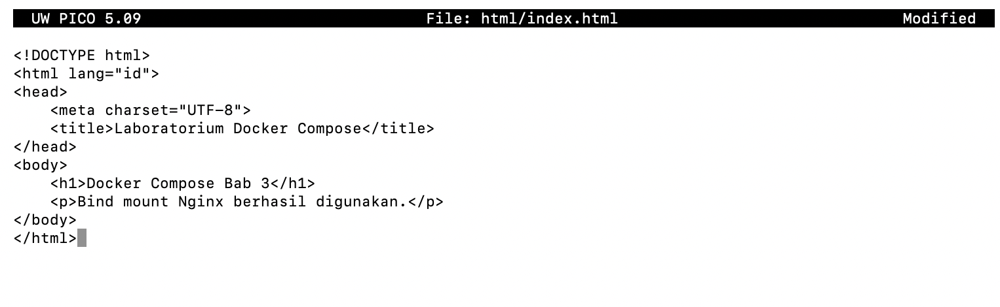

*Gambar 7. Isi file `html/index.html`.*

Folder `html` pada komputer di-*mount* ke direktori `/usr/share/nginx/html` di dalam container Nginx. Pada konfigurasi cheatsheet, pemetaan ditulis `./html:/usr/share/nginx/html:ro`, sehingga container hanya dapat membaca file dari host dan tidak dapat mengubahnya. File `nginx.conf` juga dipasang sebagai *read-only* pada `/etc/nginx/conf.d/default.conf`. Pembatasan `:ro` mengurangi risiko perubahan tidak diinginkan pada file host dari dalam container.

### 4.8 Validasi Konfigurasi Docker Compose

Sebelum menjalankan container, konfigurasi Docker Compose dicek dengan perintah berikut. Perintah tersebut digunakan untuk memastikan file YAML dapat diproses oleh Docker Compose dan tidak terdapat kesalahan sintaks atau indentasi.

```bash
docker compose config
```

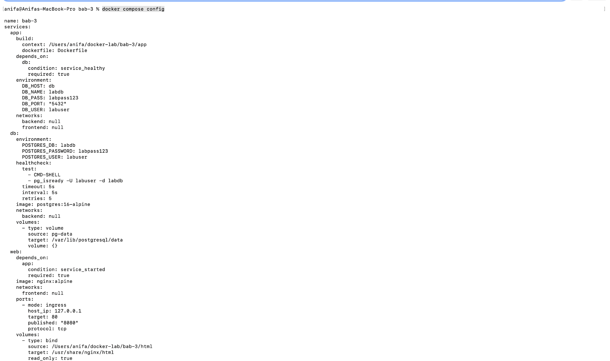

*Gambar 8. Hasil `docker compose config` (bagian 1).*

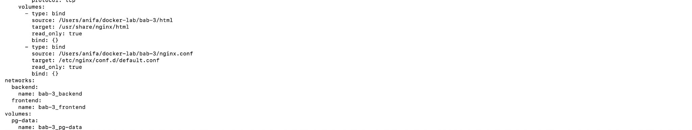

*Gambar 9. Hasil `docker compose config` (bagian 2).*

Selanjutnya dilakukan pengecekan service dengan perintah:

```bash
docker compose config --services
```

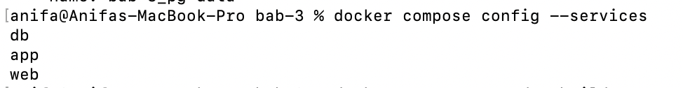

*Gambar 10. Daftar service pada konfigurasi Compose.*

### 4.9 Menjalankan Docker Compose

Setelah konfigurasi dinyatakan valid, seluruh service dijalankan menggunakan:

```bash
docker compose up -d --build
```

Parameter `-d` digunakan agar container berjalan di *background*, sedangkan `--build` digunakan untuk membangun kembali image aplikasi berdasarkan Dockerfile.

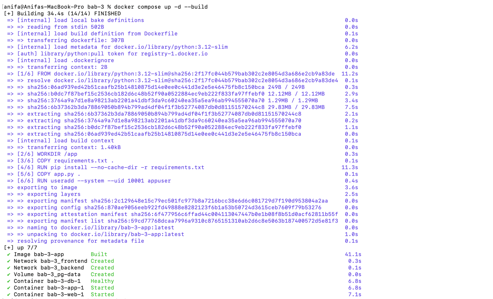

*Gambar 11. Proses build image dan penjalanan seluruh service.*

### 4.10 Memeriksa Status Container

```bash
docker compose ps
```

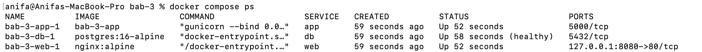

*Gambar 12. Status container hasil `docker compose ps`.*

Status `healthy` pada PostgreSQL menunjukkan bahwa *health check* database berhasil dilakukan. Pada konfigurasi cheatsheet, pemeriksaan menggunakan `pg_isready -U labuser -d labdb` dengan interval 5 detik, timeout 5 detik, dan maksimal 5 kali percobaan. Service `app` menggunakan `depends_on` dengan `condition: service_healthy`, sehingga startup aplikasi menunggu database dinyatakan sehat, bukan hanya menunggu container database dibuat.

### 4.11 Pengujian Aplikasi

Pengujian dilakukan menggunakan perintah berikut:

```bash
curl http://localhost:8080/
```

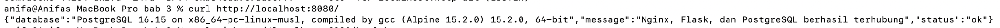

*Gambar 13. Hasil `curl` ke endpoint `/`.*

Request dikirim ke Nginx melalui port host 8080 yang diikat ke `127.0.0.1`, sehingga layanan hanya dapat diakses dari host lokal. Nginx meneruskan request ke service `app` pada port 5000 menggunakan DNS internal Docker. Flask kemudian melakukan koneksi ke PostgreSQL melalui network `backend`. Keberhasilan response menunjukkan komunikasi antarlapisan aplikasi berjalan dengan baik.

Uji *health endpoint*. Endpoint `/health` digunakan untuk memastikan aplikasi Flask dapat terhubung dengan database PostgreSQL.

```bash
curl -i http://localhost:8080/health
```

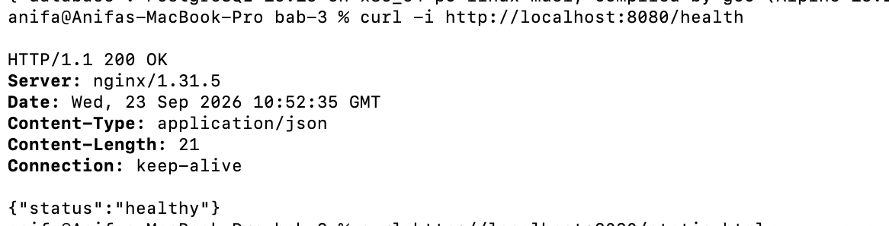

*Gambar 14. Hasil `curl -i` ke endpoint `/health`.*

Uji halaman statis:

```bash
curl http://localhost:8080/static.html
```

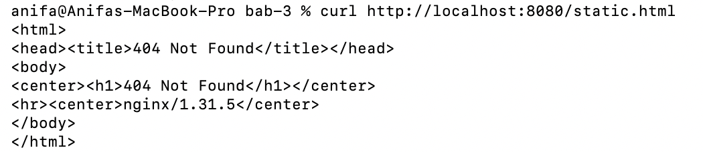

*Gambar 15. Hasil `curl` ke `/static.html`.*

### 4.12 Pemeriksaan Log

Log seluruh service diperiksa menggunakan perintah berikut. Perintah tersebut digunakan untuk melihat aktivitas dan kemungkinan *error* dari seluruh container. Log juga dapat digunakan untuk membantu mengetahui penyebab apabila aplikasi tidak dapat diakses.

```bash
docker compose logs --tail 100
```

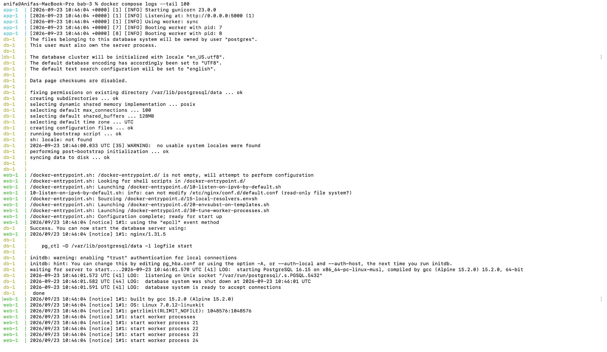

*Gambar 16. Log seluruh service.*

Pemeriksaan log berdasarkan service:

```bash
docker compose logs app
```

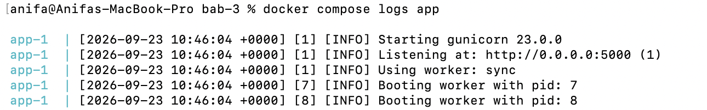

*Gambar 17. Log service `app`.*

```bash
docker compose logs db
```

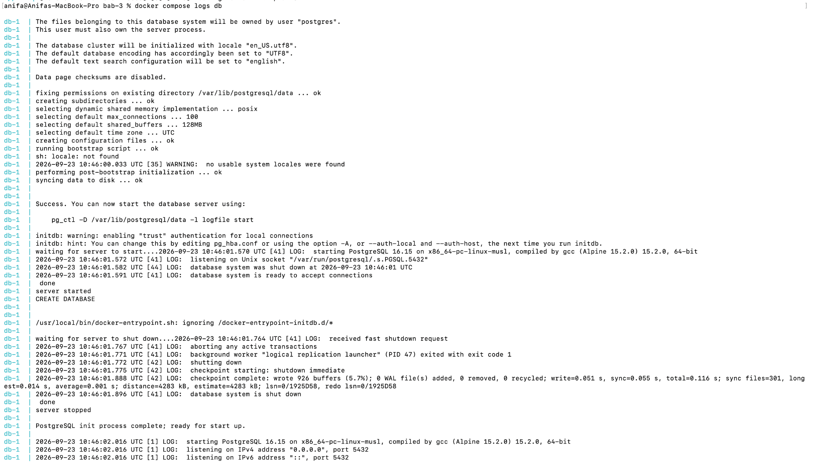

*Gambar 18. Log service `db`.*

```bash
docker compose logs web
```

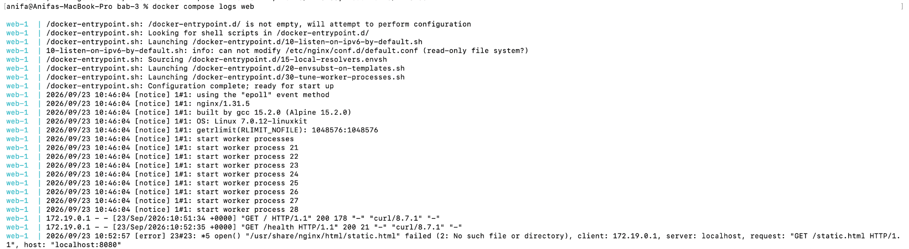

*Gambar 19. Log service `web`.*

### 4.13 Menghentikan Docker Compose

Menghentikan Docker menggunakan perintah berikut. Perintah tersebut menghentikan dan menghapus container serta network yang dibuat oleh Docker Compose. Named volume `pg-data` tidak dihapus, sehingga data PostgreSQL tetap tersedia ketika stack dijalankan kembali. Berbeda dengan perintah ini, `docker compose down -v` juga menghapus named volume yang dikelola oleh Compose sehingga data database pada `pg-data` ikut terhapus. Gunakan opsi `-v` hanya jika memang ingin menghapus data, misalnya untuk mengulang praktikum dari kondisi awal.

```bash
docker compose down
```

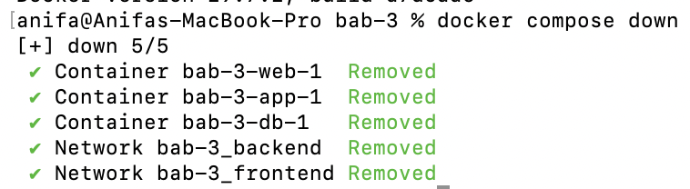

*Gambar 20. Hasil `docker compose down`.*

---

## 5. Hasil Pengujian

| Pemeriksaan | Hasil Aktual | Status |
| --- | --- | --- |
| `docker compose config` | Konfigurasi berhasil divalidasi tanpa error | Terpenuhi |
| `docker compose up -d --build` | Service `web`, `app`, dan `db` berhasil dijalankan | Terpenuhi |
| `docker compose ps` | Seluruh service berjalan dan `db` berstatus *healthy* | Terpenuhi |
| `docker network ls` | Network `frontend` dan `backend` berhasil dibuat | Terpenuhi |
| `docker ps` | Container berhasil berjalan | Terpenuhi |
| `curl http://localhost:8080/` | Flask berhasil terhubung dengan PostgreSQL | Terpenuhi |
| `curl -i http://localhost:8080/health` | Status aplikasi *healthy* | Terpenuhi |
| `curl http://localhost:8080/static.html` | Halaman statis berhasil diakses melalui Nginx | Terpenuhi |
| `ping` | Konektivitas antarcontainer pada network diuji | Terpenuhi |
| Named volume `pg-data` | Data PostgreSQL disimpan terpisah dari lifecycle container | Terpenuhi |
| Bind mount `./html` dan `nginx.conf` | File host digunakan oleh Nginx dengan mode *read-only* (`:ro`) | Terpenuhi |
| `healthcheck` dan `depends_on` | Service `app` menunggu database berstatus `healthy` | Terpenuhi |

---

## 6. Evaluasi dan Latihan Mandiri

### 1. Mengapa *user-defined bridge* lebih baik daripada *default bridge* untuk aplikasi multi-container?

*User-defined bridge* lebih sesuai untuk aplikasi multi-container karena menyediakan DNS internal Docker. Setiap container dapat berkomunikasi menggunakan nama container atau nama service, sehingga tidak perlu mencatat dan mengatur alamat IP secara manual. Hal ini penting karena alamat IP container dapat berubah ketika container dibuat ulang. Selain itu, network dapat dibuat terpisah berdasarkan kebutuhan aplikasi, seperti `frontend` dan `backend`, sehingga komunikasi antarlayanan lebih terkontrol. Pada praktikum ini, Nginx dan Flask menggunakan network `frontend`, sedangkan Flask dan PostgreSQL menggunakan network `backend`.

### 2. Apa risiko *bind mount* terhadap keamanan host?

*Bind mount* menghubungkan direktori atau file pada host secara langsung ke dalam container. Jika dipasang dengan akses tulis, proses di dalam container dapat mengubah atau menghapus file pada direktori host yang dipetakan. Jika direktori sensitif ikut dipasang, dampaknya dapat berupa perubahan konfigurasi, kerusakan file, atau akses terhadap data host. Untuk mengurangi risiko, hanya mount direktori yang diperlukan dan gunakan mode *read-only* (`:ro`) apabila container hanya perlu membaca file. Pada praktikum ini, direktori `html` dan file `nginx.conf` dipasang sebagai *read-only*.

### 3. Apa perbedaan `docker compose down` dan `docker compose down -v`?

- `docker compose down` menghentikan dan menghapus container serta network yang dibuat oleh Compose, tetapi named volume tetap dipertahankan. Karena itu, data PostgreSQL pada volume `pg-data` tidak ikut terhapus.
- `docker compose down -v` melakukan hal yang sama, tetapi juga menghapus named volume yang dikelola oleh Compose. Akibatnya, data PostgreSQL yang tersimpan pada `pg-data` ikut terhapus.

Opsi `-v` perlu digunakan dengan hati-hati karena dapat menghapus data secara permanen jika tidak tersedia backup.

### 4. Kapan `depends_on` dengan *healthcheck* lebih tepat daripada `depends_on` biasa?

`depends_on` biasa tepat digunakan ketika yang dibutuhkan hanya pengaturan urutan startup atau pembuatan service. Namun, opsi tersebut tidak memastikan bahwa service dependency sudah siap menerima koneksi. `depends_on` dengan `condition: service_healthy` lebih tepat ketika service aplikasi membutuhkan dependency yang harus benar-benar siap, misalnya Flask membutuhkan PostgreSQL. Dengan menambahkan `healthcheck` pada service database, Compose dapat menunggu sampai pemeriksaan seperti `pg_isready` berhasil sebelum menjalankan service aplikasi. Pola ini diterapkan pada service `app` yang bergantung pada service `db` dalam praktikum.

### 5. Bagaimana strategi backup volume untuk database produksi?

Backup database produksi sebaiknya dilakukan secara terjadwal, konsisten, dan diuji proses pemulihannya. Strategi yang dapat diterapkan adalah:

a. **Menggunakan backup logis database.** Jalankan `pg_dump` untuk membuat salinan database PostgreSQL, misalnya dalam format custom agar dapat dipulihkan menggunakan `pg_restore`.
b. **Menyimpan backup di lokasi terpisah.** Salinan backup tidak hanya disimpan pada volume atau host yang sama dengan database. Gunakan media atau penyimpanan terpisah dan batasi aksesnya.
c. **Mengatur jadwal dan retensi.** Lakukan backup berkala sesuai kebutuhan pemulihan data, lalu tetapkan masa penyimpanan backup harian, mingguan, atau bulanan.
d. **Mengamankan file backup.** Batasi hak akses dan enkripsi backup karena file dapat berisi data sensitif.
e. **Menguji proses restore.** Lakukan pemulihan secara berkala ke database uji untuk memastikan file backup dapat digunakan dan data benar-benar dapat dipulihkan.

Untuk backup pada tingkat file volume, database perlu dihentikan atau dibuat konsisten terlebih dahulu agar file data tidak disalin ketika sedang berubah. Backup logis seperti `pg_dump` umumnya lebih sesuai sebagai pendekatan utama untuk PostgreSQL karena menghasilkan salinan database yang dapat dipulihkan tanpa menyalin langsung seluruh isi direktori data mentah.

---

## 7. Threat Statement

Aset yang dilindungi meliputi *source code* Flask, kredensial PostgreSQL, data database, dan container. Risiko yang diperhatikan adalah akses tidak sah, kebocoran kredensial, dan eksploitasi container. Mitigasi yang diterapkan meliputi pembatasan publikasi port Nginx ke `127.0.0.1`, penggunaan user *non-root* `appuser` pada container Flask, pemasangan file Nginx dan halaman HTML sebagai *read-only* (`:ro`), serta pemisahan network *frontend* dan *backend*. Bind mount tanpa pembatasan dapat memberi container akses baca/tulis ke path host yang dipetakan; karena itu, hak akses perlu dibatasi sesuai kebutuhan. Kredensial database pada contoh praktikum masih ditulis sebagai environment variable di `compose.yaml`, sehingga untuk lingkungan produksi sebaiknya menggunakan mekanisme pengelolaan secret.

---

## 8. Analisis

Docker Compose menjalankan tiga service, yaitu Nginx (`web`), Flask (`app`), dan PostgreSQL (`db`). Pemisahan network *frontend* dan *backend* membatasi komunikasi sesuai fungsi masing-masing service. DNS internal Docker memungkinkan service ditemukan berdasarkan nama service, bukan alamat IP yang dapat berubah. Named volume `pg-data` digunakan untuk mempertahankan data PostgreSQL, sedangkan bind mount halaman HTML dan konfigurasi Nginx menggunakan mode `:ro`. Health check PostgreSQL dipadukan dengan `depends_on: condition: service_healthy` agar aplikasi menunggu database siap. Pengujian endpoint `/`, `/health`, dan `/static.html` dilakukan untuk memeriksa alur komunikasi aplikasi.

---

## 9. Tindak Lanjut

1. Menggunakan Docker Secret untuk menyimpan kredensial database.
2. Melakukan backup dan restore database secara berkala.
3. Menambahkan *resource limit* dan *logging*.
4. Menggunakan HTTPS apabila aplikasi diakses dari luar host.

---

## 10. Kesimpulan

Praktikum Bab 3 berhasil mengimplementasikan Docker Compose dengan tiga service, yaitu Nginx, Flask, dan PostgreSQL. Seluruh service berhasil berjalan dan saling terhubung. Pengujian endpoint `/`, `/health`, dan `/static.html` berhasil dilakukan. Penerapan keamanan berupa pembatasan port ke `127.0.0.1`, penggunaan user *non-root*, serta pemisahan network *frontend* dan *backend* juga berhasil diterapkan.

---

## 11. Referensi

Ferry Astika Saputra, *Bab 3 — Docker Network, Volume, Bind Mount, tmpfs, dan Compose*, Repository DevSecOps PENS, diakses pada 23 September 2026.
