# Laporan Praktikum Bab 4: Web Service Container: Apache, Nginx, Reverse Proxy, dan TLS

**Disusun untuk memenuhi Mata Kuliah Workshop DevOps**  
**Dosen Pengampu:** Dr. Ferry Astika Saputra, S.T., M.Sc.  
**Disusun oleh:** Anifa Aulia Abdari (3126640053)  
**Institusi:** Politeknik Elektronika Negeri Surabaya  
**Program Studi:** Teknik Informatika  
**Tahun:** 2026

---

> Dokumen Markdown ini dikonversi dari PDF laporan praktikum Bab 4. Gambar yang tertanam pada PDF diekstrak ke folder `assets/` dan ditautkan pada bagian halaman terkait.

## Halaman 1

LAPORAN PRAKTIKUM

### BAB 4 : Web Service Container: Apache, Nginx,

Reverse Proxy, dan TLS

Disusun untuk memenuhi Mata Kuliah Workshop DevOps

Dosen Pengampu : Dr. Ferry Astika Saputra, S.T., M.Sc.

Disusun Oleh :

Anifa Aulia Abdari (3126640053)

Politeknik Elektronika Negeri Surabaya

Departemen Teknik Informatika Dan Komputer

Program Studi Teknik Informatika

Tahun 2026

**Gambar/ilustrasi pada halaman ini:**

---

## Halaman 2

i

DAFTAR ISI

BAB I PENDAHULUAN ..................................................................................................... 1

1.1 Latar Belakang ............................................................................................................. 1

### 1.2 Tujuan Pembelajaran dan Kompetensi Utama ............................................................ 1

BAB II LANDASAN TEORI................................................................................................ 3

2.1 Apache httpd vs Nginx ................................................................................................ 3

### 2.2 Peta Konsep: TLS, Penyimpanan Private Key, dan TLS Offloading .......................... 4

### 2.3 Peta Konsep: Cara Kerja Reverse Proxy, Routing, dan Filter Keamanan ................... 5

### BAB III PENGERJAAN PRAKTIKUM .............................................................................. 6

3.1 Penyiapan Direktori Kerja dan Struktur Proyek .......................................................... 6

### 3.2 Pembuatan Sertifikat TLS Laboratorium (Self-Signed) .............................................. 6

3.3 Konfigurasi Orkestrasi compose.yaml ........................................................................ 7

### 3.4 Konfigurasi Reverse Proxy Nginx (default.conf) ........................................................ 8

### 3.5 Pembuatan Dokumen Web Statis Apache (index.html) .............................................. 9

### 3.6 Penyiapan Dependensi Backend Flask (requirements.txt) ........................................ 10

### 3.7 Implementasi Kode Sumber Backend API (app.py) ................................................. 10

### 3.8 Pembuatan Dockerfile Kustom Backend Flask ......................................................... 11

### 3.9 Validasi Konfigurasi dan Pemeriksaan Service......................................................... 11

### 3.10 Pembangunan Image dan Deployment Stack Compose .......................................... 12

### 3.11 Pengujian Cepat Fungsional Web Ingress dan API ................................................. 13

### 3.12 Pemeriksaan Boundary dan Isolasi Jaringan ........................................................... 15

### 3.13 Pemeriksaan dan Audit Log Web Service ............................................................... 16

3.14 Pembersihan Lingkungan (Cleanup) ....................................................................... 17

### BAB IV HASIL DAN PEMBAHASAN ............................................................................. 18

4.1 Hasil Pengujian .......................................................................................................... 18

4.2 Evaluasi dan Latihan Mandiri.................................................................................... 18

4.3 Analisis Wajib ........................................................................................................... 19

BAB V PENUTUP .............................................................................................................. 21

5.1 Kesimpulan ................................................................................................................ 21

---

## Halaman 3

1

### BAB I PENDAHULUAN

### 1.1 Latar Belakang

Dalam lanskap komputasi modern dan ekosistem cloud-native, web service merupakan pintu

gerbang utama (ingress boundary) yang menghubungkan pengguna eksternal dengan sistem

aplikasi dan data bisnis di lingkungan internal. Penerapan containerization menggunakan

Docker memungkinkan aplikasi web beserta web server pendukungnya dikemas secara

portabel, terisolasi, dan mudah direplikasi di berbagai tahapan pipeline DevSecOps.

Pada praktiknya, arsitektur aplikasi modern jarang sekali mengekspos server aplikasi

(application origin server) secara langsung ke jaringan publik. Pendekatan arsitektur yang

lazim dan direkomendasikan adalah menerapkan Reverse Proxy di baris terdepan. Nginx

sering kali difungsikan sebagai edge reverse proxy yang bertugas mengelola terminasi

enkripsi TLS/HTTPS (TLS Offloading), melakukan Layer-7 routing (mengarahkan rute

statis ke web server Apache httpd dan rute dinamis ke backend API Python Flask), serta

menerapkan filter keamanan berupa HTTP security headers.

Selain pemisahan fungsi komputasi, prinsip keamanan Least Exposure mengharuskan server

backend seperti Apache dan Flask berjalan dalam isolated private bridge network tanpa

membuka published port langsung ke host. Dengan demikian, seluruh alur lalu lintas data

(traffic flow) wajib melewati gerbang inspeksi proxy. Praktikum Bab 4 ini dirancang untuk

memberikan pemahaman konseptual dan pengalaman praktis dalam merancang,

mengorkestrasi, mengamankan, dan mengaudit web service multi-tier berbasis container

menggunakan Docker Compose.

### 1.2 Tujuan Pembelajaran dan Kompetensi Utama

Setelah menyelesaikan praktikum pada Bab 4 ini, mahasiswa diharapkan mampu:

1. Menjalankan Apache HTTP Server dan Nginx sebagai web server container dengan

konfigurasi kustom (custom configuration).

2. Memahami perbedaan arsitektur, karakteristik konkurensi, dan use-case antara

Apache httpd dan Nginx.

3. Menerapkan sertifikat TLS (self-signed certificate) menggunakan OpenSSL dengan

ekstensi Subject Alternative Name (SAN) untuk simulasi HTTPS lokal.

4. Mengonfigurasi Nginx sebagai reverse proxy cerdas yang melakukan path-based

routing, terminasi TLS (TLS offloading), dan pengalihan otomatis (301 permanent

redirect) dari HTTP ke HTTPS.

---

## Halaman 4

2

5. Menerapkan HTTP Security Headers (X-Content-Type-Options, X-Frame-

Options, Referrer-Policy) pada layer reverse proxy untuk memperkuat

pertahanan aplikasi.

6. Membangun container backend Python Flask yang berjalan menggunakan WSGI

server production-ready (Gunicorn) di bawah akun non-root user.

7. Mengimplementasikan service healthcheck pada Docker Compose untuk

memvalidasi kesiapan (readiness) layanan backend sebelum menerima trafik.

8. Menegakkan prinsip segregasi jaringan (network isolation), di mana hanya port

reverse proxy yang dipublikasikan ke host, sedangkan origin backend terisolasi di

internal network.

9. Membaca, menganalisis, dan mengekstrak bukti audit melalui access log dan error

log yang dipetakan secara persisten ke direktori host via bind mount.

10. Mendiagnosis kendala konfigurasi runtime serta menyusun analisis risiko keamanan

dan rekomendasi arsitektur produksi.

---

## Halaman 5

3

### BAB II LANDASAN TEORI

### 2.1 Apache httpd vs Nginx

Apache HTTP Server (httpd) dan Nginx adalah dua teknologi web server terkemuka di dunia

yang memiliki filosofi desain dan arsitektur konkurensi yang sangat berbeda:

1. Apache HTTP Server (httpd):

– Arsitektur Konkurensi: Menggunakan model Multi-Processing Modules

(MPM) seperti prefork, worker, atau event. Pada model klasik prefork, setiap

koneksi klien ditangani oleh proses terpisah, sedangkan pada worker/event,

koneksi ditangani oleh kombinasi proses dan thread.

– Karakteristik: Sangat kaya fitur (feature-rich), mendukung konfigurasi

terdesentralisasi per direktori melalui file .htaccess, dan memiliki modul

dinamis yang luas (mod_rewrite, mod_ssl, mod_proxy). Namun, pada tingkat

konkurensi masif (fenomena C10K problem), model berbasis thread/process

Apache membutuhkan konsumsi memori (RAM) yang lebih besar dan context

switching overhead.

2. Nginx:

– Arsitektur Konkurensi: Mengadopsi arsitektur asynchronous, event-driven,

dan non-blocking. Satu worker process tunggal dapat menangani ribuan koneksi

secara simultan menggunakan mekanisme multiplexing I/O kernel Linux

(epoll).

– Karakteristik: Sangat efisien dalam pemakaian CPU dan memori, unggul dalam

menyajikan berkas statis (static content delivery), memiliki modul reverse proxy

dan load balancer bawaan yang sangat tangguh, serta sangat populer sebagai TLS

termination point.

Aspek Komparasi

Apache HTTP Server (httpd)

Nginx

Model Arsitektur

Process/Thread-per-connection (MPM

prefork/worker/event)

Asynchronous Event-driven non-

blocking loop (epoll)

Penggunaan Resource

Meningkat secara linier seiring

pertambahan koneksi

Sangat rendah dan stabil pada

konkurensi tinggi

Direktori Konfigurasi

/usr/local/apache2/conf

/etc/nginx

Document Root

Bawaan

/usr/local/apache2/htdocs

/usr/share/nginx/html

Konfigurasi

Desentralisasi

Didukung via .htaccess (fleksibel

namun menambah I/O disk)

Tidak didukung (seluruh konfigurasi

harus terpusat)

Fitur Reverse Proxy

Memerlukan modul tambahan

(mod_proxy, mod_proxy_http)

Kemampuan bawaan terintegrasi

(proxy_pass)

---

## Halaman 6

4

Aspek Komparasi

Apache HTTP Server (httpd)

Nginx

Kasus Penggunaan

Ideal

Aplikasi monolitik legacy, PHP

mod_php, web hosting bersama

Reverse proxy, API gateway, TLS

terminator, web statis

### 2.2 Peta Konsep: TLS, Penyimpanan Private Key, dan TLS Offloading

Gambar 1. Peta konsep TLS, penyimpanan private key, dan TLS offloading.

Transport Layer Security (TLS) menjamin kerahasiaan data (enkripsi simetris AES-GCM),

integritas data (hash SHA-256), dan autentikasi identitas server (sertifikat X.509). Konsep

TLS Offloading (terminasi TLS) memusatkan proses dekripsi kriptografis pada reverse

proxy Nginx sehingga beban komputasi server backend diringankan dan sertifikat dikelola

terpusat di satu titik masuk. Terkait penyimpanan Private Key: kunci privat (lab.key) tidak

boleh dimasukkan ke dalam image atau repositori Git. Kunci harus disuntikkan secara

dinamis saat runtime melalui read-only bind mount (:ro) dengan izin berkas ketat (chmod

600) untuk meminimalkan risiko pencurian kunci privat.

**Gambar/ilustrasi pada halaman ini:**

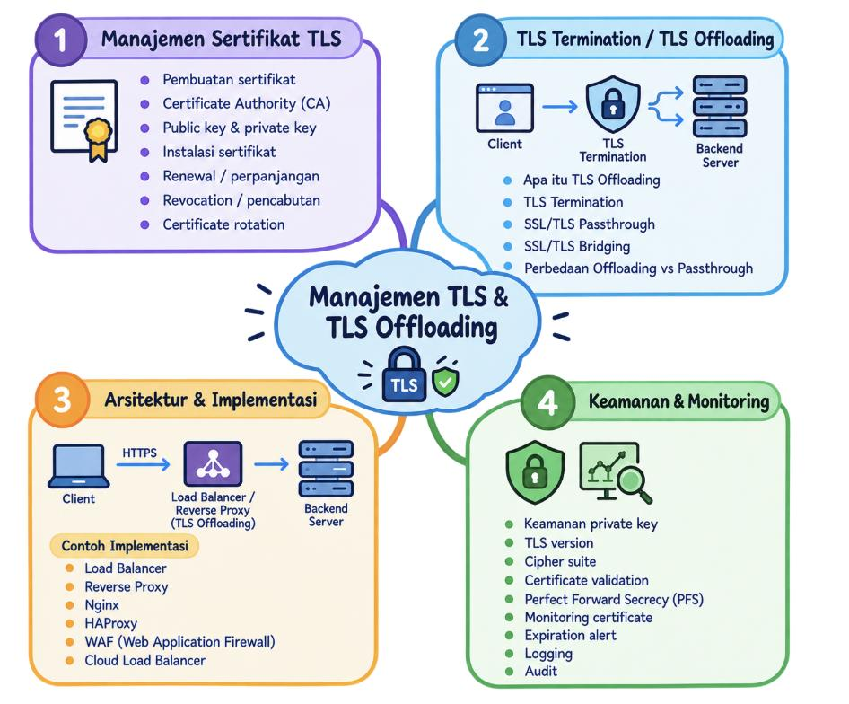

---

## Halaman 7

5

### 2.3 Peta Konsep: Cara Kerja Reverse Proxy, Routing, dan Filter Keamanan

Gambar 2. Peta konsep reverse proxy, routing, dan filter keamanan.

Reverse Proxy bertindak sebagai perantara yang mewakili server origin backend di hadapan

klien eksternal. Nginx mengevaluasi URI request untuk melakukan Layer-7 Path Routing:

rute root / diteruskan ke Apache web server, sedangkan rute /api/ dialihkan ke backend Flask.

Proxy meneruskan header klien terpercaya (Host, X-Real-IP, X-Forwarded-For, X-

Forwarded-Proto) untuk menjaga konteks alamat asli klien. Filter Keamanan: Nginx

menyuntikkan header X-Content-Type-Options: nosniff (mencegah MIME sniffing), X-

Frame-Options: DENY (mencegah Clickjacking), Referrer-Policy: no-referrer, serta

pengalihan otomatis HTTP 301 ke HTTPS port 8443.

**Gambar/ilustrasi pada halaman ini:**

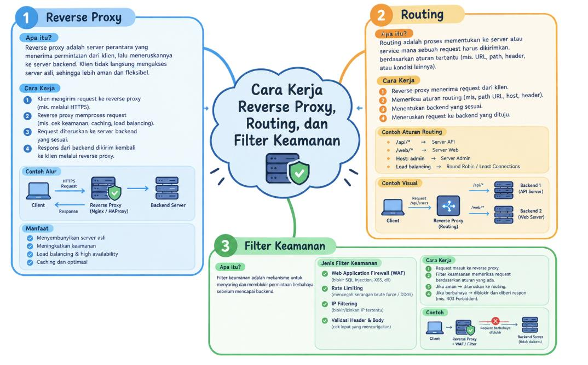

---

## Halaman 8

6

### BAB III PENGERJAAN PRAKTIKUM

Struktur berkas yang dibangun pada direktori kerja Bab 4 adalah sebagai berikut:

Berikut adalah tahapan implementasi praktikum secara sistematis sesuai dengan langkah

pada cheatsheet Bab 4.

### 3.1 Penyiapan Direktori Kerja dan Struktur Proyek

Langkah awal adalah membuat hierarki direktori kerja bab-4 yang memisahkan konfigurasi

Apache, konfigurasi Nginx, sertifikat TLS, berkas log, dan kode backend Flask.

Gambar 3. Pembuatan struktur direktori kerja Bab 4.

### 3.2 Pembuatan Sertifikat TLS Laboratorium (Self-Signed)

Pasangan kunci privat RSA 2048-bit dan sertifikat X.509 self-signed berumur 365 hari

dibuat dengan OpenSSL. Ekstensi Subject Alternative Name (SAN) ditambahkan untuk

bab-4/

├── compose.yaml

├── nginx/conf/default.conf

├── apache/sites/index.html

├── app/Dockerfile

├── app/requirements.txt

├── app/app.py

├── certs/lab.crt

├── certs/lab.key

└── logs/nginx/

`mkdir -p ~/docker-lab/bab4/{apache/sites,nginx/conf,certs,logs/nginx,app}`
`cd ~/docker-lab/bab-4`
**Gambar/ilustrasi pada halaman ini:**

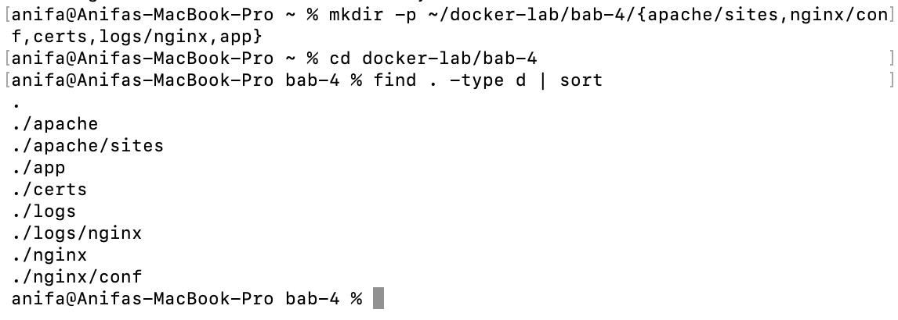

---

## Halaman 9

7

localhost dan 127.0.0.1. Hak akses kunci privat dibatasi dengan chmod 600, sedangkan

sertifikat publik menggunakan chmod 644.

Gambar 4. Pembuatan sertifikat TLS laboratorium dan pembatasan permission kunci privat.

### 3.3 Konfigurasi Orkestrasi compose.yaml

File compose.yaml mendefinisikan tiga service: proxy (Nginx), apache-web (Apache

httpd), dan flask-app (Flask). Ketiganya terhubung ke bridge network web-net. Hanya

proxy yang memiliki published port, dan dibatasi ke 127.0.0.1.

`openssl req -x509 -nodes -days 365 -newkey rsa:2048 \`
-keyout certs/lab.key \

-out certs/lab.crt \

-subj "/CN=localhost/O=DevSecOps Docker Lab" \

-addext "subjectAltName=DNS:localhost,IP:127.0.0.1"

`chmod 600 certs/lab.key`
`chmod 644 certs/lab.crt`
`nano compose.yaml`
`services:`
`proxy:`
image: nginx:alpine

ports:

- "127.0.0.1:8080:80"

- "127.0.0.1:8443:443"

volumes:

- ./nginx/conf:/etc/nginx/conf.d:ro

- ./certs:/etc/nginx/certs:ro

- ./logs/nginx:/var/log/nginx

`networks:`
- web-net

depends_on:

`apache-web:`
condition: service_started

`flask-app:`
condition: service_healthy

`apache-web:`
image: httpd:2.4-alpine

volumes:

- ./apache/sites:/usr/local/apache2/htdocs:ro

`networks:`
- web-net

**Gambar/ilustrasi pada halaman ini:**

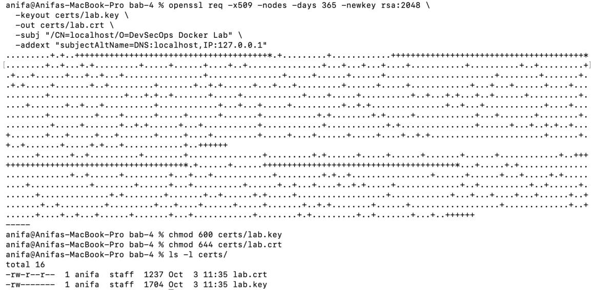

---

## Halaman 10

8

Gambar 5. Isi file compose.yaml.

### 3.4 Konfigurasi Reverse Proxy Nginx (default.conf)

Konfigurasi Nginx mengalihkan HTTP port 80 ke HTTPS port 8443, mengaktifkan TLS 1.2

dan 1.3, menambahkan security header, serta meneruskan request / ke Apache dan /api/

ke Flask.

`flask-app:`
build:

context: ./app

`networks:`
- web-net

`healthcheck:`
`test:`
- CMD

- python

- -c

- "import urllib.request; urllib.request.urlopen('http://127.0.0.1:5000/health')"

`interval: 5s`
`timeout: 3s`
`retries: 5`
`start_period: 5s`
`networks:`
web-net:

driver: bridge

`nano nginx/conf/default.conf`
`upstream apache_backend {`
server apache-web:80;

}

`upstream flask_backend {`
server flask-app:5000;

}

`server {`
`listen 80;`
server_name localhost;

`return 301 https://$host:8443$request_uri;`
}

**Gambar/ilustrasi pada halaman ini:**

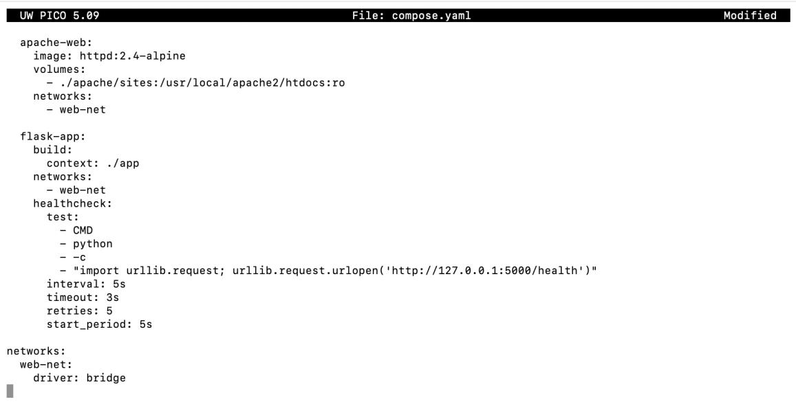

---

## Halaman 11

9

Gambar 6. Isi file nginx/conf/default.conf.

### 3.5 Pembuatan Dokumen Web Statis Apache (index.html)

File

apache/sites/index.html

di-mount

sebagai

document

root

Apache

(/usr/local/apache2/htdocs).

`server {`
`listen 443 ssl;`
server_name localhost;

`ssl_certificate /etc/nginx/certs/lab.crt;`
`ssl_certificate_key /etc/nginx/certs/lab.key;`
`ssl_protocols TLSv1.2 TLSv1.3;`
`add_header X-Content-Type-Options "nosniff" always;`
`add_header X-Frame-Options "DENY" always;`
`add_header Referrer-Policy "no-referrer" always;`
`location / {`
`proxy_pass http://apache_backend;`
proxy_set_header Host $host;

proxy_set_header X-Real-IP $remote_addr;

proxy_set_header X-Forwarded-For $proxy_add_x_forwarded_for;

proxy_set_header X-Forwarded-Proto $scheme;

}

`location /api/ {`
`proxy_pass http://flask_backend/;`
proxy_set_header Host $host;

proxy set header X-Real-IP $remote addr;

`nano apache/sites/index.html`
<!DOCTYPE html>

<html lang="id">

<head>

<meta charset="UTF-8">

<title>DevSecOps Bab 4</title>

</head>

<body>

<h1>Apache di Belakang Nginx</h1>

Halaman Bab 4 berhasil dilayani melalui reverse proxy.

<a href="/api/">Uji Flask API</a>

</body>

</html>

**Gambar/ilustrasi pada halaman ini:**

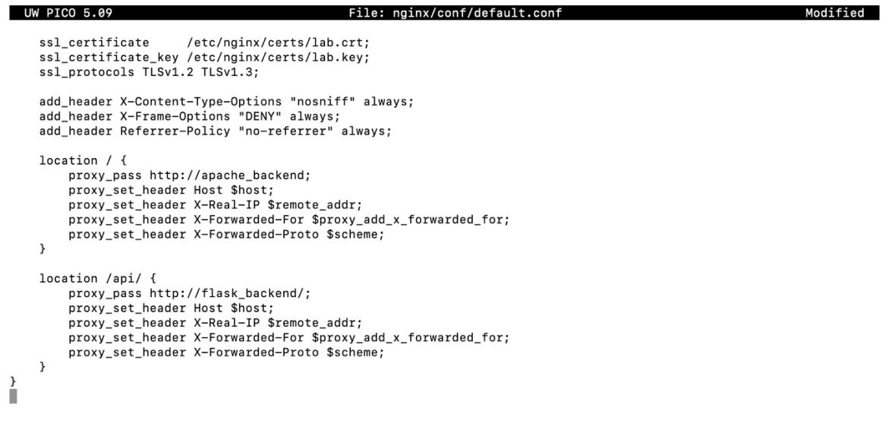

---

## Halaman 12

10

Gambar 7. Isi file apache/sites/index.html.

### 3.6 Penyiapan Dependensi Backend Flask (requirements.txt)

File app/requirements.txt berisi library yang dibutuhkan backend: Flask 3.1.2 dan

Gunicorn 23.0.0 sebagai WSGI server.

Gambar 8. Isi file app/requirements.txt.

### 3.7 Implementasi Kode Sumber Backend API (app.py)

File app/app.py menyediakan dua route. Endpoint / mengembalikan JSON berisi status,

nama service, pesan, dan nilai header X-Forwarded-Proto. Endpoint /health

mengembalikan HTTP 200 dengan {"status":

"healthy"} untuk keperluan

healthcheck.

`nano app/requirements.txt`
Flask==3.1.2

gunicorn==23.0.0

`nano app/app.py`
from flask import Flask, jsonify, request

app = Flask(__name__)

@app.get("/")

def index():

`return jsonify(`
status="ok",

service="flask-app",

message="API Bab 4 berhasil diakses melalui Nginx",

forwarded_proto=request.headers.get("X-Forwarded-Proto"),

)

@app.get("/health")

def health():

`return jsonify(status="healthy"), 200`
**Gambar/ilustrasi pada halaman ini:**

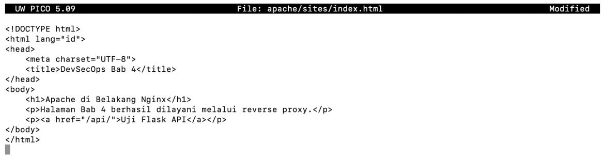

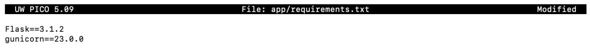

---

## Halaman 13

11

Gambar 9. Isi file app/app.py.

### 3.8 Pembuatan Dockerfile Kustom Backend Flask

app/Dockerfile membangun image backend dari python:3.12-slim. Container

dijalankan sebagai user sistem non-root appuser (UID 10001), bukan root.

Gambar 10. Isi file app/Dockerfile.

### 3.9 Validasi Konfigurasi dan Pemeriksaan Service

Sebelum deployment, struktur berkas diperiksa dan sintaks Compose divalidasi.

`nano app/Dockerfile`
`FROM python:3.12-slim`
WORKDIR /app

`COPY requirements.txt .`
`RUN pip install --no-cache-dir -r requirements.txt`
`COPY app.py .`
`RUN useradd --system --uid 10001 --no-create-home appuser`
`USER appuser`
`EXPOSE 5000`
`CMD ["gunicorn", "--bind", "0.0.0.0:5000", "--workers", "2", "app:app"]`
**Gambar/ilustrasi pada halaman ini:**

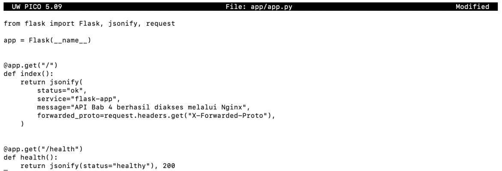

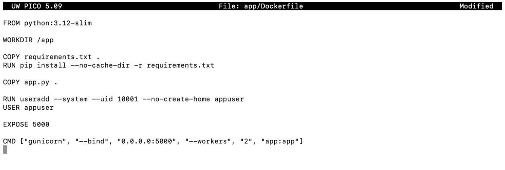

---

## Halaman 14

12

Gambar 11. Pemeriksaan struktur berkas dan validasi docker compose config.

Service yang harus muncul pada docker compose config --services adalah proxy,

apache-web, dan flask-app.

Gambar 12. Daftar service pada konfigurasi Compose.

### 3.10 Pembangunan Image dan Deployment Stack Compose

Image Flask dibangun dan seluruh container dijalankan di background. Status dan log

diperiksa setelahnya.

`cd ~/docker-lab/bab-4`
find . -maxdepth 3 -type f | sort

`docker compose config`
`docker compose config --services`
`docker compose up -d --build`
`docker compose ps`
`docker compose logs --tail 100`
**Gambar/ilustrasi pada halaman ini:**

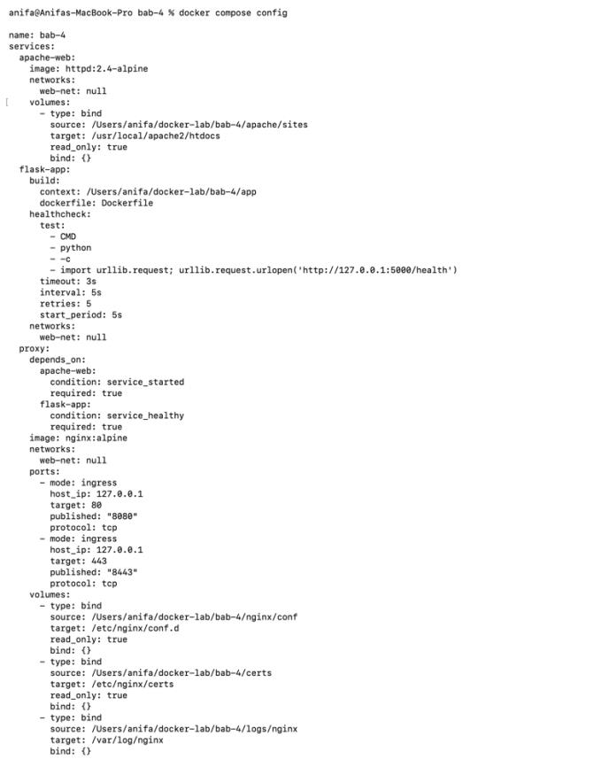

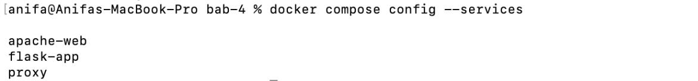

---

## Halaman 15

13

Gambar 13. Proses build image dan startup stack Compose.

Gambar 14. Status container (docker compose ps) dan log awal seluruh service.

### 3.11 Pengujian Cepat Fungsional Web Ingress dan API

1. Redirect HTTP ke HTTPS (port 8080)

Gambar 15. Hasil curl -I ke port 8080.

`curl -I http://localhost:8080/`
**Gambar/ilustrasi pada halaman ini:**

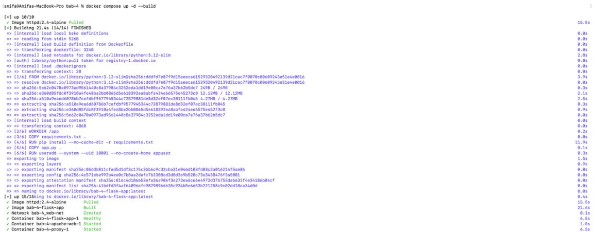

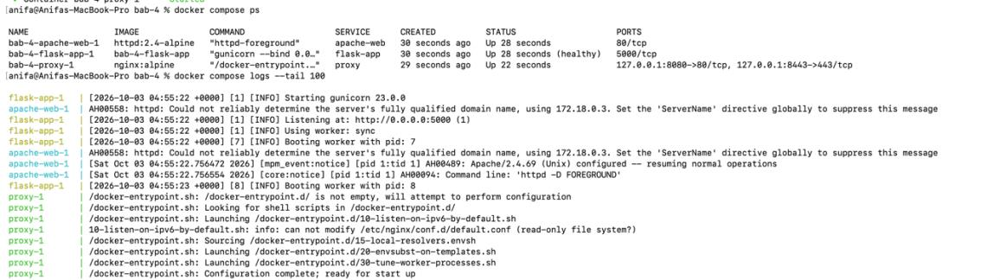

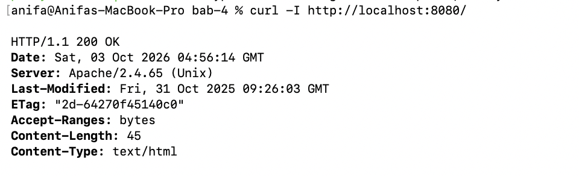

---

## Halaman 16

14

2. Halaman Apache melalui Nginx (port 8443)

Gambar 16. Hasil curl HTTPS ke endpoint /.

3. Flask API melalui Nginx

Gambar 17. Hasil curl ke endpoint /api/.

4. Health endpoint Flask

Gambar 18. Hasil curl ke endpoint /api/health.

5. Informasi TLS

`curl -k -i https://localhost:8443/`
`curl -k https://localhost:8443/api/`
`curl -k -i https://localhost:8443/api/health`
`openssl s_client \`
-connect localhost:8443 \

-servername localhost \

-brief </dev/null

**Gambar/ilustrasi pada halaman ini:**

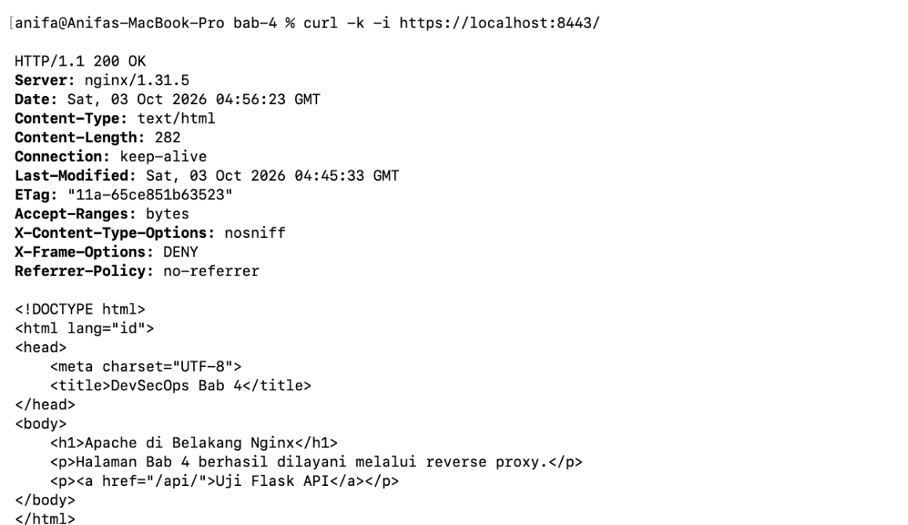

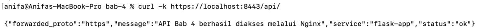

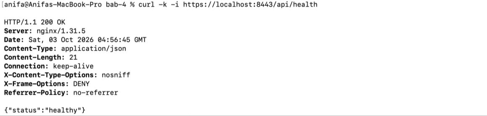

---

## Halaman 17

15

Gambar 19. Informasi handshake TLS pada endpoint HTTPS.

Opsi curl -k hanya digunakan karena sertifikat bersifat self-signed untuk laboratorium.

### 3.12 Pemeriksaan Boundary dan Isolasi Jaringan

Pemeriksaan ini memastikan hanya proxy yang memiliki published port, sementara Apache

dan Flask hanya dapat dijangkau melalui network internal web-net.

Gambar 20. Status container dan published port hasil docker compose ps.

Gambar 21. Hasil docker network inspect bab-4_web-net.

`docker compose ps`
`docker network inspect bab-4_web-net`
`docker compose exec proxy wget -qO- http://apache-web/`
`docker compose exec proxy wget -qO- http://flask-app:5000/health`
**Gambar/ilustrasi pada halaman ini:**

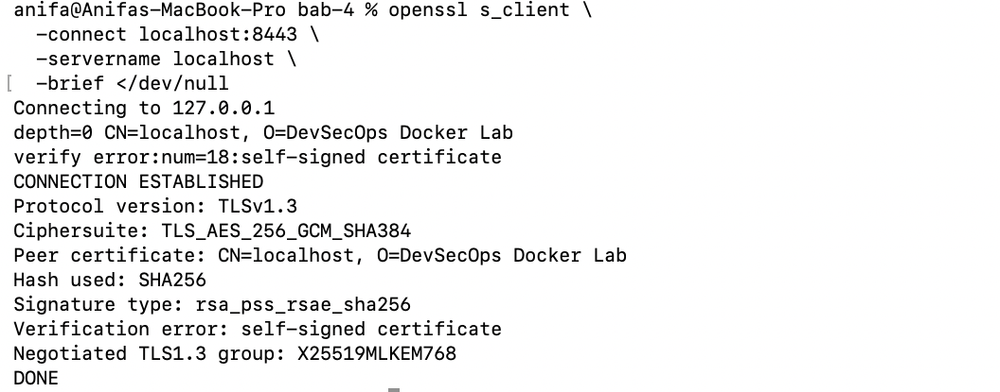

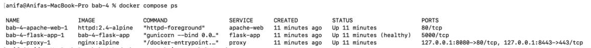

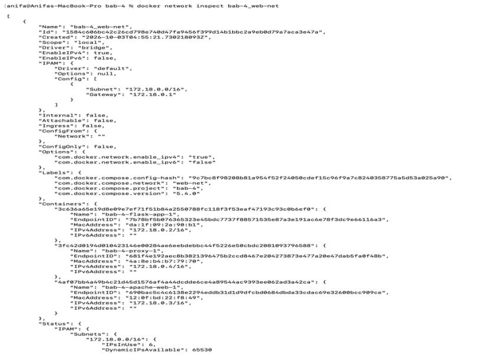

---

## Halaman 18

16

Gambar 22. Akses dari container proxy ke apache-web melalui nama service.

Gambar 23. Akses dari container proxy ke flask-app melalui nama service.

### 3.13 Pemeriksaan dan Audit Log Web Service

Log diperiksa melalui docker compose logs dan dengan membaca langsung berkas log

pada bind mount logs/nginx/.

Gambar 24. Log service proxy, apache-web, dan flask-app.

`docker compose logs proxy`
`docker compose logs apache-web`
`docker compose logs flask-app`
tail -n 20 logs/nginx/access.log

i

20

/

i

/

**Gambar/ilustrasi pada halaman ini:**

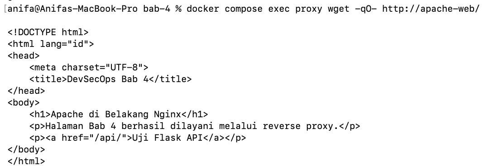

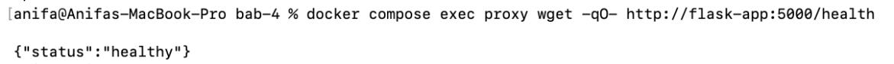

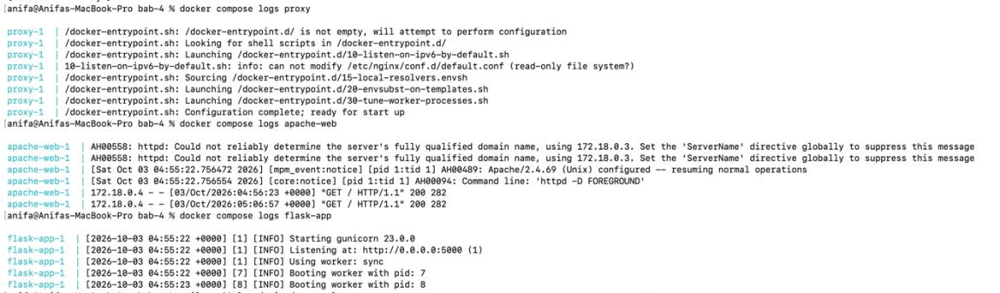

---

## Halaman 19

17

Gambar 25. Isi access.log dan error.log Nginx pada direktori host.

### 3.14 Pembersihan Lingkungan (Cleanup)

Setelah pengujian selesai, stack dihentikan. Image lokal hasil build dapat dihapus bila

diperlukan.

Gambar 26. Hasil docker compose down.

`cd ~/docker-lab/bab-4`
`docker compose down`
`docker compose down --rmi local`
**Gambar/ilustrasi pada halaman ini:**

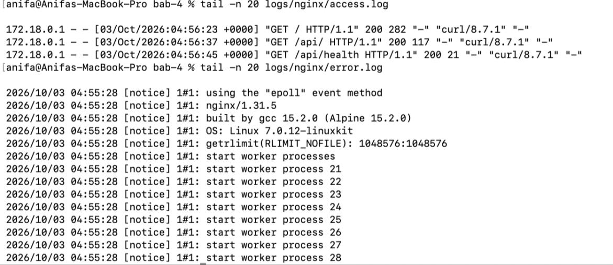

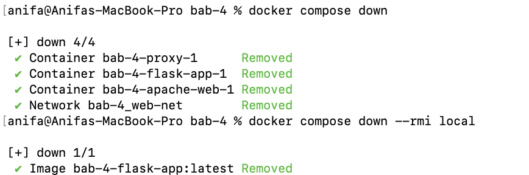

---

## Halaman 20

18

### BAB IV HASIL DAN PEMBAHASAN

### 4.1 Hasil Pengujian

Kriteria

Bukti

`docker compose config tidak menghasilkan galat`
Gambar 11

flask-app berstatus healthy

Gambar 14

HTTP port 8080 menghasilkan redirect 301

Gambar 15

HTTPS port 8443 menampilkan halaman Apache

Gambar 16

/api/ menghasilkan JSON Flask

Gambar 17, 18

TLS 1.2 atau TLS 1.3 berhasil dinegosiasikan

Gambar 19

Apache dan Flask tidak memiliki published port

Gambar 20

Request tercatat pada access log Nginx

Gambar 24, 25

### 4.2 Evaluasi dan Latihan Mandiri

1. Mengapa reverse proxy tidak seharusnya menjalankan semua logic aplikasi?

Reverse proxy dirancang untuk tugas di tepi jaringan: terminasi TLS, routing, buffering, dan

menyajikan konten statis. Jika logika bisnis ikut dijalankan di sana, proses yang berat atau

memblokir akan menahan worker proxy dan menurunkan kinerja untuk semua koneksi.

Pemisahan juga memungkinkan proxy dan backend di-scale secara terpisah, serta

memperkecil dampak bila ada celah di kode aplikasi.

2. Apa perbedaan TLS termination dan end-to-end TLS?

Pada TLS termination, enkripsi hanya berlaku antara klien dan proxy. Proxy mendekripsi

data lalu meneruskannya ke backend lewat HTTP di jaringan privat, sehingga sertifikat

dikelola di satu titik dan beban CPU backend lebih ringan. Pada end-to-end TLS, koneksi

tetap terenkripsi sampai ke backend (proxy melakukan re-encryption atau pass-through). Ini

lebih aman untuk jaringan internal yang tidak dipercaya, tetapi pengelolaan sertifikat dan

bebannya bertambah.

3. Bagaimana cara mengisolasi backend agar tidak langsung diakses dari host?

Hapus direktif ports: pada apache-web dan flask-app, lalu tempatkan keduanya di

bridge network privat (web-net) sehingga hanya dapat dijangkau lewat nama service di

dalam network itu. Publikasikan port hanya pada proxy, dan batasi ke loopback

(127.0.0.1:8080 dan 127.0.0.1:8443) agar tidak terbuka di interface host yang lebih

luas.

---

## Halaman 21

19

4. Apa konsekuensi menyimpan private key TLS di bind mount?

Keamanan kunci bergantung pada permission berkas di host: jika tidak chmod 600,

pengguna lain di host dapat membacanya. Tanpa opsi :ro, container yang disusupi dapat

mengubah atau menimpa berkas kunci. Folder certs/ juga berisiko ikut ter-commit ke

repository bila tidak masuk .gitignore. Selain itu, rotasi sertifikat dilakukan manual pada

berkas host, tidak lewat secret manager.

5. Bandingkan log Nginx dan log Apache dari sisi format dan kegunaan debugging.

Keduanya memakai format akses yang mirip (IP klien, waktu, method dan URI, status,

ukuran respons, referer, user-agent). Nginx lebih unggul untuk peran proxy karena

log_format dapat memuat variabel seperti $upstream_addr, $upstream_status, dan

$request_time, sehingga mudah membedakan lambatnya proxy dari lambatnya backend

saat terjadi 502/504. Log error Apache lebih deskriptif, dengan kode modul seperti AH00558,

sehingga membantu menelusuri masalah internal Apache, sedangkan log error Nginx lebih

ringkas dan berfokus pada koneksi, DNS upstream, dan timeout.

### 4.3 Analisis Wajib

1. Masalah yang Muncul dan Cara Diagnosis

a. Pesan read-only file system pada log Nginx.

Pada log startup proxy muncul informasi bahwa 10-listen-on-ipv6-by-default.sh

tidak dapat memodifikasi /etc/nginx/conf.d/default.conf. Diagnosis dilakukan

lewat docker compose logs proxy. Penyebabnya adalah folder konfigurasi di-mount

dengan opsi :ro, sehingga skrip bawaan image tidak bisa menulis ke berkas tersebut. Pesan

ini bersifat informasi dan tidak mengganggu layanan, karena konfigurasi sudah

mendengarkan IPv4 secara eksplisit (listen 80; dan listen 443 ssl;).

b. curl: (60) SSL certificate problem pada HTTPS.

Pemanggilan curl https://localhost:8443/ tanpa opsi tambahan ditolak karena

sertifikat self-signed tidak ada di daftar CA tepercaya klien. Untuk laboratorium, pengujian

memakai curl -k, sedangkan parameter TLS tetap diverifikasi terpisah melalui openssl

s_client.

---

## Halaman 22

20

2. Risiko Keamanan dan Operasional

Risiko

Penjelasan

Sertifikat self-signed

Tidak memiliki rantai kepercayaan CA. Di produksi, pengguna

terbiasa mengabaikan peringatan browser sehingga rawan

MITM.

Trafik internal tanpa enkripsi

Nginx ke Apache dan Flask memakai HTTP biasa. Jika host atau

container lain terkompromi, trafik dapat disadap.

Pemalsuan header

Backend mempercayai X-Forwarded-Proto dan X-Real-IP.

Bila backend dapat dijangkau langsung, header dapat

dipalsukan.

Kebocoran lewat log

URI dicatat di access.log. Token atau kunci yang dikirim

lewat query string tersimpan sebagai teks polos.

Tanpa rate limit dan batas resource

Proxy rentan terhadap HTTP flood dan resource exhaustion.

3. Rekomendasi untuk Production-Like Environment

•

Gunakan sertifikat dari CA tepercaya dengan pembaruan otomatis (ACME/Let's

Encrypt).

•

Enkripsi jalur proxy ke backend (TLS internal atau mTLS).

•

Simpan private key di secret manager (Docker/Kubernetes Secrets atau Vault), bukan

di bind mount.

•

Tambahkan limit_req_zone/limit_conn_zone di Nginx, dan pertimbangkan

WAF dengan OWASP Core Rule Set.

•

Batasi resource container (deploy.resources.limits), gunakan read_only:

true, dan cap_drop: ["ALL"] dengan cap_add: ["NET_BIND_SERVICE"] bila

diperlukan.

•

Sanitasi parameter sensitif di log dan kirim log ke sistem terpusat (SIEM).

---

## Halaman 23

21

### BAB V PENUTUP

### 5.1 Kesimpulan

Praktikum Bab 4 mengimplementasikan stack web tiga service (Nginx, Apache httpd, dan

Flask) dengan Docker Compose. Kesimpulan yang dapat diambil:

1. Nginx sebagai reverse proxy memisahkan antarmuka publik dari backend dan

mengatur routing berbasis path (/ ke Apache, /api/ ke Flask).

2. Terminasi TLS di Nginx dengan TLS 1.2/1.3 dan pengalihan HTTP 301 ke HTTPS

memusatkan pengelolaan sertifikat di satu titik masuk.

3. Prinsip least exposure diterapkan dengan private bridge network web-net: hanya

proxy yang memiliki published port, dibatasi ke 127.0.0.1.

4. Pengerasan dasar diterapkan melalui security header, chmod 600 pada kunci privat,

mount :ro, backend berjalan sebagai user non-root, dan healthcheck sebagai syarat

startup proxy.

5. Bind mount pada logs/nginx/ menyediakan jejak audit yang persisten di host untuk

pemantauan dan investigasi.

---
