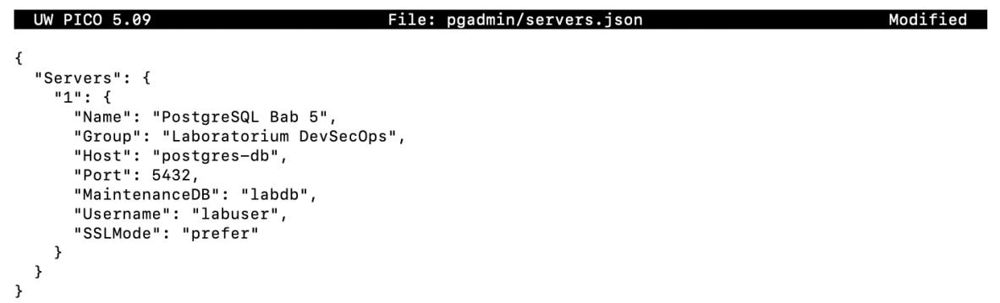
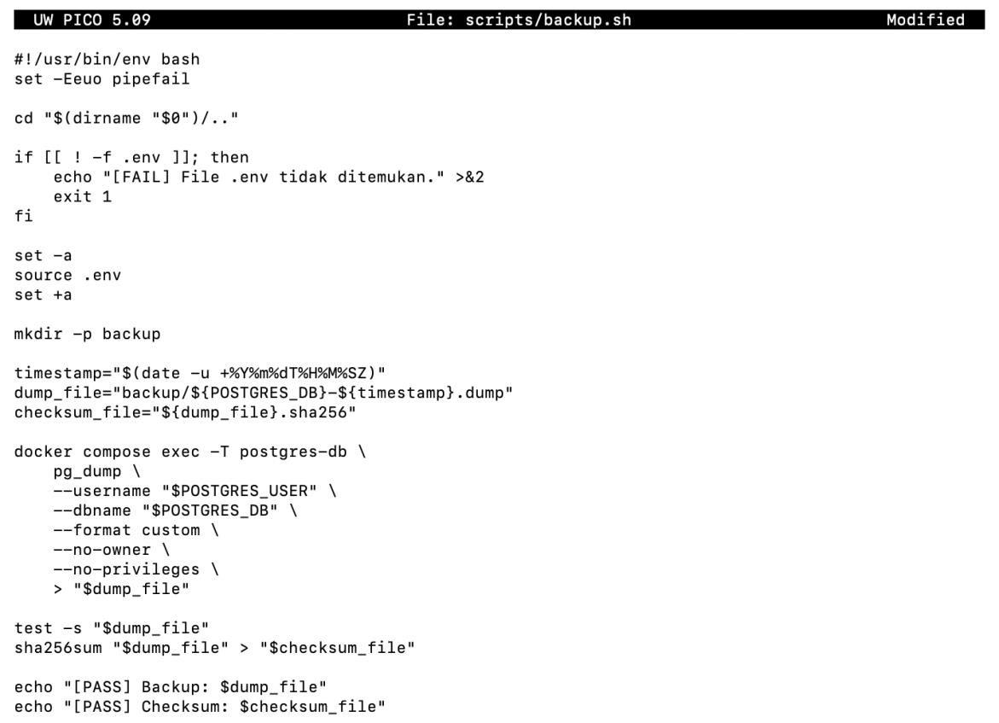
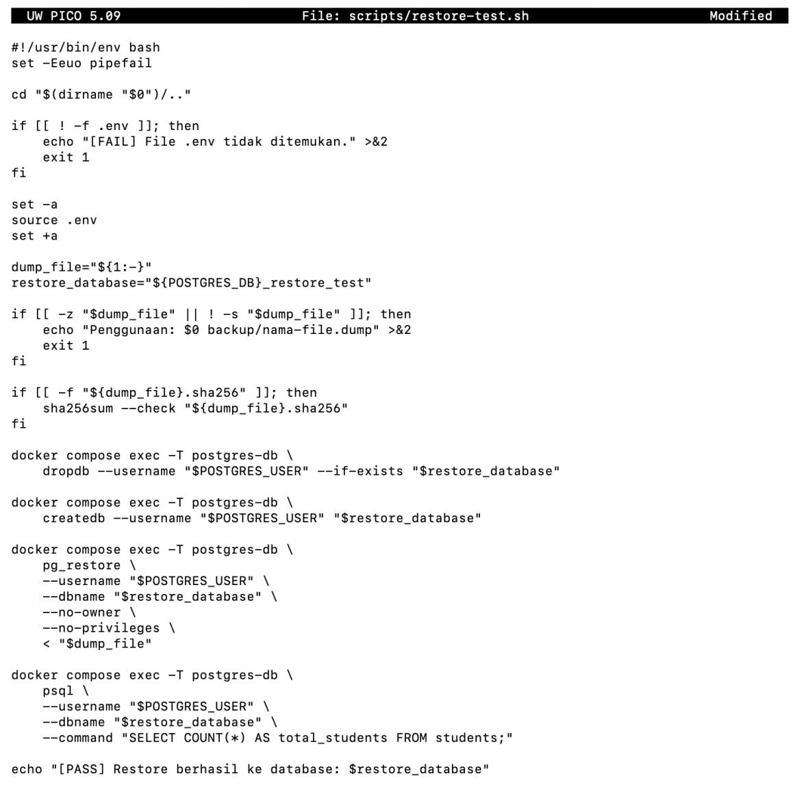
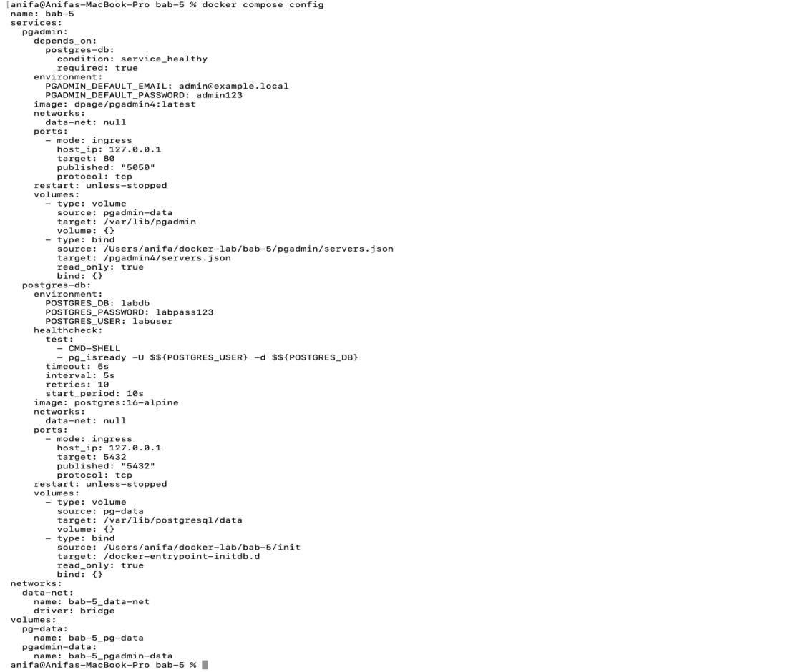
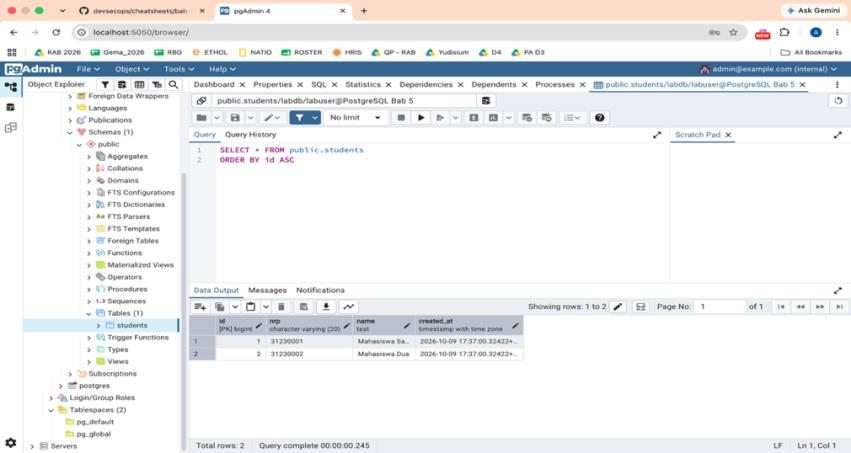
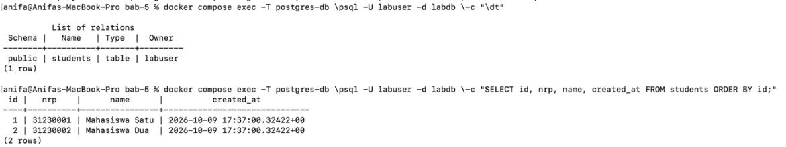
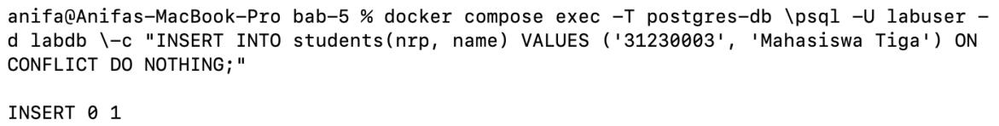
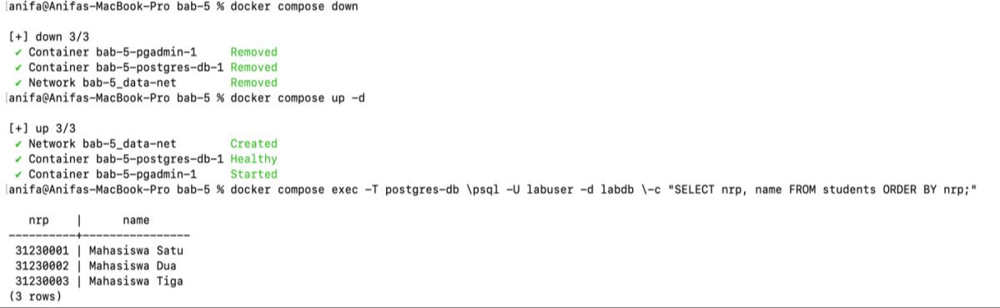
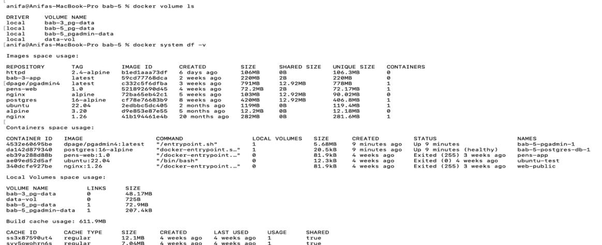

# BAB 5 : DATABASE SERVICE DI DOCKER (POSTGRESQL)
<div align="center">
  
  <h3 style="text-align: center;">Disusun Oleh : </h3>
  <p style="text-align: center;">
    <strong>Anifa Aulia Abdari (3126640053)</strong><br>
    Mata Kuliah : Workshop DevOps<br>
    Dosen Pengampu : Dr. Ferry Astika Saputra, S.T., M.Sc.<br>
    Tanggal pelaksanaan : 10 Oktober 2026 <br>
  </p>
  <h3 style="text-align: center;line-height: 1.5">Politeknik Elektronika Negeri Surabaya<br>Departemen Teknik Informatika Dan Komputer<br>Program Studi Teknik Informatika<br>Kelas B - StrLJ D4 Teknik Informatika<br>2026</h3>
  <hr><hr>
</div>

---
# 1. Tujuan Praktikum

Setelah menyelesaikan praktikum Bab 5 ini, mahasiswa diharapkan mampu:

1. Menjalankan PostgreSQL dengan konfigurasi berbasis environment variable dan volume persisten.
2. Menginisialisasi basis data menggunakan berkas SQL pada `docker-entrypoint-initdb.d`.
3. Mengakses basis data melalui `psql` dan pgAdmin 4.
4. Melakukan backup dan restore menggunakan `pg_dump` dan `pg_restore`.
5. Menerapkan healthcheck pada service PostgreSQL.

# 2. Dasar Teori Singkat

## 2.1 Database sebagai Sistem Persisten

Database container berbeda dari stateless service karena data harus diperlakukan sebagai aset utama. Oleh karena itu, volume, backup, restore, permission, dan siklus hidup container perlu dirancang dengan hati-hati.

Docker membedakan tiga jenis mekanisme penyimpanan, yaitu volume, bind mount, dan tmpfs. Untuk PostgreSQL, named volume lebih aman dibandingkan writable layer karena data dapat dipertahankan meskipun container dibuat ulang.

Namun, volume bukan pengganti backup. Kerusakan storage, kesalahan operator, atau penghapusan volume tetap dapat menyebabkan kehilangan data. Oleh karena itu, backup perlu disertai pengujian restore untuk memastikan data benar-benar dapat dipulihkan.

Image PostgreSQL resmi juga menjalankan berkas `.sql` dan `.sh` pada direktori `/docker-entrypoint-initdb.d` hanya ketika direktori data masih kosong. Perubahan pada init script tidak otomatis diterapkan ketika volume lama masih digunakan. Perubahan skema berikutnya perlu dilakukan melalui mekanisme migrasi.

## 2.2 Variabel Lingkungan PostgreSQL

Konfigurasi awal container PostgreSQL dilakukan melalui beberapa variabel lingkungan berikut.

| Variabel | Fungsi |
|---|---|
| `POSTGRES_DB` | Nama basis data awal yang dibuat ketika inisialisasi |
| `POSTGRES_USER` | User awal atau superuser container |
| `POSTGRES_PASSWORD` | Password awal yang wajib diisi untuk praktikum sederhana |
| `PGDATA` | Direktori data PostgreSQL di dalam container |
| `POSTGRES_INITDB_ARGS` | Argumen tambahan initdb, misalnya encoding atau locale |

Penggunaan environment variable membantu memisahkan konfigurasi dari definisi service. Pada praktikum ini, konfigurasi disimpan pada file `.env`.

## 2.3 Integritas, Hak Akses, dan Secret

Model ACID (Atomicity, Consistency, Isolation, Durability) digunakan untuk menjaga validitas transaksi database. Constraint seperti `PRIMARY KEY`, `UNIQUE`, dan `NOT NULL` membantu mencegah data yang tidak valid masuk ke dalam database.

Prinsip least privilege mengharuskan setiap akun hanya memperoleh hak akses yang diperlukan. Akun administrasi sebaiknya tidak digunakan untuk aktivitas aplikasi sehari-hari.

Kredensial juga tidak boleh ditanam pada Dockerfile, image layer, atau repository. File `.env` dapat digunakan untuk laboratorium, tetapi bukan pengganti secret manager pada lingkungan produksi.

## 2.4 Jaringan, Ketersediaan, dan Resource

PostgreSQL sebaiknya berada pada jaringan internal dan tidak dipublikasikan ke seluruh interface host kecuali diperlukan. TLS digunakan untuk melindungi data dalam perjalanan, sedangkan enkripsi storage melindungi media penyimpanan.

Healthcheck menggunakan `pg_isready` dapat menunjukkan bahwa server menerima koneksi. Namun, healthcheck tersebut tidak membuktikan bahwa skema, data, atau query bisnis sudah benar. Oleh karena itu, pengujian perlu mencakup query representatif, constraint, backup-restore, dan akses negatif.

## 2.5 Migrasi dan Tata Kelola Operasional

Skema database merupakan bagian dari aplikasi yang perlu diberi versi. Migrasi harus memiliki urutan, pemilik, serta strategi rollback atau forward-fix.

Sebelum membuat backup, perlu ditentukan Recovery Point Objective (RPO) dan Recovery Time Objective (RTO). Proses restore juga harus diuji dengan mengukur waktu pemulihan aktual.

Penggunaan tag image yang berubah dapat menimbulkan perbedaan versi dan kompatibilitas. Oleh karena itu, upgrade image perlu diuji terlebih dahulu pada salinan data.

# 3. Alat dan Bahan

| No. | Alat/Bahan | Keterangan |
|---|---|---|
| 1 | MacBook | Perangkat utama praktikum |
| 2 | VMware | Virtualisasi lingkungan Linux |
| 3 | Ubuntu | Sistem operasi lingkungan praktikum |
| 4 | Docker Engine | Menjalankan container |
| 5 | Docker Compose | Mengelola service container |
| 6 | PostgreSQL 16 Alpine | Database server |
| 7 | pgAdmin 4 | Antarmuka pengelolaan PostgreSQL |
| 8 | `psql` | Mengakses database melalui command line |
| 9 | `pg_dump` | Membuat backup database |
| 10 | `pg_restore` | Memulihkan database dari backup |
| 11 | `sha256sum` | Memeriksa checksum file backup |
| 12 | Terminal | Menjalankan perintah praktikum |

Direktori kerja praktikum:

```bash
~/docker-lab/bab-5
```

Struktur direktori proyek:

```text
bab-5/
├── .env.example
├── .env
├── .gitignore
├── compose.yaml
├── init/
│   └── 01-schema.sql
├── pgadmin/
│   └── servers.json
├── scripts/
│   ├── backup.sh
│   └── restore-test.sh
└── backup/
```

# 4. Langkah Praktikum

Seluruh berkas pada praktikum ini ditempatkan pada satu direktori kerja khusus Bab 5 agar berkas konfigurasi, bind mount, dan laporan mudah dipisahkan dari bab lain.

## 4.1 Penyiapan Direktori Kerja dan Struktur Proyek

Langkah awal adalah membuat direktori kerja `bab-5` beserta subdirektori `init`, `backup`, `pgadmin`, dan `scripts`.

```bash
mkdir -p ~/docker-lab/bab-5/{init,backup,pgadmin,scripts}
cd ~/docker-lab/bab-5
```


*Gambar 1. Pembuatan struktur direktori kerja Bab 5.*

Direktori tersebut digunakan untuk memisahkan file konfigurasi, SQL inisialisasi, script backup dan restore, serta hasil pencadangan database.

## 4.2 Pembuatan Template Konfigurasi (.env.example) dan Konfigurasi Aktif

File `.env.example` digunakan sebagai template konfigurasi laboratorium. Nilai di dalamnya merupakan kredensial sintetis untuk kebutuhan praktikum dan tidak boleh digunakan pada sistem produksi.

Template kemudian disalin menjadi konfigurasi aktif `.env`. Permission file dibatasi agar hanya pemilik file yang dapat membaca dan mengubahnya.

```bash
cp .env.example .env
chmod 600 .env
```


*Gambar 2. Isi `.env.example` dan pembatasan permission berkas `.env`.*

File `.env` memudahkan proses interpolasi konfigurasi Docker Compose. Meskipun demikian, penggunaan `.env` belum dapat dianggap sebagai mekanisme secret management yang aman untuk lingkungan produksi.

## 4.3 Pembuatan File .gitignore

File `.gitignore` dibuat untuk mengurangi risiko kredensial dan berkas dump ikut terkirim ke repository Git.

Konfigurasi ini mengecualikan file `.env`, direktori backup, dan file log dari version control.


*Gambar 3. Isi file `.gitignore`.*

Pengecualian tersebut penting karena file `.env` berisi informasi kredensial, sedangkan file dump dapat berisi data database yang perlu dilindungi.

## 4.4 Konfigurasi Orkestrasi compose.yaml

File `compose.yaml` digunakan untuk mendefinisikan dua service, yaitu `postgres-db` dan `pgadmin`.

Konfigurasi mencakup:

- Image PostgreSQL 16 Alpine dan pgAdmin 4.
- Environment variable yang dibaca dari `.env`.
- Named volume `pg-data` dan `pgadmin-data`.
- Bridge network `data-net`.
- Pembatasan published port ke loopback `127.0.0.1`.
- Healthcheck menggunakan `pg_isready`.
- Ketergantungan pgAdmin terhadap kondisi PostgreSQL yang sudah healthy.


*Gambar 4. Isi file `compose.yaml`.*

Port PostgreSQL dan pgAdmin dibatasi ke loopback. Untuk eksperimen yang hanya menggunakan pgAdmin di dalam Compose, published port PostgreSQL dapat dihapus sehingga database tidak terbuka langsung ke host.

## 4.5 Pembuatan Init Script Schema (init/01-schema.sql)

File `init/01-schema.sql` digunakan untuk membuat tabel `students`, memasukkan dua baris data awal, dan membuat indeks pada kolom `name`.

Berkas ini di-mount secara read-only ke direktori `/docker-entrypoint-initdb.d`.


*Gambar 5. Isi file `01-schema.sql`.*

Init script hanya dijalankan ketika direktori data PostgreSQL masih kosong. Jika volume lama masih digunakan, perubahan pada file SQL tidak otomatis dijalankan kembali.

## 4.6 Pendaftaran Server pada pgAdmin (pgadmin/servers.json)

File `pgadmin/servers.json` digunakan untuk mendaftarkan server PostgreSQL secara otomatis pada pgAdmin.

Password tidak ditulis pada file ini. pgAdmin akan meminta password ketika koneksi dibuat.

Hostname yang digunakan adalah `postgres-db`, bukan `localhost`, karena pgAdmin berjalan pada container yang berbeda. Di dalam container pgAdmin, `localhost` mengarah ke container pgAdmin itu sendiri.



*Gambar 6. Isi file `servers.json`.*

## 4.7 Pembuatan Script Backup (scripts/backup.sh)

Script `backup.sh` digunakan untuk membuat logical backup dengan format custom menggunakan `pg_dump` melalui perintah `docker compose exec`.

Script dirancang untuk:

1. Menghentikan proses apabila terjadi kesalahan menggunakan `set -Eeuo pipefail`.
2. Membuat file backup dengan format custom.
3. Memastikan file dump tidak kosong.
4. Membuat checksum SHA-256.



*Gambar 7. Isi file `backup.sh`.*

Penggunaan format custom memungkinkan file backup dipulihkan menggunakan `pg_restore`.

## 4.8 Pembuatan Script Restore Test (scripts/restore-test.sh)

Script `restore-test.sh` digunakan untuk menguji proses pemulihan database pada basis data terpisah bernama `labdb_restore_test`.

Dengan menggunakan database terpisah, database sumber `labdb` tidak ditimpa selama proses pengujian.

Script melakukan beberapa tahapan, yaitu:

1. Memeriksa keberadaan file dump.
2. Memverifikasi checksum apabila tersedia.
3. Membuat ulang database pengujian.
4. Menjalankan `pg_restore`.
5. Menghitung jumlah baris pada tabel `students`.



*Gambar 8. Isi file `restore-test.sh`.*

## 4.9 Pengaturan Permission dan Validasi Konfigurasi

Kedua script diberikan izin eksekusi. Selanjutnya, struktur berkas diperiksa dan konfigurasi Docker Compose divalidasi sebelum deployment.

```bash
cd ~/docker-lab/bab-5

chmod +x scripts/backup.sh scripts/restore-test.sh

find . -maxdepth 3 -type f | sort

docker compose config
```



*Gambar 9. Pemeriksaan struktur berkas dan validasi `docker compose config`.*

Service yang harus muncul pada hasil konfigurasi adalah `postgres-db` dan `pgadmin`.

```bash
docker compose config --services
```


*Gambar 10. Daftar service pada konfigurasi Compose.*

## 4.10 Menjalankan Stack PostgreSQL dan pgAdmin

Stack dijalankan di background menggunakan Docker Compose. Setelah itu, status container dan log awal diperiksa. PostgreSQL perlu menampilkan status `healthy` sebelum pengujian dilanjutkan.

```bash
docker compose up -d

docker compose ps

docker compose logs --tail 100
```


*Gambar 11. Hasil `docker compose up -d` dan `docker compose ps` dengan status healthy.*

Pemeriksaan log dilakukan untuk memastikan proses inisialisasi PostgreSQL dan pgAdmin berjalan dengan baik.


*Gambar 12. Log awal service PostgreSQL dan pgAdmin.*

## 4.11 Mengakses pgAdmin

Antarmuka pgAdmin diakses melalui alamat:

```text
http://localhost:5050
```

Login menggunakan nilai `PGADMIN_DEFAULT_EMAIL` dan `PGADMIN_DEFAULT_PASSWORD` yang telah ditentukan pada file `.env`.

Server bernama **PostgreSQL Bab 5** tersedia pada panel kiri. Password PostgreSQL dimasukkan ketika diminta. Setelah koneksi berhasil, tabel `students` dapat dilihat melalui antarmuka pgAdmin.



*Gambar 13. Antarmuka pgAdmin yang terhubung ke server PostgreSQL Bab 5.*

## 4.12 Pengujian Schema dan Data Awal

Pengujian dilakukan untuk memastikan init script berhasil dijalankan. Tabel `students` harus tersedia dan sedikitnya dua baris data awal telah dimasukkan.

Memeriksa daftar tabel:

```bash
docker compose exec -T postgres-db \
  psql -U labuser -d labdb \
  -c "\dt"
```

Memeriksa data awal:

```bash
docker compose exec -T postgres-db \
  psql -U labuser -d labdb \
  -c "SELECT id, nrp, name, created_at FROM students ORDER BY id;"
```



*Gambar 14. Tabel students dan data awal hasil init script.*

## 4.13 Pengujian Persistensi Volume

Pengujian persistensi dilakukan dengan menambahkan satu record baru ke tabel `students`. Setelah itu, container dibuat ulang tanpa menghapus volume.

Jika volume bekerja dengan benar, record `31230003` tetap tersedia setelah container dijalankan kembali.

```bash
docker compose exec -T postgres-db \
  psql -U labuser -d labdb \
  -c "INSERT INTO students(nrp, name) VALUES ('31230003', 'Mahasiswa Tiga') ON CONFLICT DO NOTHING;"
```



*Gambar 15. Penambahan record 31230003 pada tabel students.*

Container kemudian dihentikan dan dijalankan kembali tanpa menghapus volume.

```bash
docker compose down

docker compose up -d

docker compose exec -T postgres-db \
  psql -U labuser -d labdb \
  -c "SELECT nrp, name FROM students ORDER BY nrp;"
```



*Gambar 16. Data tetap tersedia setelah `docker compose down` dan `up`.*

Hasil pengujian menunjukkan bahwa data yang tersimpan pada named volume tetap tersedia meskipun container dibuat ulang.

## 4.14 Pembuatan Backup

Backup database dibuat menggunakan script `backup.sh`. Setelah proses selesai, ukuran file dan checksum diperiksa.

```bash
./scripts/backup.sh

ls -lh backup/

sha256sum --check backup/*.dump.sha256
```

File backup harus memiliki ukuran lebih dari nol dan checksum yang valid. Keberadaan file dump saja belum cukup untuk membuktikan bahwa proses backup berhasil.


*Gambar 17. Hasil backup.sh, daftar berkas backup, dan verifikasi checksum.*

## 4.15 Pengujian Restore

File dump terbaru dipilih secara otomatis, kemudian dipulihkan ke database terpisah `labdb_restore_test`.

```bash
latest_dump="$(find backup -maxdepth 1 -name '*.dump' -type f | sort | tail -n 1)"

./scripts/restore-test.sh "$latest_dump"
```


*Gambar 18. Hasil restore-test.sh ke database labdb_restore_test.*

Setelah proses restore selesai, isi database hasil pemulihan dibandingkan dengan database sumber.

```bash
docker compose exec -T postgres-db \
  psql -U labuser -d labdb_restore_test \
  -c "SELECT nrp, name FROM students ORDER BY nrp;"
```


*Gambar 19. Isi tabel students pada database hasil restore.*

Pengujian ini memastikan bahwa file backup dapat digunakan untuk memulihkan database tanpa menimpa database sumber.

## 4.16 Pemantauan Dasar

Pemantauan dasar dilakukan dengan memeriksa status container, log PostgreSQL, kesiapan server menggunakan `pg_isready`, serta versi PostgreSQL.

```bash
docker compose ps

docker compose logs postgres-db --tail 100

docker compose exec -T postgres-db \
  pg_isready -U labuser -d labdb

docker compose exec -T postgres-db \
  psql -U labuser -d labdb -c "SELECT version();"
```



*Gambar 20. Status container, pg_isready, dan versi PostgreSQL.*

Selanjutnya, daftar volume dan penggunaan disk diperiksa menggunakan perintah berikut.

```bash
docker volume ls

docker system df -v
```


*Gambar 21. Daftar volume Docker dan pemakaian disk.*

## 4.17 Pembersihan Lingkungan (Cleanup)

Cleanup dilakukan secara aman. Perintah `docker compose down` menghapus container dan network, tetapi mempertahankan data pada volume.

Database hasil restore test dihapus secara terpisah menggunakan `dropdb`.

```bash
cd ~/docker-lab/bab-5

docker compose down

docker compose up -d postgres-db

docker compose exec -T postgres-db \
  dropdb -U labuser --if-exists labdb_restore_test
```


*Gambar 22. Hasil cleanup: docker compose down dan dropdb labdb_restore_test.*

# 5. Hasil Pengujian

Berdasarkan tahapan praktikum, dilakukan pengujian untuk memastikan layanan PostgreSQL dapat berjalan, data dapat dipertahankan, serta mekanisme backup dan restore dapat digunakan.

| No. | Kriteria Pengujian | Bukti |
|---|---|---|
| 1 | Struktur direktori dan konfigurasi lingkungan berhasil disiapkan | Gambar 1–2 |
| 2 | File `.gitignore` berhasil dibuat | Gambar 3 |
| 3 | Konfigurasi Docker Compose berhasil dibuat | Gambar 4 |
| 4 | Init script PostgreSQL berhasil dikonfigurasi | Gambar 5 |
| 5 | Pendaftaran server pgAdmin berhasil dikonfigurasi | Gambar 6 |
| 6 | Script backup dan restore berhasil dibuat | Gambar 7–8 |
| 7 | Validasi konfigurasi Compose berhasil dilakukan | Gambar 9–10 |
| 8 | PostgreSQL berjalan dengan status healthy | Gambar 11–12 |
| 9 | pgAdmin berhasil terhubung ke PostgreSQL | Gambar 13 |
| 10 | Tabel students dan data awal tersedia | Gambar 14 |
| 11 | Data tetap tersedia setelah container dibuat ulang | Gambar 15–16 |
| 12 | File backup berhasil dibuat dan checksum diperiksa | Gambar 17 |
| 13 | Restore berhasil dilakukan pada database terpisah | Gambar 18–19 |
| 14 | Status layanan dan penggunaan volume berhasil diperiksa | Gambar 20–21 |
| 15 | Cleanup lingkungan praktikum berhasil dilakukan | Gambar 22 |

Berdasarkan bukti pengujian tersebut, tahapan praktikum mencakup konfigurasi layanan, inisialisasi database, pengujian persistensi, backup, restore, pemantauan, dan cleanup.

# 6. Evaluasi dan Latihan Mandiri

## 6.1 Mengapa init script tidak dijalankan ulang saat volume lama masih ada?

Image PostgreSQL resmi hanya mengeksekusi berkas `.sql` dan `.sh` pada `/docker-entrypoint-initdb.d` ketika direktori data masih kosong, yaitu saat cluster database pertama kali diinisialisasi.

Apabila volume `pg-data` sudah berisi cluster database, proses inisialisasi akan dilewati sehingga perubahan pada init script tidak berpengaruh.

Perubahan skema berikutnya sebaiknya dilakukan melalui migrasi, misalnya dengan menjalankan file SQL menggunakan `psql`. Penghapusan volume hanya boleh dilakukan apabila data di dalamnya memang sudah tidak diperlukan.

## 6.2 Apa risiko menaruh password database pada docker-compose.yml?

Password yang ditulis langsung sebagai teks pada file konfigurasi dapat ikut ter-commit ke repository, dibagikan, atau dibaca pengguna lain.

Nilainya juga dapat terlihat melalui `docker compose config`, `docker inspect`, atau daftar proses, serta berpotensi bocor ke log.

Mitigasi yang dapat diterapkan adalah:

1. Menyimpan nilai kredensial pada `.env` yang dikecualikan dari Git.
2. Menggunakan Docker Secrets atau secret manager pada lingkungan produksi.
3. Melakukan rotasi kredensial secara berkala.

## 6.3 Bagaimana cara membuktikan backup dapat dipulihkan?

Pembuktian dilakukan dengan melakukan restore ke database atau instance terpisah, bukan menimpa database sumber.

Pada praktikum ini, file dump dipulihkan ke `labdb_restore_test` setelah checksum diverifikasi. Selanjutnya, jumlah dan isi baris pada tabel `students` dibandingkan dengan database sumber.

Keberadaan file dump saja belum cukup untuk membuktikan bahwa backup dapat dipulihkan.

## 6.4 Apa perbedaan logical backup pg_dump dan backup filesystem volume mentah?

Logical backup menggunakan `pg_dump` untuk mengekstrak isi database, yaitu skema dan data, melalui snapshot transaksi. Backup ini dapat dipulihkan secara selektif dan relatif portabel antarversi, tetapi membutuhkan waktu lebih lama pada database berukuran besar.

Sementara itu, backup filesystem volume mentah bersifat fisik karena menyalin file data secara langsung. Metode ini terikat pada versi mayor dan arsitektur PostgreSQL. Proses penyalinan juga berisiko menghasilkan data tidak konsisten atau rusak apabila dilakukan saat server berjalan tanpa mekanisme yang tepat.

Contoh mekanisme backup fisik yang tepat adalah menghentikan server terlebih dahulu atau menggunakan `pg_basebackup` dan arsip WAL.

## 6.5 Apa dampak docker compose down -v terhadap database?

Opsi `-v` akan menghapus named volume yang dideklarasikan pada Compose, yaitu `pg-data` dan `pgadmin-data`.

Dampaknya adalah seluruh data PostgreSQL dan pengaturan pgAdmin yang tersimpan pada volume tersebut akan hilang. Pada saat `docker compose up` dijalankan kembali, cluster database akan dibuat dari awal dan init script dijalankan kembali.

Direktori bind mount pada host, seperti `backup/`, tidak ikut terhapus.

# 7. Threat Statement

Dalam penerapan PostgreSQL menggunakan Docker, terdapat beberapa risiko keamanan dan operasional yang perlu diperhatikan.

| Risiko | Penjelasan | Mitigasi |
|---|---|---|
| Kredensial teks polos | `POSTGRES_PASSWORD` dan password pgAdmin disimpan pada `.env` dan diteruskan sebagai environment variable. Informasi tersebut dapat terlihat melalui `docker inspect` atau `docker compose config`. | Menggunakan Docker Secrets atau secret manager dan melakukan rotasi kredensial. |
| Pelanggaran least privilege | `labuser` merupakan superuser awal container. Apabila akun digunakan oleh aplikasi atau script backup, kebocoran kredensial dapat berdampak pada seluruh cluster. | Menggunakan akun khusus dengan hak akses minimum. |
| Backup berisiko di host yang sama | Dump disimpan pada direktori `backup/` di host yang sama dengan volume dan tidak dienkripsi. Kehilangan host dapat menyebabkan database dan backup hilang bersamaan. | Menyimpan backup pada lokasi terpisah dan menggunakan enkripsi. |
| Kehilangan data karena perintah destruktif | Perintah `docker compose down -v` menghapus volume dan seluruh data di dalamnya. | Menghindari penghapusan volume sebelum memastikan backup tersedia. |
| Tag image tidak dikunci | `dpage/pgadmin4:latest` dapat berubah kapan saja, sedangkan `postgres:16-alpine` menerima pembaruan minor otomatis. | Menggunakan versi image yang dikunci dan menguji upgrade terlebih dahulu. |
| Healthcheck terbatas | `pg_isready` hanya membuktikan bahwa server menerima koneksi, bukan bahwa skema, data, atau query bisnis sudah benar. | Menambahkan pengujian query dan validasi data. |
| Trafik tanpa enkripsi | Koneksi pgAdmin ke PostgreSQL menggunakan `SSLMode prefer` pada jaringan internal Compose sehingga TLS tidak diwajibkan. | Mengonfigurasi TLS sesuai kebutuhan keamanan. |

# 8. Analisis

Berdasarkan praktikum yang telah dilakukan, PostgreSQL berhasil diimplementasikan sebagai layanan database berbasis container dengan Docker Compose. Penggunaan dua service, yaitu `postgres-db` dan `pgadmin`, memudahkan pengelolaan database melalui command line maupun antarmuka web.

Penerapan named volume `pg-data` menunjukkan bahwa data database dapat dipertahankan ketika container dihentikan dan dibuat ulang. Namun, volume tetap bukan pengganti backup karena kerusakan storage atau penghapusan volume dapat menyebabkan kehilangan data.

Beberapa hal yang perlu diperhatikan berdasarkan hasil praktikum adalah sebagai berikut.

## 8.1 Pengelolaan Konfigurasi

Penggunaan file `.env` membantu memisahkan kredensial dari definisi service pada `compose.yaml`. File `.gitignore` juga berperan mencegah file konfigurasi sensitif dan hasil backup masuk ke repository.

Meskipun demikian, environment variable masih dapat terlihat melalui beberapa mekanisme inspeksi Docker. Oleh karena itu, pendekatan ini lebih sesuai untuk kebutuhan laboratorium daripada sistem produksi.

## 8.2 Inisialisasi Database

Init script pada `/docker-entrypoint-initdb.d` hanya dijalankan ketika direktori data PostgreSQL masih kosong.

Apabila volume lama masih digunakan, perubahan pada `01-schema.sql` tidak otomatis diterapkan. Oleh karena itu, perubahan skema berikutnya perlu dikelola melalui mekanisme migrasi.

## 8.3 Koneksi pgAdmin

pgAdmin berjalan pada container yang berbeda dengan PostgreSQL. Oleh karena itu, hostname koneksi harus menggunakan nama service `postgres-db`, bukan `localhost`.

Penggunaan hostname service memungkinkan komunikasi melalui jaringan internal Docker Compose.

## 8.4 Persistensi Data

Pengujian dengan menambahkan record `31230003`, kemudian menjalankan `docker compose down` dan `docker compose up`, menunjukkan bahwa data tetap tersedia selama volume tidak dihapus.

Hal ini membuktikan fungsi named volume dalam mempertahankan data di luar siklus hidup container.

## 8.5 Backup dan Restore

Backup menggunakan `pg_dump` menghasilkan file dalam format custom. File tersebut kemudian diperiksa ukurannya dan checksum-nya menggunakan SHA-256.

Pengujian restore dilakukan pada database terpisah bernama `labdb_restore_test`. Isi tabel `students` pada database hasil restore kemudian dibandingkan dengan database sumber.

Dengan demikian, proses backup tidak hanya dinilai berdasarkan keberadaan file, tetapi juga berdasarkan keberhasilan pemulihan data.

## 8.6 Risiko Keamanan dan Operasional

Praktikum juga menunjukkan beberapa hal yang perlu ditingkatkan, seperti pengelolaan kredensial, penggunaan akun superuser, penyimpanan backup pada host yang sama, penggunaan tag image yang tidak dikunci, serta keterbatasan healthcheck.

Hal tersebut menunjukkan bahwa keberhasilan menjalankan container belum tentu menjamin keamanan dan keandalan layanan database secara keseluruhan.

# 9. Tindak Lanjut

Berdasarkan hasil praktikum dan identifikasi risiko, beberapa tindak lanjut yang dapat dilakukan adalah:

1. Menggunakan Docker Secrets atau secret manager untuk mengelola kredensial database.
2. Membuat akun database khusus dengan hak akses minimum sesuai prinsip least privilege.
3. Menyimpan backup pada lokasi terpisah dari host utama.
4. Menerapkan enkripsi pada file backup.
5. Membuat jadwal backup secara berkala.
6. Menentukan RPO dan RTO untuk kebutuhan pemulihan database.
7. Melakukan pengujian restore secara rutin.
8. Mengunci versi image PostgreSQL dan pgAdmin untuk menjaga konsistensi lingkungan.
9. Menambahkan pengujian query dan validasi skema sebagai pelengkap healthcheck.
10. Mengonfigurasi TLS untuk melindungi komunikasi database sesuai kebutuhan.

# 10. Kesimpulan

Praktikum Bab 5 berhasil mengimplementasikan layanan basis data PostgreSQL dengan pgAdmin 4 menggunakan Docker Compose.

Berdasarkan tahapan praktikum, dapat disimpulkan bahwa:

1. Database pada container harus diperlakukan sebagai sistem persisten. Named volume `pg-data` menjaga data tetap tersedia ketika container dibuat ulang, tetapi volume bukan pengganti backup.
2. Konfigurasi berbasis environment variable melalui file `.env` memisahkan kredensial dari definisi service. Namun, `.env` hanya merupakan solusi untuk laboratorium dan harus dikecualikan dari Git serta digantikan dengan secret manager pada lingkungan produksi.
3. Init script pada `docker-entrypoint-initdb.d` hanya dijalankan ketika volume masih kosong. Perubahan skema berikutnya perlu ditangani melalui migrasi.
4. Healthcheck `pg_isready` dan konfigurasi `depends_on` dengan kondisi `service_healthy` membantu memastikan pgAdmin dijalankan setelah PostgreSQL siap. Pembatasan published port ke `127.0.0.1` dan penggunaan jaringan `data-net` juga menerapkan prinsip least exposure.
5. Backup menggunakan `pg_dump` dengan format custom disertai checksum perlu diuji melalui restore ke database terpisah, yaitu `labdb_restore_test`, dan dibandingkan isinya dengan database sumber.

Dengan demikian, praktikum ini memberikan pemahaman mengenai pengelolaan database dalam lingkungan container, mulai dari konfigurasi, penyimpanan persisten, akses database, backup, restore, hingga aspek keamanan dan operasional.

# 11. Referensi

Ferry Astika Saputra. (2026). *Bab 5: Database Service di Docker (PostgreSQL).* Materi Praktikum Workshop DevOps. Politeknik Elektronika Negeri Surabaya.
