# Laporan Praktikum Bab 5: Database Service di Docker (PostgreSQL)

**Mata Kuliah:** Workshop DevOps  
**Dosen Pengampu:** Dr. Ferry Astika Saputra, S.T., M.Sc.  
**Disusun oleh:** Anifa Aulia Abdari (3126640053)  
**Institusi:** Politeknik Elektronika Negeri Surabaya  
**Departemen:** Teknik Informatika dan Komputer  
**Program Studi:** Teknik Informatika  
**Tahun:** 2026

---

> Dokumen ini dikonversi dari PDF laporan praktikum Bab 5. Gambar yang tertanam pada PDF diekstrak ke folder `assets/` dan ditautkan pada halaman terkait.

## Halaman 1

LAPORAN PRAKTIKUM

### BAB 5 : Database Service di Docker (PostgreSQL)

Disusun untuk memenuhi Mata Kuliah Workshop DevOps

Dosen Pengampu : Dr. Ferry Astika Saputra, S.T., M.Sc.

Disusun Oleh :

Anifa Aulia Abdari (3126640053)

Politeknik Elektronika Negeri Surabaya

Departemen Teknik Informatika Dan Komputer

Program Studi Teknik Informatika

Tahun 2026

**Gambar/ilustrasi pada halaman ini:**

---

## Halaman 2

1

### 1. Tujuan Pembelajaran dan Kompetensi Utama

Setelah menyelesaikan praktikum pada Bab 5 ini, mahasiswa diharapkan mampu:

### 1. Menjalankan PostgreSQL dengan konfigurasi berbasis environment variable dan

volume persisten.

### 2. Menginisialisasi basis data menggunakan berkas SQL pada docker-entrypoint-

initdb.d.

### 3. Mengakses basis data melalui psql dan pgAdmin4.

### 4. Melakukan backup dan restore menggunakan pg_dump dan pg_restore.

### 5. Menerapkan healthcheck pada service PostgreSQL.

### 2. Konsep Inti dan Landasan Teori

Database container berbeda dari stateless service: data harus diperlakukan sebagai aset

utama, sehingga volume, backup, restore, permission, dan siklus hidup (lifecycle) container

perlu dirancang dengan hati-hati. PostgreSQL di dalam container tetap merupakan sistem

basis data relasional yang lengkap; container hanya mengubah cara proses dan

dependensinya dikemas.

### 2.1 Database sebagai Sistem Persisten

Docker membedakan volume (dikelola Docker Engine), bind mount (path pada host), dan

tmpfs (sementara). Untuk PostgreSQL, named volume lebih aman daripada writable layer,

tetapi volume bukan backup: kerusakan storage, kesalahan operator, atau penghapusan

volume tetap dapat menghilangkan data. Backup baru bernilai bila terbukti dapat dipulihkan,

sehingga praktikum menyertakan uji restore ke database terpisah dan pemeriksaan jumlah

baris. Selain itu, image PostgreSQL resmi menjalankan berkas .sql dan .sh pada /docker-

entrypoint-initdb.d hanya ketika direktori data masih kosong; mengubah init script tidak

berpengaruh selama volume lama masih dipakai, sehingga perubahan skema berikutnya

dilakukan melalui migrasi.

### 2.2 Variabel Lingkungan PostgreSQL

Konfigurasi awal container PostgreSQL dilakukan melalui variabel lingkungan berikut.

Variabel

Fungsi

`POSTGRES_DB`
Nama basis data awal yang dibuat ketika inisialisasi

`POSTGRES_USER`
User awal/superuser container

`POSTGRES_PASSWORD`
Password awal; wajib diisi untuk lab sederhana

---

## Halaman 3

2

Variabel

Fungsi

`PGDATA`
Direktori data PostgreSQL di dalam container

`POSTGRES_INITDB_ARGS`
Argumen tambahan initdb, misalnya encoding atau

locale

### 2.3 Integritas, Hak Akses, dan Secret

Model ACID (atomicity, consistency, isolation, durability) menjaga transaksi tetap valid,

sedangkan constraint seperti primary key, unique, dan not-null menolak data tidak valid

meskipun aplikasi memiliki bug. Prinsip least privilege mengharuskan akun aplikasi hanya

memperoleh hak yang diperlukan; akun administrasi tidak dipakai oleh aplikasi harian.

Kredensial tidak boleh ditanam pada Dockerfile, image layer, atau repository. Environment

variable mudah terekspos melalui konfigurasi efektif, daftar proses, atau log, sedangkan

Docker Compose mendukung secret yang dipasang sebagai berkas. Berkas .env hanya layak

untuk laboratorium, harus dikecualikan dari version control, dan bukan pengganti secret

manager produksi.

### 2.4 Jaringan, Ketersediaan, dan Resource

PostgreSQL sebaiknya berada pada jaringan internal dan tidak dipublikasikan ke seluruh

interface host kecuali diperlukan. TLS melindungi data dalam transit, sedangkan enkripsi

storage melindungi media. Limit container mencegah satu workload menghabiskan resource

host, tetapi limit yang terlalu kecil dapat memicu OOM. Healthcheck pg_isready hanya

menunjukkan server menerima koneksi, bukan bahwa skema, data, atau query bisnis sudah

benar; karena itu kriteria penerimaan perlu mencakup query representatif, constraint,

backup-restore, dan akses negatif.

### 2.5 Migrasi dan Tata Kelola Operasional

Skema basis data adalah artefak aplikasi yang harus diberi versi; migrasi perlu memiliki

urutan, pemilik, dan strategi rollback atau forward-fix, serta dijalankan oleh satu job khusus

agar tidak terjadi race condition antarreplika. Sebelum membuat backup, tim menentukan

Recovery Point Objective (RPO) dan Recovery Time Objective (RTO), lalu menguji restore

dengan mengukur waktu aktual. Tag image yang berubah dapat membawa perbedaan major

version dan format data, sehingga upgrade diuji pada salinan data. Evidence praktikum yang

sah meliputi status health, hasil transaksi, bukti constraint menolak data invalid, checksum

backup, dan keberhasilan restore.

---

## Halaman 4

3

### 3. Langkah Praktikum

Seluruh berkas pada praktikum ini ditempatkan pada satu direktori kerja khusus Bab 5 agar

berkas konfigurasi, bind mount, dan laporan mudah dipisahkan dari bab lain. Struktur berkas

yang dibangun adalah sebagai berikut:

bab-5/

├── .env.example

├── .env

├── .gitignore

├── compose.yaml

├── init/

│ └── 01-schema.sql

├── pgadmin/

│ └── servers.json

├── scripts/

│ ├── backup.sh

│ └── restore-test.sh

└── backup/

Berikut adalah tahapan implementasi praktikum sesuai dengan langkah pada cheatsheet Bab

### 5. Pada setiap tahap, hasil eksekusi diverifikasi sebelum melanjutkan ke tahap berikutnya.

### 3.1 Penyiapan Direktori Kerja dan Struktur Proyek

Langkah awal adalah membuat direktori kerja bab-5 beserta subdirektori init, backup,

pgadmin, dan scripts.

Gambar 1. Pembuatan struktur direktori kerja Bab 5.

### 3.2 Pembuatan Template Konfigurasi (.env.example) dan Konfigurasi Aktif

File .env.example berisi template konfigurasi laboratorium. Nilai di dalamnya hanyalah

kredensial sintetis untuk pembelajaran praktikum dan tidak boleh digunakan pada sistem

produksi. Berkas dibuat dengan nano .env.example pada ~/docker-lab/bab-5/.

`mkdir -p ~/docker-lab/bab-5/{init,backup,pgadmin,scripts}`
`cd ~/docker-lab/bab-5`
**Gambar/ilustrasi pada halaman ini:**

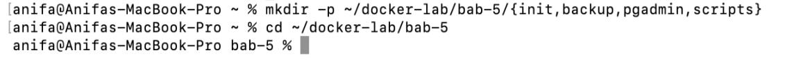

---

## Halaman 5

4

Template kemudian disalin menjadi konfigurasi aktif .env dan izin aksesnya dibatasi hanya

untuk pemilik berkas. File .env memudahkan interpolasi Compose, tetapi bukan secret

manager.

`cp .env.example .env`
`chmod 600 .env`
Gambar 2. Isi .env.example dan pembatasan permission berkas .env.

### 3.3 Pembuatan File .gitignore

File .gitignore dibuat untuk mengurangi risiko kredensial dan berkas dump ikut terkirim ke

repository Git.

Gambar 3. Isi file .gitignore.

### 3.4 Konfigurasi Orkestrasi compose.yaml

File compose.yaml mendefinisikan dua service, yaitu postgres-db (PostgreSQL 16 Alpine)

dan pgadmin (pgAdmin 4), dua named volume (pg-data dan pgadmin-data), serta bridge

network data-net. Nilai kredensial dibaca dari .env, port dibatasi ke loopback 127.0.0.1,

healthcheck memakai pg_isready, dan pgAdmin baru dijalankan setelah PostgreSQL

berstatus healthy.

**Gambar/ilustrasi pada halaman ini:**

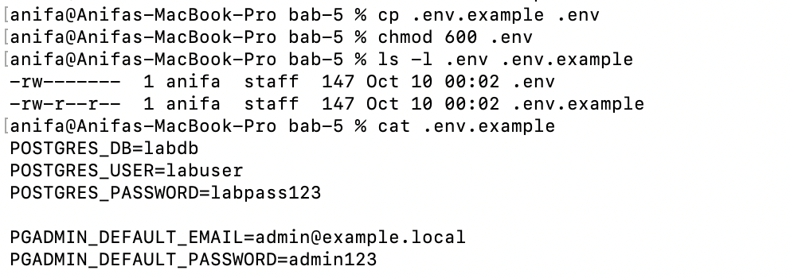

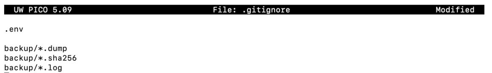

---

## Halaman 6

5

Gambar 4. Isi file compose.yaml.

Port PostgreSQL dan pgAdmin dibatasi ke loopback. Untuk eksperimen yang hanya

menggunakan pgAdmin di dalam Compose, published port PostgreSQL dapat dihapus

sehingga basis data sama sekali tidak terbuka ke host.

### 3.5 Pembuatan Init Script Schema (init/01-schema.sql)

Berkas init/01-schema.sql membuat tabel students, mengisi dua baris data awal, dan

membuat indeks pada kolom name. Berkas ini di-mount read-only ke /docker-entrypoint-

initdb.d, sehingga hanya dijalankan ketika direktori data PostgreSQL masih kosong.

**Gambar/ilustrasi pada halaman ini:**

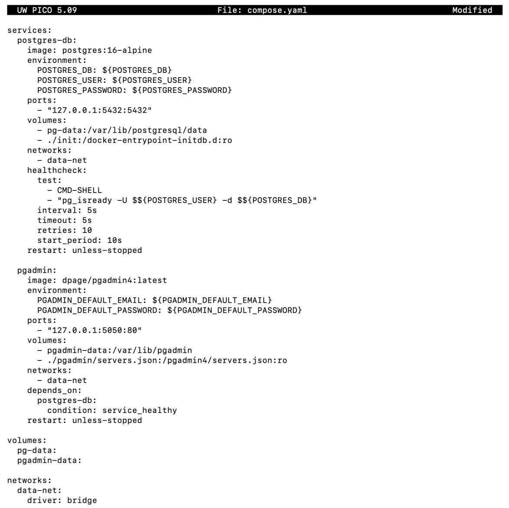

---

## Halaman 7

6

Gambar 5. Isi file 01-schema.sql.

### 3.6 Pendaftaran Server pada pgAdmin (pgadmin/servers.json)

Berkas pgadmin/servers.json mendaftarkan server PostgreSQL secara otomatis pada

pgAdmin. Password tidak ditulis pada berkas ini; pgAdmin akan memintanya ketika koneksi

dibuat. Hostname yang digunakan adalah postgres-db, bukan localhost, karena pgAdmin

berjalan di container yang berbeda; di dalam container pgAdmin, localhost berarti container

pgAdmin itu sendiri.

Gambar 6. Isi file servers.json.

### 3.7 Pembuatan Script Backup (scripts/backup.sh)

Script backup.sh membuat logical backup berformat custom menggunakan pg_dump

melalui docker compose exec, sehingga tidak bergantung pada nama container yang dinamis.

Script berhenti bila terjadi galat (set -Eeuo pipefail), memastikan berkas dump tidak kosong,

lalu membuat checksum SHA-256.

**Gambar/ilustrasi pada halaman ini:**

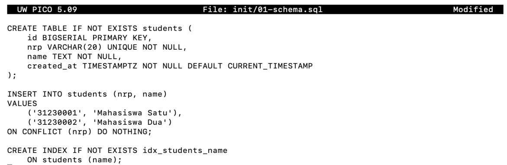

---

## Halaman 8

7

Gambar 7. Isi file backup.sh.

### 3.8 Pembuatan Script Restore Test (scripts/restore-test.sh)

Script restore-test.sh menguji restore pada basis data terpisah bernama labdb_restore_test,

sehingga basis data sumber labdb tidak ditimpa. Script memverifikasi checksum (bila

tersedia), membuat ulang basis data uji, menjalankan pg_restore, lalu menghitung jumlah

baris pada tabel students.

**Gambar/ilustrasi pada halaman ini:**

---

## Halaman 9

8

Gambar 8. Isi file restore-test.sh.

### 3.9 Pengaturan Permission dan Validasi Konfigurasi

Kedua script diberi izin eksekusi, daftar berkas diperiksa, dan sintaks Compose divalidasi

sebelum deployment.

`cd ~/docker-lab/bab-5`
`chmod +x scripts/backup.sh scripts/restore-test.sh`
`find . -maxdepth 3 -type f | sort`
`docker compose config`
**Gambar/ilustrasi pada halaman ini:**

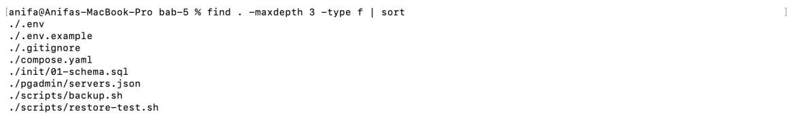

---

## Halaman 10

9

Gambar 9. Pemeriksaan struktur berkas dan validasi docker compose config.

Service yang harus muncul pada docker compose config --services adalah postgres-db dan

pgadmin.

`docker compose config --services`
Gambar 10. Daftar service pada konfigurasi Compose.

### 3.10 Menjalankan Stack PostgreSQL dan pgAdmin

Stack dijalankan di background, kemudian status container dan log awal diperiksa. Tunggu

sampai PostgreSQL berstatus healthy.

`docker compose up -d`
`docker compose ps`
`docker compose logs --tail 100`
**Gambar/ilustrasi pada halaman ini:**

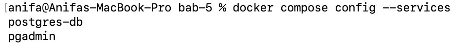

---

## Halaman 11

10

Gambar 11. Hasil docker compose up -d dan docker compose ps (status healthy).

Gambar 12. Log awal service PostgreSQL dan pgAdmin.

Antarmuka

pgAdmin

diakses

melalui

http://localhost:5050

dengan

nilai

`PGADMIN_DEFAULT_EMAIL dan PGADMIN_DEFAULT_PASSWORD pada .env.`
Server "PostgreSQL Bab 5" akan tersedia pada panel kiri, password PostgreSQL

dimasukkan ketika diminta, dan pada Gambar 13, di bawah ini adalah tampilan table

students.

Gambar 13. Antarmuka pgAdmin yang terhubung ke server PostgreSQL Bab 5.

**Gambar/ilustrasi pada halaman ini:**

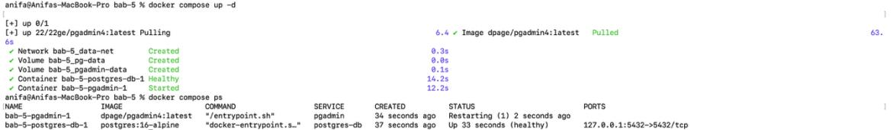

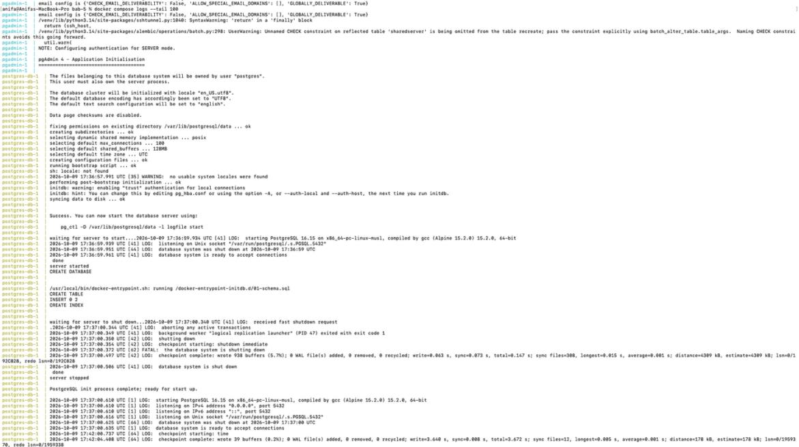

---

## Halaman 12

11

### 3.11 Pengujian Schema dan Data Awal

Pengujian ini memastikan init script berjalan: tabel students harus ada dan sedikitnya dua

baris data awal tersedia.

`docker compose exec -T postgres-db \`
psql -U labuser -d labdb \

-c "\dt"

`docker compose exec -T postgres-db \`
psql -U labuser -d labdb \

-c "SELECT id, nrp, name, created_at FROM students ORDER BY id;"

Gambar 14. Tabel students dan data awal hasil init script.

### 3.12 Pengujian Persistensi Volume

Satu record ditambahkan, lalu container dibuat ulang tanpa menghapus volume. Bila volume

bekerja dengan benar, record 31230003 tetap tersedia.

`docker compose exec -T postgres-db \`
psql -U labuser -d labdb \

-c "INSERT INTO students(nrp, name) VALUES ('31230003', 'Mahasiswa Tiga') ON

CONFLICT DO NOTHING;"

Gambar 15. Penambahan record 31230003 pada tabel students.

`docker compose down`
`docker compose up -d`
`docker compose exec -T postgres-db \`
psql -U labuser -d labdb \

-c "SELECT nrp, name FROM students ORDER BY nrp;"

**Gambar/ilustrasi pada halaman ini:**

---

## Halaman 13

12

Gambar 16. Data tetap tersedia setelah docker compose down dan up.

### 3.13 Pembuatan Backup

Backup dibuat dengan backup.sh, kemudian ukuran berkas dan checksum-nya diperiksa.

Berkas saja tidak dapat menyatakan bahwa backup berhasil, berkas harus berukuran lebih

dari nol, checksum valid, dan restore harus diuji.

`./scripts/backup.sh`
ls -lh backup/

`sha256sum --check backup/*.dump.sha256`
Gambar 17. Hasil backup.sh, daftar berkas backup, dan verifikasi checksum.

### 3.14 Pengujian Restore

Dump terbaru dipilih secara otomatis, lalu dipulihkan ke basis data terpisah

labdb_restore_test dengan restore-test.sh.

`latest_dump="$(find backup -maxdepth 1 -name '*.dump' -type f | sort | tail -n 1)"`
`./scripts/restore-test.sh "$latest_dump"`
Gambar 18. Hasil restore-test.sh ke database labdb_restore_test.

**Gambar/ilustrasi pada halaman ini:**

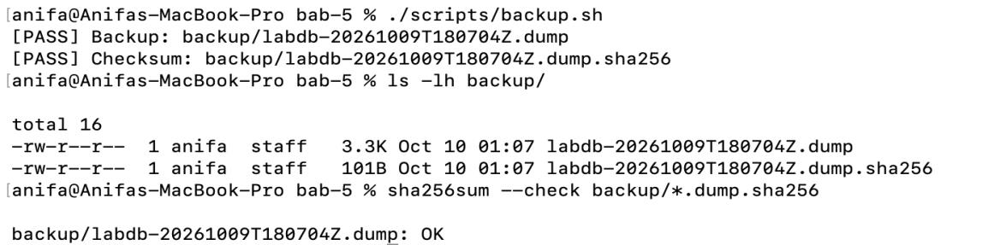

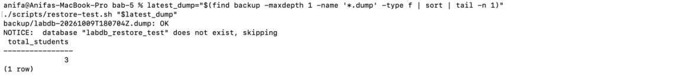

---

## Halaman 14

13

Isi basis data hasil restore dibandingkan dengan basis data sumber.

`docker compose exec -T postgres-db \`
psql -U labuser -d labdb_restore_test \

-c "SELECT nrp, name FROM students ORDER BY nrp;"

Gambar 19. Isi tabel students pada database hasil restore.

### 3.15 Pemantauan Dasar

Pemantauan dasar dilakukan dengan memeriksa status container, log, kesiapan server

(pg_isready), versi PostgreSQL, serta daftar dan pemakaian volume.

`docker compose ps`
`docker compose logs postgres-db --tail 100`
`docker compose exec -T postgres-db pg_isready -U labuser -d labdb`
`docker compose exec -T postgres-db psql -U labuser -d labdb -c "SELECT version();"`
Gambar 20. Status container, pg_isready, dan versi PostgreSQL.

`docker volume ls`
`docker system df -v`
Gambar 21. Daftar volume Docker dan pemakaian disk.

**Gambar/ilustrasi pada halaman ini:**

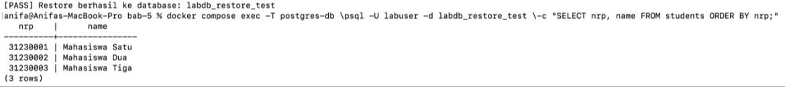

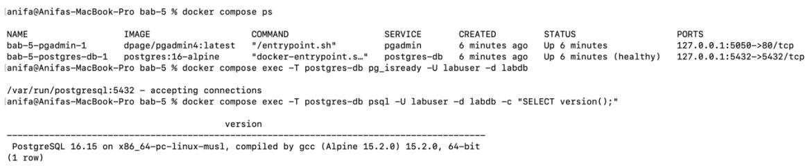

---

## Halaman 15

14

### 3.16 Pembersihan Lingkungan (Cleanup)

Cleanup dilakukan secara aman. Perintah docker compose down menghapus container dan

network tetapi mempertahankan data pada volume. Basis data hasil restore test dihapus

melalui dropdb.

`cd ~/docker-lab/bab-5`
`docker compose down`
`docker compose up -d postgres-db`
`docker compose exec -T postgres-db \`
dropdb -U labuser --if-exists labdb_restore_test

Gambar 22. Hasil cleanup: docker compose down dan dropdb labdb_restore_test.

### 4. Verifikasi dan Skenario Pengujian

### 4.1 Checklist Verifikasi

[v] PostgreSQL berjalan dengan volume pg-data.

[v] Tabel students dibuat otomatis dari init script.

[v] pgAdmin dapat login dan terkoneksi ke database.

[v] Backup menghasilkan file dump di direktori host.

[v] Restore sudah diuji, bukan hanya diasumsikan berhasil.

**Gambar/ilustrasi pada halaman ini:**

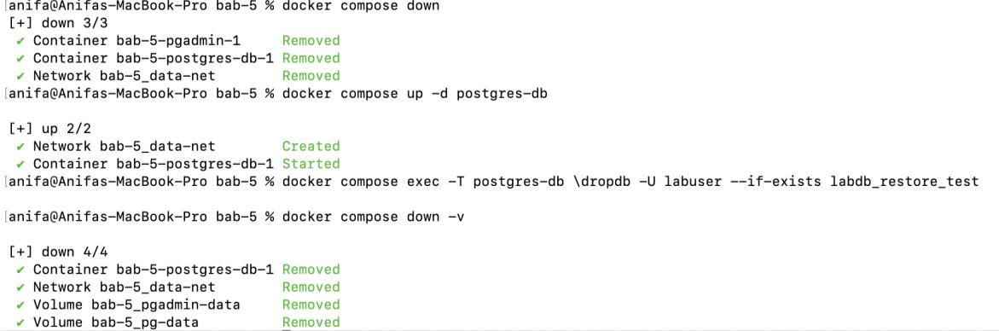

---

## Halaman 16

15

### 4.2 Pemetaan Bukti Pengujian

Tabel berikut memetakan kriteria keberhasilan pada cheatsheet Bab 5 dengan bukti yang

disertakan pada laporan ini.

Kriteria

Bukti

`docker compose config tidak menghasilkan galat`
Gambar 9, Gambar 10

PostgreSQL berstatus healthy

Gambar 11

Tabel students dan data awal tersedia

Gambar 14

pgAdmin dapat terhubung menggunakan hostname

postgres-db

Gambar 13

Data tetap tersedia setelah docker compose down

dan up

Gambar 15, Gambar 16

Backup dump berukuran lebih dari nol dan

checksum valid

Gambar 17

Restore berhasil pada database labdb_restore_test

Gambar 18

Jumlah dan isi record hasil restore sesuai database

sumber

Gambar 19, Gambar 14

Credential dan dump tidak masuk repository Git

Gambar 3 (Bagian 3.3 .gitignore)

### 5. Troubleshooting dan Analisis Hasil

### 5.1 Masalah yang Muncul dan Cara Diagnosis

Sebagai acuan alur diagnosis, pemeriksaan dilakukan berurutan dari status container,

pembacaan log, pemeriksaan jaringan, pemeriksaan volume, baru kemudian validasi

konfigurasi. Volume tidak langsung dihapus sebelum dipastikan datanya tidak lagi

dibutuhkan, berikut perintah yang dijalankan untuk melakukan pemeriksaan tersebut :

`docker compose ps`
`docker compose logs --tail 100`
`docker network ls`
`docker volume ls`
`docker inspect <container-name>`
`docker compose config`
Berikut beberapa permasalahan yang dihadapi ketika melakukan praktikum :

Gejala

Pemeriksaan

Perbaikan utama

pgAdmin tidak

terhubung

Host dan network

Gunakan hostname postgres-db,

bukan localhost

---

## Halaman 17

16

Gejala

Pemeriksaan

Perbaikan utama

Password lama tetap

berlaku

Volume sudah diinisialisasi

Variabel init tidak mengubah

basis data yang sudah ada; ubah

password melalui SQL

Restore gagal

Checksum, versi, atau role

Verifikasi checksum dan baca

keluaran pg_restore

### 5.2 Risiko Keamanan dan Operasional

Risiko

Penjelasan

Kredensial teks polos

`POSTGRES_PASSWORD dan password pgAdmin disimpan`
pada .env dan diteruskan sebagai environment variable,

sehingga terlihat melalui docker inspect atau docker compose

config. Nilai laboratorium (labpass123, admin123) juga lemah

dan mudah ditebak.

Pelanggaran least

privilege

labuser adalah superuser awal container. Bila dipakai juga oleh

aplikasi atau script backup, kebocoran kredensial berdampak

pada seluruh klaster.

Backup berisiko di host

yang sama

Dump disimpan pada direktori backup/ di host yang sama

dengan volume dan tidak dienkripsi. Checksum yang disimpan

berdampingan dengan dump hanya mendeteksi kerusakan,

bukan pemalsuan. Kehilangan host berarti kehilangan data dan

backup sekaligus.

Kehilangan data karena

perintah destruktif

`docker compose down -v menghapus volume dan seluruh data`
tanpa konfirmasi tambahan.

Tag image tidak

dikunci

dpage/pgadmin4:latest dapat berubah kapan saja, dan tag

postgres:16-alpine menerima pembaruan minor otomatis.

Perubahan versi dapat memengaruhi kompatibilitas dan

reproduksibilitas hasil.

Healthcheck terbatas

pg_isready hanya membuktikan server menerima koneksi,

bukan bahwa skema, data, atau query bisnis benar.

Trafik tanpa enkripsi

Koneksi pgAdmin ke PostgreSQL memakai SSLMode prefer

pada jaringan internal Compose; TLS tidak diwajibkan.

### 6. Evaluasi dan Latihan Mandiri

### 1. Mengapa init script tidak dijalankan ulang saat volume lama masih ada?

Image PostgreSQL resmi hanya mengeksekusi berkas .sql dan .sh pada /docker-entrypoint-

initdb.d ketika direktori data masih kosong, yaitu pada saat klaster basis data pertama kali

diinisialisasi. Bila volume pg-data sudah berisi klaster, proses inisialisasi dilewati sehingga

---

## Halaman 18

17

perubahan pada init script tidak berpengaruh. Perubahan skema berikutnya sebaiknya

dilakukan lewat migrasi (misalnya menjalankan berkas SQL dengan psql). Menghapus

volume hanya boleh dilakukan bila datanya memang tidak diperlukan lagi.

### 2. Apa risiko menaruh password database pada docker-compose.yml?

Password tertulis sebagai teks polos pada berkas yang mudah ikut ter-commit ke repository,

dibagikan, atau dibaca pengguna lain. Nilainya juga mudah terlihat melalui docker compose

config, docker inspect, atau daftar proses, dan dapat bocor ke log. Mitigasinya adalah

menyimpan nilai pada .env yang dikecualikan dari Git (seperti pada praktikum ini),

menggunakan Docker secrets atau secret manager pada lingkungan produksi, serta merotasi

kredensial secara berkala.

### 3. Bagaimana cara membuktikan backup dapat dipulihkan?

Dengan melakukan restore ke basis data atau instance terpisah, bukan menimpa basis data

sumber. Pada praktikum ini dump dipulihkan ke labdb_restore_test setelah checksum

diverifikasi, lalu jumlah dan isi baris tabel students dibandingkan dengan basis data sumber.

Versi PostgreSQL dan waktu restore juga dicatat. Keberadaan berkas dump saja bukan bukti.

### 4. Apa bedanya logical backup pg_dump dan backup filesystem volume mentah?

Logical backup oleh pg_dump mengekstrak isi basis data (skema dan data) secara konsisten

melalui sebuah snapshot transaksi, dapat dipulihkan secara selektif, dan relatif portabel

antarversi, tetapi memerlukan waktu lebih lama pada basis data besar. Salinan filesystem

volume mentah bersifat fisik, seperti menyalin berkas data apa adanya, terikat pada versi

mayor dan arsitektur PostgreSQL, serta berisiko tidak konsisten atau rusak bila diambil saat

server berjalan tanpa mekanisme yang tepat (misalnya server dihentikan terlebih dahulu atau

memakai pg_basebackup dan arsip WAL).

### 5. Apa dampak docker compose down -v terhadap database?

Opsi -v menghapus named volume yang dideklarasikan pada Compose, yaitu pg-data dan

pgadmin-data, sehingga seluruh data PostgreSQL dan pengaturan pgAdmin hilang

permanen. Pada docker compose up berikutnya klaster dibuat dari awal dan init script

dijalankan kembali. Direktori bind mount pada host, seperti backup/, tidak ikut terhapus.

---

## Halaman 19

18

### 7. Kesimpulan

Praktikum Bab 5 mengimplementasikan layanan basis data PostgreSQL dengan pgAdmin 4

menggunakan Docker Compose. Kesimpulan yang dapat diambil:

### 1. Basis data pada container harus diperlakukan sebagai sistem persisten. Named

volume pg-data menjaga data tetap ada ketika container dibuat ulang, tetapi volume

bukan pengganti backup.

### 2. Konfigurasi berbasis environment variable dari berkas .env memisahkan kredensial

dari definisi service, namun .env hanyalah solusi laboratorium dan harus

dikecualikan dari Git (.gitignore) serta digantikan secret manager pada produksi.

### 3. Init script pada docker-entrypoint-initdb.d hanya dijalankan saat volume masih

kosong, sehingga perubahan skema berikutnya harus ditangani melalui migrasi.

### 4. Healthcheck pg_isready dengan depends_on service_healthy memastikan pgAdmin

baru dijalankan setelah PostgreSQL siap, dan pembatasan published port ke

127.0.0.1 serta pemakaian jaringan data-net menerapkan prinsip least exposure;

keduanya tidak membuktikan kebenaran data atau skema.

### 5. Backup dengan pg_dump (format custom) disertai checksum baru bernilai bila diuji

melalui restore ke basis data terpisah (labdb_restore_test) dan isinya dibandingkan

dengan sumber.

---
