# LAPORAN PRAKTIKUM BAB 6

## CENTRALIZED LOGGING DAN IMPLEMENTASI APLIKASI PMB

**Topik:** Docker Fluentd Logging Driver, Fluent Bit, PostgreSQL, dan penerapan centralized logging pada aplikasi PMB

**Mata Kuliah:** Workshop DevOps  
**Dosen Pengampu:** Dr. Ferry Astika Saputra, S.T., M.Sc.  
**Disusun oleh:** Anifa Aulia Abdari (3126640053)  
**Institusi:** Politeknik Elektronika Negeri Surabaya  
**Departemen:** Teknik Informatika dan Komputer  
**Program Studi:** Teknik Informatika  
**Tahun:** 2026

---

## DAFTAR ISI

1. [Tujuan Pembelajaran dan Kompetensi Utama](#1-tujuan-pembelajaran-dan-kompetensi-utama)
2. [Konsep Inti dan Landasan Teori](#2-konsep-inti-dan-landasan-teori)
   - [2.1 Centralized Logging dan Fluent Bit](#21-centralized-logging-dan-fluent-bit)
   - [2.2 Struktur Event dan Kualitas Data](#22-struktur-event-dan-kualitas-data)
   - [2.3 Pipeline Fluent Bit dan Format Record](#23-pipeline-fluent-bit-dan-format-record)
   - [2.4 PostgreSQL sebagai Backend Laboratorium](#24-postgresql-sebagai-backend-laboratorium)
   - [2.5 Reliability dan Backpressure](#25-reliability-dan-backpressure)
   - [2.6 Korelasi Event dan Redaksi Data pada Aplikasi PMB](#26-korelasi-event-dan-redaksi-data-pada-aplikasi-pmb)
3. [Langkah Praktikum](#3-langkah-praktikum)
   - [Bagian A – Pipeline Log Generator](#bagian-a--pipeline-log-generator)
   - [Bagian B – Implementasi Aplikasi PMB](#bagian-b--implementasi-aplikasi-pmb)
4. [Verifikasi dan Skenario Pengujian](#4-verifikasi-dan-skenario-pengujian)
5. [Troubleshooting dan Analisis Hasil](#5-troubleshooting-dan-analisis-hasil)
6. [Evaluasi dan Latihan Mandiri](#6-evaluasi-dan-latihan-mandiri)
7. [Kesimpulan](#7-kesimpulan)

---

## 1. Tujuan Pembelajaran dan Kompetensi Utama

Setelah menyelesaikan praktikum pada Bab 6 ini, mahasiswa diharapkan mampu:

1. Menjelaskan kebutuhan centralized logging pada lingkungan container yang ephemeral.
2. Mengirim log stdout/stderr container ke Fluent Bit menggunakan Docker Fluentd Logging Driver.
3. Menyimpan log ke PostgreSQL dalam kolom JSONB dan membuat view analisis.
4. Membuat log generator untuk mensimulasikan event dengan severity berbeda.
5. Menerapkan query pencarian log dan retensi sederhana.
6. Menerapkan pipeline centralized logging pada aplikasi PMB yang terdiri atas beberapa service.
7. Menggunakan `request_id` sebagai correlation ID untuk menelusuri satu transaksi lintas service.
8. Memahami penerapan redaksi data sensitif sebelum event ditulis ke log.
9. Menganalisis skenario normal, insiden, recovery, dan resilience logging pada aplikasi PMB.

## 2. Konsep Inti dan Landasan Teori

Container sering dibuat dan dihapus dengan cepat. Jika log hanya tersimpan di dalam container, proses debugging dan audit menjadi sulit karena log ikut hilang bersama container. Centralized logging memindahkan log ke satu penyimpanan sehingga dapat dicari, dianalisis, dan diaudit secara konsisten.

### 2.1 Centralized Logging dan Fluent Bit

Log adalah rekaman diskrit mengenai peristiwa pada aplikasi, container, host, maupun kontrol keamanan. Fluent Bit berperan sebagai agen yang membaca input, melakukan parsing dan filtering, lalu meneruskan record ke output yang ditentukan.

Pada praktikum ini, aplikasi menulis log ke stdout, Docker logging driver fluentd meneruskannya ke Fluent Bit, dan Fluent Bit menyimpannya ke PostgreSQL. Proses logging driver dilakukan langsung oleh Docker Engine dan tidak dilakukan oleh container generator.

Oleh karena itu, `fluentd-address` harus diarahkan ke alamat port collector yang tersedia di host, yaitu `127.0.0.1:24224`, bukan menggunakan nama service yang ada di Docker Compose.

### 2.2 Struktur Event dan Kualitas Data

Structured logging memakai field yang konsisten seperti timestamp, severity, service, event, dan request ID. Meskipun JSON mudah di-parse, JSON yang valid belum menjamin semantik yang konsisten. Nama field, satuan durasi, dan zona waktu tetap harus distandarisasi.

Correlation ID memungkinkan satu transaksi ditelusuri lintas komponen.

Prinsip minimisasi data juga berlaku: secret, token, password, dan data pribadi tidak boleh dicatat secara default.

### 2.3 Pipeline Fluent Bit dan Format Record

Pipeline Fluent Bit terdiri atas input, parser, filter, buffer, dan output. Plugin output PostgreSQL menyimpan record pada tiga kolom, yaitu `tag`, `time`, dan `data`.

| Field | Makna |
|---|---|
| `tag` | Klasifikasi sumber log, misalnya `docker.bab-6-generator-auth-1` atau `pmb.pmb-lab-registration-api-1`. |
| `time` | Timestamp log diterima collector. |
| `data` | Record log penuh dalam format JSONB. |
| `container_name` | Nama container penghasil log (di dalam `data`). |
| `source` | `stdout` atau `stderr` (di dalam `data`). |
| `log` | Pesan aplikasi. JSON dari aplikasi tetap tersimpan sebagai string pada `data.log`. |

Schema `logs` dipilih melalui `search_path` akun PostgreSQL, bukan melalui opsi `Schema` atau `Timestamp_Key` pada konfigurasi Fluent Bit. Pesan aplikasi berbentuk JSON masih tersimpan sebagai string pada `data.log`.

### 2.4 PostgreSQL sebagai Backend Laboratorium

PostgreSQL mudah digunakan untuk mempelajari schema, query, indeks, dan retensi.

Namun, database relasional tidak selalu efisien untuk volume log yang sangat besar. Untuk produksi, perlu dievaluasi sistem seperti Loki, OpenSearch, atau ClickHouse.

Retensi juga harus menjadi kebijakan eksplisit. Menyimpan semua log tanpa batas dapat menaikkan biaya dan risiko privasi, sedangkan menghapus terlalu cepat dapat menghilangkan evidence insiden.

### 2.5 Reliability dan Backpressure

Backpressure terjadi ketika proses pengiriman data lebih lambat dibandingkan data yang masuk. Buffer memori memiliki kinerja yang cepat, tetapi datanya dapat hilang ketika proses berhenti. Sementara itu, buffer filesystem lebih tahan terhadap gangguan, meskipun berisiko memenuhi kapasitas disk.

Dalam praktikum ini, Fluent Bit menggunakan `storage.type filesystem` untuk menyimpan data sementara di volume ketika PostgreSQL tidak tersedia. Mekanisme ini menunjukkan bahwa pipeline dapat pulih dalam pengujian skala lab, tetapi belum menjamin setiap event diproses tepat satu kali (*exactly-once*).

Proses retry dapat menyebabkan duplikasi data, sedangkan buffer yang penuh atau penghentian proses secara paksa dapat mengakibatkan kehilangan event.

### 2.6 Korelasi Event dan Redaksi Data pada Aplikasi PMB

Aplikasi PMB memberi setiap request HTTP sebuah `request_id` melalui header `X-Request-ID`. Nilai dari client hanya diterima apabila sesuai dengan pola:

```regex
^[A-Za-z0-9][A-Za-z0-9._:-]{7,127}$
```

Jika tidak sesuai, server membuat ID baru berawalan `REQ-`.

ID tersebut diteruskan dari `registration-api` ke `auth-service` melalui header, disimpan pada kolom `registrations.request_id`, lalu digunakan kembali oleh `verification-worker`. Dengan demikian, satu pendaftaran dapat ditelusuri lintas tiga service menggunakan correlation ID yang sama.

Setiap event dicetak sebagai satu baris JSON melalui fungsi `emit_event`. Fungsi ini menyamarkan nilai pada field bernama `authorization`, `cookie`, `password`, `passwd`, `secret`, `session`, atau `token` menjadi `[REDACTED]` dan memotong string yang lebih dari 1000 karakter.

Nama dan email pendaftar tidak dimasukkan ke log. Aktivitas pendaftaran dicatat menggunakan `user_ref`, `registration_id` (UUID), dan `program`.

## 3. Langkah Praktikum

Praktikum pada Bab 6 terdiri atas dua bagian yang saling berkaitan.

- **Bagian A (3.1–3.15)** membangun pipeline dasar menggunakan tiga log generator dengan severity INFO, WARN, dan ERROR.
- **Bagian B (3.16–3.26)** menerapkan pipeline yang sama pada aplikasi PMB melalui skenario baseline, insiden, recovery, dan resilience logging.

Kedua bagian menggunakan port host `24224` dan `2020`. Oleh karena itu, Bagian A harus dibersihkan terlebih dahulu melalui langkah 3.15 sebelum Bagian B dijalankan agar tidak terjadi konflik port.

### Bagian A – Pipeline Log Generator

Bagian ini membangun dan menguji pipeline centralized logging dasar dari log generator menuju PostgreSQL.

### 3.1 Penyiapan Direktori Kerja dan Struktur Proyek

Direktori kerja Bab 6 dibuat beserta subdirektori `init`, `fluent-bit`, `queries`, dan `scripts` agar berkas konfigurasi, bind mount, dan laporan terpisah dari bab lain.

### 3.2 Pembuatan Template Konfigurasi (`.env.example`) dan Konfigurasi Aktif

File `.env.example` berisi parameter laboratorium, yaitu nama database, akun administrator PostgreSQL, dan akun `fluentbit_user` untuk proses ingest. Nilainya hanya kredensial sintetis untuk pembelajaran dan tidak boleh dipakai pada sistem produksi.

Template disalin menjadi `.env` dan izin aksesnya dibatasi hanya untuk pemilik berkas. File `.env` memudahkan interpolasi Compose, tetapi bukan secret manager.

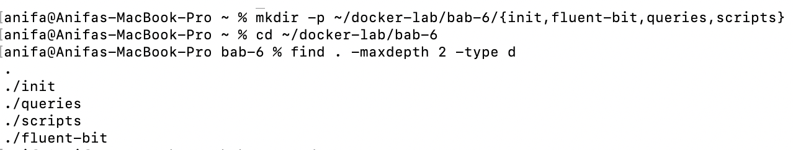

*Gambar 1. Dokumentasi konfigurasi lingkungan praktikum.*

### 3.3 Pembuatan File `.gitignore`

File `.gitignore` mencegah `.env`, berkas `*.log`, dan direktori `reports/` ikut terkirim ke repository Git. Volume PostgreSQL dan buffer Fluent Bit dikelola Docker sehingga tidak perlu dimasukkan.

### 3.4 Konfigurasi Orkestrasi `compose.yaml`

File `compose.yaml` mendefinisikan lima service, yaitu `postgres-db` (PostgreSQL 16 Alpine), `fluent-bit` (image 4.2.8), serta tiga log generator (`generator-auth`, `generator-api`, dan `generator-worker`).

Konfigurasi juga menggunakan dua named volume (`pg-data` dan `flb-storage`) serta bridge network `logging-net`.

Beberapa keputusan desain penting:

a. Port PostgreSQL tidak dipublikasikan ke host. Fluent Bit mengaksesnya melalui jaringan internal `logging-net`.

b. Fluent Bit mempublikasikan port `24224` (Forward) dan `2020` (monitoring) hanya ke `127.0.0.1`.

c. `depends_on` dengan `service_healthy` memastikan Fluent Bit baru berjalan setelah PostgreSQL sehat.

d. Setiap generator memakai logging driver `fluentd` dengan `fluentd-async: "true"` dan tag `docker.{{.Name}}`, sehingga kegagalan collector tidak langsung menggagalkan startup container.

e. Setiap generator mencetak 20 baris JSON (satu per detik) dengan severity berbeda, yaitu `INFO` (auth), `WARN` (api), dan `ERROR` (worker).

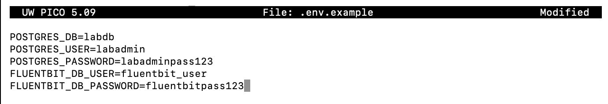

*Gambar 2. Dokumentasi konfigurasi file dan service Docker Compose.*

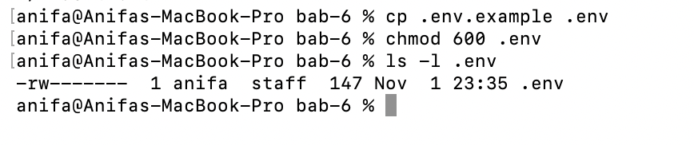

*Gambar 3. Dokumentasi konfigurasi service pada Docker Compose.*

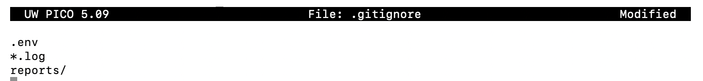

*Gambar 4. Dokumentasi konfigurasi logging driver.*

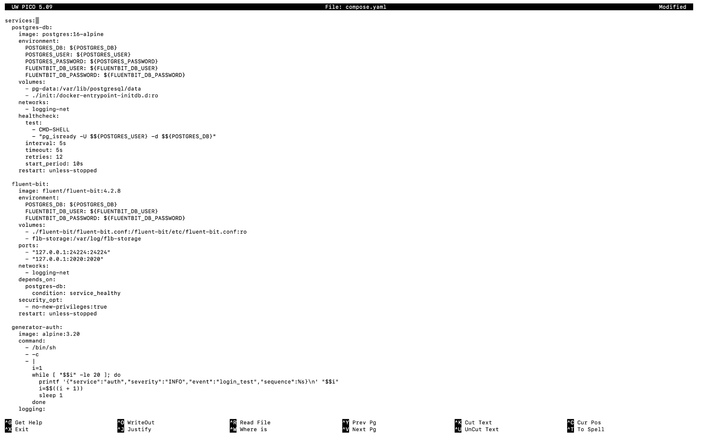

*Gambar 5. Dokumentasi lanjutan konfigurasi Docker Compose.*

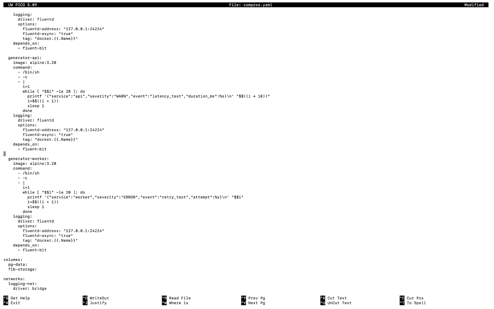

*Gambar 6. Dokumentasi lanjutan konfigurasi Docker Compose.*

### 3.5 Pembuatan Init Script (`init/01-init-logging.sh`)

Berkas `01-init-logging.sh` dijalankan sekali oleh image PostgreSQL ketika direktori data masih kosong.

Script ini membuat role `fluentbit_user`, schema `logs`, tabel `logs.fluentbit` (kolom `tag`, `time`, dan `data JSONB`), tiga indeks (waktu, tag, dan GIN pada data), serta view `logs.recent_logs`.

Role ingest diberi `search_path` ke schema `logs` dan hak `USAGE`, `CREATE` pada schema serta `SELECT`, `INSERT` pada tabel. Hak `CREATE` diperlukan karena plugin PostgreSQL dapat melakukan bootstrap tabel. Pada produksi, bootstrap sebaiknya dipisahkan dari akun ingest.

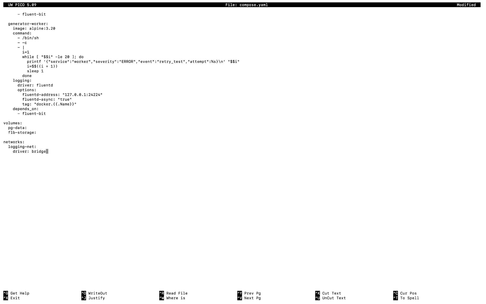

*Gambar 7. Dokumentasi initialization script PostgreSQL.*

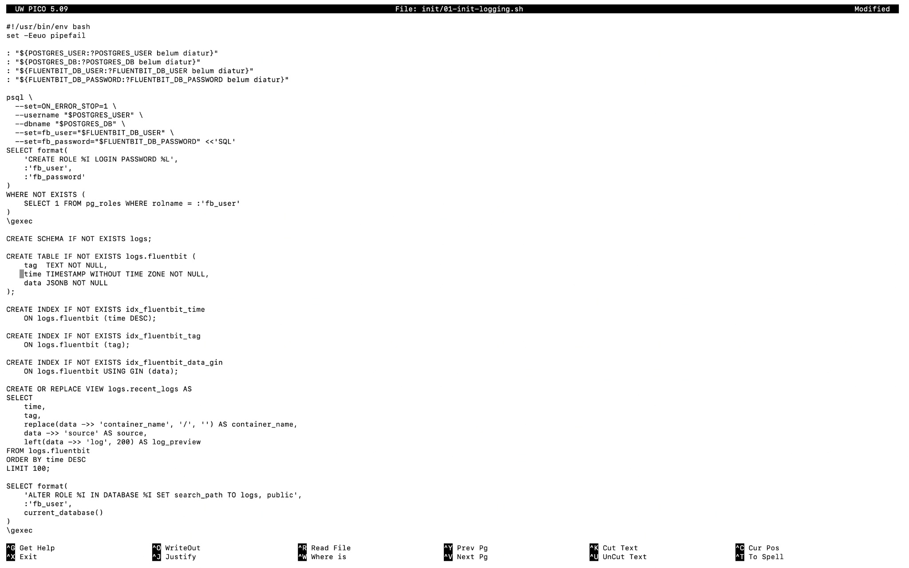

*Gambar 8. Dokumentasi pembuatan schema dan tabel log.*

### 3.6 Konfigurasi Fluent Bit (`fluent-bit/fluent-bit.conf`)

Konfigurasi terdiri atas empat bagian:

a. **`[SERVICE]`**: mengatur flush 1 detik, `storage.path /var/log/flb-storage`, checksum aktif, dan HTTP server pada port `2020` untuk monitoring.

b. **`[INPUT] forward`**: mendengarkan port `24224` dengan `Mem_Buf_Limit 10M` dan `storage.type filesystem`.

c. **`[OUTPUT] pgsql`**: menulis ke `postgres-db` memakai kredensial dari environment variable, dengan `storage.total_limit_size 256M` sebagai batas backlog.

d. **`[OUTPUT] stdout`**: menyediakan jalur observasi tambahan dalam format `json_lines`.

### 3.7 Pembuatan Query Analisis (`queries/analysis.sql`)

Berkas `analysis.sql` berisi lima query:

a. Jumlah event dan rentang waktu.

b. Distribusi per tag.

c. Metadata container pada 15 record terbaru.

d. Pencarian severity ERROR pada field `data.log`.

e. Ringkasan jumlah event per menit.

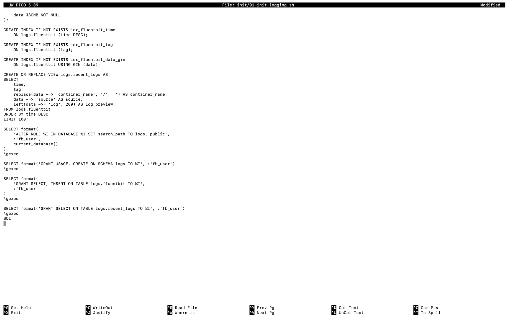

*Gambar 9. Dokumentasi konfigurasi Fluent Bit.*

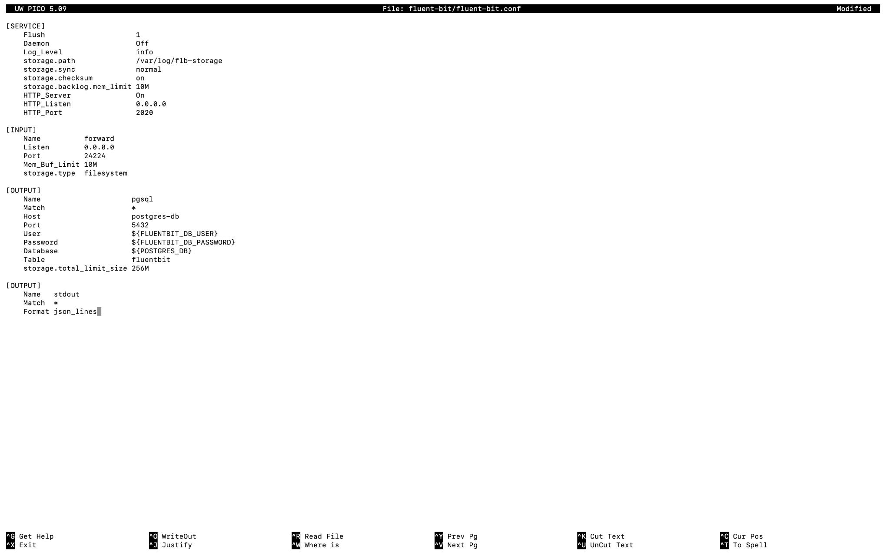

*Gambar 10. Dokumentasi query analisis log.*

### 3.8 Pembuatan Script `generate-logs.sh` dan `test-buffering.sh`

Script `generate-logs.sh` menjalankan PostgreSQL dan Fluent Bit, menunggu endpoint `/api/v1/health` siap (maksimal 30 percobaan), lalu membuat ulang ketiga generator dengan opsi `--force-recreate`.

Script `test-buffering.sh` mencatat jumlah record awal, menghentikan PostgreSQL, menjalankan generator selama 25 detik, menyalakan PostgreSQL kembali, menunggu `pg_isready`, lalu memeriksa apakah jumlah record bertambah.

Kedua script memakai `set -Eeuo pipefail` agar berhenti saat terjadi galat.

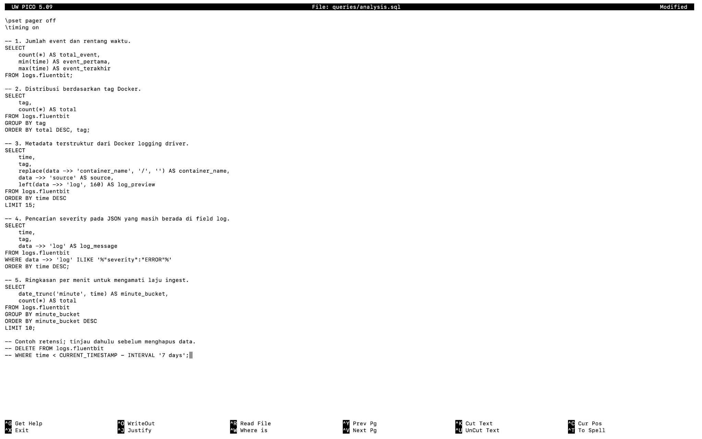

*Gambar 11. Dokumentasi script generate-logs.sh.*

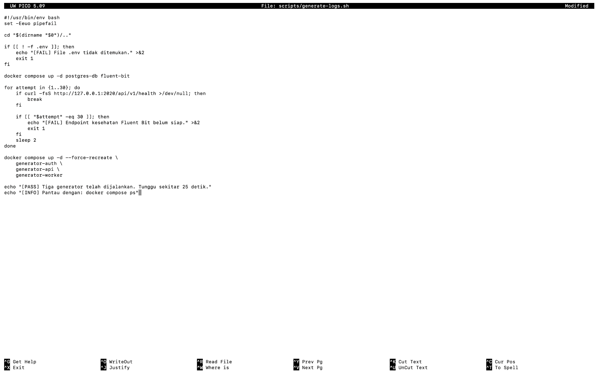

*Gambar 12. Dokumentasi script test-buffering.sh.*

### 3.9 Pengaturan Permission dan Validasi Konfigurasi

Script diberi izin eksekusi, sintaks Bash diperiksa dengan `bash -n`, dan konfigurasi Compose divalidasi sebelum deployment.

Konfigurasi Fluent Bit juga divalidasi tanpa menjalankan seluruh stack:

```bash
docker compose run --rm --no-deps fluent-bit --dry-run \
  --config=/fluent-bit/etc/fluent-bit.conf
```

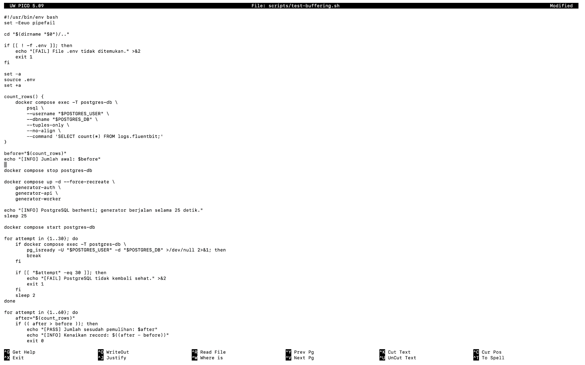

*Gambar 13. Dokumentasi validasi sintaks script.*

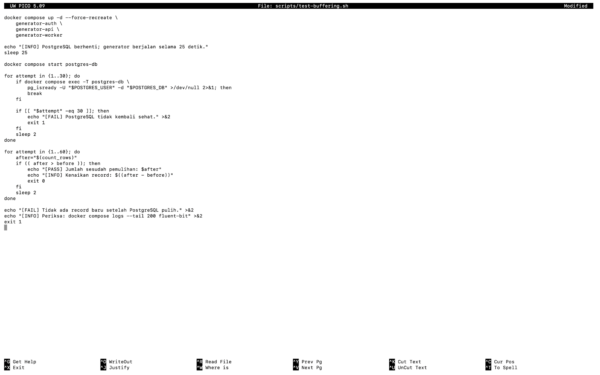

*Gambar 14. Dokumentasi validasi Docker Compose.*

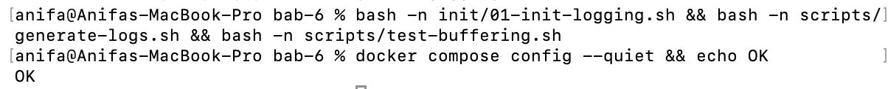

*Gambar 15. Dokumentasi validasi konfigurasi Fluent Bit.*

### 3.10 Menjalankan Pipeline dan Menghasilkan Log

Pipeline dijalankan dengan `generate-logs.sh`, kemudian status semua container diperiksa setelah sekitar 25 detik.

Ketiga generator diharapkan berstatus `Exited (0)` karena prosesnya selesai setelah menghasilkan 20 baris log, sedangkan PostgreSQL dan Fluent Bit tetap berstatus `Up`.

```bash
./scripts/generate-logs.sh
sleep 25
docker compose ps --all
```

### 3.11 Pemeriksaan Monitoring Fluent Bit

Endpoint monitoring hanya diikat ke `127.0.0.1`. Pemeriksaan dilakukan untuk memastikan Fluent Bit dapat diakses dan menyediakan informasi kesehatan serta metrik pemrosesan log.

```bash
curl -fsS http://127.0.0.1:2020/api/v1/health
curl -fsS http://127.0.0.1:2020/api/v1/metrics
```

### 3.12 Verifikasi Record pada PostgreSQL

Query analisis dijalankan melalui `docker compose exec` dengan memuat variabel dari `.env`.

```bash
set -a
source .env
set +a
```

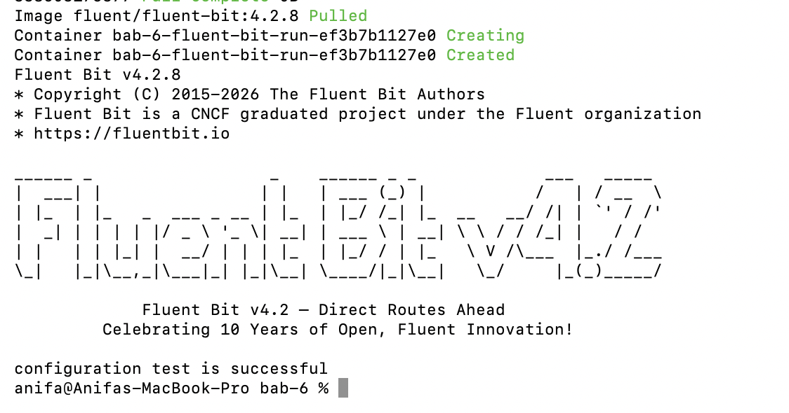

*Gambar 16. Dokumentasi proses menjalankan pipeline.*

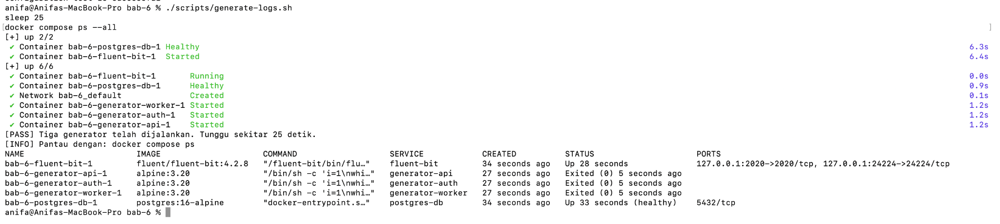

*Gambar 17. Dokumentasi pemeriksaan status container.*

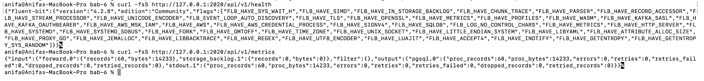

*Gambar 18. Dokumentasi pemeriksaan monitoring Fluent Bit.*

Selanjutnya, query analisis dijalankan menggunakan perintah berikut:

```bash
docker compose exec -T postgres-db \
  psql \
  --username "$POSTGRES_USER" \
  --dbname "$POSTGRES_DB" \
  --file /dev/stdin \
  < queries/analysis.sql
```

View `recent_logs` dan tipe data kolom `data` diperiksa secara terpisah:

```bash
docker compose exec -T postgres-db \
  psql --username "$POSTGRES_USER" --dbname "$POSTGRES_DB" \
  --command 'TABLE logs.recent_logs;'
```

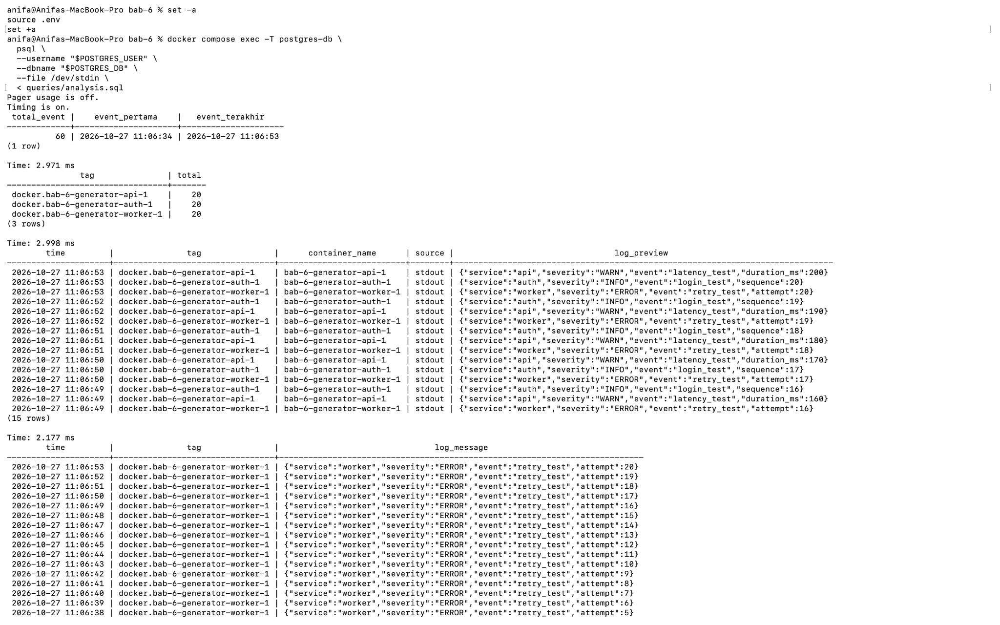

*Gambar 19. Dokumentasi hasil query analisis log.*

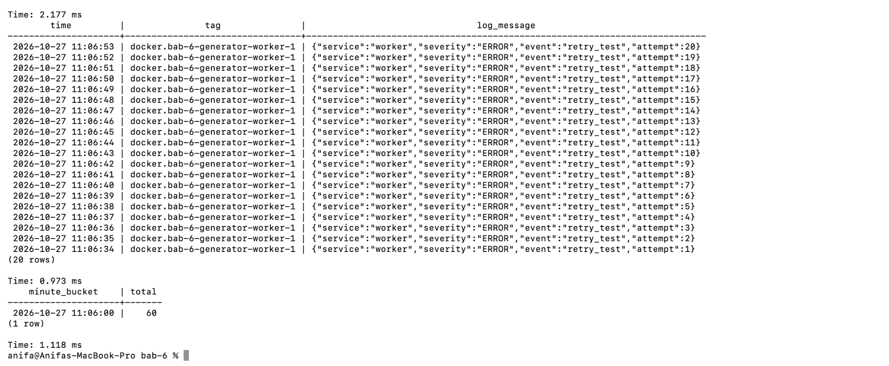

*Gambar 20. Dokumentasi pemeriksaan view recent_logs.*

### 3.13 Pengujian Buffering dan Pemulihan

Pengujian ini membuktikan bahwa Fluent Bit tetap berjalan dan menahan event saat PostgreSQL dihentikan sementara, lalu mengirimkannya setelah backend pulih.

Pengujian dijalankan menggunakan script berikut:

```bash
./scripts/test-buffering.sh
```

Selama PostgreSQL berhenti, retry Fluent Bit dan kondisi volume diperiksa menggunakan perintah:

```bash
docker compose logs --tail 200 fluent-bit
docker volume ls
```

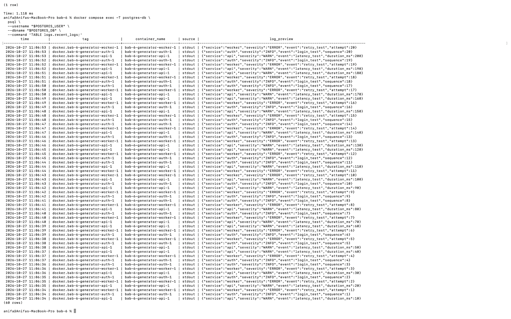

*Gambar 21. Dokumentasi pengujian filesystem buffering.*

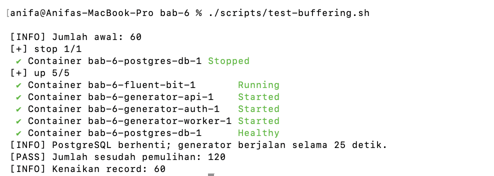

*Gambar 22. Dokumentasi log retry Fluent Bit.*

### 3.14 Verifikasi Pembatasan Jaringan

PostgreSQL tidak boleh memiliki published port. Hal ini diperiksa melalui kolom `PORTS` pada daftar container.

```bash
docker compose ps
```

Pada konfigurasi praktikum ini, PostgreSQL diakses oleh Fluent Bit melalui jaringan internal Docker sehingga port database tidak perlu dipublikasikan ke host.

### 3.15 Pembersihan Lingkungan (Cleanup)

Perintah `docker compose down` menghapus container dan network, tetapi mempertahankan data pada named volume.

Opsi `--volumes` bersifat destruktif karena menghapus tabel log dan backlog Fluent Bit, sehingga hanya dijalankan setelah evidence disimpan.

```bash
# Menghapus container dan network, tetapi mempertahankan volume
docker compose down --remove-orphans

# Menghapus container, network, dan volume (destruktif)
docker compose down --volumes --remove-orphans
```

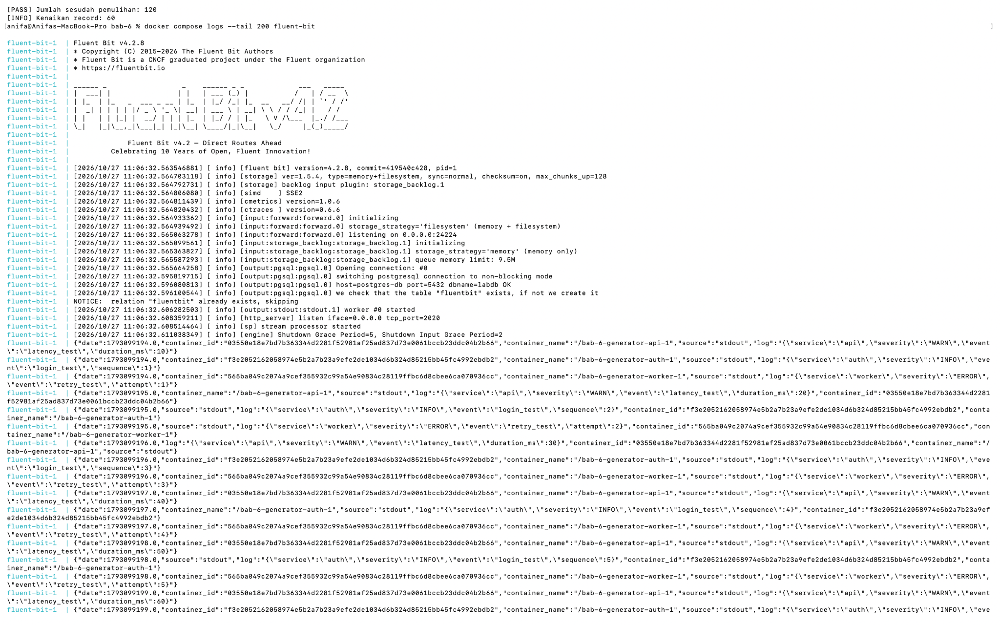

*Gambar 23. Dokumentasi verifikasi pembatasan port PostgreSQL.*

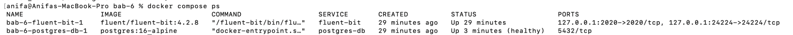

*Gambar 24. Dokumentasi proses cleanup container dan network.*

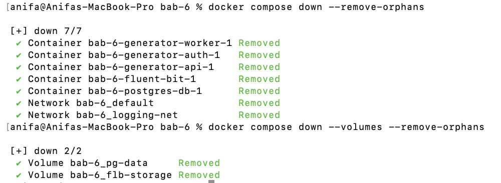

*Gambar 25. Dokumentasi akhir praktikum.*

### Bagian B – Implementasi Aplikasi PMB

Bagian B menerapkan pipeline centralized logging pada aplikasi PMB. Pengujian berfokus pada keterhubungan service, pencatatan event aplikasi, penelusuran transaksi melalui `request_id`, simulasi kegagalan, serta pemulihan setelah gangguan.

> **Catatan kelengkapan sumber:** Sumber laporan yang tersedia memuat ringkasan skenario dan pemetaan bukti Bagian B, tetapi tidak memuat rincian command atau isi script untuk setiap langkah 3.16–3.26. Karena itu, bagian berikut merapikan urutan aktivitas berdasarkan bukti pengujian yang tercantum tanpa menambahkan command yang tidak tersedia.

### 3.16 Persiapan Konfigurasi dan Validasi Lingkungan PMB

Menyiapkan konfigurasi lingkungan aplikasi PMB serta melakukan validasi terhadap konfigurasi dan berkas pendukung sebelum seluruh service dijalankan.

Pastikan konfigurasi logging mengarahkan event aplikasi ke Fluent Bit dan kredensial tidak ditulis langsung pada repository.

**Bukti pengujian:** Gambar 26 – konfigurasi lingkungan dan hasil validasi.

### 3.17 Menjalankan Seluruh Service PMB

Menjalankan service yang membentuk alur aplikasi PMB, yaitu:

- `registration-api`
- `auth-service`
- `verification-worker`

Service tersebut dijalankan bersama komponen pendukung logging. Periksa status container untuk memastikan seluruh service yang diperlukan berhasil dijalankan.

**Bukti pengujian:** Gambar 27 – status seluruh service PMB.

### 3.18 Memeriksa Health Aplikasi dan Fluent Bit

Melakukan pemeriksaan health pada aplikasi dan Fluent Bit untuk memastikan endpoint layanan dapat diakses sebelum pengujian transaksi dilakukan.

Pemeriksaan ini menjadi verifikasi awal ketersediaan pipeline, tetapi belum membuktikan bahwa alur bisnis pendaftaran telah berhasil.

**Bukti pengujian:** Gambar 28 – hasil pemeriksaan health aplikasi dan Fluent Bit.

### 3.19 Menjalankan Skenario Pendaftaran Normal (Baseline)

Menjalankan proses pendaftaran dalam kondisi normal. Hasil yang diharapkan pada skenario ini adalah pendaftaran berhasil diproses dan memperoleh status `VERIFIED`.

Event dari service terkait dicatat agar alur transaksi dapat ditelusuri.

**Bukti pengujian:** Gambar 29 – hasil pendaftaran normal dengan status `VERIFIED`.

### 3.20 Menjalankan Failure Injection

Menjalankan skenario injeksi kegagalan (*failure injection*) untuk menguji kemampuan sistem mencatat kondisi ketika proses pendaftaran atau verifikasi mengalami gangguan.

Pada pengujian yang tercatat, failure injection menghasilkan status `FAILED`.

**Bukti pengujian:** Gambar 30 – hasil failure injection dengan status `FAILED`.

### 3.21 Menelusuri Kronologi Transaksi Menggunakan Request ID

Menggunakan `request_id` untuk menelusuri event dari satu transaksi PMB pada beberapa service.

Request ID yang sama digunakan untuk menghubungkan event dari `registration-api`, `auth-service`, dan `verification-worker`, sehingga urutan aktivitas dan titik kegagalan dapat direkonstruksi.

**Bukti pengujian:**

- Gambar 31 – hasil penelusuran berdasarkan Request ID.
- Gambar 32 – rekonstruksi kronologi transaksi.

### 3.22 Melakukan Agregasi Event dan Severity

Melakukan analisis terhadap event yang tersimpan berdasarkan kategori atau severity.

Agregasi digunakan untuk melihat distribusi event dan membantu mengidentifikasi pesan dengan tingkat keparahan tertentu, termasuk event `WARN` dan `ERROR`.

**Bukti pengujian:** Gambar 33 – hasil agregasi event dan severity.

### 3.23 Menguji Pemulihan Transaksi Aplikasi

Setelah skenario gangguan, menjalankan kembali proses transaksi untuk memastikan aplikasi dapat memproses pendaftaran setelah kondisi dipulihkan.

Hasil pengujian yang tercatat menunjukkan aplikasi berhasil memproses transaksi setelah recovery.

**Bukti pengujian:** Gambar 34 – hasil transaksi setelah recovery.

### 3.24 Memverifikasi Retry dan Pengiriman Log Setelah Database Pulih

Memeriksa perilaku Fluent Bit ketika database tujuan log mengalami gangguan dan kembali tersedia.

Pengujian memverifikasi bahwa Fluent Bit melakukan retry dan mengirimkan log yang tertahan setelah database pulih.

**Bukti pengujian:** Gambar 35 – bukti retry dan pengiriman log setelah database pulih.

### 3.25 Memeriksa Duplikasi, Kerahasiaan Data, dan Unit Test

Melakukan pemeriksaan terhadap kemungkinan duplikasi record setelah proses retry.

Selanjutnya, memeriksa bahwa data sensitif telah disamarkan dan menjalankan unit test yang disediakan pada proyek.

Pemeriksaan ini melengkapi verifikasi bahwa pipeline tidak hanya mengirimkan log, tetapi juga memperhatikan kualitas dan kerahasiaan data.

**Bukti pengujian:**

- Gambar 36 – pemeriksaan duplikasi record.
- Gambar 37 – pemeriksaan kerahasiaan data dan hasil unit test.

### 3.26 Mengumpulkan Evidence dan Membersihkan Lingkungan PMB

Mengumpulkan evidence praktikum serta checksum konfigurasi untuk membantu memastikan berkas bukti dan konfigurasi yang dikumpulkan sesuai dengan hasil praktikum.

Setelah seluruh bukti disimpan, lakukan cleanup terhadap resource Docker yang digunakan oleh aplikasi PMB.

**Bukti pengujian:**

- Gambar 38 – pengumpulan evidence dan checksum konfigurasi.
- Gambar 39 – hasil cleanup seluruh resource Docker.

---

## 4. Verifikasi dan Skenario Pengujian

### 4.1 Checklist Verifikasi

Checklist berikut digunakan untuk memastikan setiap komponen pada Bagian A dan Bagian B telah diuji. Tanda centang mengikuti hasil pengujian yang tercantum pada sumber laporan.

**Bagian A – Pipeline Log Generator**

- [x] Struktur direktori dan konfigurasi lingkungan Bab 6 berhasil dibuat.
- [x] File `.env.example`, `.env`, dan `.gitignore` berhasil dikonfigurasi.
- [x] Docker Compose mendefinisikan service PostgreSQL, Fluent Bit, dan tiga log generator.
- [x] Initialization script membuat role, schema, tabel, indeks, dan view pada PostgreSQL.
- [x] Fluent Bit menerima log melalui Forward Input pada port `24224`.
- [x] Ketiga container generator menghasilkan log dengan severity INFO, WARN, dan ERROR.
- [x] Validasi sintaks Bash, konfigurasi Docker Compose, dan konfigurasi Fluent Bit berhasil dilakukan.
- [x] Endpoint health dan metrics Fluent Bit dapat diakses melalui port `2020`.
- [x] Record log tersimpan pada PostgreSQL menggunakan tipe data JSONB.
- [x] Query analisis menampilkan jumlah event, distribusi tag, metadata container, severity ERROR, dan agregasi log per menit.
- [x] Pengujian filesystem buffering dan recovery setelah PostgreSQL kembali berjalan berhasil dilakukan.
- [x] Port PostgreSQL tidak dipublikasikan ke host dan resource Bagian A berhasil dibersihkan.

**Bagian B – Implementasi Aplikasi PMB**

- [x] Konfigurasi lingkungan dan validasi berhasil dijalankan.
- [x] Seluruh service PMB berhasil dijalankan.
- [x] Health aplikasi dan Fluent Bit dapat diperiksa.
- [x] Pendaftaran normal berhasil dengan status `VERIFIED`.
- [x] Failure injection menghasilkan status `FAILED`.
- [x] Kronologi transaksi dapat direkonstruksi berdasarkan Request ID.
- [x] Agregasi event dan severity berhasil dilakukan.
- [x] Aplikasi berhasil memproses transaksi setelah recovery.
- [x] Fluent Bit melakukan retry dan mengirimkan log setelah database pulih.
- [x] Pemeriksaan duplikasi record berhasil dilakukan.
- [x] Pemeriksaan kerahasiaan data dan unit test berhasil dilakukan.
- [x] Evidence dan checksum konfigurasi berhasil dikumpulkan.
- [x] Seluruh resource Docker berhasil dibersihkan.

### 4.2 Pemetaan Bukti Pengujian

Tabel berikut memetakan kriteria keberhasilan kedua bagian praktikum dengan nomor gambar yang tercantum pada sumber laporan.

| No. | Bagian | Kriteria Pengujian | Bukti |
|---:|---|---|---|
| 1 | A – Pipeline Log Generator | Struktur direktori dan konfigurasi lingkungan berhasil disiapkan. | Gambar 1–3 |
| 2 | A – Pipeline Log Generator | File `.gitignore` dan konfigurasi Docker Compose berhasil dibuat. | Gambar 4–5 |
| 3 | A – Pipeline Log Generator | Init script PostgreSQL berhasil dikonfigurasi. | Gambar 6 |
| 4 | A – Pipeline Log Generator | Konfigurasi Fluent Bit dan query analisis berhasil dibuat. | Gambar 7–8 |
| 5 | A – Pipeline Log Generator | Script generator log dan pengujian buffering berhasil dibuat. | Gambar 9–10 |
| 6 | A – Pipeline Log Generator | Validasi sintaks, Docker Compose, dan konfigurasi Fluent Bit berhasil dilakukan. | Gambar 11–12 |
| 7 | A – Pipeline Log Generator | Pipeline berjalan dan seluruh generator menghasilkan log. | Gambar 13 |
| 8 | A – Pipeline Log Generator | Endpoint health dan metrics Fluent Bit dapat diakses. | Gambar 14 |
| 9 | A – Pipeline Log Generator | Record berhasil disimpan dan dianalisis pada PostgreSQL. | Gambar 15–16 |
| 10 | A – Pipeline Log Generator | Buffering dan pemulihan pengiriman log berhasil diuji. | Gambar 17–18 |
| 11 | A – Pipeline Log Generator | Port PostgreSQL tidak dipublikasikan ke host. | Gambar 19 |
| 12 | A – Pipeline Log Generator | Seluruh resource Bagian A berhasil dibersihkan. | Gambar 20 |
| 13 | B – Aplikasi PMB | Konfigurasi lingkungan dan validasi berhasil dijalankan. | Gambar 21 |
| 14 | B – Aplikasi PMB | Seluruh service PMB berhasil dijalankan. | Gambar 22 |
| 15 | B – Aplikasi PMB | Health aplikasi dan Fluent Bit dapat diperiksa. | Gambar 23 |
| 16 | B – Aplikasi PMB | Pendaftaran normal berhasil dengan status VERIFIED. | Gambar 24 |
| 17 | B – Aplikasi PMB | Failure injection menghasilkan status FAILED. | Gambar 25 |
| 18 | B – Aplikasi PMB | Kronologi transaksi berdasarkan Request ID berhasil direkonstruksi. | Gambar 26–27 |
| 19 | B – Aplikasi PMB | Agregasi event dan severity berhasil dilakukan. | Gambar 28 |
| 20 | B – Aplikasi PMB | Aplikasi berhasil memproses transaksi setelah recovery. | Gambar 29 |
| 21 | B – Aplikasi PMB | Fluent Bit melakukan retry dan mengirimkan log setelah database pulih. | Gambar 30 |
| 22 | B – Aplikasi PMB | Pemeriksaan duplikasi record berhasil dilakukan. | Gambar 31 |
| 23 | B – Aplikasi PMB | Pemeriksaan kerahasiaan data dan unit test berhasil dilakukan. | Gambar 32 |
| 24 | B – Aplikasi PMB | Evidence dan checksum konfigurasi berhasil dikumpulkan. | Gambar 33 |
| 25 | B – Aplikasi PMB | Seluruh resource Docker berhasil dibersihkan. | Gambar 34 |

Berdasarkan pemetaan tersebut, Bagian A memverifikasi pipeline pengiriman dan penyimpanan log menggunakan Fluent Bit dan PostgreSQL. Bagian B menguji penerapan pipeline pada aplikasi PMB melalui skenario normal, kegagalan, recovery, dan resilience logging.

Secara keseluruhan, pengujian mencakup proses pengumpulan log, penyimpanan, penelusuran transaksi, serta pemulihan ketika terjadi gangguan.

### 4.3 Rekapitulasi Hasil Verifikasi

| Bagian | Hasil utama | Bukti yang dirujuk |
|---|---|---|
| A – Pipeline Log Generator | Log dari tiga generator diterima Fluent Bit, disimpan di PostgreSQL, dianalisis melalui query, dan diuji melalui buffering serta recovery. | Gambar 1–20 |
| B – Implementasi Aplikasi PMB | Service PMB berjalan, skenario normal menghasilkan VERIFIED, failure injection menghasilkan FAILED, transaksi dapat ditelusuri dengan Request ID, dan pengujian recovery serta redaksi data dilakukan. | Gambar 21–34 |

Rekapitulasi ini mengikuti hasil dan pemetaan evidence yang tercantum pada sumber laporan. Pastikan seluruh screenshot yang dirujuk tersedia di folder `assets` sebelum laporan dikumpulkan.

---

## 5. Troubleshooting dan Analisis Hasil

### 5.1 Masalah yang Muncul dan Cara Diagnosis

Diagnosis dilakukan secara bertahap mulai dari pemeriksaan status container, pembacaan log service, pemeriksaan port dan jaringan, hingga validasi konfigurasi.

Volume tidak langsung dihapus sebelum dipastikan bahwa data di dalamnya tidak lagi diperlukan.

Perintah pemeriksaan yang dapat digunakan:

```bash
docker compose ps
docker compose logs --tail 100
docker network ls
docker volume ls
docker compose config
```

Beberapa gejala yang mungkin ditemukan selama praktikum beserta pemeriksaan dan perbaikannya adalah sebagai berikut.

| Gejala | Pemeriksaan | Perbaikan |
|---|---|---|
| Log generator tidak dapat mengirim log ke Fluent Bit. | Periksa status Fluent Bit, port Forward `24224`, dan konfigurasi `fluentd-address`. | Pastikan Fluent Bit berjalan dan alamat collector mengarah ke `127.0.0.1:24224` sesuai konfigurasi Docker Engine. |
| Container generator gagal dijalankan. | Periksa `docker compose ps -a` dan log container terkait. | Perbaiki konfigurasi logging driver atau parameter environment yang menyebabkan container gagal berjalan. |
| Fluent Bit tidak dapat terhubung ke PostgreSQL. | Periksa `docker compose logs fluent-bit` dan status PostgreSQL. | Pastikan service PostgreSQL sehat, hostname `postgres-db` benar, dan kredensial ingest sesuai. |
| Record log tidak ditemukan pada PostgreSQL. | Periksa jumlah record pada tabel `logs.fluentbit`, tag, serta log Fluent Bit. | Pastikan input Forward menerima data dan output PostgreSQL berhasil melakukan pengiriman. |
| Initialization script tidak diterapkan. | Periksa apakah named volume `pg-data` sudah berisi data sebelumnya. | Jalankan migrasi SQL secara terpisah atau inisialisasi ulang hanya jika data lama memang boleh dihapus. |
| Pengiriman log tertunda ketika PostgreSQL berhenti. | Periksa log retry Fluent Bit dan kondisi filesystem buffer. | Pulihkan PostgreSQL, lalu pastikan Fluent Bit dapat melanjutkan pengiriman log. |

### 5.2 Diagnosis pada Implementasi Aplikasi PMB

Selain pemeriksaan pipeline dasar, implementasi PMB memerlukan pemeriksaan lintas service karena satu transaksi dapat menghasilkan event dari beberapa komponen.

| Gejala | Pemeriksaan | Fokus diagnosis |
|---|---|---|
| Pendaftaran tidak mencapai status `VERIFIED`. | Telusuri event berdasarkan `request_id` pada `registration-api`, `auth-service`, dan `verification-worker`. | Tentukan service dan tahapan transaksi tempat proses berhenti atau gagal. |
| Failure injection tidak menghasilkan status `FAILED`. | Periksa hasil skenario injeksi dan event yang dihasilkan aplikasi. | Pastikan skenario gangguan benar-benar diterapkan dan dicatat. |
| Kronologi transaksi tidak lengkap. | Periksa konsistensi header `X-Request-ID` dan nilai `request_id` pada record. | Pastikan correlation ID diteruskan antarservice. |
| Log tidak terkirim ketika database berhenti. | Periksa log retry Fluent Bit dan kondisi buffer. | Pastikan Fluent Bit tetap berjalan dan melakukan retry setelah database pulih. |
| Record terduplikasi setelah recovery. | Bandingkan record berdasarkan identifier transaksi dan waktu pencatatan. | Evaluasi efek retry; pipeline tidak menjamin exactly-once. |
| Data sensitif muncul di log. | Periksa field yang dicatat dan hasil redaksi pada event. | Pastikan field sensitif disamarkan sebelum event ditulis. |

### 5.3 Risiko Keamanan dan Operasional

| Risiko | Penjelasan |
|---|---|
| Kredensial tersimpan dalam konfigurasi | File `.env` berisi kredensial yang diteruskan sebagai environment variable. File tersebut harus dikecualikan dari Git dan aksesnya dibatasi. Untuk produksi, gunakan Docker Secrets atau secret manager. |
| Hak akses akun ingest terlalu luas | Akun `fluentbit_user` memperoleh hak yang diperlukan plugin untuk melakukan ingest dan bootstrap tabel. Pada lingkungan produksi, hak pembuatan schema atau tabel sebaiknya dipisahkan dari akun ingest. |
| Log memuat data sensitif | Password, token, cookie, secret, dan data pribadi yang tercatat dapat menyebabkan kebocoran informasi. Terapkan minimisasi data dan redaksi sebelum log disimpan. |
| Buffer memenuhi kapasitas penyimpanan | Gangguan backend yang berlangsung lama dapat membuat backlog bertambah hingga batas buffer tercapai. Pantau kapasitas disk dan tetapkan kebijakan penanganan backlog. |
| Duplikasi atau kehilangan event | Mekanisme retry tidak menjamin exactly-once. Event dapat terduplikasi atau hilang ketika buffer penuh maupun proses berhenti secara paksa. |
| Retensi log tidak dikelola | Penyimpanan tanpa batas meningkatkan kebutuhan storage dan risiko privasi. Tentukan masa retensi sesuai kebutuhan operasional dan audit. |
| PostgreSQL terekspos ke jaringan host | Published port yang tidak diperlukan dapat memperluas permukaan serangan. Pada praktikum ini port PostgreSQL tidak dipublikasikan ke host dan komunikasi antarlayanan dilakukan melalui jaringan internal Docker. |
| Monitoring dianggap sebagai bukti kebenaran aplikasi | Status health dan metrics Fluent Bit menunjukkan kondisi pipeline, tetapi tidak otomatis membuktikan bahwa isi log lengkap atau seluruh fungsi aplikasi berjalan benar. Lakukan verifikasi record dan query secara terpisah. |

---

## 6. Evaluasi dan Latihan Mandiri

### 6.1 Mengapa centralized logging diperlukan pada lingkungan container?

Container memiliki karakteristik *ephemeral*, yaitu dapat dibuat, dihentikan, dan dihapus dalam waktu singkat. Apabila log hanya disimpan di dalam container, data log berisiko ikut hilang ketika container dihapus.

Centralized logging diperlukan untuk mengumpulkan log dari berbagai container ke dalam satu tempat penyimpanan terpusat. Dengan demikian, log tetap dapat diakses meskipun container sumber sudah tidak berjalan.

Selain itu, centralized logging memudahkan proses debugging, monitoring, analisis kesalahan, dan audit karena informasi aktivitas sistem dapat ditelusuri melalui satu sumber data.

### 6.2 Apa peran Docker Fluentd Logging Driver dan Fluent Bit dalam proses pengiriman log?

Docker Fluentd Logging Driver berfungsi meneruskan log yang dihasilkan container melalui stdout dan stderr menuju collector Fluent Bit.

Sementara itu, Fluent Bit bertugas menerima log, melakukan pemrosesan record, buffering, dan meneruskan data ke sistem penyimpanan, yaitu PostgreSQL.

Pada praktikum ini, alur pengiriman log adalah:

**Application → Docker Fluentd Logging Driver → Fluent Bit → PostgreSQL**

Docker Engine menjalankan proses pengiriman melalui logging driver. Oleh karena itu, alamat collector dikonfigurasi menggunakan `127.0.0.1:24224`, sesuai port Fluent Bit yang tersedia pada host.

### 6.3 Mengapa PostgreSQL menggunakan tipe data JSONB untuk menyimpan log?

JSONB digunakan karena data log memiliki struktur yang terdiri atas beberapa field, seperti timestamp, severity, service, event, dan informasi container.

Dengan menggunakan JSONB, PostgreSQL dapat menyimpan record log dalam format terstruktur dan mendukung pencarian berdasarkan field tertentu.

Selain itu, PostgreSQL menyediakan indeks GIN yang dapat membantu mempercepat pencarian dan analisis data JSONB.

Pada praktikum ini, record log disimpan pada tabel `logs.fluentbit` dengan tiga kolom utama, yaitu `tag`, `time`, dan `data`.

### 6.4 Apa fungsi filesystem buffering pada Fluent Bit ketika PostgreSQL tidak tersedia?

Filesystem buffering berfungsi menyimpan sementara data log pada media penyimpanan ketika tujuan pengiriman, yaitu PostgreSQL, sedang mengalami gangguan atau tidak dapat diakses.

Dengan mekanisme ini, Fluent Bit tetap dapat menerima log dan menahan data sementara pada buffer sebelum mencoba mengirimkannya kembali ketika PostgreSQL sudah pulih.

Pada praktikum ini, pengujian dilakukan dengan menghentikan PostgreSQL sementara, menjalankan log generator, kemudian menyalakan kembali PostgreSQL.

Setelah backend kembali tersedia, Fluent Bit melakukan retry untuk mengirimkan data yang sebelumnya tertahan.

Namun, filesystem buffering belum menjamin mekanisme *exactly-once*. Proses retry dapat menyebabkan duplikasi data, sedangkan buffer yang penuh atau penghentian proses secara paksa tetap berisiko menyebabkan kehilangan event.

### 6.5 Bagaimana cara memastikan sistem centralized logging berjalan dengan baik dan aman?

Sistem centralized logging perlu diperiksa melalui beberapa aspek, yaitu:

1. **Ketersediaan layanan:** Memastikan container PostgreSQL dan Fluent Bit berjalan dengan baik melalui `docker compose ps`.
2. **Monitoring:** Memeriksa endpoint health dan metrics Fluent Bit untuk mengetahui kondisi serta statistik pemrosesan log.
3. **Penyimpanan data:** Memastikan record log berhasil masuk ke tabel `logs.fluentbit` pada PostgreSQL.
4. **Analisis log:** Menjalankan query untuk memeriksa jumlah event, distribusi severity, sumber container, dan waktu pencatatan.
5. **Reliability:** Melakukan pengujian buffering dan recovery ketika PostgreSQL tidak tersedia sementara.
6. **Keamanan:** Membatasi akses jaringan PostgreSQL, mengelola kredensial dengan aman, serta menghindari pencatatan password, token, secret, dan informasi pribadi.

Dengan melakukan pemeriksaan tersebut, sistem dapat dipastikan mampu mengumpulkan, menyimpan, dan menyediakan data log untuk kebutuhan monitoring serta analisis ketika terjadi gangguan.

### 6.6 Mengapa Request ID diperlukan pada aplikasi PMB yang terdiri atas beberapa service?

Request ID berfungsi sebagai correlation ID untuk menghubungkan event yang dihasilkan oleh beberapa service dalam satu transaksi.

Pada aplikasi PMB, ID yang sama diteruskan dari `registration-api` ke `auth-service`, disimpan pada data pendaftaran, lalu digunakan kembali oleh `verification-worker`.

Dengan demikian, urutan aktivitas dapat ditelusuri dan kronologi transaksi dapat direkonstruksi meskipun event berasal dari service yang berbeda.

### 6.7 Mengapa data sensitif perlu disamarkan sebelum disimpan sebagai log?

Log dapat digunakan untuk debugging dan audit, tetapi juga berpotensi menjadi sumber kebocoran informasi. Password, token, cookie, session, dan data pribadi tidak diperlukan untuk memahami sebagian besar alur operasional.

Karena itu, aplikasi PMB menerapkan redaksi pada field sensitif dan tidak memasukkan nama maupun email pendaftar ke dalam log. Pencatatan menggunakan referensi seperti `user_ref`, `registration_id`, dan `program`.

### 6.8 Apa yang dapat dipelajari dari skenario baseline, failure injection, dan recovery?

Skenario baseline memverifikasi bahwa alur pendaftaran normal dapat menghasilkan status `VERIFIED`.

Failure injection menguji kemampuan aplikasi dan pipeline dalam mencatat gangguan, yang pada pengujian menghasilkan status `FAILED`.

Skenario recovery kemudian memverifikasi bahwa aplikasi dapat memproses transaksi kembali setelah kondisi dipulihkan.

Ketiga skenario tersebut membantu membedakan perilaku normal, kegagalan, dan pemulihan sistem.

---

## 7. Kesimpulan

Berdasarkan praktikum Bab 6 mengenai centralized logging dengan Fluent Bit dan PostgreSQL serta penerapannya pada aplikasi PMB, dapat disimpulkan beberapa hal berikut:

1. Centralized logging memungkinkan log dari container yang bersifat ephemeral dikumpulkan ke dalam penyimpanan terpusat sehingga dapat dicari, dianalisis, dan diaudit. Pada Bagian A, pipeline dibangun menggunakan Docker Fluentd Logging Driver, Fluent Bit, dan PostgreSQL.

2. Docker Fluentd Logging Driver meneruskan log dari stdout dan stderr container menuju Fluent Bit. Selanjutnya, Fluent Bit menerima, memproses, melakukan buffering, dan mengirimkan record ke PostgreSQL menggunakan format JSONB.

3. Structured logging dan query SQL memudahkan analisis log berdasarkan tag, waktu, metadata container, serta severity. Query tersebut membantu mengidentifikasi aktivitas dan kejadian dari berbagai sumber log.

4. Filesystem buffering membantu mempertahankan data sementara ketika PostgreSQL tidak tersedia. Mekanisme retry memungkinkan pengiriman log dilanjutkan setelah backend pulih, tetapi belum menjamin exactly-once sehingga duplikasi atau kehilangan event tetap mungkin terjadi.

5. Pada Bagian B, pipeline centralized logging diterapkan pada aplikasi PMB. Penggunaan `request_id` memungkinkan satu transaksi ditelusuri lintas `registration-api`, `auth-service`, dan `verification-worker`.

6. Skenario baseline, failure injection, dan recovery menunjukkan pentingnya memeriksa hasil proses bisnis selain hanya melihat status container. Log terpusat membantu merekonstruksi kronologi dan mengidentifikasi titik gangguan.

7. Redaksi data sensitif dan minimisasi data diperlukan agar log tidak menyimpan password, token, cookie, session, maupun informasi pribadi pendaftar. Untuk lingkungan produksi, pengelolaan secret, kontrol akses, TLS, retensi, dan kapasitas penyimpanan tetap perlu diperhatikan.

