# Laporan Praktikum Bab 6: Centralized Logging dengan Fluent Bit dan PostgreSQL

**Mata Kuliah:** Workshop DevOps  
**Dosen Pengampu:** Dr. Ferry Astika Saputra, S.T., M.Sc.  
**Disusun oleh:** Anifa Aulia Abdari (3126640053)  
**Institusi:** Politeknik Elektronika Negeri Surabaya  
**Program Studi:** Teknik Informatika  
**Tahun:** 2026

---

LAPORAN PRAKTIKUM

### BAB 6 : Centralized Logging dengan Fluent Bit dan

PostgreSQL

Disusun untuk memenuhi Mata Kuliah Workshop DevOps

Dosen Pengampu : Dr. Ferry Astika Saputra, S.T., M.Sc.

Disusun Oleh :

Anifa Aulia Abdari (3126640053)

Politeknik Elektronika Negeri Surabaya

Departemen Teknik Informatika Dan Komputer

Program Studi Teknik Informatika

Tahun 2026

**Gambar/ilustrasi pada halaman ini:**

---

### 1. Tujuan Pembelajaran dan Kompetensi Utama

Setelah menyelesaikan praktikum pada Bab 6 ini, mahasiswa diharapkan mampu:

1.​ Menjelaskan kebutuhan centralized logging pada lingkungan container yang

ephemeral.

2.​ Mengirim log stdout/stderr container ke Fluent Bit menggunakan Docker fluentd

logging driver.

3.​ Menyimpan log ke PostgreSQL dalam kolom JSONB dan membuat view analisis.

4.​ Membuat log generator untuk mensimulasikan event dengan severity berbeda.

5.​ Menerapkan query pencarian log dan retensi sederhana.

### 2. Konsep Inti dan Landasan Teori

Container sering dibuat dan dihapus dengan cepat. Jika log hanya tersimpan di dalam

container, proses debugging dan audit menjadi sulit karena log ikut hilang bersama

container. Centralized logging memindahkan log ke satu penyimpanan sehingga dapat

dicari, dianalisis, dan diaudit secara konsisten.

### 2.1 Centralized Logging dan Fluent Bit

Log adalah rekaman diskrit mengenai peristiwa pada aplikasi, container, host, maupun

kontrol keamanan. Fluent Bit berperan sebagai agen yang membaca input, melakukan

parsing dan filtering, lalu meneruskan record ke output yang ditentukan. Pada praktikum

ini, aplikasi menulis log ke stdout, Docker logging driver fluentd meneruskannya ke Fluent

Bit, dan Fluent Bit menyimpannya ke PostgreSQL. Proses logging driver dilakukan

langsung oleh Docker Engine dan tidak dilakukan oleh container generator. Oleh karena

itu, fluentd-address harus diarahkan ke alamat port collector yang tersedia di host, yaitu

127.0.0.1:24224, bukan menggunakan nama service yang ada di Docker Compose.

### 2.2 Struktur Event dan Kualitas Data

Structured logging memakai field yang konsisten seperti timestamp, severity, service,

event, dan request ID. Meskipun JSON mudah di parse, JSON yang valid belum menjamin

semantik yang konsisten: nama field, satuan durasi, dan zona waktu tetap harus

distandarisasi. Correlation ID memungkinkan satu transaksi ditelusuri lintas komponen.

Prinsip minimisasi data juga berlaku: secret, token, password, dan data pribadi tidak boleh

dicatat secara default.

---

## Halaman PDF 3

### 2.3 Pipeline Fluent bit dan Format Record

Pipeline Fluent Bit terdiri atas input, parser, filter, buffer, dan output. Plugin output

PostgreSQL menyimpan record pada tiga kolom, yaitu tag, time, dan data.

Field

Makna

tag

Klasifikasi sumber log, misalnya docker.bab-6-generator-auth-1

atau pmb.pmb-lab-registration-api-1

time

Timestamp log diterima collector

data

Record log penuh dalam format JSONB

container_name

Nama container penghasil log (di dalam data)

source

stdout atau stderr (di dalam data)

log

Pesan aplikasi; JSON dari aplikasi tetap tersimpan sebagai string pada

data.log

Schema logs dipilih melalui search_path akun PostgreSQL, tidak melalui opsi Schema atau

Timestamp_Key pada konfigurasi Fluent Bit. Pesan aplikasi berbentuk JSON masih

tersimpan sebagai string pada data.log.

### 2.4 PostgreSQL sebagai Backend Laboratorium

PostgreSQL mudah digunakan untuk mempelajari schema, query, indeks, dan retensi.

Namun database relasional tidak selalu efisien untuk volume log yang sangat besar; untuk

produksi perlu dievaluasi sistem seperti Loki, OpenSearch, atau ClickHouse. Retensi juga

harus menjadi kebijakan eksplisit: menyimpan semua log tanpa batas menaikkan biaya dan

risiko privasi, sedangkan apabila menghapus terlalu cepat akan menghilangkan evidence

insiden.

### 2.5 Reliability dan Backpressure

Backpressure terjadi ketika proses pengiriman data lebih lambat dibandingkan data yang

masuk. Buffer memori memiliki kinerja yang cepat, tetapi datanya dapat hilang ketika

proses berhenti. Sementara itu, buffer filesystem lebih tahan terhadap gangguan, meskipun

berisiko memenuhi kapasitas disk. Dalam praktikum ini, Fluent Bit menggunakan

storage.type filesystem untuk menyimpan data sementara di volume ketika PostgreSQL

tidak tersedia. Mekanisme ini menunjukkan bahwa pipeline dapat pulih dalam pengujian

skala lab, tetapi belum menjamin setiap event diproses tepat satu kali (exactly-once).

---

## Halaman PDF 4

Proses retry dapat menyebabkan duplikasi data, sedangkan buffer yang penuh atau

penghentian proses secara paksa dapat mengakibatkan kehilangan event.

### 2.6 Korelasi Event dan Redaksi Data pada Aplikasi PMB

Aplikasi PMB memberi setiap request HTTP sebuah request_id (header X-Request-ID).

Nilai

dari

client

hanya

diterima

bila

cocok

dengan

pola

^[A-Za-z0-9][A-Za-z0-9._:-]{7,127}$; selain itu server membuat ID baru berawalan

REQ-. ID diteruskan dari registration-api ke auth-service melalui header, disimpan pada

kolom registrations.request_id, lalu dipakai kembali oleh verification-worker, sehingga

satu pendaftaran dapat ditelusuri lintas tiga service. Setiap event dicetak sebagai satu baris

JSON oleh fungsi emit_event, yang menyamarkan nilai field bernama authorization,

cookie, password, passwd, secret, session, atau token menjadi [REDACTED] dan

memotong string lebih dari 1000 karakter. Nama dan email pendaftar tidak pernah

dimasukkan ke log; pendaftaran hanya dicatat melalui user_ref, registration_id (UUID),

dan program.

### 3. Langkah Praktikum

Praktikum terdiri atas dua bagian. Bagian A (3.1-3.15) membangun pipeline dasar dengan

tiga log generator. Bagian B (3.16-3.26) menerapkan pipeline yang sama pada aplikasi

PMB dengan skenario baseline, insiden, recovery, dan resilience. Kedua bagian memakai

port host 24224 dan 2020, sehingga Bagian A harus dibersihkan (3.15) sebelum Bagian B

dijalankan.

### 3.1 Penyiapan Direktori Kerja dan Struktur Proyek

Direktori kerja Bab 6 dibuat beserta subdirektori init, fluent-bit, queries, dan scripts agar

berkas konfigurasi, bind mount, dan laporan terpisah dari bab lain.

Gambar 1. Pembuatan struktur direktori kerja Bab 6.

### 3.2 Pembuatan Template Konfigurasi (.env.example) dan Konfigurasi Aktif

File .env.example berisi parameter laboratorium: nama database, akun administrator

PostgreSQL, dan akun fluentbit_user untuk proses ingest. Nilainya hanya kredensial

sintetis untuk pembelajaran dan tidak boleh dipakai pada sistem produksi. Template disalin

**Gambar/ilustrasi pada halaman ini:**

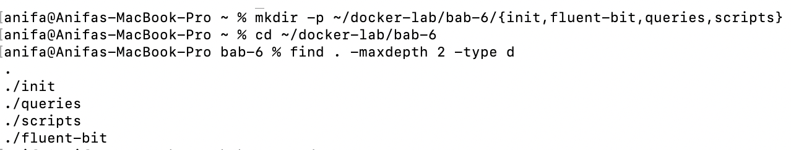

---

## Halaman PDF 5

menjadi .env dan izin aksesnya dibatasi hanya untuk pemilik berkas. File .env

memudahkan interpolasi Compose, tetapi bukan secret manager.

Gambar 3. Isi file .env.example

Gambar 3. Permission .env

### 3.3 Pembuatan File .gitignore

File .gitignore mencegah .env, berkas *.log, dan direktori reports/ ikut terkirim ke

repository Git. Volume PostgreSQL dan buffer Fluent Bit dikelola Docker sehingga tidak

perlu dimasukkan.

Gambar 4. Isi file .gitignore.

### 3.4 Konfigurasi Orkestrasi compose.yaml

File compose.yaml mendefinisikan lima service: postgres-db (PostgreSQL 16 Alpine),

fluent-bit (image 4.2.8), serta tiga log generator (generator-auth, generator-api,

generator-worker), dua named volume (pg-data dan flb-storage), dan bridge network

logging-net. Beberapa keputusan desain penting:

a.​ Port PostgreSQL tidak dipublikasikan ke host; Fluent Bit mengaksesnya lewat

jaringan internal logging-net.

b.​ Fluent Bit mempublikasikan port 24224 (Forward) dan 2020 (monitoring) hanya ke

127.0.0.1.

c.​ depends_on dengan service_healthy memastikan Fluent Bit baru berjalan setelah

PostgreSQL sehat.

d.​ Setiap generator memakai logging driver fluentd dengan fluentd-async: "true" dan

tag docker.{{.Name}}, sehingga kegagalan collector tidak langsung menggagalkan

startup container.

e.​ Setiap generator mencetak 20 baris JSON (satu per detik) dengan severity berbeda:

INFO (auth), WARN (api), dan ERROR (worker).

**Gambar/ilustrasi pada halaman ini:**

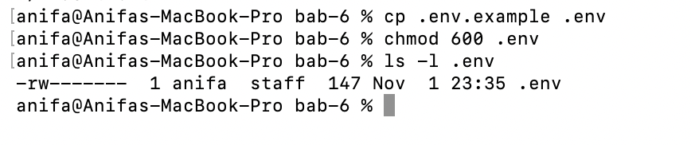

---

## Halaman PDF 6

**Gambar/ilustrasi pada halaman ini:**

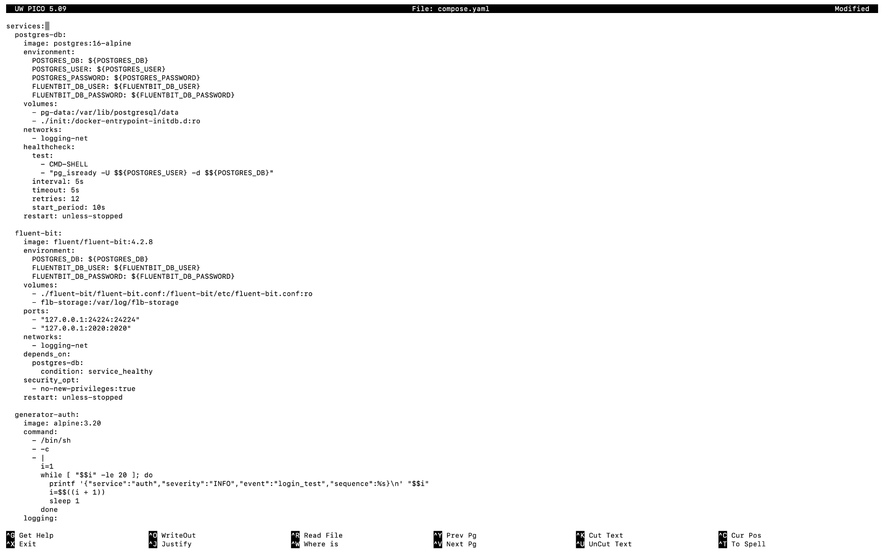

---

## Halaman PDF 7

Gambar 5. Isi file compose.yaml.

### 3.5 Pembuatan Init Script (init/01-init-logging.sh)

Berkas 01-init-logging.sh dijalankan sekali oleh image PostgreSQL ketika direktori data

masih kosong. Script ini membuat role fluentbit_user, schema logs, tabel logs.fluentbit

(kolom tag, time, data JSONB), tiga indeks (waktu, tag, dan GIN pada data), serta view

logs.recent_logs. Role ingest diberi search_path ke schema logs dan hak USAGE,

`CREATE pada schema serta SELECT, INSERT pada tabel. Hak CREATE diperlukan`
karena plugin PostgreSQL dapat melakukan bootstrap tabel; pada produksi, bootstrap

sebaiknya dipisahkan dari akun ingest.

**Gambar/ilustrasi pada halaman ini:**

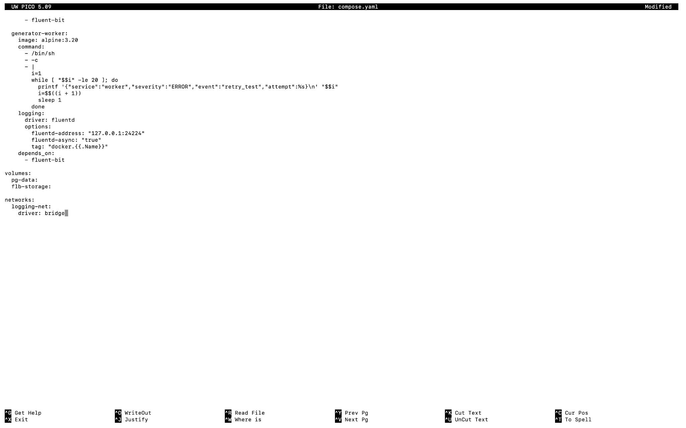

---

## Halaman PDF 8

Gambar 6. Isi file 01-init-logging.sh.

### 3.6 Konfigurasi Fluent Bit (fluent-bit/fluent-bit.conf)

Konfigurasi terdiri atas empat bagian:

a.​ [SERVICE]: flush 1 detik, storage.path /var/log/flb-storage, checksum aktif, dan

HTTP server pada port 2020 untuk monitoring.

b.​ [INPUT] forward: mendengarkan port 24224 dengan Mem_Buf_Limit 10M dan

storage.type filesystem.

c.​ [OUTPUT] pgsql: menulis ke postgres-db memakai kredensial dari environment

variable, dengan storage.total_limit_size 256M sebagai batas backlog.

d.​ [OUTPUT] stdout: jalur observasi tambahan dalam format json_lines.

Gambar 7. Isi file fluent-bit.conf.

### 3.7 Pembuatan Query Analisis (queries/analysis.sql)

Berkas analysis.sql berisi lima query:

a.​ jumlah event dan rentang waktu,

b.​ distribusi per tag,

c.​ metadata container pada 15 record terbaru,

d.​ pencarian severity ERROR pada field data.log, dan

e.​ ringkasan jumlah event per menit.

**Gambar/ilustrasi pada halaman ini:**

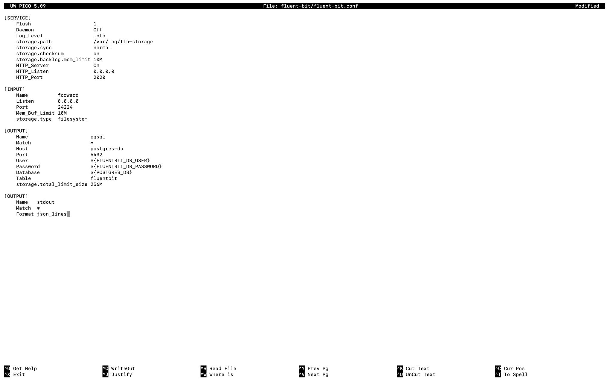

---

## Halaman PDF 9

Gambar 8. Isi file analysis.sql.

### 3.8 Pembuatan Script generate-logs.sh dan test-buffering.sh

generate-logs.sh menjalankan PostgreSQL dan Fluent Bit, menunggu endpoint

/api/v1/health siap (maksimal 30 percobaan), lalu membuat ulang ketiga generator dengan

--force-recreate.test-buffering.sh mencatat jumlah record awal, menghentikan PostgreSQL,

menjalankan generator selama 25 detik, menyalakan PostgreSQL kembali, menunggu

pg_isready, lalu memeriksa apakah jumlah record bertambah. Kedua script memakai set

-Eeuo pipefail agar berhenti saat terjadi galat.

Gambar 9. Isi file generate-logs.sh.

**Gambar/ilustrasi pada halaman ini:**

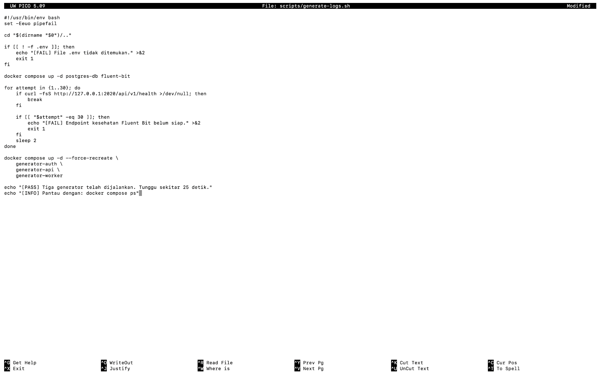

---

## Halaman PDF 10

Gambar 10. Isi file test-buffering.sh.

### 3.9 Pengaturan Permission dan Validasi Konfigurasi

Script diberi izin eksekusi, sintaks Bash diperiksa dengan bash -n, dan konfigurasi

Compose divalidasi sebelum deployment.

Gambar 11. Validasi sintaks script dan docker compose config.

Konfigurasi Fluent Bit juga divalidasi tanpa menjalankan seluruh stack:

`docker compose run --rm --no-deps fluent-bit \--dry-run`
\--config=/fluent-bit/etc/fluent-bit.conf

**Gambar/ilustrasi pada halaman ini:**

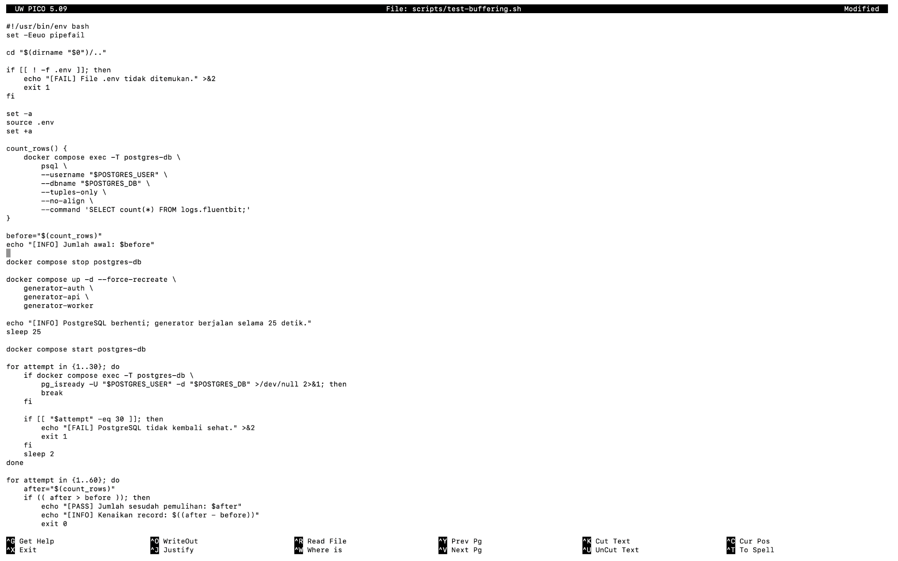

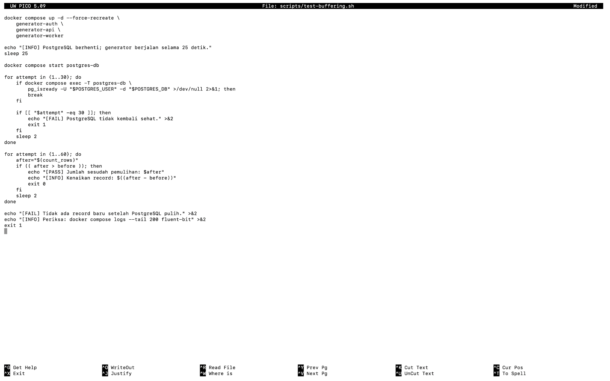

---

## Halaman PDF 11

Gambar 12. Validasi konfigurasi Fluent Bit.

### 3.10 Menjalankan Pipeline dan Menghasilkan Log

Pipeline dijalankan dengan generate-logs.sh, kemudian status semua container diperiksa

setelah sekitar 25 detik. Ketiga generator diharapkan berstatus Exited (0) karena prosesnya

selesai setelah 20 baris, sedangkan PostgreSQL dan Fluent Bit tetap Up.

`./scripts/generate-logs.sh`
`sleep 25`
`docker compose ps --all`
Gambar 13. Hasil menjalankan pipeline dan status container.

### 3.11 Pemeriksaan Monitoring Fluent Bit

Endpoint monitoring hanya diikat ke 127.0.0.1.

`curl -fsS http://127.0.0.1:2020/api/v1/health`
`curl -fsS http://127.0.0.1:2020/api/v1/metrics`
Gambar 14. Health dan metrics Fluent Bit.

### 3.12 Verifikasi Record pada PostgreSQL

Query analisis dijalankan melalui docker compose exec dengan memuat variabel dari .env.

`set -a`
`source .env`
`set +a`
**Gambar/ilustrasi pada halaman ini:**

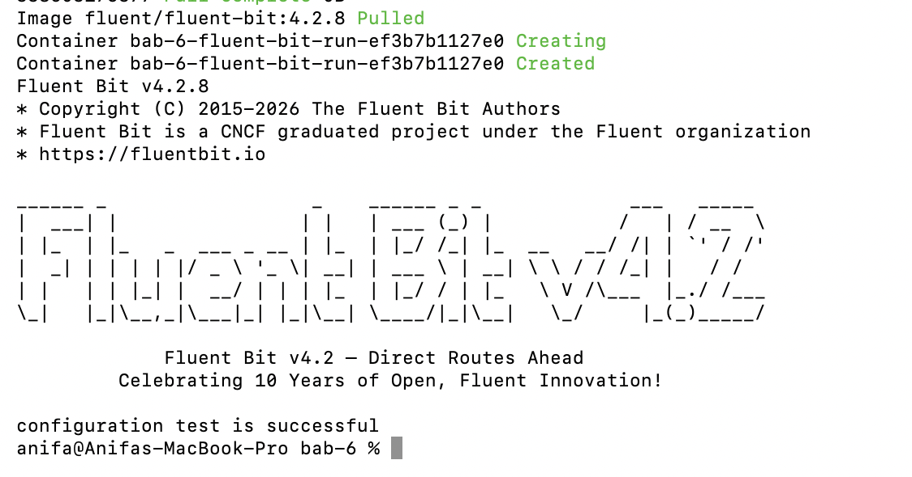

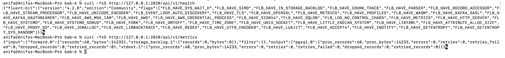

---

## Halaman PDF 12

`docker compose exec -T postgres-db \`
psql \

--username "$POSTGRES_USER" \

--dbname "$POSTGRES_DB" \

--file /dev/stdin \

< queries/analysis.sql

Gambar 15. Hasil query analisis log.

View recent_logs dan tipe data kolom data diperiksa secara terpisah:

`docker compose exec -T postgres-db \`
psql --username "$POSTGRES_USER" --dbname "$POSTGRES_DB" \

--command 'TABLE logs.recent_logs;'

**Gambar/ilustrasi pada halaman ini:**

---

## Halaman PDF 13

Gambar 16. Isi view logs.recent_logs.

### 3.13 Pengujian Buffering dan Pemulihan

Pengujian ini membuktikan bahwa Fluent Bit tetap berjalan dan menahan event saat

PostgreSQL dihentikan sementara, lalu mengirimkannya setelah backend pulih.

`./scripts/test-buffering.sh`
Gambar 17. Hasil test-buffering.sh.

Selama PostgreSQL berhenti, retry Fluent Bit dan kondisi volume diperiksa

`docker compose logs --tail 200 fluent-bit`
`docker volume ls`
**Gambar/ilustrasi pada halaman ini:**

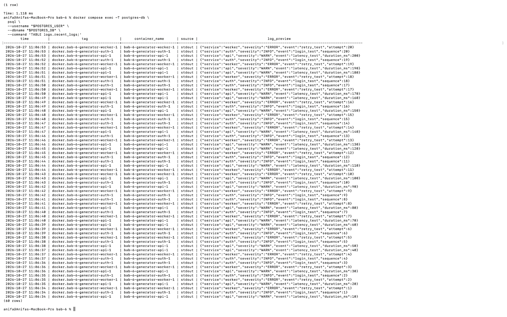

---

## Halaman PDF 14

Gambar 18. Log retry Fluent Bit saat PostgreSQL berhenti.

### 3.14 Verifikasi Pembatasan Jaringan

PostgreSQL tidak boleh memiliki published port. Hal ini diperiksa pada kolom PORTS:

`docker compose ps`
Gambar 19. Port PostgreSQL tidak dipublikasikan ke host.

### 3.15 Pembersihan Lingkungan (Cleanup)

`docker compose down menghapus container dan network tetapi mempertahankan data`
pada volume. Opsi --volumes bersifat destruktif karena menghapus tabel log dan backlog

Fluent Bit, sehingga hanya dijalankan setelah evidence disimpan.

`docker compose down --remove-orphans`
`docker compose down --volumes --remove-orphans`
Gambar 20. Hasil cleanup Bagian A

**Gambar/ilustrasi pada halaman ini:**

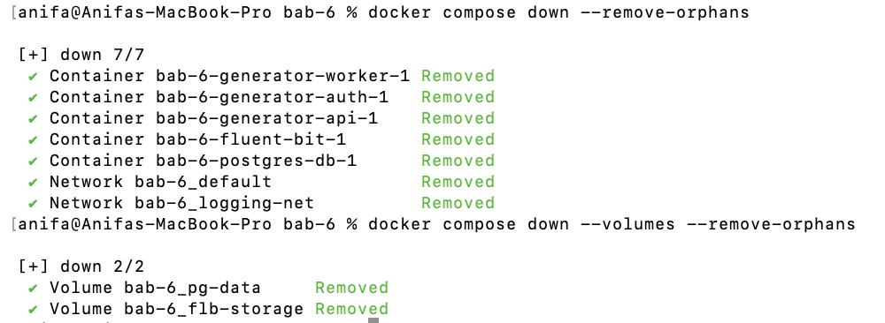

---

## Halaman PDF 22

### 4. Verifikasi dan Skenario Pengujian

### 4.1 Checklist Verifikasi

[v] PostgreSQL berjalan dengan volume pg-data.

[v] Tabel students dibuat otomatis dari init script.

[v] pgAdmin dapat login dan terkoneksi ke database.

[v] Backup menghasilkan file dump di direktori host.

[v] Restore sudah diuji, bukan hanya diasumsikan berhasil.

### 4.2 Pemetaan Bukti Pengujian

Tabel berikut memetakan kriteria keberhasilan pengujian pada Bagian A dan Bagian B

berdasarkan evidence yang diperoleh selama praktikum.

No.

Kriteria Pengujian

Bukti

Bagian A – Pipeline Log Generator

1

Struktur direktori dan konfigurasi lingkungan berhasil

disiapkan.

Gambar 1–3

2

File .gitignore dan konfigurasi Docker Compose berhasil

dibuat.

Gambar 4–5

3

Init script PostgreSQL berhasil dikonfigurasi.

Gambar 6

4

Konfigurasi Fluent Bit dan query analisis berhasil dibuat.

Gambar 7–8

5

Script generator log dan pengujian buffering berhasil dibuat.

Gambar 9–10

6

Validasi sintaks, Docker Compose, dan konfigurasi Fluent Bit

berhasil dilakukan.

Gambar 11–12

7

Pipeline berjalan dan seluruh generator menghasilkan log.

Gambar 13

---

## Halaman PDF 23

8

Monitoring Fluent Bit menunjukkan bahwa endpoint health

dan metrics dapat diakses.

Gambar 14

9

Record berhasil disimpan dan dianalisis pada PostgreSQL.

Gambar 15–16

10

Buffering dan pemulihan pengiriman log berhasil diuji.

Gambar 17–18

11

Port PostgreSQL tidak dipublikasikan ke host.

Gambar 19

12

Seluruh resource Bagian A berhasil dibersihkan.

Gambar 20

Bagian B – Implementasi Aplikasi PMB

13

Konfigurasi lingkungan dan validasi berhasil dijalankan.

Gambar 21

14

Seluruh service PMB berhasil dijalankan.

Gambar 22

15

Health aplikasi dan Fluent Bit dapat diperiksa.

Gambar 23

16

Pendaftaran normal berhasil dengan status VERIFIED.

Gambar 24

17

Failure injection menghasilkan status FAILED.

Gambar 25

18

Rekonstruksi kronologi berdasarkan Request ID berhasil

dilakukan.

Gambar 26–27

19

Agregasi event dan severity berhasil dilakukan.

Gambar 28

20

Aplikasi berhasil memproses transaksi setelah recovery.

Gambar 29

21

Fluent Bit melakukan retry dan mengirimkan log setelah

database pulih.

Gambar 30

22

Pemeriksaan duplikasi record berhasil dilakukan.

Gambar 31

---

## Halaman PDF 24

23

Pemeriksaan kerahasiaan data dan unit test berhasil.

Gambar 32

24

Evidence dan checksum konfigurasi berhasil dikumpulkan.

Gambar 33

25

Seluruh resource Docker berhasil dibersihkan.

Gambar 34

Berdasarkan pemetaan tersebut, pengujian pada Bagian A berhasil memverifikasi pipeline

pengiriman dan penyimpanan log menggunakan Fluent Bit dan PostgreSQL. Sementara

itu, Bagian B menguji penerapan pipeline pada aplikasi PMB melalui skenario normal,

kegagalan, recovery, dan resilience logging.

### 5. Evaluasi dan Latihan Mandiri

### 1. Mengapa init script tidak dijalankan ulang saat volume lama masih ada?

Image

PostgreSQL

resmi

hanya

mengeksekusi

berkas

.sql

dan

.sh

pada

/docker-entrypoint-initdb.d ketika direktori data masih kosong, yaitu pada saat klaster basis

data pertama kali diinisialisasi. Bila volume pg-data sudah berisi klaster, proses inisialisasi

dilewati sehingga perubahan pada init script tidak berpengaruh. Perubahan skema

berikutnya sebaiknya dilakukan lewat migrasi (misalnya menjalankan berkas SQL dengan

psql). Menghapus volume hanya boleh dilakukan bila datanya memang tidak diperlukan

lagi.

### 2. Apa risiko menaruh password database pada docker-compose.yml?

Password tertulis sebagai teks polos pada berkas yang mudah ikut ter-commit ke repository,

dibagikan, atau dibaca pengguna lain. Nilainya juga mudah terlihat melalui docker

compose config, docker inspect, atau daftar proses, dan dapat bocor ke log. Mitigasinya

adalah menyimpan nilai pada .env yang dikecualikan dari Git (seperti pada praktikum ini),

menggunakan Docker secrets atau secret manager pada lingkungan produksi, serta

merotasi kredensial secara berkala.

### 3. Bagaimana cara membuktikan backup dapat dipulihkan?

Dengan melakukan restore ke basis data atau instance terpisah, bukan menimpa basis data

sumber. Pada praktikum ini dump dipulihkan ke labdb_restore_test setelah checksum

diverifikasi, lalu jumlah dan isi baris tabel students dibandingkan dengan basis data

sumber. Versi PostgreSQL dan waktu restore juga dicatat. Keberadaan berkas dump saja

bukan bukti.

---

## Halaman PDF 25

### 4. Apa bedanya logical backup pg_dump dan backup filesystem volume mentah?

Logical backup oleh pg_dump mengekstrak isi basis data (skema dan data) secara

konsisten melalui sebuah snapshot transaksi, dapat dipulihkan secara selektif, dan relatif

portabel antarversi, tetapi memerlukan waktu lebih lama pada basis data besar. Salinan

filesystem volume mentah bersifat fisik, seperti menyalin berkas data apa adanya, terikat

pada versi mayor dan arsitektur PostgreSQL, serta berisiko tidak konsisten atau rusak bila

diambil saat server berjalan tanpa mekanisme yang tepat (misalnya server dihentikan

terlebih dahulu atau memakai pg_basebackup dan arsip WAL).

### 5. Apa dampak docker compose down -v terhadap database?

Command ini menghapus container, network, dan named volume seperti pg-data dan

pgadmin-data, sehingga data database dan konfigurasi pgAdmin hilang. Saat dijalankan

kembali, PostgreSQL diinisialisasi ulang. Data pada bind mount host, seperti folder

backup/, tetap tersimpan.

### 7. Kesimpulan

1.​ Centralized logging memindahkan log dari container yang ephemeral ke

penyimpanan terpusat sehingga dapat dicari dan diaudit. Pipeline stdout, Docker

fluentd driver, Fluent Bit, dan PostgreSQL JSONB berhasil diimplementasikan

pada log generator dan aplikasi PMB.

2.​ Structured log dengan field konsisten dan request_id memungkinkan satu transaksi

PMB ditelusuri lintas registration-api, auth-service, dan verification-worker;

redaksi data sensitif serta minimisasi data menjaga log bebas dari kredensial dan

data pribadi pendaftar.

3.​ Status container yang sehat tidak membuktikan fungsi bisnis yang sehat. Gangguan

timeout pada verifikasi hanya dapat didiagnosis dari event WARN dan ERROR

pada log terpusat, bukan dari status proses.

4.​ Buffer filesystem Fluent Bit memungkinkan pemulihan setelah database log

berhenti, tetapi pipeline belum menjamin exactly-once; duplikasi dan kehilangan

event tetap mungkin.

5.​ PostgreSQL sesuai sebagai backend laboratorium. Untuk produksi diperlukan TLS,

secret manager, kebijakan retensi, kontrol akses, dan evaluasi log backend yang

lebih sesuai untuk volume besar.

---
