# LAPORAN PRAKTIKUM BAB 6
# CENTRALIZED LOGGING DENGAN FLUENT BIT DAN POSTGRESQL

**Mata Kuliah:** Workshop DevOps  
**Dosen Pengampu:** Dr. Ferry Astika Saputra, S.T., M.Sc.  
**Disusun oleh:** Anifa Aulia Abdari (3126640053)  
**Institusi:** Politeknik Elektronika Negeri Surabaya  
**Departemen:** Teknik Informatika dan Komputer  
**Program Studi:** Teknik Informatika  
**Tahun:** 2026

---

## 1. Tujuan Pembelajaran dan Kompetensi Utama

Setelah menyelesaikan praktikum pada Bab 6 ini, mahasiswa diharapkan mampu:

1. Menjelaskan kebutuhan *centralized logging* pada lingkungan container yang bersifat *ephemeral*.
2. Mengirim log stdout/stderr container ke Fluent Bit menggunakan Docker Fluentd Logging Driver.
3. Menyimpan log ke PostgreSQL dalam kolom JSONB dan membuat view untuk analisis.
4. Membuat log generator untuk menyimulasikan event dengan tingkat severity berbeda.
5. Menerapkan query pencarian log dan retensi sederhana.

## 2. Konsep Inti dan Landasan Teori

Container sering dibuat dan dihapus dengan cepat. Jika log hanya tersimpan di dalam container, proses debugging dan audit menjadi sulit karena log dapat ikut hilang ketika container dihapus.

*Centralized logging* merupakan pendekatan untuk mengumpulkan log dari berbagai sumber ke dalam satu tempat penyimpanan. Dengan demikian, log dapat dicari, dianalisis, dan diaudit secara konsisten.

### 2.1 Centralized Logging dan Fluent Bit

Log merupakan rekaman peristiwa yang terjadi pada aplikasi, container, host, maupun kontrol keamanan. Fluent Bit berperan sebagai agen yang membaca input, melakukan parsing dan filtering, kemudian meneruskan record ke output yang telah ditentukan.

Pada praktikum ini, aplikasi menulis log melalui stdout, kemudian Docker Logging Driver dengan jenis Fluentd meneruskannya ke Fluent Bit. Selanjutnya, Fluent Bit menyimpan log ke PostgreSQL.

Proses logging driver dijalankan oleh Docker Engine, bukan oleh container generator. Oleh karena itu, alamat `fluentd-address` diarahkan ke alamat collector yang tersedia pada host, yaitu `127.0.0.1:24224`, sesuai konfigurasi port Fluent Bit.

### 2.2 Struktur Event dan Kualitas Data

*Structured logging* menggunakan field yang konsisten, seperti timestamp, severity, service, event, dan request ID. Penggunaan format terstruktur memudahkan proses pencarian dan analisis log.

Meskipun JSON mudah diproses, JSON yang valid belum tentu memiliki struktur semantik yang konsisten. Oleh karena itu, nama field, satuan durasi, dan zona waktu perlu distandarisasi.

Correlation ID juga dapat digunakan untuk menelusuri satu transaksi yang melibatkan beberapa komponen aplikasi.

Selain itu, prinsip minimisasi data perlu diterapkan. Informasi sensitif seperti password, token, secret, dan data pribadi tidak boleh dicatat ke dalam log secara default.

### 2.3 Pipeline Fluent Bit dan Format Record

Pipeline Fluent Bit terdiri atas beberapa tahapan, yaitu input, parser, filter, buffer, dan output.

Pada praktikum ini, plugin output PostgreSQL menyimpan record ke dalam tiga kolom utama:

| Field | Makna |
|---|---|
| `tag` | Klasifikasi sumber log, misalnya `docker.bab-6-generator-auth-1`. |
| `time` | Timestamp ketika log diterima oleh collector. |
| `data` | Record log lengkap dalam format JSONB. |
| `container_name` | Nama container penghasil log yang tersimpan di dalam `data`. |
| `source` | Sumber log, yaitu stdout atau stderr, yang tersimpan di dalam `data`. |
| `log` | Pesan aplikasi. JSON dari aplikasi tetap tersimpan sebagai string pada `data.log`. |

Schema `logs` dipilih melalui `search_path` akun PostgreSQL, bukan melalui opsi Schema atau `Timestamp_Key` pada konfigurasi Fluent Bit. Pesan aplikasi berbentuk JSON masih tersimpan sebagai string pada `data.log`.

### 2.4 PostgreSQL sebagai Backend Laboratorium

PostgreSQL digunakan sebagai backend penyimpanan log karena mendukung pengelolaan schema, query, indeks, dan tipe data JSONB.

Penggunaan JSONB memungkinkan record log disimpan dalam bentuk terstruktur sehingga field tertentu dapat dicari dan dianalisis menggunakan query SQL.

Namun, database relasional tidak selalu menjadi pilihan paling efisien untuk penyimpanan log dengan volume sangat besar. Pada lingkungan produksi, sistem seperti Loki, OpenSearch, atau ClickHouse dapat dipertimbangkan sesuai kebutuhan.

Kebijakan retensi juga perlu ditentukan secara eksplisit. Penyimpanan log tanpa batas dapat meningkatkan kebutuhan storage dan risiko privasi, sedangkan penghapusan log terlalu cepat dapat menghilangkan bukti yang diperlukan untuk analisis insiden.

### 2.5 Reliability dan Backpressure

*Backpressure* terjadi ketika proses pengiriman data berjalan lebih lambat dibandingkan jumlah data yang masuk.

Buffer memori memiliki kinerja yang cepat, tetapi data di dalamnya berisiko hilang ketika proses berhenti. Sementara itu, filesystem buffering menyimpan data sementara pada media penyimpanan sehingga lebih tahan terhadap gangguan proses.

Pada praktikum ini, Fluent Bit menggunakan `storage.type filesystem` untuk menyimpan data sementara ketika PostgreSQL tidak tersedia.

Mekanisme tersebut membantu pipeline melakukan pemulihan dalam pengujian skala laboratorium. Namun, mekanisme retry dan buffering belum menjamin setiap event diproses tepat satu kali atau *exactly-once*. Proses retry dapat menyebabkan duplikasi data, sedangkan buffer yang penuh atau penghentian proses secara paksa dapat mengakibatkan kehilangan event.

---

## 3. Langkah Praktikum

Praktikum pada laporan ini berfokus pada pembangunan pipeline centralized logging menggunakan tiga log generator. Pengujian dilakukan mulai dari penyiapan direktori dan konfigurasi, menjalankan pipeline, memeriksa penyimpanan log pada PostgreSQL, menguji buffering, hingga membersihkan resource praktikum.

Pembahasan implementasi centralized logging pada aplikasi PMB dipisahkan dari laporan ini.

### 3.1 Penyiapan Direktori Kerja dan Struktur Proyek

Langkah pertama adalah membuat direktori kerja Bab 6 beserta subdirektori yang diperlukan. Struktur direktori digunakan untuk memisahkan file konfigurasi, initialization script, query analisis, dan script pengujian.

Direktori yang digunakan terdiri atas `init`, `fluent-bit`, `queries`, dan `scripts`. Pemisahan tersebut bertujuan agar file konfigurasi, bind mount, dan script praktikum tersusun secara terstruktur.


*Gambar 1. Struktur direktori kerja Bab 6*

### 3.2 Pembuatan Template Konfigurasi (.env.example) dan Konfigurasi Aktif

File `.env.example` dibuat untuk menyediakan template konfigurasi lingkungan praktikum. File ini berisi parameter yang diperlukan oleh Docker Compose, seperti nama database, akun administrator PostgreSQL, serta akun `fluentbit_user` yang digunakan untuk proses ingest log.

Template tersebut kemudian disalin menjadi file `.env` sebagai konfigurasi aktif. File `.env` berisi nilai kredensial yang digunakan selama praktikum sehingga tidak boleh dimasukkan ke repository Git.

File `.env` memudahkan proses interpolasi variabel pada Docker Compose, tetapi bukan merupakan pengganti secret manager.

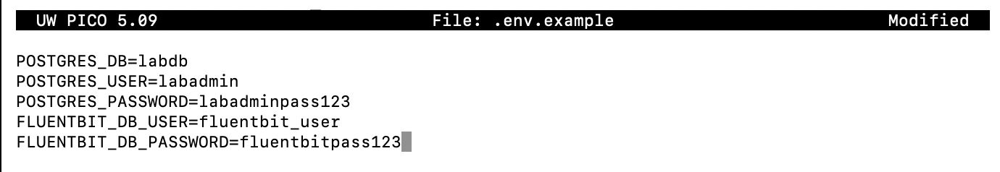

*Gambar 2. Isi file .env.example*


*Gambar 3. Pengaturan variabel lingkungan praktikum*

Setelah file konfigurasi aktif dibuat, permission file `.env` dibatasi agar hanya pemilik file yang dapat mengaksesnya.

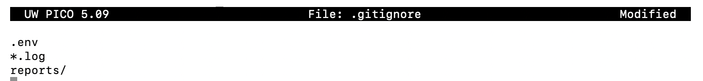

*Gambar 4. Pengaturan permission file .env*

### 3.3 Pembuatan File .gitignore

File `.gitignore` dibuat untuk mencegah file yang bersifat lokal dan sensitif ikut dikirim ke repository GitHub.

Beberapa file dan direktori yang perlu dikecualikan antara lain:

- File `.env` yang berisi kredensial aktif.
- File log dengan ekstensi `.log`.
- Direktori `reports/` yang berisi hasil atau bukti pengujian lokal.

Volume PostgreSQL dan buffer Fluent Bit dikelola oleh Docker sehingga tidak perlu dimasukkan ke repository.


*Gambar 5. Isi file .gitignore*

### 3.4 Konfigurasi Orkestrasi compose.yaml

File `compose.yaml` dibuat untuk mendefinisikan layanan yang dibutuhkan dalam pipeline centralized logging.

Konfigurasi ini mendefinisikan lima service, yaitu:

1. `postgres-db` menggunakan PostgreSQL 16 Alpine sebagai backend penyimpanan log.
2. `fluent-bit` menggunakan image Fluent Bit versi 4.2.8 sebagai collector dan pengirim log.
3. `generator-auth` sebagai generator log autentikasi.
4. `generator-api` sebagai generator log API.
5. `generator-worker` sebagai generator log worker.

Selain service tersebut, konfigurasi menggunakan dua named volume, yaitu `pg-data` untuk menyimpan data PostgreSQL dan `flb-storage` untuk menyimpan buffer Fluent Bit. Seluruh service terhubung melalui bridge network bernama `logging-net`.

Beberapa keputusan konfigurasi yang diterapkan adalah sebagai berikut.

a. Port PostgreSQL tidak dipublikasikan ke host. Fluent Bit mengakses PostgreSQL melalui jaringan internal `logging-net`.

b. Fluent Bit mempublikasikan port `24224` untuk Forward Input dan port `2020` untuk monitoring. Kedua port hanya diikat ke alamat `127.0.0.1`.

c. Konfigurasi `depends_on` dengan kondisi `service_healthy` digunakan agar Fluent Bit berjalan setelah PostgreSQL dinyatakan sehat.

d. Setiap generator menggunakan logging driver `fluentd` dengan `fluentd-async: "true"` dan tag `docker.{{.Name}}`.

e. Setiap generator mencetak 20 baris log JSON dengan interval satu detik. Ketiga generator menghasilkan severity yang berbeda, yaitu INFO untuk auth, WARN untuk API, dan ERROR untuk worker.

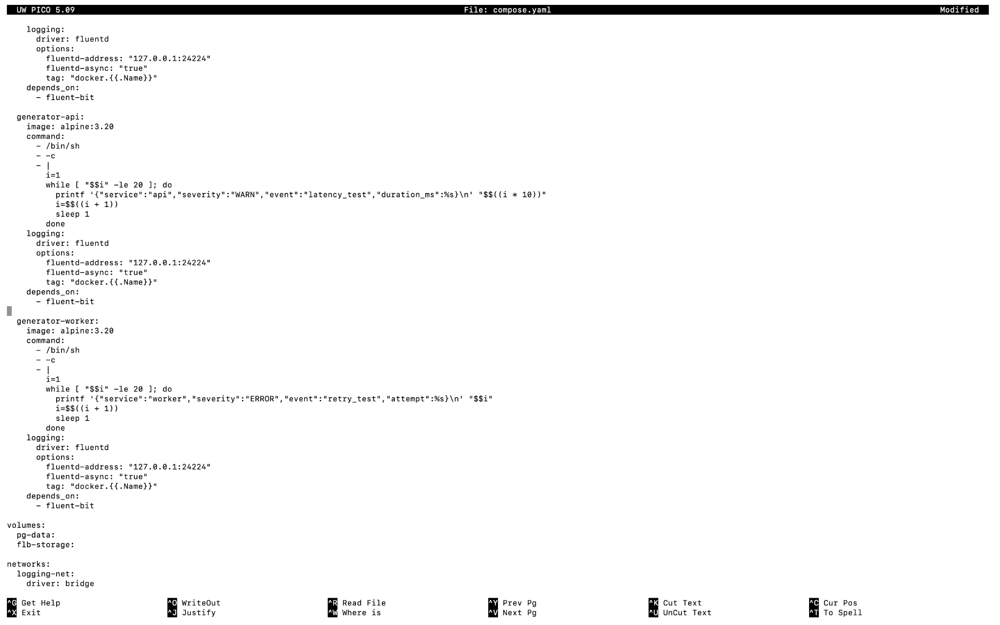

*Gambar 6. Konfigurasi service pada Docker Compose*


*Gambar 7. Konfigurasi logging driver Docker*

### 3.5 Pembuatan Init Script (init/01-init-logging.sh)

File `01-init-logging.sh` dibuat untuk menginisialisasi struktur database PostgreSQL ketika direktori data masih kosong.

Script ini menjalankan beberapa proses, yaitu:

1. Membuat role `fluentbit_user` untuk proses ingest log.
2. Membuat schema `logs`.
3. Membuat tabel `logs.fluentbit`.
4. Menentukan kolom `tag`, `time`, dan `data` dengan tipe data JSONB pada kolom `data`.
5. Membuat indeks berdasarkan waktu, tag, dan GIN pada kolom `data`.
6. Membuat view `logs.recent_logs` untuk menampilkan log terbaru.

Role `fluentbit_user` diberikan hak akses `USAGE` dan `CREATE` pada schema serta hak `SELECT` dan `INSERT` pada tabel. Hak `CREATE` diperlukan karena plugin PostgreSQL dapat melakukan bootstrap tabel.

Pada lingkungan produksi, proses bootstrap sebaiknya dipisahkan dari akun ingest agar hak akses yang diberikan lebih terbatas.

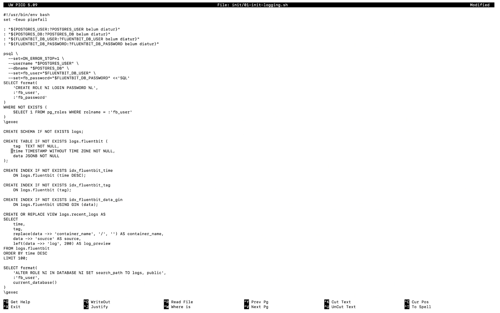

*Gambar 8. Initialization script PostgreSQL*

### 3.6 Konfigurasi Fluent Bit (fluent-bit/fluent-bit.conf)

File `fluent-bit.conf` digunakan untuk mengatur proses penerimaan, pemrosesan, buffering, dan pengiriman log.

Konfigurasi Fluent Bit terdiri atas beberapa bagian utama:

a. **SERVICE**

Bagian ini mengatur interval flush selama satu detik, lokasi penyimpanan buffer pada `/var/log/flb-storage`, pengaktifan checksum, serta HTTP server untuk monitoring pada port `2020`.

b. **INPUT**

Bagian input menggunakan plugin `forward` yang mendengarkan log melalui port `24224`. Konfigurasi ini juga menggunakan `Mem_Buf_Limit 10M` dan `storage.type filesystem`.

c. **OUTPUT PostgreSQL**

Bagian output mengatur pengiriman log ke service `postgres-db` menggunakan kredensial dari environment variable. Konfigurasi `storage.total_limit_size 256M` digunakan untuk membatasi ukuran backlog.

d. **OUTPUT stdout**

Output tambahan menggunakan stdout dengan format `json_lines` untuk membantu proses observasi record selama pengujian.

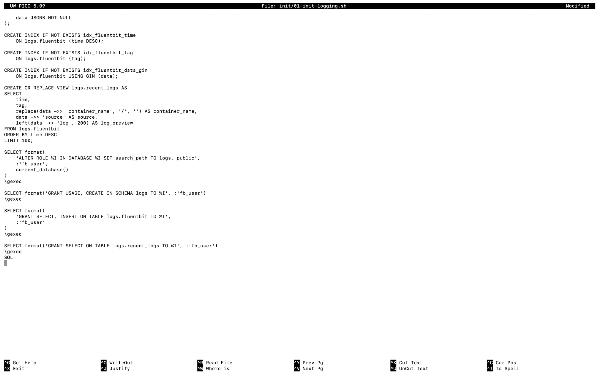

*Gambar 9. Konfigurasi Fluent Bit*

### 3.7 Pembuatan Query Analisis (queries/analysis.sql)

File `analysis.sql` dibuat untuk melakukan pemeriksaan dan analisis terhadap log yang telah tersimpan pada PostgreSQL.

Query yang disiapkan meliputi:

a. Menghitung jumlah event dan rentang waktu log.

b. Menampilkan distribusi log berdasarkan tag.

c. Menampilkan metadata container dari 15 record terbaru.

d. Mencari severity ERROR pada field `data.log`.

e. Menampilkan ringkasan jumlah event berdasarkan interval satu menit.

Query tersebut digunakan untuk memastikan data log telah tersimpan dan dapat dianalisis menggunakan SQL.


*Gambar 10. Query analisis log*

### 3.8 Pembuatan Script generate-logs.sh dan test-buffering.sh

Dua script dibuat untuk membantu otomatisasi proses pengujian centralized logging.

**a. generate-logs.sh**

Script ini digunakan untuk menjalankan PostgreSQL dan Fluent Bit, kemudian menunggu endpoint health hingga siap. Proses penantian dilakukan dengan maksimal 30 percobaan.

Setelah layanan siap, script membuat ulang ketiga container generator menggunakan opsi `--force-recreate`.

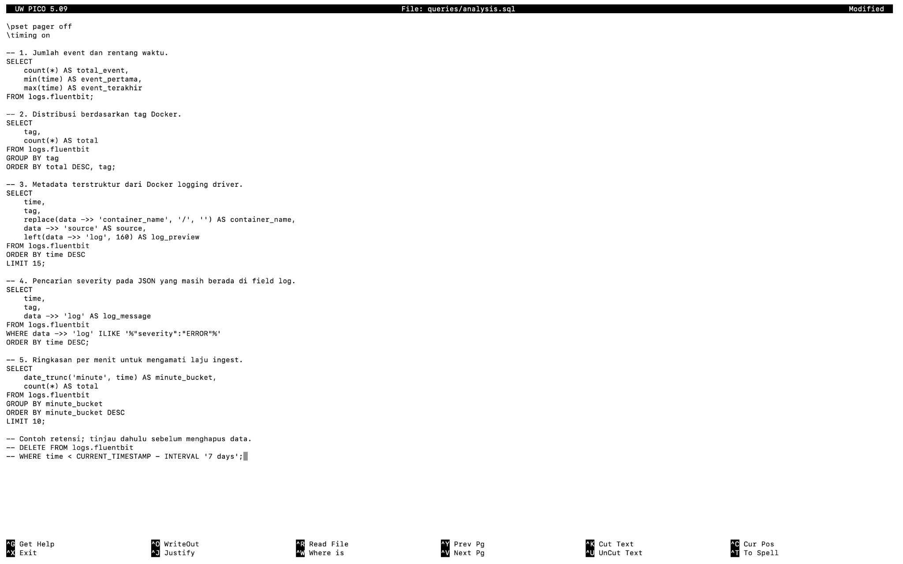

*Gambar 11. Script generate-logs.sh*

**b. test-buffering.sh**

Script ini digunakan untuk menguji kemampuan filesystem buffering ketika PostgreSQL tidak tersedia.

Tahapan pengujiannya meliputi:

1. Mencatat jumlah record awal pada PostgreSQL.
2. Menghentikan service PostgreSQL.
3. Menjalankan generator selama 25 detik.
4. Menyalakan kembali PostgreSQL.
5. Menunggu PostgreSQL siap melalui `pg_isready`.
6. Memeriksa apakah jumlah record bertambah setelah backend kembali tersedia.

Kedua script menggunakan `set -Eeuo pipefail` agar proses berhenti ketika terjadi kesalahan.


*Gambar 12. Script test-buffering.sh*

### 3.9 Pengaturan Permission dan Validasi Konfigurasi

Setelah seluruh file konfigurasi dan script dibuat, langkah berikutnya adalah memberikan izin eksekusi pada script dan melakukan validasi.

Perintah yang digunakan:

```bash
chmod +x scripts/*.sh

bash -n scripts/generate-logs.sh
bash -n scripts/test-buffering.sh

docker compose config
```

Validasi tersebut dilakukan untuk memastikan sintaks Bash dan konfigurasi Docker Compose tidak memiliki kesalahan.

Konfigurasi Fluent Bit juga divalidasi tanpa menjalankan seluruh stack menggunakan perintah:

```bash
docker compose run --rm --no-deps fluent-bit \
  --dry-run \
  --config=/fluent-bit/etc/fluent-bit.conf
```


*Gambar 13. Validasi sintaks Bash*


*Gambar 14. Validasi konfigurasi Docker Compose*

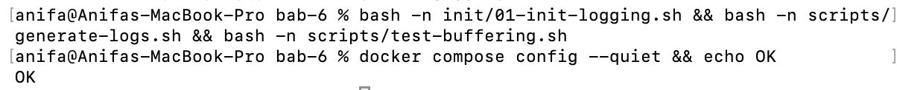

*Gambar 15. Validasi konfigurasi Fluent Bit*

### 3.10 Menjalankan Pipeline dan Menghasilkan Log

Setelah konfigurasi berhasil divalidasi, pipeline dijalankan menggunakan script `generate-logs.sh`.

Perintah yang digunakan:

```bash
./scripts/generate-logs.sh

sleep 25

docker compose ps --all
```

Setelah proses berjalan, status seluruh container diperiksa.

Ketiga container generator diharapkan berstatus `Exited (0)` karena proses menghasilkan 20 baris log kemudian selesai. Sementara itu, PostgreSQL dan Fluent Bit tetap berjalan untuk menyimpan dan memproses log.


*Gambar 16. Proses menjalankan pipeline centralized logging*

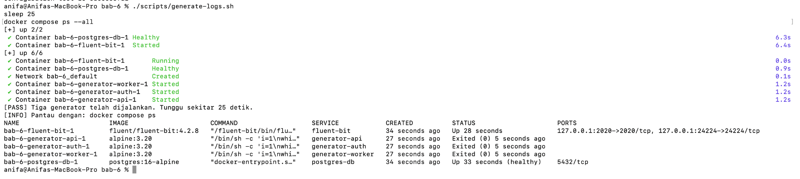

*Gambar 17. Pemeriksaan status container*

### 3.11 Pemeriksaan Monitoring Fluent Bit

Fluent Bit menyediakan endpoint monitoring untuk memeriksa kondisi layanan dan statistik pemrosesan log.

Pemeriksaan dilakukan menggunakan perintah:

```bash
curl -fsS http://127.0.0.1:2020/api/v1/health

curl -fsS http://127.0.0.1:2020/api/v1/metrics
```

Endpoint health digunakan untuk memeriksa kondisi layanan, sedangkan endpoint metrics digunakan untuk melihat statistik aktivitas Fluent Bit.

Port monitoring hanya diikat ke `127.0.0.1` sehingga tidak dibuka secara langsung ke seluruh jaringan.


*Gambar 18. Pemeriksaan health dan metrics Fluent Bit*

### 3.12 Verifikasi Record pada PostgreSQL

Setelah pipeline berjalan, langkah berikutnya adalah memastikan log berhasil disimpan pada PostgreSQL.

Query analisis dijalankan melalui container PostgreSQL dengan memuat variabel lingkungan dari file `.env`.

Perintah yang digunakan:

```bash
set -a
source .env
set +a

docker compose exec -T postgres-db \
  psql \
  --username "$POSTGRES_USER" \
  --dbname "$POSTGRES_DB" \
  --file /dev/stdin \
  < queries/analysis.sql
```

Hasil query digunakan untuk memeriksa jumlah event, distribusi tag, metadata container, severity ERROR, dan agregasi log per menit.

Selain itu, view `logs.recent_logs` diperiksa menggunakan perintah:

```bash
docker compose exec -T postgres-db \
  psql --username "$POSTGRES_USER" \
  --dbname "$POSTGRES_DB" \
  --command 'TABLE logs.recent_logs;'
```

Pemeriksaan tersebut memastikan bahwa record log telah tersimpan pada tabel PostgreSQL dan dapat ditampilkan melalui view yang telah dibuat.

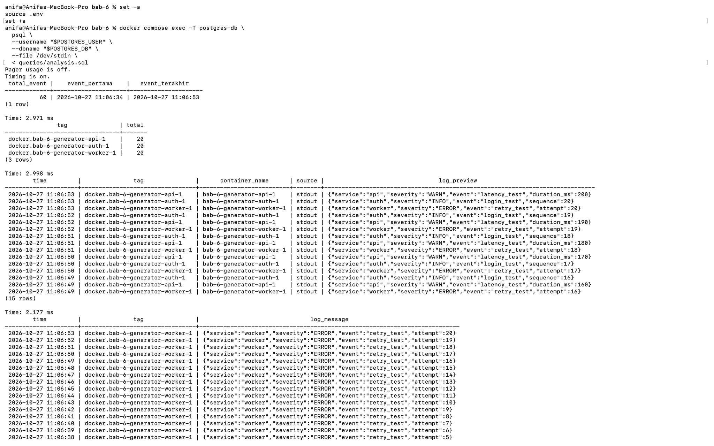

*Gambar 19. Hasil query analisis log pada PostgreSQL*

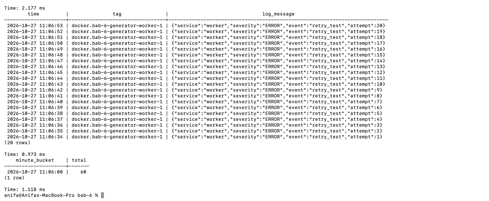

*Gambar 20. Pemeriksaan view logs.recent_logs*

### 3.13 Pengujian Buffering dan Pemulihan

Pengujian buffering dilakukan untuk membuktikan bahwa Fluent Bit dapat menahan event sementara ketika PostgreSQL tidak tersedia.

Pengujian dijalankan menggunakan script:

```bash
./scripts/test-buffering.sh
```

Script akan menghentikan PostgreSQL sementara, menjalankan log generator, kemudian menyalakan kembali PostgreSQL.

Selama PostgreSQL berhenti, Fluent Bit diharapkan tetap berjalan dan menyimpan data sementara menggunakan filesystem buffer.

Setelah PostgreSQL kembali tersedia, Fluent Bit melakukan retry untuk mengirimkan data yang sebelumnya tertahan.

Kondisi tersebut dapat diperiksa menggunakan perintah:

```bash
docker compose logs --tail 200 fluent-bit

docker volume ls
```

Pengujian ini menunjukkan kemampuan pipeline dalam melakukan pemulihan setelah backend mengalami gangguan sementara.


*Gambar 21. Hasil pengujian filesystem buffering*

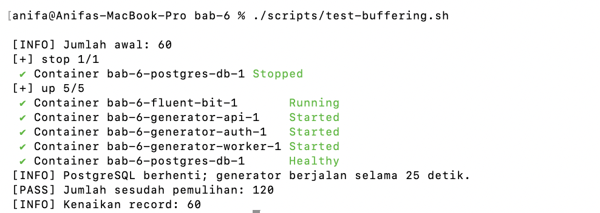

*Gambar 22. Log retry Fluent Bit ketika PostgreSQL tidak tersedia*

### 3.14 Verifikasi Pembatasan Jaringan

Salah satu aspek keamanan yang diterapkan pada praktikum ini adalah tidak mempublikasikan port PostgreSQL secara langsung ke host.

Pemeriksaan dilakukan menggunakan perintah:

```bash
docker compose ps
```

Pada hasil pemeriksaan, service PostgreSQL tidak seharusnya memiliki published port. Fluent Bit tetap dapat mengakses PostgreSQL melalui jaringan internal Docker, yaitu `logging-net`.

Pembatasan tersebut mengurangi paparan layanan database terhadap jaringan host.

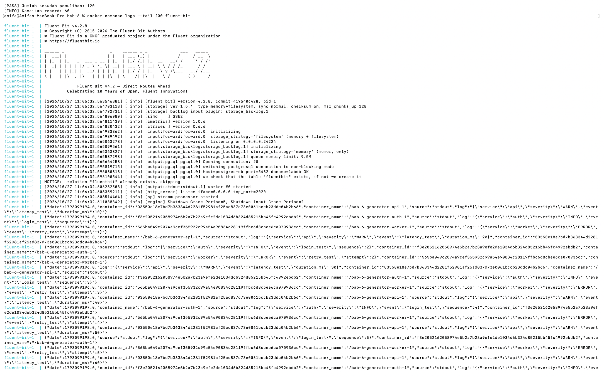

*Gambar 23. Verifikasi port PostgreSQL tidak dipublikasikan ke host*

### 3.15 Pembersihan Lingkungan (Cleanup)

Setelah seluruh pengujian selesai, resource praktikum dapat dibersihkan menggunakan Docker Compose.

Perintah berikut digunakan untuk menghapus container dan network, tetapi tetap mempertahankan named volume:

```bash
docker compose down --remove-orphans
```

Apabila seluruh data praktikum sudah tidak diperlukan, container, network, dan volume dapat dihapus menggunakan perintah:

```bash
docker compose down --volumes --remove-orphans
```

Perintah dengan opsi `--volumes` bersifat destruktif karena menghapus data PostgreSQL dan buffer Fluent Bit. Oleh karena itu, perintah tersebut hanya dijalankan setelah seluruh bukti pengujian disimpan.

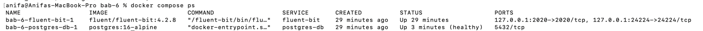

*Gambar 24. Hasil proses cleanup container dan network*


*Gambar 25. Dokumentasi akhir praktikum*

---

## 4. Verifikasi dan Skenario Pengujian

### 4.1 Checklist Verifikasi

Checklist berikut digunakan untuk memastikan setiap komponen pada praktikum Centralized Logging telah berjalan sesuai dengan tujuan pengujian.

**Checklist Pengujian Pipeline Log Generator:**

- [x] Struktur direktori dan konfigurasi lingkungan Bab 6 berhasil dibuat.
- [x] File `.env.example`, `.env`, dan `.gitignore` berhasil dikonfigurasi.
- [x] Docker Compose berhasil mendefinisikan service PostgreSQL, Fluent Bit, dan tiga log generator.
- [x] Initialization script berhasil membuat role, schema, tabel, indeks, dan view pada PostgreSQL.
- [x] Fluent Bit berhasil dikonfigurasi untuk menerima log melalui Forward Input pada port `24224`.
- [x] Ketiga container generator menghasilkan log dengan severity INFO, WARN, dan ERROR.
- [x] Validasi sintaks Bash, konfigurasi Docker Compose, dan konfigurasi Fluent Bit berhasil dilakukan.
- [x] Endpoint health dan metrics Fluent Bit berhasil diakses melalui port `2020`.
- [x] Record log berhasil disimpan ke PostgreSQL menggunakan tipe data JSONB.
- [x] Query analisis berhasil menampilkan jumlah event, distribusi tag, metadata container, severity ERROR, dan agregasi log per menit.
- [x] Pengujian filesystem buffering dan proses recovery setelah PostgreSQL kembali berjalan berhasil dilakukan.
- [x] Port PostgreSQL tidak dipublikasikan secara langsung ke host.
- [x] Resource praktikum berhasil dibersihkan setelah seluruh bukti pengujian disimpan.

### 4.2 Pemetaan Bukti Pengujian

Tabel berikut memetakan kriteria keberhasilan praktikum Centralized Logging dengan bukti gambar pada bagian langkah praktikum.

| Kriteria Pengujian | Bukti |
|---|---|
| Pembuatan struktur direktori kerja. | Gambar 1 |
| Konfigurasi file lingkungan dan permission `.env`. | Gambar 2–4 |
| Pembuatan file `.gitignore`. | Gambar 5 |
| Konfigurasi service dan logging driver Docker Compose. | Gambar 6–7 |
| Pembuatan initialization script PostgreSQL. | Gambar 8 |
| Konfigurasi Fluent Bit. | Gambar 9 |
| Pembuatan query analisis log. | Gambar 10 |
| Pembuatan script generator dan buffering. | Gambar 11–12 |
| Validasi sintaks Bash dan konfigurasi. | Gambar 13–15 |
| Menjalankan pipeline dan memeriksa status container. | Gambar 16–17 |
| Pemeriksaan monitoring Fluent Bit. | Gambar 18 |
| Verifikasi penyimpanan log dan view PostgreSQL. | Gambar 19–20 |
| Pengujian buffering dan retry. | Gambar 21–22 |
| Verifikasi pembatasan port PostgreSQL. | Gambar 23 |
| Pembersihan resource praktikum. | Gambar 24–25 |

Berdasarkan hasil pengujian tersebut, pipeline centralized logging berhasil dibangun menggunakan Docker Fluentd Logging Driver, Fluent Bit, dan PostgreSQL. Pengujian memverifikasi bahwa log dari container dapat diterima, diproses, disimpan, dan dianalisis melalui sistem penyimpanan terpusat.

---

## 5. Troubleshooting dan Analisis Hasil

### 5.1 Masalah yang Muncul dan Cara Diagnosis

Diagnosis dilakukan secara bertahap mulai dari pemeriksaan status container, pembacaan log service, pemeriksaan port dan jaringan, hingga validasi konfigurasi.

Volume tidak langsung dihapus sebelum dipastikan bahwa data di dalamnya tidak lagi diperlukan.

Beberapa perintah pemeriksaan yang dapat digunakan adalah:

```bash
docker compose ps

docker compose logs --tail 100

docker network ls

docker volume ls

docker compose config
```

Beberapa gejala yang mungkin ditemukan selama praktikum beserta pemeriksaan dan perbaikannya adalah sebagai berikut.

| Gejala | Pemeriksaan | Perbaikan |
|---|---|---|
| Log generator tidak dapat mengirim log ke Fluent Bit. | Periksa status Fluent Bit, port Forward `24224`, dan konfigurasi `fluentd-address`. | Pastikan Fluent Bit berjalan dan alamat collector mengarah ke `127.0.0.1:24224` sesuai konfigurasi Docker Engine. |
| Container generator gagal dijalankan. | Periksa `docker compose ps -a` dan log container terkait. | Perbaiki konfigurasi logging driver atau parameter environment yang menyebabkan container gagal berjalan. |
| Fluent Bit tidak dapat terhubung ke PostgreSQL. | Periksa `docker compose logs fluent-bit` dan status PostgreSQL. | Pastikan service PostgreSQL sehat, hostname `postgres-db` benar, dan kredensial ingest sesuai. |
| Record log tidak ditemukan pada PostgreSQL. | Periksa jumlah record pada tabel `logs.fluentbit`, tag, serta log Fluent Bit. | Pastikan input Forward menerima data dan output PostgreSQL berhasil melakukan pengiriman. |
| Initialization script tidak diterapkan. | Periksa apakah named volume `pg-data` sudah berisi data sebelumnya. | Jalankan migrasi SQL secara terpisah atau inisialisasi ulang hanya jika data lama memang boleh dihapus. |
| Pengiriman log tertunda ketika PostgreSQL berhenti. | Periksa log retry Fluent Bit dan kondisi filesystem buffer. | Pulihkan PostgreSQL, lalu pastikan Fluent Bit dapat melanjutkan pengiriman log. |

### 5.2 Risiko Keamanan dan Operasional

Selain memastikan pipeline berjalan, aspek keamanan dan operasional juga perlu diperhatikan.

| Risiko | Penjelasan |
|---|---|
| Kredensial tersimpan dalam konfigurasi | File `.env` berisi kredensial yang diteruskan sebagai environment variable. File tersebut harus dikecualikan dari Git dan aksesnya dibatasi. Untuk produksi, gunakan Docker Secrets atau secret manager. |
| Hak akses akun ingest terlalu luas | Akun `fluentbit_user` memperoleh hak yang diperlukan plugin untuk melakukan ingest dan bootstrap tabel. Pada lingkungan produksi, hak pembuatan schema atau tabel sebaiknya dipisahkan dari akun ingest. |
| Log memuat data sensitif | Password, token, cookie, secret, dan data pribadi yang tercatat dapat menyebabkan kebocoran informasi. Terapkan minimisasi data dan redaksi sebelum log disimpan. |
| Buffer memenuhi kapasitas penyimpanan | Gangguan backend yang berlangsung lama dapat membuat backlog bertambah hingga batas buffer tercapai. Pantau kapasitas disk dan tetapkan kebijakan penanganan backlog. |
| Duplikasi atau kehilangan event | Mekanisme retry tidak menjamin exactly-once. Event dapat terduplikasi atau hilang ketika buffer penuh maupun proses berhenti secara paksa. |
| Retensi log tidak dikelola | Penyimpanan tanpa batas meningkatkan kebutuhan storage dan risiko privasi. Tentukan masa retensi sesuai kebutuhan operasional dan audit. |
| PostgreSQL terekspos ke jaringan host | Published port yang tidak diperlukan dapat memperluas permukaan serangan. Pada praktikum ini, port PostgreSQL tidak dipublikasikan ke host dan komunikasi antarlayanan dilakukan melalui jaringan internal Docker. |
| Monitoring dianggap sebagai bukti kebenaran aplikasi | Status health dan metrics Fluent Bit menunjukkan kondisi pipeline, tetapi tidak otomatis membuktikan bahwa isi log lengkap atau seluruh fungsi aplikasi berjalan benar. Lakukan verifikasi record dan query secara terpisah. |

---

## 6. Evaluasi dan Latihan Mandiri

### 1. Mengapa centralized logging diperlukan pada lingkungan container?

Container memiliki karakteristik ephemeral, yaitu dapat dibuat, dihentikan, dan dihapus dalam waktu singkat. Apabila log hanya disimpan di dalam container, data log berisiko ikut hilang ketika container dihapus.

Centralized logging diperlukan untuk mengumpulkan log dari berbagai container ke dalam satu tempat penyimpanan terpusat. Dengan demikian, log tetap dapat diakses meskipun container sumber sudah tidak berjalan.

Selain itu, centralized logging memudahkan proses debugging, monitoring, analisis kesalahan, dan audit karena informasi aktivitas sistem dapat ditelusuri melalui satu sumber data.

### 2. Apa peran Docker Fluentd Logging Driver dan Fluent Bit dalam proses pengiriman log?

Docker Fluentd Logging Driver berfungsi meneruskan log yang dihasilkan container melalui stdout dan stderr menuju collector Fluent Bit.

Sementara itu, Fluent Bit bertugas menerima log, melakukan pemrosesan record, buffering, dan meneruskan data ke sistem penyimpanan, yaitu PostgreSQL.

Pada praktikum ini, alur pengiriman log adalah:

**Application → Docker Fluentd Logging Driver → Fluent Bit → PostgreSQL**

Docker Engine menjalankan proses pengiriman melalui logging driver. Oleh karena itu, alamat collector dikonfigurasi menggunakan `127.0.0.1:24224`, sesuai port Fluent Bit yang tersedia pada host.

### 3. Mengapa PostgreSQL menggunakan tipe data JSONB untuk menyimpan log?

JSONB digunakan karena data log memiliki struktur yang terdiri atas beberapa field, seperti timestamp, severity, service, event, dan informasi container.

Dengan menggunakan JSONB, PostgreSQL dapat menyimpan record log dalam format terstruktur dan mendukung pencarian berdasarkan field tertentu.

Selain itu, PostgreSQL menyediakan indeks GIN yang dapat membantu mempercepat pencarian dan analisis data JSONB.

Pada praktikum ini, record log disimpan pada tabel `logs.fluentbit` dengan tiga kolom utama, yaitu `tag`, `time`, dan `data`.

### 4. Apa fungsi filesystem buffering pada Fluent Bit ketika PostgreSQL tidak tersedia?

Filesystem buffering berfungsi menyimpan sementara data log pada media penyimpanan ketika tujuan pengiriman, yaitu PostgreSQL, sedang mengalami gangguan atau tidak dapat diakses.

Dengan mekanisme ini, Fluent Bit tetap dapat menerima log dan menahan data sementara pada buffer sebelum mencoba mengirimkannya kembali ketika PostgreSQL sudah pulih.

Pada praktikum ini, pengujian dilakukan dengan menghentikan PostgreSQL sementara, menjalankan log generator, kemudian menyalakan kembali PostgreSQL.

Setelah backend kembali tersedia, Fluent Bit melakukan retry untuk mengirimkan data yang sebelumnya tertahan.

Namun, filesystem buffering belum menjamin mekanisme exactly-once. Proses retry dapat menyebabkan duplikasi data, sedangkan buffer yang penuh atau penghentian proses secara paksa tetap berisiko menyebabkan kehilangan event.

### 5. Bagaimana cara memastikan sistem centralized logging berjalan dengan baik dan aman?

Sistem centralized logging perlu diperiksa melalui beberapa aspek, yaitu:

1. Memastikan container PostgreSQL dan Fluent Bit berjalan dengan baik melalui perintah `docker compose ps`.
2. Memeriksa endpoint health dan metrics Fluent Bit untuk mengetahui kondisi serta statistik pemrosesan log.
3. Memastikan record log berhasil masuk ke tabel `logs.fluentbit` pada PostgreSQL.
4. Menjalankan query untuk memeriksa jumlah event, distribusi severity, sumber container, dan waktu pencatatan.
5. Melakukan pengujian buffering dan recovery ketika PostgreSQL tidak tersedia sementara.
6. Membatasi akses jaringan PostgreSQL, mengelola kredensial dengan aman, serta menghindari pencatatan password, token, secret, dan informasi pribadi.

Dengan melakukan pemeriksaan tersebut, sistem dapat dipastikan mampu mengumpulkan, menyimpan, dan menyediakan data log untuk kebutuhan monitoring serta analisis ketika terjadi gangguan.

---

## 7. Kesimpulan

Berdasarkan praktikum Bab 6 mengenai Centralized Logging dengan Fluent Bit dan PostgreSQL, dapat disimpulkan beberapa hal berikut:

1. Centralized logging memungkinkan log dari container yang bersifat ephemeral dikumpulkan ke dalam penyimpanan terpusat sehingga dapat dicari, dianalisis, dan diaudit. Pada praktikum ini, pipeline dibangun menggunakan Docker Fluentd Logging Driver, Fluent Bit, dan PostgreSQL.

2. Docker Fluentd Logging Driver berperan dalam meneruskan log dari stdout dan stderr container menuju Fluent Bit. Selanjutnya, Fluent Bit menerima, memproses, dan mengirimkan record log ke PostgreSQL menggunakan format JSONB.

3. Penggunaan structured logging dan query SQL memudahkan proses analisis log berdasarkan tag, waktu, metadata container, dan severity. Dengan demikian, informasi aktivitas dari berbagai container dapat diperiksa secara lebih terstruktur.

4. Filesystem buffering pada Fluent Bit membantu mempertahankan data sementara ketika PostgreSQL tidak tersedia. Mekanisme retry memungkinkan proses pengiriman log dilanjutkan setelah backend kembali berjalan, meskipun belum menjamin pengiriman exactly-once.

5. Keamanan centralized logging perlu diperhatikan melalui pembatasan akses jaringan, pengelolaan kredensial, perlindungan data sensitif, serta penerapan kebijakan retensi log. PostgreSQL dapat digunakan sebagai backend pada lingkungan laboratorium, sedangkan lingkungan produksi memerlukan evaluasi lebih lanjut terhadap kapasitas, keamanan, dan kebutuhan penyimpanan.

Dengan demikian, praktikum ini memberikan pemahaman mengenai proses implementasi centralized logging, mulai dari pengumpulan log container, pemrosesan menggunakan Fluent Bit, penyimpanan pada PostgreSQL, hingga pengujian buffering dan recovery ketika terjadi gangguan pada sistem.
