# Laporan Praktikum Bab 7: Monitoring Infrastruktur dan Container

**Topik:** Prometheus, Node Exporter, cAdvisor, dan Grafana  
**Mata Kuliah:** Workshop DevOps  
**Dosen Pengampu:** Dr. Ferry Astika Saputra, S.T., M.Sc.  
**Disusun oleh:** Anifa Aulia Abdari (3126640053)  
**Institusi:** Politeknik Elektronika Negeri Surabaya  
**Departemen:** Teknik Informatika dan Komputer  
**Program Studi:** Teknik Informatika  
**Tahun:** 2026

---

> Dokumen Markdown ini disusun dari PDF laporan praktikum Bab 7. Gambar yang diekstrak dari PDF disimpan di folder `assets` dan ditautkan menggunakan relative path.

## Halaman PDF 2

### 1. Tujuan Pembelajaran dan Kompetensi Utama

Setelah menyelesaikan praktikum Bab 7, mahasiswa diharapkan mampu memahami dan

menerapkan konsep monitoring resource pada infrastruktur dan container menggunakan

Prometheus, cAdvisor, Node Exporter, dan Grafana. Adapun tujuan pembelajaran dan

kompetensi utama yang ingin dicapai adalah sebagai berikut:

1.​ Membedakan konsep monitoring metrics dan logging events dalam proses

pemantauan sistem.

2.​ Menjalankan Prometheus sebagai metrics scraper dan time-series database untuk

mengumpulkan serta menyimpan data monitoring.

3.​ Mengumpulkan metrik penggunaan resource pada host menggunakan Node

Exporter dan metrik container menggunakan cAdvisor.

4.​ Membuat dashboard Grafana untuk memvisualisasikan penggunaan CPU, memori,

disk, jaringan, dan resource container.

5.​ Mengintegrasikan data log PostgreSQL dari praktikum Bab 6 ke dalam Grafana

untuk mendukung analisis monitoring dan troubleshooting.

6.​ Memahami penggunaan PromQL untuk melakukan pencarian, agregasi, dan

analisis data metrik.

7.​ Memahami perbedaan jenis metrik, seperti Counter, Gauge, Histogram, dan

Summary, serta penggunaannya dalam pemantauan sistem.

8.​ Memahami konsep alerting, cardinality, dan keamanan endpoint monitoring dalam

pengelolaan infrastruktur.

9.​ Menganalisis kondisi sistem berdasarkan metrik dan log untuk mendukung proses

troubleshooting serta pengambilan keputusan operasional.

### 2. Konsep Inti dan Landasan Teori

### 2.1 Monitoring dan Logging

Monitoring merupakan proses pemantauan kondisi sistem melalui pengumpulan

data metrik (metrics) yang disajikan dalam bentuk angka dan deret waktu (time-series).

Monitoring digunakan untuk mengetahui kondisi dan perubahan performa sistem, seperti

penggunaan CPU, memori, disk, jaringan, serta aktivitas container.

Sementara itu, logging merupakan proses pencatatan kejadian (events) dan pesan

detail yang dihasilkan oleh aplikasi maupun infrastruktur. Logging membantu menjelaskan

alasan terjadinya suatu kondisi atau permasalahan pada sistem.

Keduanya memiliki fungsi yang saling melengkapi. Monitoring membantu

mengidentifikasi gejala atau perubahan kondisi sistem, sedangkan logging memberikan

informasi lebih terperinci mengenai kejadian yang menyebabkan kondisi tersebut.

### 2.2 Prometheus

Prometheus merupakan sistem monitoring yang berfungsi mengumpulkan,

menyimpan, dan menganalisis data metrik dalam format time-series. Prometheus

menggunakan pendekatan pull-based monitoring, yaitu mengambil data secara berkala dari

endpoint metrik yang tersedia pada setiap target melalui proses yang disebut scraping.

---

## Halaman PDF 3

Data yang dikumpulkan disimpan bersama timestamp dan label sehingga dapat dianalisis

berdasarkan waktu maupun karakteristik tertentu. Prometheus juga menyediakan PromQL

(Prometheus Query Language) untuk melakukan pencarian, agregasi, dan pengolahan data

metrik. Dalam praktikum ini, Prometheus berperan sebagai komponen utama yang

mengumpulkan metrik dari Node Exporter dan cAdvisor.

### 2.3 Node Exporter dan cAdvisor

Node Exporter dan cAdvisor merupakan komponen yang digunakan untuk menyediakan

data metrik dari sumber yang berbeda.

-​

Node Exporter merupakan exporter yang digunakan untuk mengumpulkan metrik

pada tingkat host atau sistem operasi, seperti penggunaan CPU, memori, disk, dan

jaringan.

-​

cAdvisor merupakan komponen yang digunakan untuk mengumpulkan metrik

penggunaan resource pada tingkat container, seperti penggunaan CPU dan memori

container.

Keduanya memberikan sudut pandang monitoring yang berbeda. Node Exporter digunakan

untuk mengetahui kondisi infrastruktur host, sedangkan cAdvisor digunakan untuk

memantau penggunaan resource oleh masing-masing container.

### 2.4 Grafana

Grafana merupakan platform visualisasi dan analisis data yang digunakan untuk

menyajikan informasi monitoring dalam bentuk dashboard. Grafana dapat terhubung

dengan berbagai sumber data (data source), termasuk Prometheus dan PostgreSQL. Dalam

praktikum ini, Grafana digunakan untuk menampilkan data metrik yang dikumpulkan oleh

Prometheus, seperti penggunaan CPU, memori, disk, jaringan, dan resource container.

Selain itu, Grafana dapat digunakan untuk membaca data log PostgreSQL dari praktikum

Bab 6 sehingga informasi metrik dan log dapat dianalisis melalui satu platform. Grafana

berfungsi sebagai media visualisasi dan tidak menjadi penyimpanan utama metrik

Prometheus.

### 2.5 PromQL dan Jenis Metric

PromQL merupakan bahasa query yang digunakan untuk mengambil dan mengolah

data metrik dari Prometheus. PromQL menyediakan fungsi agregasi dan perhitungan

temporal, seperti rate, avg, dan sum. Dalam monitoring, terdapat beberapa jenis metrik

yang memiliki karakteristik dan kegunaan berbeda :

Jenis Metric

Penjelasan

Contoh Penggunaan

Counter

Nilai yang hanya bertambah dan dapat

di-reset ketika proses dimulai ulang.

Jumlah request, error, dan

total byte.

---

## Halaman PDF 4

Gauge

Nilai yang dapat meningkat maupun

menurun.

Penggunaan memori,

panjang antrean, dan

jumlah koneksi.

Histogram

Mengelompokkan hasil pengamatan ke

dalam beberapa bucket.​

Pengukuran distribusi

latency.

Summary

Menghitung nilai quantile berdasarkan

pengamatan pada sisi client.​

Analisis distribusi waktu

respons.

Salah satu fungsi penting dalam PromQL adalah rate(), yang digunakan untuk menghitung

laju perubahan nilai counter dalam rentang waktu tertentu. Contohnya, rate digunakan

untuk menganalisis laju perubahan penggunaan waktu CPU dalam periode lima menit.

### 2.6 Resource Monitoring

Resource monitoring merupakan proses pemantauan penggunaan sumber daya sistem

untuk mengetahui kondisi performa dan kapasitas infrastruktur. Beberapa metrik yang

perlu diperhatikan antara lain:

a.​ CPU Usage: Menggambarkan tingkat penggunaan prosesor oleh sistem atau

container.

b.​ Memory Usage: Menggambarkan penggunaan memori oleh sistem atau container.

c.​ Disk Usage: Menunjukkan kapasitas penyimpanan yang telah digunakan maupun

yang masih tersedia.

d.​ Network Usage: Menggambarkan aktivitas lalu lintas jaringan.

e.​ CPU Throttling: Menunjukkan kondisi ketika penggunaan CPU dibatasi oleh

konfigurasi limit resource.

f.​ I/O Latency: Menggambarkan waktu yang dibutuhkan dalam proses input dan

output.

Analisis resource perlu memperhatikan konteks penggunaannya. Sebagai contoh,

penggunaan CPU yang tinggi tidak selalu menunjukkan adanya masalah karena dapat

terjadi akibat aktivitas pemrosesan yang normal. Oleh karena itu, metrik perlu dianalisis

bersama indikator lainnya.

### 2.7 Golden Signals, SLI, dan SLO

Dalam monitoring layanan, terdapat empat indikator utama yang dikenal sebagai Golden

Signals, yaitu:

1.​ Waktu yang dibutuhkan sistem untuk memproses suatu permintaan.

2.​ Traffic: Jumlah permintaan atau aktivitas yang diterima oleh sistem.

3.​ Errors: Jumlah atau persentase permintaan yang mengalami kegagalan.

4.​ Saturation: Tingkat penggunaan atau keterbatasan kapasitas resource sistem.

Selain Golden Signals, terdapat konsep Service Level Indicator (SLI) dan Service Level

Objective (SLO). SLI merupakan ukuran yang digunakan untuk menilai kualitas layanan,

---

## Halaman PDF 5

sedangkan SLO merupakan target tingkat layanan yang ingin dicapai dalam periode

tertentu. Keduanya dapat digunakan sebagai dasar dalam menentukan kebutuhan

monitoring dan alerting.

### 2.8 Scraping, Service Discovery, dan Keamanan Monitoring

Prometheus menggunakan mekanisme scraping untuk mengambil data metrik dari

endpoint setiap target secara berkala. Konfigurasi target dan interval pengambilan data

ditentukan melalui file konfigurasi Prometheus. Dalam lingkungan Docker Compose,

Prometheus dapat mengakses service lain menggunakan nama service melalui DNS

internal jaringan Docker. Dengan demikian, endpoint metrik tidak harus dipublikasikan ke

host untuk dapat diakses oleh Prometheus. Namun, endpoint monitoring dapat

menampilkan informasi seperti versi aplikasi, nama host, pola beban, dan identifier

tertentu. Oleh karena itu, akses terhadap endpoint metrik perlu dibatasi menggunakan

konfigurasi jaringan, autentikasi, TLS, atau proxy sesuai kebutuhan keamanan.

### 2.9 Alerting dan Kualitas Monitoring

Alerting merupakan mekanisme pemberian peringatan ketika kondisi sistem

memenuhi kriteria tertentu. Alert digunakan untuk membantu administrator mengetahui

kondisi yang berpotensi mengganggu ketersediaan maupun performa sistem. Alert yang

baik harus bersifat actionable, yaitu memberikan informasi yang jelas mengenai dampak,

tingkat urgensi, konteks permasalahan, serta langkah awal yang dapat dilakukan.

Salah satu konfigurasi yang dapat digunakan adalah parameter for, yaitu durasi

ketika suatu kondisi harus terus terpenuhi sebelum alert berubah menjadi aktif. Pengaturan

ini membantu mengurangi peringatan akibat lonjakan metrik yang hanya terjadi sesaat.

Pengujian alert dapat dilakukan melalui simulasi kegagalan service, pemberian beban

terkontrol, atau perubahan batas resource. Keberhasilan monitoring tidak hanya dilihat dari

keberadaan aturan alert, tetapi juga dari perubahan status alert dan pemulihan sistem

setelah kondisi gangguan berakhir.

### 2.10 Cardinality dan Time-Series Database

Prometheus menyimpan data metrik dalam bentuk time-series. Setiap time series

dibentuk berdasarkan nama metrik dan kombinasi label yang dimilikinya. Label digunakan

untuk mengelompokkan dan membedakan data metrik berdasarkan karakteristik tertentu,

seperti service, instance, method, status, dan environment. Namun, penggunaan label

dengan nilai yang terlalu beragam dapat menyebabkan high cardinality. Contohnya adalah

penggunaan user ID, request ID, UUID, atau pesan error sebagai label metrik. Cardinality

yang tinggi dapat meningkatkan kebutuhan memori dan storage serta membuat proses

query menjadi lebih berat. Oleh karena itu, penggunaan label perlu dibatasi pada dimensi

yang relevan untuk kebutuhan monitoring. Informasi yang memiliki variasi sangat tinggi

lebih tepat disimpan dalam log atau trace.

### 3. Langkah Praktikum

---

## Halaman PDF 6

### 3.1 Mempersiapkan Direktori

Gambar 1. Hasil Pembuatan Struktur Direktori Praktikum Bab 7

### 3.2 Membuat file .env.example

File .env.example merupakan template konfigurasi environment yang digunakan untuk

menyimpan daftar variabel lingkungan (environment variables) yang dibutuhkan oleh

layanan Grafana dan integrasi PostgreSQL. File ini memisahkan konfigurasi kredensial

dari konfigurasi utama aplikasi sehingga nilai yang digunakan dapat disesuaikan tanpa

mengubah file konfigurasi lainnya.

Gambar 2. Isi file nano .env.example

Penjelasan Isi Konfigurasi :

●​ GRAFANA_ADMIN_USER

Menentukan username administrator Grafana.

●​ GRAFANA_ADMIN_PASSWORD

Menentukan password administrator Grafana.

●​ GRAFANA_DB_USER

Menentukan username khusus untuk

mengakses PostgreSQL dari Grafana.

●​ GRAFANA_DB_PASSWORD

Menentukan password akun PostgreSQL

tersebut.

●​ POSTGRES_DB

Menentukan nama database PostgreSQL yang

akan digunakan.

Perintah cp digunakan untuk menyalin template menjadi file .env yang akan digunakan

oleh Docker Compose. Selanjutnya, chmod 600 membatasi hak akses file agar hanya

pemilik file yang dapat membaca dan mengubahnya. Pembatasan ini diterapkan untuk

mengurangi risiko terbukanya informasi kredensial kepada pengguna lain.

**Gambar/ilustrasi pada halaman ini:**

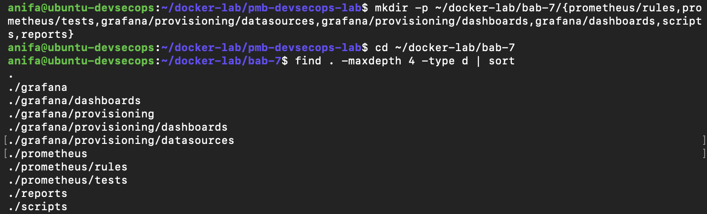

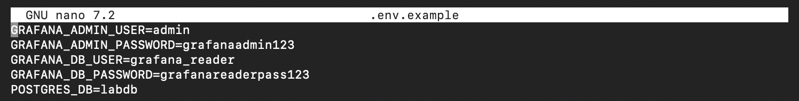

---

## Halaman PDF 7

### 3.3 Membuat File .gitignore

File .gitignore digunakan untuk menentukan file atau direktori yang tidak perlu

dimasukkan ke dalam repository Git. Pada praktikum ini, file tersebut digunakan untuk

melindungi credential dan evidence lokal agar tidak ikut terunggah ke repository.

Gambar 3. Isi file .gitignore

Penjelasan Isi File Konfigurasi :

●​ .env

Mengecualikan file yang menyimpan kredensial lokal.

●​ reports/*

Mengecualikan seluruh isi folder reports.

●​ !reports/.gitkeep

Tetap mengizinkan file .gitkeep masuk repository.

●​ *.log

Mengecualikan seluruh file berekstensi .log.

### 3.4 Membuat File compose.yaml

File compose.yaml digunakan untuk mendefinisikan layanan, image, konfigurasi jaringan,

volume, dan pengaturan keamanan yang dibutuhkan untuk menjalankan monitoring stack

Bab 7 menggunakan Docker Compose.

**Gambar/ilustrasi pada halaman ini:**

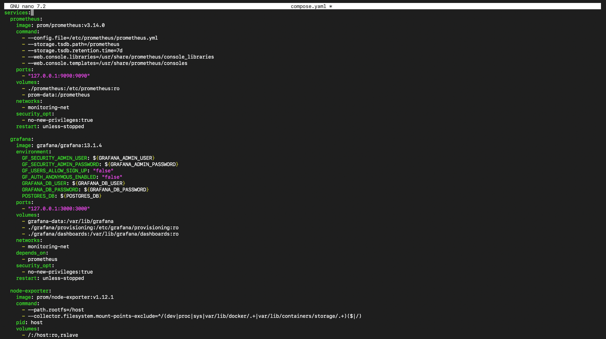

---

## Halaman PDF 8

Gambar 4. Konfigurasi Monitoring Stack pada File compose.yaml

Penjelasan Komponen Konfigurasi

●​ Prometheus

Mengumpulkan dan menyimpan metrik monitoring selama

retensi 7 hari.

●​ Grafana

Menampilkan dashboard dan mengelola visualisasi metrik.

●​ Node Exporter

Mengumpulkan metrik resource host Linux.

●​ cAdvisor

Mengumpulkan metrik penggunaan resource container.

●​ Load Generator

Menghasilkan beban CPU untuk pengujian monitoring.

●​ Volumes

Mempertahankan data Prometheus dan Grafana.

●​ Networks

Menghubungkan seluruh service melalui jaringan internal

Docker.

Konfigurasi Docker Compose mengintegrasikan Prometheus, Grafana, Node

Exporter, dan cAdvisor dalam satu lingkungan monitoring. Setiap service memiliki fungsi

masing-masing untuk mengumpulkan, menyimpan, dan memvisualisasikan metrik.

Penggunaan volume dan jaringan internal Docker mendukung penyimpanan data serta

komunikasi antarservice.

**Gambar/ilustrasi pada halaman ini:**

---

## Halaman PDF 9

### 3.5 Konfigurasi Prometheus

Mengatur interval pengambilan metrik (scraping), mengevaluasi rule, serta

menentukan target monitoring yang akan dipantau oleh Prometheus.

Buka file dengan command : nano prometheus/prometheus.yml

Gambar 5. Konfigurasi Target Monitoring pada File prometheus.yml

Penjelasan Konfigurasi :

●​ scrape_interval: 15s​ ​

Mengambil metrik setiap 15 detik.

●​ scrape_timeout: 10s​ ​

Batas waktu pengambilan metrik.

●​ evaluation_interval: 15s​

Mengevaluasi rule setiap 15 detik.

●​ external_labels​

​

Memberikan identitas lingkungan monitoring.

●​ rule_files​

​

​

Menentukan file recording dan alert rules.

●​ scrape_configs​

​

Mendefinisikan target yang dipantau.

●​ job_name​

​

​

Memberikan nama pada setiap pekerjaan monitoring.

●​ targets​​

​

​

Menentukan alamat service yang mengambil metrik.

Konfigurasi ini mengatur Prometheus untuk mengambil metrik setiap 15 detik dari

tiga target, yaitu Prometheus, Node Exporter, dan cAdvisor. Selain itu, Prometheus

memuat file recording rules dan alert rules sebagai dasar pengolahan metrik serta

pemantauan kondisi resource.

### 3.6 Konfigurasi Recording Rules

Membuat query metrik turunan yang dapat digunakan kembali oleh dashboard dan alert

tanpa harus menuliskan perhitungan PromQL secara berulang.

Buka file dengan command: nano prometheus/rules/recording-rules.yml

**Gambar/ilustrasi pada halaman ini:**

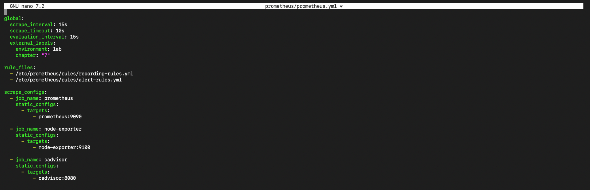

---

## Halaman PDF 10

Gambar 6. Konfigurasi Recording Rules pada File recording-rules.

Penjelasan Komponen :

●​ groups​​

​

Mengelompokkan recording rules.

●​ interval: 15s​ ​

Menjalankan evaluasi setiap 15 detik.

●​ record​ ​

​

Memberikan nama pada metrik hasil perhitungan.

●​ expr​

​

​

Berisi ekspresi PromQL untuk menghitung metrik.

●​ CPU Utilisation​

Menghitung persentase penggunaan CPU host.

●​ Memory Utilisation​

Menghitung persentase penggunaan memori host.

●​ Filesystem Available​ Menghitung rasio kapasitas disk yang tersedia.

●​ Container CPU​

Menghitung penggunaan CPU setiap container.

●​ Container Memory​

Menghitung penggunaan memori setiap container.

Recording rules digunakan untuk menyimpan hasil perhitungan metrik CPU,

memori, filesystem, dan resource container dalam bentuk time series baru. Dengan

demikian, query dapat digunakan kembali pada dashboard dan alert sehingga pengolahan

metrik menjadi lebih praktis.

### 3.7 Konfigurasi Alert Rules

Pada tahap ini, dilakukan pengaturan alert rules untuk membantu mendeteksi kondisi

tertentu pada sistem monitoring. Aturan ini digunakan untuk memberikan tanda ketika

target monitoring mengalami gangguan atau penggunaan resource melewati batas yang

telah ditentukan.

**Gambar/ilustrasi pada halaman ini:**

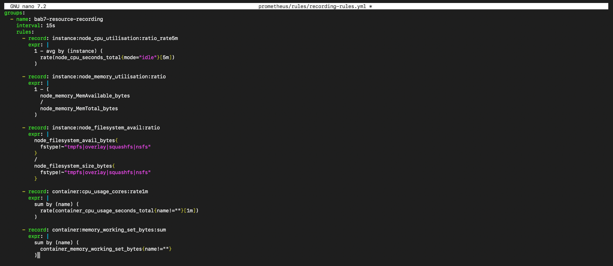

---

## Halaman PDF 11

Buka file dengan command : nano prometheus/rules/alert-rules.yml

Gambar 7. Konfigurasi Alert Rules pada File alert-rules.yml

Penjelasan Komponen Konfigurasi

●​ groups​

Mengelompokkan aturan alert berdasarkan kebutuhan monitoring.

●​ interval​ Menentukan frekuensi pemeriksaan aturan.

●​ alert​

Menetapkan nama untuk setiap kondisi peringatan.

●​ expr​

Menentukan kondisi menggunakan ekspresi PromQL.

●​ for​

Menentukan berapa lama kondisi harus terpenuhi sebelum alert aktif.

●​ labels​

Memberikan informasi kategori dan tingkat prioritas alert.

●​ annotations Menyediakan ringkasan dan keterangan mengenai kondisi alert.

Jenis alert yang digunakan:

●​ TargetDown, mendeteksi target monitoring yang tidak dapat diakses.

●​ HostHighCPU, mendeteksi penggunaan CPU host di atas 90%.

●​ HostLowAvailableMemory, mendeteksi penggunaan memori host di atas 90%.

●​ ContainerHighCPU, mendeteksi penggunaan CPU container di atas 0,30 core.

●​ PrometheusRuleEvaluationFailure, mendeteksi kegagalan proses evaluasi rule

Prometheus.

**Gambar/ilustrasi pada halaman ini:**

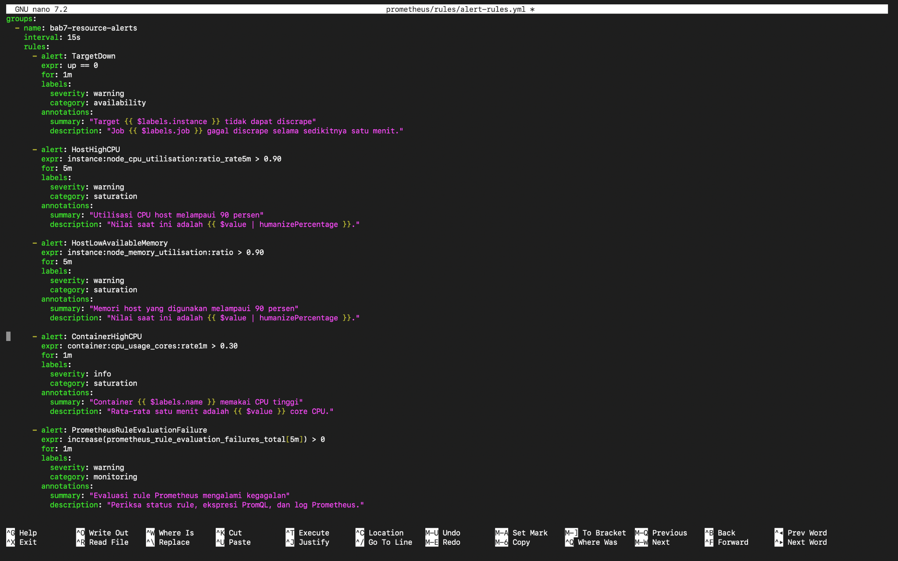

---

## Halaman PDF 12

Konfigurasi alert rules digunakan untuk memantau kondisi target dan penggunaan resource

sistem. Setiap aturan memiliki ambang batas serta durasi tertentu sebelum peringatan

diaktifkan. Dengan adanya aturan tersebut, gangguan maupun penggunaan resource yang

berlebihan dapat lebih mudah teridentifikasi.

### 3.8 Konfigurasi Unit Test Prometheus.

Tahap ini bertujuan untuk menguji apakah aturan alert yang telah dibuat sebelumnya

dapat berjalan sesuai kondisi yang diharapkan. Pengujian dilakukan menggunakan data

simulasi sehingga tidak perlu menunggu gangguan pada sistem yang sebenarnya.

Buka file dengan command : nano prometheus/tests/rules.test.yml

Gambar 8. Konfigurasi Unit Test pada File rules.test.yml

Penjelasan komponen konfigurasi

●​ rule_files​

​

Menentukan file alert rules yang akan diuji.

●​ evaluation_interval​

Mengatur interval evaluasi pengujian.

●​ tests​

​

​

Menampung skenario pengujian alert.

●​ input_series​

​

Menyediakan data metrik simulasi.

●​ values​ ​

​

Menggambarkan perubahan status target dari 1 menjadi 0.

●​ alert_rule_test​​

Menentukan aturan alert yang akan diperiksa.

●​ eval_time​

​

Menentukan waktu evaluasi pengujian.

●​ exp_alerts​

​

Menentukan hasil alert yang diharapkan.

Pengujian ini menyimulasikan kondisi ketika Node Exporter mengalami gangguan dengan

mengubah nilai metrik up dari 1 menjadi 0. Prometheus kemudian memeriksa apakah

kondisi tersebut memicu alert TargetDown sesuai aturan yang telah ditentukan

**Gambar/ilustrasi pada halaman ini:**

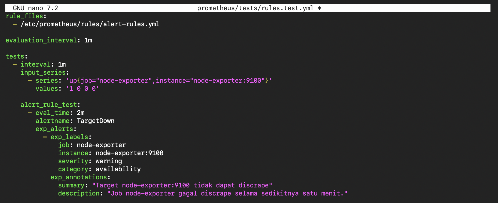

---

## Halaman PDF 13

### 3.9 Konfigurasi Data Source Grafana

Tahap ini mengatur sumber data yang akan digunakan Grafana untuk mengambil dan

menampilkan informasi monitoring dari Prometheus. Konfigurasi juga menyiapkan

koneksi PostgreSQL untuk integrasi log Bab 6.

Buka file dengan command : nano grafana/provisioning/datasources/datasources.yml

Gambar 9. Konfigurasi Data Source Grafana pada File datasources.yml

Penjelasan komponen konfigurasi

●​ apiVersion​

​

Menentukan versi konfigurasi provisioning Grafana.

●​ deleteDatasources​

Menghapus konfigurasi data source lama dengan nama yang

sama sebelum provisioning.

●​ datasources​

​

Mendefinisikan sumber data yang digunakan Grafana.

●​ name​ ​

​

Nama sumber data yang ditampilkan di Grafana.

●​ uid​

​

​

Identitas unik setiap data source.

●​ type​

​

​

Menentukan jenis sumber data, yaitu Prometheus atau

PostgreSQL.

●​ url​

​

​

Alamat service yang akan dihubungkan.

●​ isDefault​

​

Menetapkan Prometheus sebagai sumber data utama.

●​ secureJsonData​

Menyimpan konfigurasi password secara aman melalui

mekanisme Grafana.

**Gambar/ilustrasi pada halaman ini:**

---

## Halaman PDF 14

Konfigurasi ini menghubungkan Grafana dengan Prometheus sebagai sumber utama data

monitoring. Selain itu, tersedia konfigurasi PostgreSQL untuk mendukung visualisasi log

dari praktikum Bab 6 melalui akun khusus.

### 3.10 Konfigurasi Dashboard Provider Grafana.

Tahap ini mengatur bagaimana Grafana menemukan dan memuat dashboard secara

otomatis dari direktori yang telah ditentukan.

Buka file dengan command: nano grafana/provisioning/dashboards/provider.yml

Gambar 10. Konfigurasi Dashboard Provider pada File provider.yml

Penjelasan komponen konfigurasi

●​ apiVersion​

​

: Menentukan versi konfigurasi provisioning.

●​ providers​ ​

​

: Mendefinisikan sumber penyedia dashboard.

●​ name ​

​

​

: Memberikan nama provider dashboard.

●​ orgId​

​

​

: Menentukan organisasi Grafana yang digunakan.

●​ folder​

​

​

: Menentukan folder tempat dashboard ditampilkan.

●​ type: file​ ​

​

: Menunjukkan bahwa dashboard dimuat dari file lokal.

●​ disableDeletion​ ​

: Mengatur apakah dashboard dapat dihapus melalui

provisioning.

●​ allowUiUpdates​ ​

: Mengatur izin perubahan dashboard melalui antarmuka

Grafana.

●​ updateIntervalSeconds​

: Menentukan interval pemeriksaan perubahan file

dashboard.

●​ path​

​

​

: Menentukan direktori penyimpanan file dashboard.

Konfigurasi ini memungkinkan Grafana memuat dashboard secara otomatis dari direktori

yang telah ditentukan. Dashboard akan ditempatkan dalam folder DevSecOps Lab dan

diperiksa kembali setiap 30 detik untuk mendeteksi perubahan konfigurasi.

**Gambar/ilustrasi pada halaman ini:**

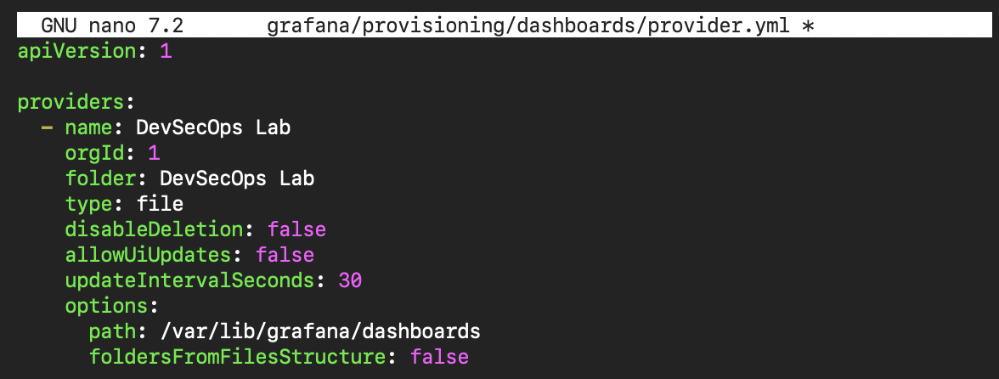

---

## Halaman PDF 15

### 3.11 Pembuatan Dashboard Monitoring Grafana

Pada tahap ini, dibuat dashboard yang menampilkan hasil pemantauan resource sistem.

Dashboard dirancang agar informasi penggunaan CPU, memori, dan kondisi target

monitoring dapat dilihat dalam satu tampilan.

Buka file dengan command : nano grafana/dashboards/bab-7-overview.json

**Gambar/ilustrasi pada halaman ini:**

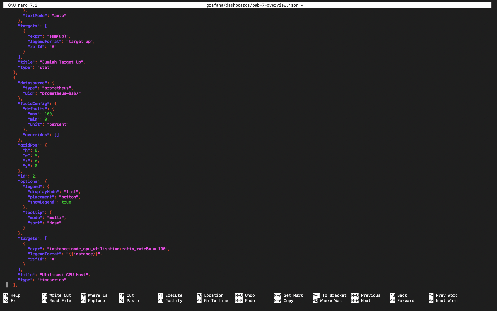

---

## Halaman PDF 16

Gambar 11. Konfigurasi Dashboard Monitoring pada File bab-7-overview.json

Penjelasan komponen konfigurasi

●​ annotations​

Menyediakan konfigurasi anotasi dashboard.

●​ editable​

Mengatur agar dashboard tidak dapat diedit melalui UI.

●​ panels​ ​

Menampung panel-panel visualisasi.

●​ datasource​

Menentukan sumber data dari Prometheus.

●​ targets​​

Berisi query PromQL untuk mengambil data.

●​ title​

​

Menentukan judul dashboard atau panel.

**Gambar/ilustrasi pada halaman ini:**

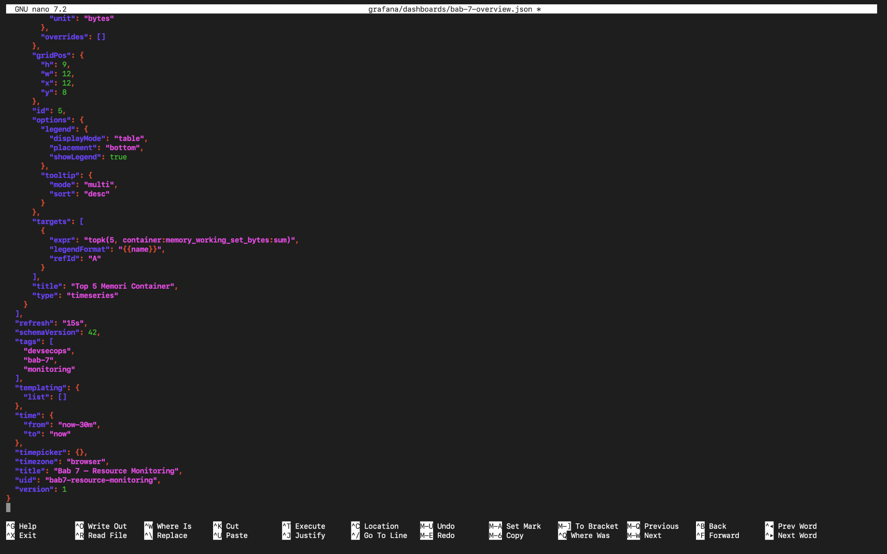

---

## Halaman PDF 17

●​ type​

​

Menentukan bentuk visualisasi, seperti stat atau timeseries.

●​ refresh​​

Mengatur pembaruan dashboard setiap 15 detik.

●​ time​

​

Menentukan rentang waktu data yang ditampilkan.

Panel yang tersedia pada dashboard :

1.​ Jumlah Target Up, menampilkan jumlah target yang aktif.

2.​ Utilisasi CPU Host, menampilkan penggunaan CPU host.

3.​ Utilisasi Memori Host, menampilkan penggunaan memori host.

4.​ Top 5 CPU Container, menampilkan lima container dengan penggunaan CPU

tertinggi.

5.​ Top 5 Memori Container, menampilkan lima container dengan penggunaan memori

tertinggi.

Dashboard ini menggabungkan informasi kondisi target, penggunaan CPU, dan memori

host maupun container dalam satu tampilan. Data diperoleh melalui query PromQL yang

terhubung dengan Prometheus, sehingga kondisi resource dapat dipantau secara berkala.

### 3.12 Pembuatan Script Verifikasi Monitoring Stack.

Pada tahap ini membuat script untuk memeriksa apakah Prometheus dan Grafana sudah

berjalan serta memastikan target monitoring dan konfigurasi Prometheus dapat diperiksa

dengan baik.

Buka file dengan command : nano scripts/verify-stack.sh

Gambar 12. Script Verifikasi Monitoring Stack pada File verify-stack.sh

**Gambar/ilustrasi pada halaman ini:**

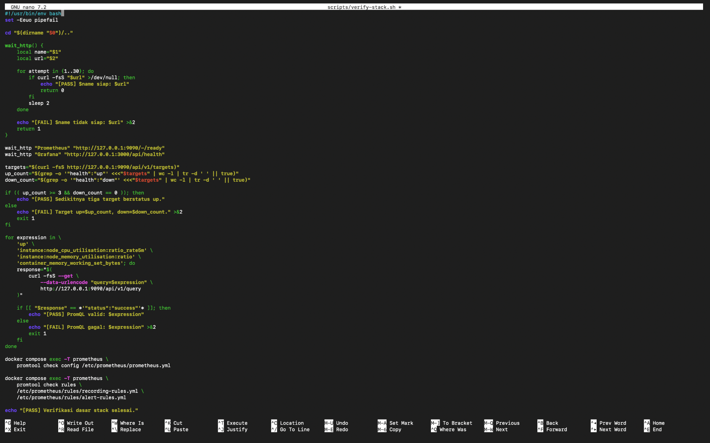

---

## Halaman PDF 18

Penjelasan komponen script :

●​ set -Eeuo pipefail​

Mengatur script agar berhenti ketika terjadi kesalahan.

●​ cd​

​

​

Mengarahkan lokasi kerja ke direktori utama Bab 7.

●​ wait_http()​

​

Memeriksa kesiapan layanan melalui HTTP.

●​ curl​

​

​

Mengirim permintaan untuk memeriksa endpoint.

●​ targets​​

​

Mengambil informasi status target monitoring.

●​ up_count dan

down_count​

​

Menghitung jumlah target yang aktif dan tidak aktif.

●​ for expression​​

Memeriksa beberapa query PromQL.

●​ promtool check

config​ ​

​

Memvalidasi konfigurasi Prometheus.

●​ promtool check rules​ Memvalidasi recording rules dan alert rules.

Script ini membantu melakukan pemeriksaan awal terhadap layanan monitoring, status

target, serta validitas konfigurasi Prometheus. Hasil pemeriksaan ditampilkan dalam

bentuk status PASS atau FAIL sehingga kesalahan konfigurasi lebih mudah diketahui.

### 3.13 Pembuatan Script Integrasi Bab 6 (connect-bab6.sh).

Script ini digunakan untuk menghubungkan Grafana dengan PostgreSQL Bab 6

menggunakan akun khusus yang hanya memiliki hak akses membaca data (read-only).

**Gambar/ilustrasi pada halaman ini:**

---

## Halaman PDF 19

Gambar 13. Script Integrasi PostgreSQL Bab 6 pada File connect-bab6.sh

Penjelasan komponen script

●​ bab6_dir​

​

​

Menentukan lokasi direktori praktikum Bab 6.

●​ source .env​​

​

Membaca variabel konfigurasi dari file environment.

●​ reader_user​​

​

Menentukan akun khusus untuk Grafana.

●​ db_container​

​

Mengambil identitas container PostgreSQL Bab 6.

●​ docker network connect​

Menghubungkan container database ke jaringan Bab 7.

●​ CREATE ROLE​

​

Membuat akun database khusus.

●​ GRANT SELECT​ ​

Memberikan izin membaca data pada tabel log.

●​ docker compose restart

●​ grafana​

​

​

Memulai ulang Grafana setelah konfigurasi integrasi.

Script ini mengatur koneksi antara Grafana dan PostgreSQL Bab 6 melalui jaringan

internal Docker. Penggunaan akun read-only membatasi akses Grafana agar hanya dapat

membaca data log tanpa mengubah isi database.

**Gambar/ilustrasi pada halaman ini:**

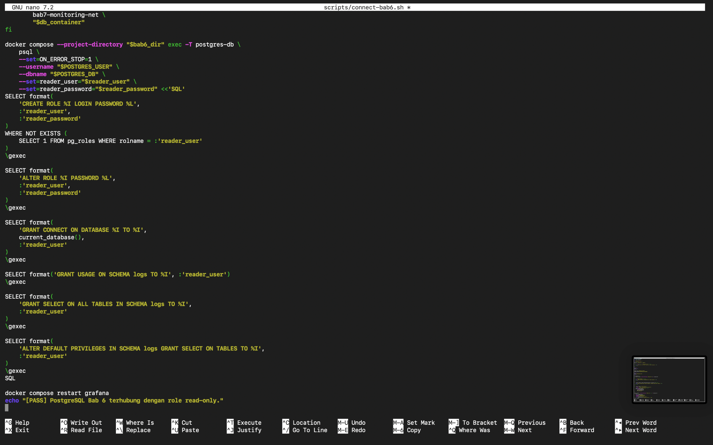

---

## Halaman PDF 20

### 3.14 Validasi Script dan Konfigurasi Monitoring

a.​ Pemberian izin eksekusi script

Gambar 14. Pemberian Izin Eksekusi pada Script Verifikasi dan Integrasi.

Perintah chmod +x digunakan untuk memberikan izin eksekusi pada kedua file

script. Dengan demikian, script dapat dijalankan secara langsung melalui terminal

tanpa harus memanggil interpreter Bash secara manual.

b.​ Pemeriksaan sintaks script Bash

Gambar 15. Pemeriksaan Sintaks Script Bash

Perintah bash -n digunakan untuk memeriksa struktur dan sintaks pada script Bash

tanpa menjalankan instruksi di dalamnya. Pada tahap ini, kedua script berhasil

diperiksa karena tidak ditemukan pesan kesalahan.

c.​ Validasi konfigurasi Docker Compose

Gambar 16. Validasi Konfigurasi Docker Compose.

Perintah ini digunakan untuk memeriksa konfigurasi Docker Compose, termasuk

struktur YAML dan variabel lingkungan yang digunakan. Tidak munculnya pesan

kesalahan menunjukkan bahwa konfigurasi dapat diproses dengan baik oleh Docker

Compose.

d.​ Validasi file JSON dashboard

Gambar 17. Validasi File JSON Dashboard Grafana.

Perintah tersebut digunakan untuk memastikan file JSON dashboard Grafana

memiliki format yang valid. Penggunaan >/dev/null membuat hasil keluaran tidak

ditampilkan, sehingga terminal hanya menampilkan pesan apabila ditemukan

kesalahan.

**Gambar/ilustrasi pada halaman ini:**

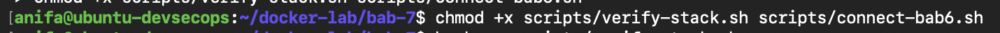

---

## Halaman PDF 21

e.​ Validasi konfigurasi Prometheus

Gambar 18. Validasi Konfigurasi Prometheus dan Rules.

Perintah ini menjalankan promtool untuk memeriksa konfigurasi utama Prometheus

beserta file rule yang terhubung dengannya.

Berdasarkan hasil pemeriksaan, diperoleh informasi:

●​ 2 rule files found: Prometheus berhasil menemukan dua file rule yang telah

dikonfigurasi.

●​ 5 rules found pada recording rules: terdapat lima aturan pencatatan metrik

yang berhasil diperiksa.

●​ 5 rules found pada alert rules: terdapat lima aturan peringatan yang berhasil

diperiksa.

●​ SUCCESS: Konfigurasi Prometheus dan kedua file rule berhasil melewati

pemeriksaan sintaks.

f.​ Pengujian Prometheus Rules

Gambar 19. Pengujian Unit Alert Prometheus.

Perintah tersebut digunakan untuk menjalankan pengujian terhadap aturan

alert yang telah dibuat menggunakan fitur promtool test rules. Pengujian dilakukan

berdasarkan skenario simulasi yang tersimpan pada file rules.test.yml, yaitu kondisi

ketika target Node Exporter mengalami gangguan.

Berdasarkan hasil pengujian, muncul status SUCCESS yang menunjukkan

bahwa aturan alert berhasil melewati pengujian sesuai hasil yang diharapkan.

**Gambar/ilustrasi pada halaman ini:**

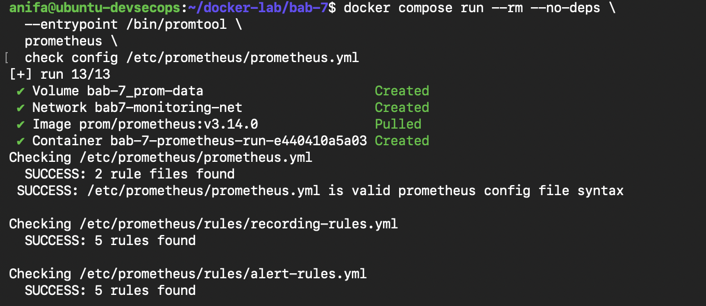

---

## Halaman PDF 22

Dengan demikian, konfigurasi alert TargetDown dapat dinyatakan berhasil diuji

melalui skenario tersebut.

### 3.15 Menjalankan Stack Monitoring

Gambar 20. Hasil Pengunduhan Image Monitoring Stack.

Perintah ini mengunduh image Prometheus, Grafana, Node Exporter, cAdvisor, dan

Alpine yang dibutuhkan untuk menjalankan monitoring stack.

Gambar 21. Hasil Menjalankan Monitoring Stack.

Perintah docker compose up -d berhasil menjalankan service monitoring di

latar belakang.

Gambar 22. Hasil Pemeriksaan Status Container Monitoring Stack

Seluruh service utama menunjukkan status Up dan cAdvisor berstatus healthy.

**Gambar/ilustrasi pada halaman ini:**

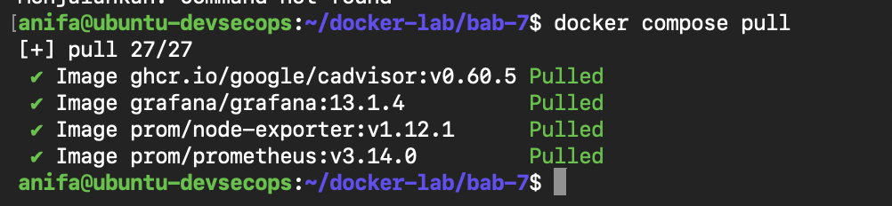

---

## Halaman PDF 23

Gambar 23. Hasil Verifikasi Monitoring Stack.

Script verifikasi menunjukkan status PASS pada kesiapan layanan, status target, query

PromQL, serta validasi konfigurasi dan rules.

### 3.16 Query PromQL Dasar

​

Gambar 24. Hasil Pengujian Query PromQL Dasar.

Query PromQL berhasil mengambil metrik status target, penggunaan CPU dan memori

host, serta penggunaan CPU dan memori container.

**Gambar/ilustrasi pada halaman ini:**

---

## Halaman PDF 24

### 3.17 Pengujian beban (Load Testing)

Gambar 25. Hasil Pengujian Beban dan Alert ContainerHighCPU.

Load generator menghasilkan penggunaan CPU sekitar 0,498 core dan Prometheus

memicu alert ContainerHighCPU dengan status firing.

Gambar 26. Hasil Penghentian dan Penghapusan Load Generator.

Setelah pengujian selesai, container load generator dihentikan dan dihapus agar tidak terus

menggunakan resource sistem.

### 3.18 Pengujian alert TargetDown

Gambar 27. Hasil Pengujian Alert TargetDown

**Gambar/ilustrasi pada halaman ini:**

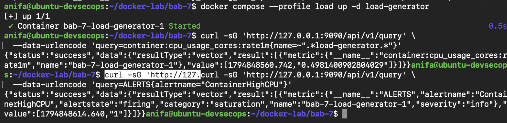

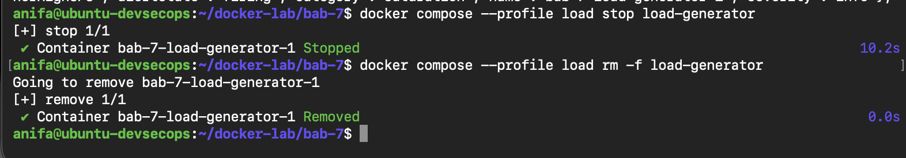

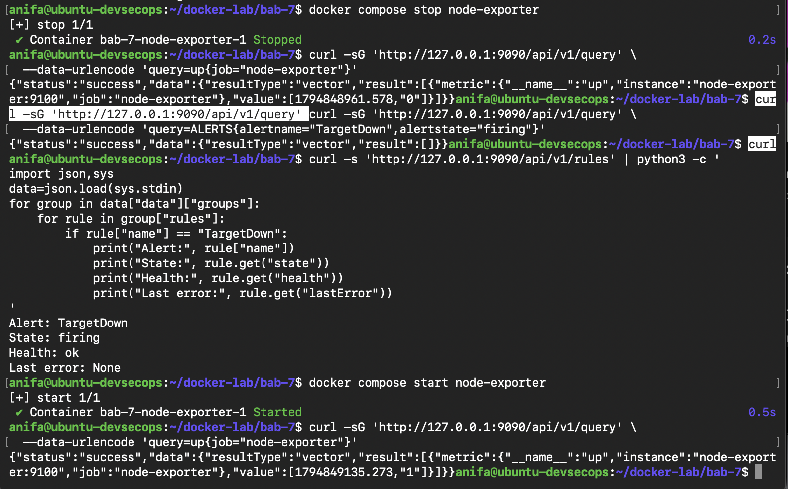

---

## Halaman PDF 25

Ketika Node Exporter dihentikan, metrik up berubah menjadi 0 dan alert TargetDown

terdeteksi firing. Setelah service dijalankan kembali, nilai up kembali menjadi 1.

.

### 3.19 Integrasi Grafana dengan database Bab 6 (opsional)

Gambar 28. Hasil Integrasi Grafana dengan PostgreSQL Bab 6.

Endpoint health Grafana menunjukkan database berstatus ok setelah proses integrasi

PostgreSQL dan restart service.

### 3.20 Verifikasi Grafana

Gambar 29. Hasil Verifikasi Kesehatan Grafana.

Endpoint health Grafana menunjukkan database berstatus ok setelah proses integrasi

PostgreSQL dan restart service.

### 3.21 Verifikasi dashboard Grafana

Gambar 30. Dashboard Resource Monitoring pada Grafana.

Dashboard menampilkan lima panel, yaitu jumlah target aktif, utilisasi CPU dan memori

host, serta lima container dengan penggunaan CPU dan memori tertinggi

**Gambar/ilustrasi pada halaman ini:**

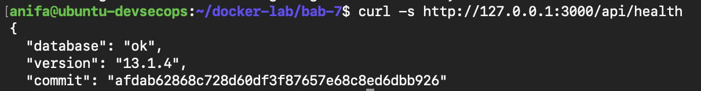

---

## Halaman PDF 26

### 4. Tabel Verifikasi PASS

Tabel berikut merangkum hasil pemeriksaan dan pengujian yang telah dilakukan selama

praktikum Bab 7.

No

Pemeriksaan

Hasil

1

Sintaks script Bash (verify-stack.sh dan

connect-bab6.sh)

PASS

2

Validasi konfigurasi Docker Compose

PASS

3

Validasi JSON dashboard Grafana

PASS

4

Validasi konfigurasi Prometheus dan 2 file rules

PASS

5

Validasi 5 recording rules dan 5 alert rules

PASS

6

Unit test Prometheus untuk skenario TargetDown

PASS

7

Kesiapan endpoint Prometheus dan Grafana

PASS

8

Tiga target monitoring berstatus up

PASS

**Gambar/ilustrasi pada halaman ini:**

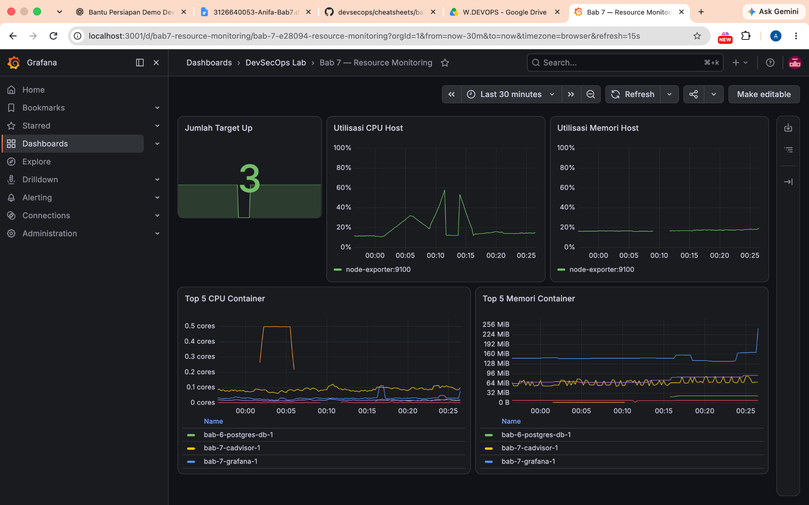

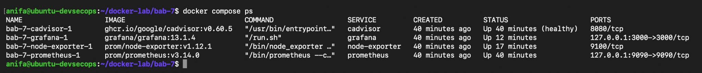

---

## Halaman PDF 27

9

Query PromQL untuk status target, CPU, dan memori

PASS

10

Load testing dan alert ContainerHighCPU

PASS

11

Pengujian TargetDown dan pemulihan Node Exporter

PASS

12

Integrasi PostgreSQL Bab 6 dengan role read-only

(opsional)

PASS

13

Dashboard Grafana menampilkan lima panel monitoring

PASS

14

Pemeriksaan akhir container monitoring

PASS

### 5. Troubleshooting

Beberapa kendala yang dapat muncul selama praktikum beserta langkah penanganannya

dirangkum pada tabel berikut.

Kendala

Kemungkinan Penyebab

Penanganan

Prometheus atau

Grafana tidak dapat

diakses

Container belum berjalan

atau service belum siap.

Periksa docker compose ps, lalu

jalankan docker compose up -d dan

periksa endpoint health.

SSH tunnel

menunjukkan

Address already in

use

Port lokal pada Mac telah

digunakan proses lain.

Gunakan port lokal lain, misalnya

`ssh -N -L 3001:127.0.0.1:3000`

anifa@172.16.85.128, lalu buka

localhost:3001.

Grafana

menampilkan

ERR_CONNECTIO

N_REFUSED

SSH tunnel belum aktif

atau sesi tunnel sudah

ditutup.

Jalankan SSH tunnel dari Terminal

Mac dan biarkan terminal tersebut

tetap terbuka.

Target Node

Exporter berstatus

down

Container Node Exporter

berhenti atau belum pulih.

Periksa docker compose ps,

jalankan docker compose start

node-exporter, lalu cek query

`up{job="node-exporter"}.`

Alert belum terlihat

pada query ALERTS

Alert mungkin masih

pending atau query hanya

memfilter status firing.

Periksa status rule melalui endpoint

/api/v1/rules dan tunggu durasi

evaluasi sesuai konfigurasi.

Script integrasi Bab

6 gagal menemukan

PostgreSQL

Container PostgreSQL

Bab 6 belum berjalan.

Jalankan docker compose up -d

postgres-db dari direktori Bab 6,

kemudian ulangi script integrasi

dari direktori Bab 7.

---

## Halaman PDF 28

Data dashboard

belum muncul

Rentang waktu dashboard

atau data source belum

sesuai.

Pastikan Prometheus menjadi data

`source aktif, target berstatus up, dan`

rentang waktu dashboard mencakup

waktu pengujian.

Troubleshooting dilakukan dengan memeriksa status container, endpoint layanan, status

target, dan konfigurasi data source. Pemeriksaan bertahap membantu menemukan sumber

kendala tanpa menghapus volume maupun data praktikum.

### 6. Latihan Mandiri

Latihan mandiri berikut digunakan untuk memperdalam pemahaman mengenai monitoring

host dan container menggunakan Prometheus serta Grafana.

a.​ Mengapa Prometheus menggunakan scrape model dan bukan hanya push

model?

Prometheus menggunakan scrape model karena Prometheus mengambil metrik

secara berkala langsung dari target yang dipantau. Dengan cara ini, Prometheus

dapat mengatur sendiri interval pengambilan data dan mengetahui apakah suatu

target masih aktif atau tidak melalui nilai up. Jika target tidak dapat dijangkau,

Prometheus dapat mendeteksinya dari kegagalan proses scraping. Model ini juga

membuat pengelolaan monitoring lebih terpusat karena Prometheus yang

menentukan kapan data dikumpulkan. Sementara itu, push model tetap dapat

digunakan untuk kebutuhan tertentu, tetapi bukan mekanisme utama Prometheus.

b.​ Apa dampak scrape_interval terlalu kecil terhadap storage dan network?

Jika scrape_interval terlalu kecil, Prometheus akan mengambil metrik lebih sering

sehingga jumlah sampel yang dikumpulkan semakin banyak. Akibatnya,

penggunaan storage untuk menyimpan data time-series meningkat dan kebutuhan

bandwidth jaringan juga bertambah. Proses scraping yang terlalu sering bahkan

dapat menambah beban pada Prometheus maupun exporter yang menyediakan

metrik. Oleh karena itu, interval scraping perlu disesuaikan dengan kebutuhan

monitoring agar data tetap cukup detail tanpa membebani sistem.

c.​ Mengapa rate diperlukan untuk counter seperti node_cpu_seconds_total?

node_cpu_seconds_total merupakan jenis counter yang nilainya terus bertambah

selama CPU bekerja. Nilai tersebut menunjukkan akumulasi waktu CPU, bukan

persentase penggunaan CPU secara langsung. Fungsi rate() digunakan untuk

menghitung seberapa cepat nilai counter bertambah dalam rentang waktu tertentu,

misalnya lima menit. Dengan begitu, kita dapat memperkirakan tingkat penggunaan

CPU berdasarkan perubahan nilai counter per detik. Hasilnya lebih mudah

digunakan untuk memantau aktivitas CPU dibandingkan hanya melihat nilai

counter mentah.

---

## Halaman PDF 29

d.​ Apa indikator awal container mengalami memory pressure?

Salah satu indikator awal container mengalami memory pressure adalah

meningkatnya penggunaan memori secara terus-menerus hingga mendekati batas

memori yang tersedia atau ditetapkan. Kondisi ini dapat terlihat melalui metrik

penggunaan memori container, seperti container_memory_working_set_bytes.

Selain itu, aktivitas penggunaan swap, peningkatan proses reclaim memori, hingga

kejadian Out of Memory (OOM) juga dapat menjadi tanda bahwa container

mengalami tekanan memori. Jika kondisi ini tidak ditangani, container berisiko

mengalami penurunan performa atau bahkan dihentikan oleh sistem.

e.​ Bagaimana menghubungkan alert metrics dengan pencarian log?

Alert metrics dapat dihubungkan dengan pencarian log menggunakan informasi

waktu kejadian dan identitas container atau service. Ketika Prometheus mendeteksi

kondisi tertentu dan menghasilkan alert, misalnya penggunaan CPU container

terlalu tinggi, kita dapat mencatat waktu kejadian serta nama container yang

terdampak. Selanjutnya, informasi tersebut digunakan untuk mencari log pada

Grafana Explore melalui sumber data PostgreSQL dari praktikum Bab 6. Dengan

membandingkan metrik dan log pada rentang waktu yang sama, kita dapat

mengetahui aktivitas atau error yang mungkin berkaitan dengan peningkatan

penggunaan resource. Namun, hubungan waktu antara keduanya belum tentu

membuktikan bahwa suatu log menjadi penyebab langsung kenaikan CPU.

---
