# LAPORAN PRAKTIKUM BAB 7
# MONITORING INFRASTRUKTUR DAN CONTAINER

**Topik:** Prometheus, Node Exporter, cAdvisor, dan Grafana  
**Mata Kuliah:** Workshop DevOps  
**Dosen Pengampu:** Dr. Ferry Astika Saputra, S.T., M.Sc.  
**Disusun oleh:** Anifa Aulia Abdari (3126640053)  
**Institusi:** Politeknik Elektronika Negeri Surabaya  
**Departemen:** Teknik Informatika dan Komputer  
**Program Studi:** Teknik Informatika  
**Tahun:** 2026

---

## 1. Tujuan Pembelajaran dan Kompetensi Utama

Setelah menyelesaikan praktikum Bab 7, mahasiswa diharapkan mampu memahami dan menerapkan konsep monitoring resource pada infrastruktur dan container menggunakan Prometheus, cAdvisor, Node Exporter, dan Grafana. Adapun tujuan pembelajaran dan kompetensi utama yang ingin dicapai adalah sebagai berikut:

1. Membedakan konsep monitoring metrics dan logging events dalam proses pemantauan sistem.
2. Menjalankan Prometheus sebagai metrics scraper dan time-series database untuk mengumpulkan serta menyimpan data monitoring.
3. Mengumpulkan metrik penggunaan resource pada host menggunakan Node Exporter dan metrik container menggunakan cAdvisor.
4. Membuat dashboard Grafana untuk memvisualisasikan penggunaan CPU, memori, disk, jaringan, dan resource container.
5. Mengintegrasikan data log PostgreSQL dari praktikum Bab 6 ke dalam Grafana untuk mendukung analisis monitoring dan troubleshooting.
6. Memahami penggunaan PromQL untuk melakukan pencarian, agregasi, dan analisis data metrik.
7. Memahami perbedaan jenis metrik, seperti Counter, Gauge, Histogram, dan Summary, serta penggunaannya dalam pemantauan sistem.
8. Memahami konsep alerting, cardinality, dan keamanan endpoint monitoring dalam pengelolaan infrastruktur.
9. Menganalisis kondisi sistem berdasarkan metrik dan log untuk mendukung proses troubleshooting serta pengambilan keputusan operasional.

## 2. Konsep Inti dan Landasan Teori

### 2.1 Monitoring dan Logging

Monitoring merupakan proses pemantauan kondisi sistem melalui pengumpulan data metrik (metrics) yang disajikan dalam bentuk angka dan deret waktu (time-series). Monitoring digunakan untuk mengetahui kondisi dan perubahan performa sistem, seperti penggunaan CPU, memori, disk, jaringan, serta aktivitas container. Sementara itu, logging merupakan proses pencatatan kejadian (events) dan pesan detail yang dihasilkan oleh aplikasi maupun infrastruktur. Logging membantu menjelaskan alasan terjadinya suatu kondisi atau permasalahan pada sistem. Keduanya memiliki fungsi yang saling melengkapi. Monitoring membantu mengidentifikasi gejala atau perubahan kondisi sistem, sedangkan logging memberikan informasi lebih terperinci mengenai kejadian yang menyebabkan kondisi tersebut.

### 2.2 Prometheus

Prometheus merupakan sistem monitoring yang berfungsi mengumpulkan, menyimpan, dan menganalisis data metrik dalam format time-series. Prometheus menggunakan pendekatan pull-based monitoring, yaitu mengambil data secara berkala dari endpoint metrik yang tersedia pada setiap target melalui proses yang disebut scraping. Data yang dikumpulkan disimpan bersama timestamp dan label sehingga dapat dianalisis berdasarkan waktu maupun karakteristik tertentu. Prometheus juga menyediakan PromQL (Prometheus Query Language) untuk melakukan pencarian, agregasi, dan pengolahan data metrik. Dalam praktikum ini, Prometheus berperan sebagai komponen utama yang mengumpulkan metrik dari Node Exporter dan cAdvisor.

### 2.3 Node Exporter dan cAdvisor

Node Exporter dan cAdvisor merupakan komponen yang digunakan untuk menyediakan data metrik dari sumber yang berbeda.

- **Node Exporter** merupakan exporter yang digunakan untuk mengumpulkan metrik pada tingkat host atau sistem operasi, seperti penggunaan CPU, memori, disk, dan jaringan.
- **cAdvisor** merupakan komponen yang digunakan untuk mengumpulkan metrik penggunaan resource pada tingkat container, seperti penggunaan CPU dan memori container.

Keduanya memberikan sudut pandang monitoring yang berbeda. Node Exporter digunakan untuk mengetahui kondisi infrastruktur host, sedangkan cAdvisor digunakan untuk memantau penggunaan resource oleh masing-masing container.

### 2.4 Grafana

Grafana merupakan platform visualisasi dan analisis data yang digunakan untuk menyajikan informasi monitoring dalam bentuk dashboard. Grafana dapat terhubung dengan berbagai sumber data (data source), termasuk Prometheus dan PostgreSQL. Dalam praktikum ini, Grafana digunakan untuk menampilkan data metrik yang dikumpulkan oleh Prometheus, seperti penggunaan CPU, memori, disk, jaringan, dan resource container. Selain itu, Grafana dapat digunakan untuk membaca data log PostgreSQL dari praktikum Bab 6 sehingga informasi metrik dan log dapat dianalisis melalui satu platform. Grafana berfungsi sebagai media visualisasi dan tidak menjadi penyimpanan utama metrik Prometheus.

### 2.5 PromQL dan Jenis Metric

PromQL merupakan bahasa query yang digunakan untuk mengambil dan mengolah data metrik dari Prometheus. PromQL menyediakan fungsi agregasi dan perhitungan temporal, seperti `rate()`, `avg()`, dan `sum()`.

Dalam monitoring, terdapat beberapa jenis metrik yang memiliki karakteristik dan kegunaan berbeda.

| Jenis Metric | Penjelasan | Contoh Penggunaan |
|---|---|---|
| Counter | Nilai yang hanya bertambah dan dapat di-reset ketika proses dimulai ulang. | Jumlah request, error, dan total byte. |
| Gauge | Nilai yang dapat meningkat maupun menurun. | Penggunaan memori, panjang antrean, dan jumlah koneksi. |
| Histogram | Mengelompokkan hasil pengamatan ke dalam beberapa bucket. | Pengukuran distribusi latency. |
| Summary | Menghitung nilai quantile berdasarkan pengamatan pada sisi client. | Analisis distribusi waktu respons. |

Salah satu fungsi penting dalam PromQL adalah `rate()`, yang digunakan untuk menghitung laju perubahan nilai counter dalam rentang waktu tertentu. Contohnya, `rate()` digunakan untuk menganalisis laju perubahan penggunaan waktu CPU dalam periode lima menit.

### 2.6 Resource Monitoring

Resource monitoring merupakan proses pemantauan penggunaan sumber daya sistem untuk mengetahui kondisi performa dan kapasitas infrastruktur.

Beberapa metrik yang perlu diperhatikan antara lain:

a. **CPU Usage:** Menggambarkan tingkat penggunaan prosesor oleh sistem atau container.

b. **Memory Usage:** Menggambarkan penggunaan memori oleh sistem atau container.

c. **Disk Usage:** Menunjukkan kapasitas penyimpanan yang telah digunakan maupun yang masih tersedia.

d. **Network Usage:** Menggambarkan aktivitas lalu lintas jaringan.

e. **CPU Throttling:** Menunjukkan kondisi ketika penggunaan CPU dibatasi oleh konfigurasi limit resource.

f. **I/O Latency:** Menggambarkan waktu yang dibutuhkan dalam proses input dan output.

Analisis resource perlu memperhatikan konteks penggunaannya. Sebagai contoh, penggunaan CPU yang tinggi tidak selalu menunjukkan adanya masalah karena dapat terjadi akibat aktivitas pemrosesan yang normal. Oleh karena itu, metrik perlu dianalisis bersama indikator lainnya.

### 2.7 Golden Signals, SLI, dan SLO

Dalam monitoring layanan, terdapat empat indikator utama yang dikenal sebagai Golden Signals, yaitu:

1. **Latency:** Waktu yang dibutuhkan sistem untuk memproses suatu permintaan.
2. **Traffic:** Jumlah permintaan atau aktivitas yang diterima oleh sistem.
3. **Errors:** Jumlah atau persentase permintaan yang mengalami kegagalan.
4. **Saturation:** Tingkat penggunaan atau keterbatasan kapasitas resource sistem.

Selain Golden Signals, terdapat konsep Service Level Indicator (SLI) dan Service Level Objective (SLO).

SLI merupakan ukuran yang digunakan untuk menilai kualitas layanan, sedangkan SLO merupakan target tingkat layanan yang ingin dicapai dalam periode tertentu. Keduanya dapat digunakan sebagai dasar dalam menentukan kebutuhan monitoring dan alerting.

### 2.8 Scraping, Service Discovery, dan Keamanan Monitoring

Prometheus menggunakan mekanisme scraping untuk mengambil data metrik dari endpoint setiap target secara berkala. Konfigurasi target dan interval pengambilan data ditentukan melalui file konfigurasi Prometheus. Dalam lingkungan Docker Compose, Prometheus dapat mengakses service lain menggunakan nama service melalui DNS internal jaringan Docker. Dengan demikian, endpoint metrik tidak harus dipublikasikan ke host untuk dapat diakses oleh Prometheus. Namun, endpoint monitoring dapat menampilkan informasi seperti versi aplikasi, nama host, pola beban, dan identifier tertentu. Oleh karena itu, akses terhadap endpoint metrik perlu dibatasi menggunakan konfigurasi jaringan, autentikasi, TLS, atau proxy sesuai kebutuhan keamanan.

### 2.9 Alerting dan Kualitas Monitoring

Alerting merupakan mekanisme pemberian peringatan ketika kondisi sistem memenuhi kriteria tertentu. Alert digunakan untuk membantu administrator mengetahui kondisi yang berpotensi mengganggu ketersediaan maupun performa sistem. Alert yang baik harus bersifat actionable, yaitu memberikan informasi yang jelas mengenai dampak, tingkat urgensi, konteks permasalahan, serta langkah awal yang dapat dilakukan. Salah satu konfigurasi yang dapat digunakan adalah parameter `for`, yaitu durasi ketika suatu kondisi harus terus terpenuhi sebelum alert berubah menjadi aktif. Pengaturan ini membantu mengurangi peringatan akibat lonjakan metrik yang hanya terjadi sesaat. Pengujian alert dapat dilakukan melalui simulasi kegagalan service, pemberian beban terkontrol, atau perubahan batas resource. Keberhasilan monitoring tidak hanya dilihat dari keberadaan aturan alert, tetapi juga dari perubahan status alert dan pemulihan sistem setelah kondisi gangguan berakhir.

### 2.10 Cardinality dan Time-Series Database

Prometheus menyimpan data metrik dalam bentuk time-series. Setiap time-series dibentuk berdasarkan nama metrik dan kombinasi label yang dimilikinya. Label digunakan untuk mengelompokkan dan membedakan data metrik berdasarkan karakteristik tertentu, seperti service, instance, method, status, dan environment. Namun, penggunaan label dengan nilai yang terlalu beragam dapat menyebabkan high cardinality. Contohnya adalah penggunaan user ID, request ID, UUID, atau pesan error sebagai label metrik. Cardinality yang tinggi dapat meningkatkan kebutuhan memori dan storage serta membuat proses query menjadi lebih berat. Oleh karena itu, penggunaan label perlu dibatasi pada dimensi yang relevan untuk kebutuhan monitoring. Informasi yang memiliki variasi sangat tinggi lebih tepat disimpan dalam log atau trace.

---

## 3. Langkah Praktikum

Praktikum Bab 7 dilakukan dengan membangun monitoring stack menggunakan Prometheus, Grafana, Node Exporter, dan cAdvisor. Proses praktikum mencakup persiapan direktori, konfigurasi service, pembuatan recording rules dan alert rules, konfigurasi data source Grafana, pembuatan dashboard, validasi, serta pengujian monitoring dan alert.

### 3.1 Mempersiapkan Direktori

Langkah pertama adalah mempersiapkan direktori kerja Bab 7 sebagai tempat penyimpanan konfigurasi dan file yang dibutuhkan oleh monitoring stack.

Direktori kerja digunakan untuk memisahkan file konfigurasi Prometheus, dashboard Grafana, provisioning, script, serta file pengujian.

**Gambar 1. Hasil Pembuatan Struktur Direktori Praktikum Bab 7**

<escape></escape>

### 3.2 Membuat File .env.example

File `.env.example` merupakan template konfigurasi environment yang digunakan untuk menyimpan daftar variabel lingkungan (environment variables) yang dibutuhkan oleh layanan Grafana dan integrasi PostgreSQL.

File ini memisahkan konfigurasi kredensial dari konfigurasi utama aplikasi sehingga nilai yang digunakan dapat disesuaikan tanpa mengubah file konfigurasi lainnya.


*Gambar 2. Isi file .env.example*

Beberapa variabel yang terdapat pada file tersebut adalah:

- **GRAFANA_ADMIN_USER:** Menentukan username administrator Grafana.
- **GRAFANA_ADMIN_PASSWORD:** Menentukan password administrator Grafana.
- **GRAFANA_DB_USER:** Menentukan username khusus untuk mengakses PostgreSQL dari Grafana.
- **GRAFANA_DB_PASSWORD:** Menentukan password akun PostgreSQL tersebut.
- **POSTGRES_DB:** Menentukan nama database PostgreSQL yang akan digunakan.

Perintah `cp` digunakan untuk menyalin template menjadi file `.env` yang akan digunakan oleh Docker Compose. Selanjutnya, `chmod 600` membatasi hak akses file agar hanya pemilik file yang dapat membaca dan mengubahnya.

Pembatasan ini diterapkan untuk mengurangi risiko terbukanya informasi kredensial kepada pengguna lain.


*Gambar 3. Proses penyalinan template konfigurasi menjadi file .env*

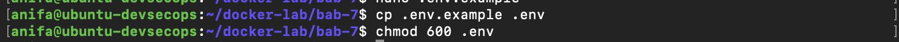

*Gambar 4. Pengaturan permission file .env*

### 3.3 Membuat File .gitignore

File `.gitignore` digunakan untuk menentukan file atau direktori yang tidak perlu dimasukkan ke dalam repository Git.

Pada praktikum ini, file tersebut digunakan untuk melindungi credential dan evidence lokal agar tidak ikut terunggah ke repository.

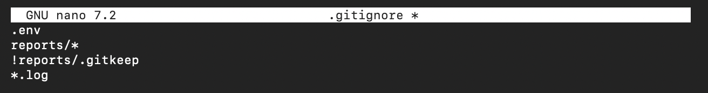

*Gambar 5. Isi file .gitignore*

Penjelasan isi file konfigurasi:

- `.env`: Mengecualikan file yang menyimpan kredensial lokal.
- `reports/*`: Mengecualikan seluruh isi folder reports.
- `!reports/.gitkeep`: Tetap mengizinkan file `.gitkeep` masuk repository.
- `*.log`: Mengecualikan seluruh file berekstensi `.log`.

### 3.4 Membuat File compose.yaml

File `compose.yaml` digunakan untuk mendefinisikan layanan, image, konfigurasi jaringan, volume, dan pengaturan keamanan yang dibutuhkan untuk menjalankan monitoring stack Bab 7 menggunakan Docker Compose.


*Gambar 6. Konfigurasi monitoring stack pada compose.yaml*

Monitoring stack yang dibangun terdiri atas beberapa komponen berikut:

| Komponen | Fungsi |
|---|---|
| Prometheus | Mengumpulkan dan menyimpan metrik monitoring selama retensi tujuh hari. |
| Grafana | Menampilkan dashboard dan mengelola visualisasi metrik. |
| Node Exporter | Mengumpulkan metrik resource host Linux. |
| cAdvisor | Mengumpulkan metrik penggunaan resource container. |
| Load Generator | Menghasilkan beban CPU untuk pengujian monitoring. |
| Volumes | Mempertahankan data Prometheus dan Grafana. |
| Networks | Menghubungkan seluruh service melalui jaringan internal Docker. |

Konfigurasi Docker Compose mengintegrasikan Prometheus, Grafana, Node Exporter, dan cAdvisor dalam satu lingkungan monitoring. Setiap service memiliki fungsi masing-masing untuk mengumpulkan, menyimpan, dan memvisualisasikan metrik.

Penggunaan volume dan jaringan internal Docker mendukung penyimpanan data serta komunikasi antarservice.

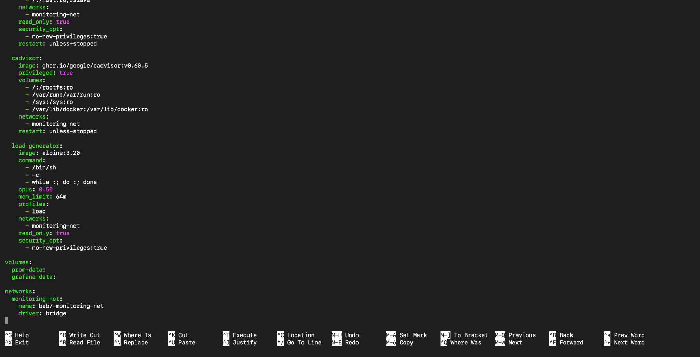

*Gambar 7. Konfigurasi lanjutan monitoring stack*

### 3.5 Konfigurasi Prometheus

Konfigurasi Prometheus dilakukan untuk mengatur interval pengambilan metrik (scraping), mengevaluasi rule, serta menentukan target monitoring yang akan dipantau.

File konfigurasi dibuka menggunakan perintah:

```bash
nano prometheus/prometheus.yml
```


*Gambar 8. Konfigurasi target monitoring pada prometheus.yml*

Penjelasan komponen konfigurasi:

- `scrape_interval: 15s`: Mengambil metrik setiap 15 detik.
- `scrape_timeout: 10s`: Menentukan batas waktu pengambilan metrik.
- `evaluation_interval: 15s`: Mengevaluasi rule setiap 15 detik.
- `external_labels`: Memberikan identitas lingkungan monitoring.
- `rule_files`: Menentukan file recording rules dan alert rules.
- `scrape_configs`: Mendefinisikan target yang dipantau.
- `job_name`: Memberikan nama pada setiap pekerjaan monitoring.
- `targets`: Menentukan alamat service yang mengambil metrik.

Konfigurasi ini mengatur Prometheus untuk mengambil metrik setiap 15 detik dari tiga target, yaitu Prometheus, Node Exporter, dan cAdvisor. Selain itu, Prometheus memuat file recording rules dan alert rules sebagai dasar pengolahan metrik serta pemantauan kondisi resource.

### 3.6 Konfigurasi Recording Rules

Recording rules digunakan untuk membuat query metrik turunan yang dapat digunakan kembali oleh dashboard dan alert tanpa harus menuliskan perhitungan PromQL secara berulang.

File konfigurasi dibuka menggunakan perintah:

```bash
nano prometheus/rules/recording-rules.yml
```


*Gambar 9. Konfigurasi recording rules*

Penjelasan komponen konfigurasi:

- `groups`: Mengelompokkan recording rules.
- `interval: 15s`: Menjalankan evaluasi setiap 15 detik.
- `record`: Memberikan nama pada metrik hasil perhitungan.
- `expr`: Berisi ekspresi PromQL untuk menghitung metrik.
- **CPU Utilisation:** Menghitung persentase penggunaan CPU host.
- **Memory Utilisation:** Menghitung persentase penggunaan memori host.
- **Filesystem Available:** Menghitung rasio kapasitas disk yang tersedia.
- **Container CPU:** Menghitung penggunaan CPU setiap container.
- **Container Memory:** Menghitung penggunaan memori setiap container.

Recording rules digunakan untuk menyimpan hasil perhitungan metrik CPU, memori, filesystem, dan resource container dalam bentuk time-series baru. Dengan demikian, query dapat digunakan kembali pada dashboard dan alert sehingga pengolahan metrik menjadi lebih praktis.

### 3.7 Konfigurasi Alert Rules

Pada tahap ini dilakukan pengaturan alert rules untuk membantu mendeteksi kondisi tertentu pada sistem monitoring.

Aturan ini digunakan untuk memberikan tanda ketika target monitoring mengalami gangguan atau penggunaan resource melewati batas yang telah ditentukan.

File konfigurasi dibuka menggunakan perintah:

```bash
nano prometheus/rules/alert-rules.yml
```


*Gambar 10. Konfigurasi alert rules*

Penjelasan komponen konfigurasi:

- `groups`: Mengelompokkan aturan alert berdasarkan kebutuhan monitoring.
- `interval`: Menentukan frekuensi pemeriksaan aturan.
- `alert`: Menetapkan nama untuk setiap kondisi peringatan.
- `expr`: Menentukan kondisi menggunakan ekspresi PromQL.
- `for`: Menentukan berapa lama kondisi harus terpenuhi sebelum alert aktif.
- `labels`: Memberikan informasi kategori dan tingkat prioritas alert.
- `annotations`: Menyediakan ringkasan dan keterangan mengenai kondisi alert.

Jenis alert yang digunakan:

1. **TargetDown:** Mendeteksi target monitoring yang tidak dapat diakses.
2. **HostHighCPU:** Mendeteksi penggunaan CPU host di atas 90%.
3. **HostLowAvailableMemory:** Mendeteksi penggunaan memori host di atas 90%.
4. **ContainerHighCPU:** Mendeteksi penggunaan CPU container di atas 0,30 core.
5. **PrometheusRuleEvaluationFailure:** Mendeteksi kegagalan proses evaluasi rule Prometheus.

Konfigurasi alert rules digunakan untuk memantau kondisi target dan penggunaan resource sistem. Setiap aturan memiliki ambang batas serta durasi tertentu sebelum peringatan diaktifkan.

Dengan adanya aturan tersebut, gangguan maupun penggunaan resource yang berlebihan dapat lebih mudah teridentifikasi.

### 3.8 Konfigurasi Unit Test Prometheus

Tahap ini bertujuan untuk menguji apakah aturan alert yang telah dibuat sebelumnya dapat berjalan sesuai kondisi yang diharapkan.

Pengujian dilakukan menggunakan data simulasi sehingga tidak perlu menunggu gangguan pada sistem yang sebenarnya.

File pengujian dibuka menggunakan perintah:

```bash
nano prometheus/tests/rules.test.yml
```


*Gambar 11. Konfigurasi unit test pada rules.test.yml*

Penjelasan komponen konfigurasi:

- `rule_files`: Menentukan file alert rules yang akan diuji.
- `evaluation_interval`: Mengatur interval evaluasi pengujian.
- `tests`: Menampung skenario pengujian alert.
- `input_series`: Menyediakan data metrik simulasi.
- `values`: Menggambarkan perubahan status target dari 1 menjadi 0.
- `alert_rule_test`: Menentukan aturan alert yang akan diperiksa.
- `eval_time`: Menentukan waktu evaluasi pengujian.
- `exp_alerts`: Menentukan hasil alert yang diharapkan.

Pengujian ini menyimulasikan kondisi ketika Node Exporter mengalami gangguan dengan mengubah nilai metrik `up` dari 1 menjadi 0. Prometheus kemudian memeriksa apakah kondisi tersebut memicu alert TargetDown sesuai aturan yang telah ditentukan.

### 3.9 Konfigurasi Data Source Grafana

Tahap ini mengatur sumber data yang akan digunakan Grafana untuk mengambil dan menampilkan informasi monitoring dari Prometheus. Konfigurasi juga menyiapkan koneksi PostgreSQL untuk integrasi log Bab 6.

File konfigurasi dibuka menggunakan perintah:

```bash
nano grafana/provisioning/datasources/datasources.yml
```

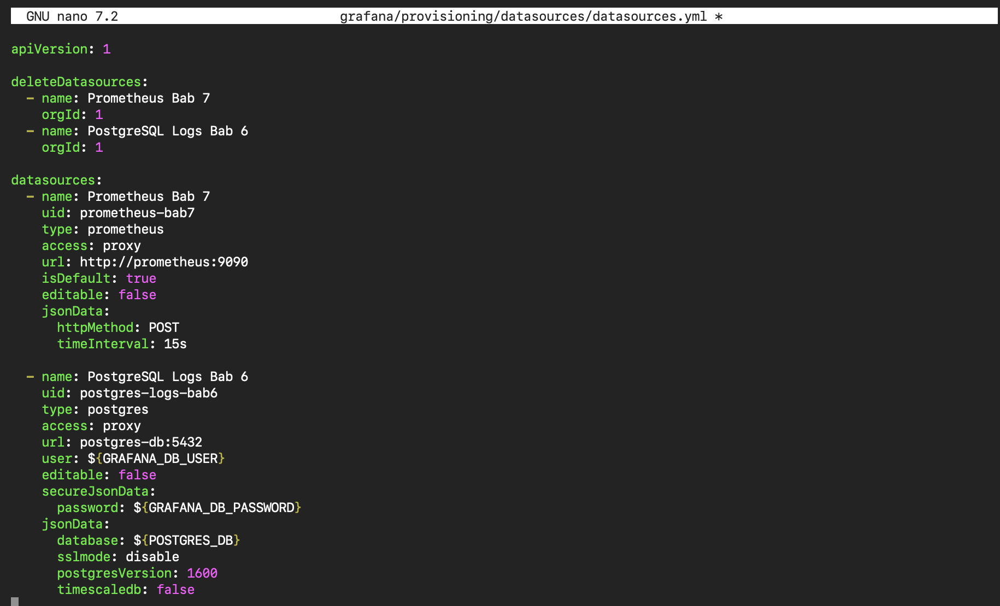

*Gambar 12. Konfigurasi data source Grafana*

Penjelasan komponen konfigurasi:

- `apiVersion`: Menentukan versi konfigurasi provisioning Grafana.
- `deleteDatasources`: Menghapus konfigurasi data source lama dengan nama yang sama sebelum provisioning.
- `datasources`: Mendefinisikan sumber data yang digunakan Grafana.
- `name`: Nama sumber data yang ditampilkan di Grafana.
- `uid`: Identitas unik setiap data source.
- `type`: Menentukan jenis sumber data, yaitu Prometheus atau PostgreSQL.
- `url`: Alamat service yang akan dihubungkan.
- `isDefault`: Menetapkan Prometheus sebagai sumber data utama.
- `secureJsonData`: Menyimpan konfigurasi password melalui mekanisme Grafana.

Konfigurasi ini menghubungkan Grafana dengan Prometheus sebagai sumber utama data monitoring. Selain itu, tersedia konfigurasi PostgreSQL untuk mendukung visualisasi log dari praktikum Bab 6 melalui akun khusus.

### 3.10 Konfigurasi Dashboard Provider Grafana

Tahap ini mengatur bagaimana Grafana menemukan dan memuat dashboard secara otomatis dari direktori yang telah ditentukan.

File konfigurasi dibuka menggunakan perintah:

```bash
nano grafana/provisioning/dashboards/provider.yml
```


*Gambar 13. Konfigurasi dashboard provider pada provider.yml*

Penjelasan komponen konfigurasi:

- `apiVersion`: Menentukan versi konfigurasi provisioning.
- `providers`: Mendefinisikan sumber penyedia dashboard.
- `name`: Memberikan nama provider dashboard.
- `orgId`: Menentukan organisasi Grafana yang digunakan.
- `folder`: Menentukan folder tempat dashboard ditampilkan.
- `type: file`: Menunjukkan bahwa dashboard dimuat dari file lokal.
- `disableDeletion`: Mengatur apakah dashboard dapat dihapus melalui provisioning.
- `allowUiUpdates`: Mengatur izin perubahan dashboard melalui antarmuka Grafana.
- `updateIntervalSeconds`: Menentukan interval pemeriksaan perubahan file dashboard.
- `path`: Menentukan direktori penyimpanan file dashboard.

Konfigurasi ini memungkinkan Grafana memuat dashboard secara otomatis dari direktori yang telah ditentukan. Dashboard akan ditempatkan dalam folder DevSecOps Lab dan diperiksa kembali setiap 30 detik untuk mendeteksi perubahan konfigurasi.

### 3.11 Pembuatan Dashboard Monitoring Grafana

Pada tahap ini dibuat dashboard yang menampilkan hasil pemantauan resource sistem.

Dashboard dirancang agar informasi penggunaan CPU, memori, dan kondisi target monitoring dapat dilihat dalam satu tampilan.

File dashboard dibuka menggunakan perintah:

```bash
nano grafana/dashboards/bab-7-overview.json
```

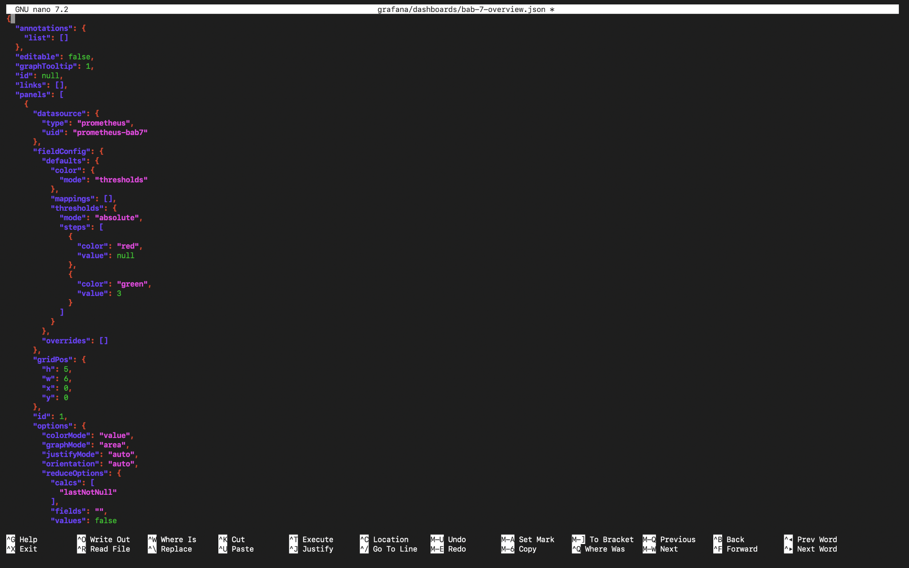

*Gambar 14. Bagian konfigurasi dashboard monitoring*


*Gambar 15. Konfigurasi lanjutan dashboard monitoring*


*Gambar 16. Konfigurasi panel dashboard Grafana*

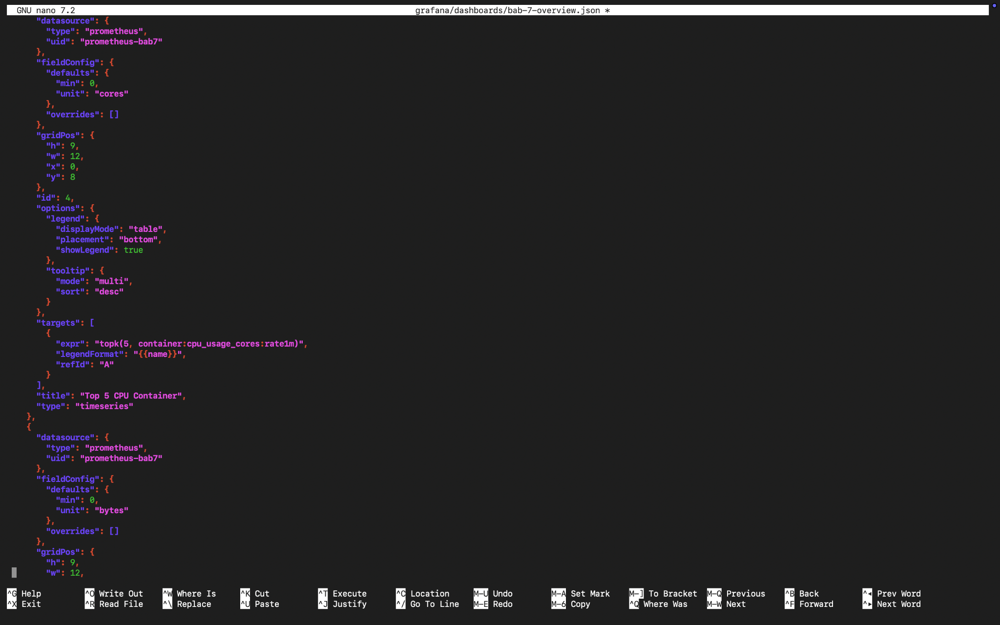

*Gambar 17. Konfigurasi lanjutan panel dashboard Grafana*

Penjelasan komponen konfigurasi:

- `annotations`: Menyediakan konfigurasi anotasi dashboard.
- `editable`: Mengatur agar dashboard tidak dapat diedit melalui UI.
- `panels`: Menampung panel-panel visualisasi.
- `datasource`: Menentukan sumber data dari Prometheus.
- `targets`: Berisi query PromQL untuk mengambil data.
- `title`: Menentukan judul dashboard atau panel.
- `type`: Menentukan bentuk visualisasi, seperti stat atau timeseries.
- `refresh`: Mengatur pembaruan dashboard setiap 15 detik.
- `time`: Menentukan rentang waktu data yang ditampilkan.

Panel yang tersedia pada dashboard:

1. **Jumlah Target Up:** Menampilkan jumlah target yang aktif.
2. **Utilisasi CPU Host:** Menampilkan penggunaan CPU host.
3. **Utilisasi Memori Host:** Menampilkan penggunaan memori host.
4. **Top 5 CPU Container:** Menampilkan lima container dengan penggunaan CPU tertinggi.
5. **Top 5 Memori Container:** Menampilkan lima container dengan penggunaan memori tertinggi.

Dashboard ini menggabungkan informasi kondisi target, penggunaan CPU, dan memori host maupun container dalam satu tampilan. Data diperoleh melalui query PromQL yang terhubung dengan Prometheus, sehingga kondisi resource dapat dipantau secara berkala.

### 3.12 Pembuatan Script Verifikasi Monitoring Stack

Pada tahap ini dibuat script untuk memeriksa apakah Prometheus dan Grafana sudah berjalan serta memastikan target monitoring dan konfigurasi Prometheus dapat diperiksa dengan baik.

File script dibuka menggunakan perintah:

```bash
nano scripts/verify-stack.sh
```


*Gambar 18. Script verifikasi monitoring stack pada verify-stack.sh*

Penjelasan komponen script:

- `set -Eeuo pipefail`: Mengatur script agar berhenti ketika terjadi kesalahan.
- `cd`: Mengarahkan lokasi kerja ke direktori utama Bab 7.
- `wait_http()`: Memeriksa kesiapan layanan melalui HTTP.
- `curl`: Mengirim permintaan untuk memeriksa endpoint.
- `targets`: Mengambil informasi status target monitoring.
- `up_count` dan `down_count`: Menghitung jumlah target yang aktif dan tidak aktif.
- `for expression`: Memeriksa beberapa query PromQL.
- `promtool check config`: Memvalidasi konfigurasi Prometheus.
- `promtool check rules`: Memvalidasi recording rules dan alert rules.

Script ini membantu melakukan pemeriksaan awal terhadap layanan monitoring, status target, serta validitas konfigurasi Prometheus. Hasil pemeriksaan ditampilkan dalam bentuk status PASS atau FAIL sehingga kesalahan konfigurasi lebih mudah diketahui.

### 3.13 Pembuatan Script Integrasi Bab 6 (connect-bab6.sh)

Script ini digunakan untuk menghubungkan Grafana dengan PostgreSQL Bab 6 menggunakan akun khusus yang hanya memiliki hak akses membaca data (read-only).

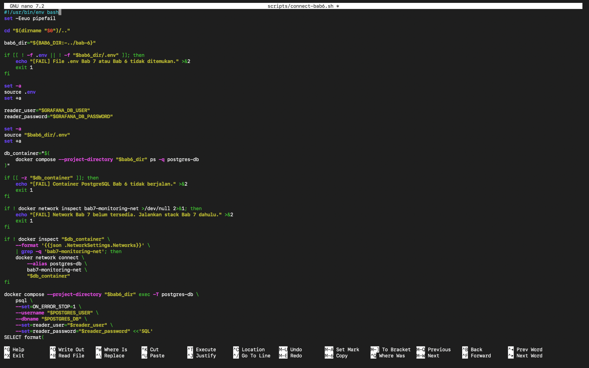

*Gambar 19. Script integrasi PostgreSQL Bab 6 pada connect-bab6.sh*

Penjelasan komponen script:

- `bab6_dir`: Menentukan lokasi direktori praktikum Bab 6.
- `source .env`: Membaca variabel konfigurasi dari file environment.
- `reader_user`: Menentukan akun khusus untuk Grafana.
- `db_container`: Mengambil identitas container PostgreSQL Bab 6.
- `docker network connect`: Menghubungkan container database ke jaringan Bab 7.
- `CREATE ROLE`: Membuat akun database khusus.
- `GRANT SELECT`: Memberikan izin membaca data pada tabel log.
- `docker compose restart grafana`: Memulai ulang Grafana setelah konfigurasi integrasi.

Script ini mengatur koneksi antara Grafana dan PostgreSQL Bab 6 melalui jaringan internal Docker. Penggunaan akun read-only membatasi akses Grafana agar hanya dapat membaca data log tanpa mengubah isi database.

### 3.14 Validasi Script dan Konfigurasi Monitoring

Setelah seluruh script dan konfigurasi dibuat, langkah selanjutnya adalah melakukan validasi untuk memastikan file dapat dijalankan dan tidak memiliki kesalahan sintaks maupun struktur konfigurasi.

**a. Pemberian izin eksekusi script**

Perintah `chmod +x` digunakan untuk memberikan izin eksekusi pada kedua file script. Dengan demikian, script dapat dijalankan secara langsung melalui terminal tanpa harus memanggil interpreter Bash secara manual.


*Gambar 20. Pemberian izin eksekusi pada script verifikasi dan integrasi*

**b. Pemeriksaan sintaks script Bash**

Perintah `bash -n` digunakan untuk memeriksa struktur dan sintaks pada script Bash tanpa menjalankan instruksi di dalamnya. Pada tahap ini, kedua script berhasil diperiksa karena tidak ditemukan pesan kesalahan.

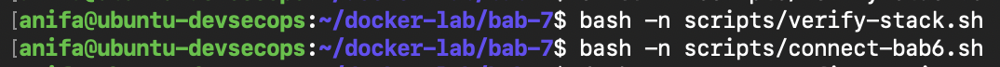

*Gambar 21. Pemeriksaan sintaks script Bash*

**c. Validasi konfigurasi Docker Compose**

Perintah `docker compose config` digunakan untuk memeriksa konfigurasi Docker Compose, termasuk struktur YAML dan variabel lingkungan yang digunakan. Tidak munculnya pesan kesalahan menunjukkan bahwa konfigurasi dapat diproses dengan baik oleh Docker Compose.

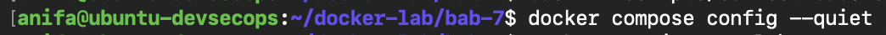

*Gambar 22. Validasi konfigurasi Docker Compose*

**d. Validasi file JSON dashboard Grafana**

Validasi file JSON dashboard Grafana dilakukan untuk memastikan struktur JSON memiliki format yang valid. Penggunaan `>/dev/null` membuat hasil keluaran tidak ditampilkan, sehingga terminal hanya menampilkan pesan apabila ditemukan kesalahan.

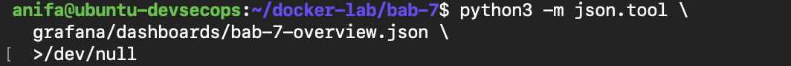

*Gambar 23. Validasi file JSON dashboard Grafana*

**e. Validasi konfigurasi Prometheus**

Perintah `promtool` digunakan untuk memeriksa konfigurasi utama Prometheus beserta file rule yang terhubung dengannya.

Berdasarkan hasil pemeriksaan, diperoleh informasi:

- `2 rule files found`: Prometheus berhasil menemukan dua file rule yang telah dikonfigurasi.
- `5 rules found` pada recording rules: Terdapat lima aturan pencatatan metrik yang berhasil diperiksa.
- `5 rules found` pada alert rules: Terdapat lima aturan peringatan yang berhasil diperiksa.
- `SUCCESS`: Konfigurasi Prometheus dan kedua file rule berhasil melewati pemeriksaan sintaks.


*Gambar 24. Validasi konfigurasi Prometheus dan rules*

**f. Pengujian Prometheus Rules**

Perintah `promtool test rules` digunakan untuk menjalankan pengujian terhadap aturan alert yang telah dibuat.

Pengujian dilakukan berdasarkan skenario simulasi yang tersimpan pada file `rules.test.yml`, yaitu kondisi ketika target Node Exporter mengalami gangguan.

Berdasarkan hasil pengujian, muncul status SUCCESS yang menunjukkan bahwa aturan alert berhasil melewati pengujian sesuai hasil yang diharapkan.

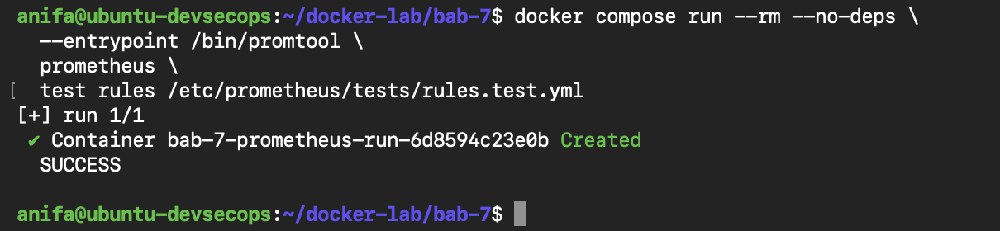

*Gambar 25. Pengujian unit alert Prometheus*

Dengan demikian, konfigurasi alert TargetDown dapat dinyatakan berhasil diuji melalui skenario tersebut.

### 3.15 Menjalankan Stack Monitoring

Setelah seluruh konfigurasi berhasil divalidasi, langkah berikutnya adalah menjalankan monitoring stack menggunakan Docker Compose.

Image Prometheus, Grafana, Node Exporter, cAdvisor, dan Alpine diunduh sesuai kebutuhan konfigurasi praktikum.


*Gambar 26. Hasil pengunduhan image monitoring stack*

Monitoring stack kemudian dijalankan menggunakan perintah:

```bash
docker compose up -d
```

Perintah tersebut digunakan untuk menjalankan seluruh service di latar belakang.

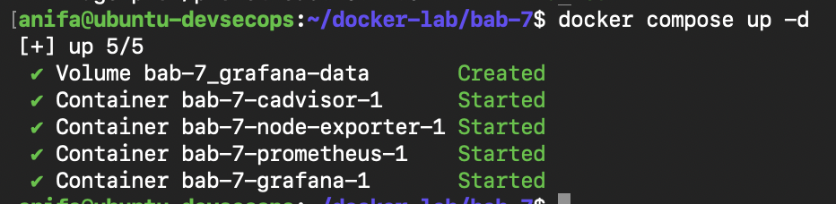

*Gambar 27. Hasil menjalankan monitoring stack*

Setelah proses dijalankan, status container diperiksa untuk memastikan seluruh service telah aktif.

```bash
docker compose ps
```

Seluruh service utama menunjukkan status Up dan cAdvisor berstatus healthy.

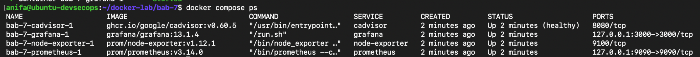

*Gambar 28. Hasil pemeriksaan status container monitoring stack*

### 3.16 Verifikasi Monitoring Stack

Setelah monitoring stack berjalan, dilakukan verifikasi untuk memastikan Prometheus, Grafana, serta target monitoring dapat diakses dan memberikan respons sesuai konfigurasi.

Script verifikasi dijalankan untuk memeriksa kesiapan layanan, status target, query PromQL, serta validasi konfigurasi dan rules.

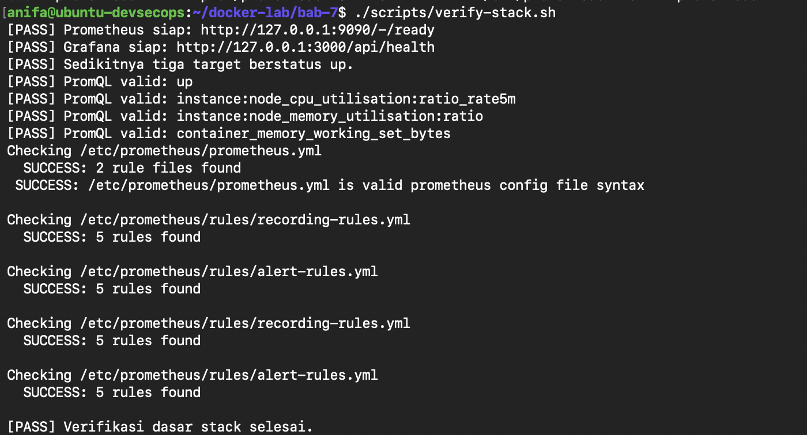

*Gambar 29. Hasil verifikasi monitoring stack*

### 3.17 Query PromQL Dasar

Pengujian query PromQL dilakukan untuk mengambil informasi metrik dari target yang telah dikonfigurasi.

Query yang diuji mencakup status target, penggunaan CPU dan memori host, serta penggunaan CPU dan memori container.

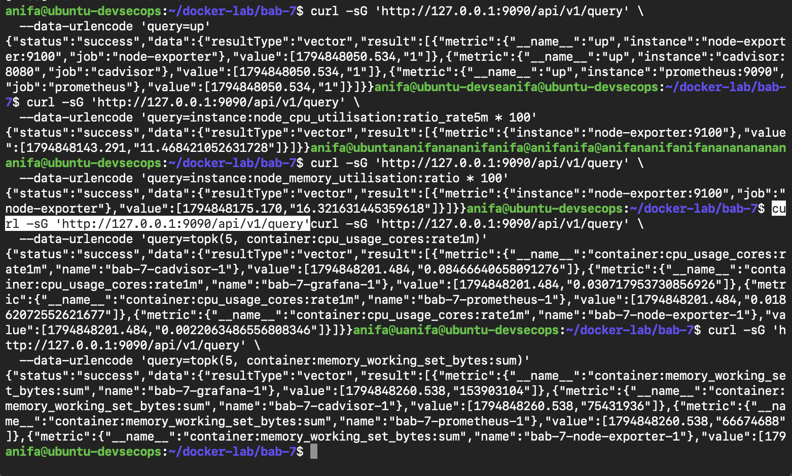

*Gambar 30. Hasil pengujian query PromQL dasar*

Hasil pengujian menunjukkan bahwa Prometheus berhasil mengambil data metrik dari target monitoring. Data tersebut dapat digunakan sebagai dasar untuk melakukan analisis kondisi resource sistem.

### 3.18 Pengujian Beban (Load Testing)

Pengujian beban dilakukan untuk melihat respons sistem monitoring ketika container menggunakan resource CPU dalam jumlah tertentu.

Load generator digunakan untuk menghasilkan beban CPU sehingga perubahan metrik dapat diamati melalui Prometheus.


*Gambar 31. Hasil pengujian beban dan alert ContainerHighCPU*

Berdasarkan hasil pengujian, load generator menghasilkan penggunaan CPU sekitar 0,498 core. Prometheus kemudian memicu alert `ContainerHighCPU` dengan status firing karena penggunaan CPU melewati ambang batas yang telah ditentukan.

Setelah pengujian selesai, container load generator dihentikan dan dihapus agar tidak terus menggunakan resource sistem.


*Gambar 32. Hasil penghentian dan penghapusan load generator*

### 3.19 Pengujian Alert TargetDown

Pengujian TargetDown dilakukan dengan menghentikan Node Exporter untuk menyimulasikan kondisi ketika target monitoring tidak dapat diakses.


*Gambar 33. Hasil pengujian alert TargetDown*

Ketika Node Exporter dihentikan, metrik `up` berubah menjadi 0 dan alert TargetDown terdeteksi firing. Setelah service dijalankan kembali, nilai `up` kembali menjadi 1.

Pengujian ini menunjukkan bahwa Prometheus dapat mendeteksi target yang tidak tersedia dan memperbarui statusnya setelah service kembali berjalan.

### 3.20 Integrasi Grafana dengan Database Bab 6 (Opsional)

Tahap ini merupakan integrasi tambahan untuk menghubungkan Grafana dengan PostgreSQL dari praktikum Bab 6.

Integrasi dilakukan melalui jaringan internal Docker dengan menggunakan akun khusus yang memiliki hak akses read-only terhadap data log.

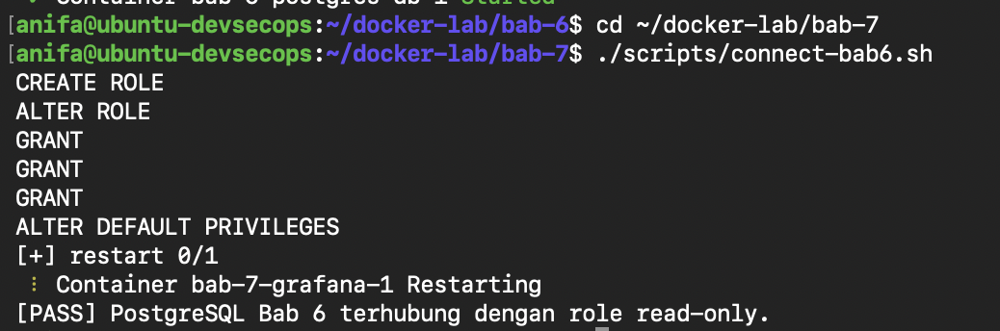

*Gambar 34. Hasil integrasi Grafana dengan PostgreSQL Bab 6*

Endpoint health Grafana menunjukkan database berstatus `ok` setelah proses integrasi PostgreSQL dan restart service.

### 3.21 Verifikasi Grafana

Verifikasi dilakukan untuk memastikan layanan Grafana dapat berjalan dengan baik setelah monitoring stack dijalankan.


*Gambar 35. Hasil verifikasi kesehatan Grafana*

Endpoint health Grafana menunjukkan database berstatus `ok`, yang menandakan layanan Grafana dapat mengakses database internalnya.

### 3.22 Verifikasi Dashboard Grafana

Tahap terakhir adalah memeriksa dashboard monitoring yang telah dibuat dan memastikan seluruh panel dapat menampilkan data dari Prometheus.

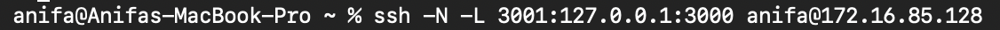

*Gambar 36. Dashboard resource monitoring pada Grafana*

Dashboard menampilkan lima panel, yaitu jumlah target aktif, utilisasi CPU dan memori host, serta lima container dengan penggunaan CPU dan memori tertinggi.

Dengan adanya dashboard tersebut, informasi monitoring dapat diamati melalui satu tampilan sehingga memudahkan pemantauan kondisi host dan container.

---

## 4. Verifikasi dan Skenario Pengujian

### 4.1 Checklist Verifikasi

Checklist berikut digunakan untuk memastikan setiap tahapan konfigurasi, validasi, dan pengujian monitoring stack telah dilakukan.

**Checklist Pengujian Monitoring Infrastruktur dan Container:**

- [x] Struktur direktori kerja Bab 7 berhasil dibuat.
- [x] File `.env.example` berhasil dibuat dan dikonfigurasi.
- [x] File `.env` berhasil disiapkan dengan permission terbatas.
- [x] File `.gitignore` berhasil dikonfigurasi untuk mengecualikan file sensitif dan evidence lokal.
- [x] Docker Compose berhasil mendefinisikan Prometheus, Grafana, Node Exporter, cAdvisor, dan load generator.
- [x] Konfigurasi Prometheus berhasil dibuat dengan interval scraping 15 detik.
- [x] Recording rules berhasil dibuat dan memuat lima aturan metrik.
- [x] Alert rules berhasil dibuat dan memuat lima aturan peringatan.
- [x] Unit test Prometheus berhasil dijalankan untuk skenario TargetDown.
- [x] Data source Prometheus dan PostgreSQL dikonfigurasi pada Grafana.
- [x] Dashboard provider dan dashboard monitoring berhasil dikonfigurasi.
- [x] Script `verify-stack.sh` dan `connect-bab6.sh` berhasil dibuat.
- [x] Sintaks script Bash berhasil divalidasi.
- [x] Konfigurasi Docker Compose dan JSON dashboard berhasil divalidasi.
- [x] Konfigurasi Prometheus dan kedua file rules berhasil divalidasi menggunakan promtool.
- [x] Monitoring stack berhasil dijalankan menggunakan Docker Compose.
- [x] Endpoint Prometheus dan Grafana berhasil diperiksa.
- [x] Tiga target monitoring berhasil menunjukkan status up.
- [x] Query PromQL dasar berhasil mengambil metrik host dan container.
- [x] Pengujian beban berhasil memicu alert ContainerHighCPU.
- [x] Pengujian TargetDown berhasil mendeteksi gangguan Node Exporter dan pemulihannya.
- [x] Integrasi PostgreSQL Bab 6 berhasil dilakukan sebagai pengujian opsional.
- [x] Dashboard Grafana berhasil menampilkan lima panel monitoring.

### 4.2 Pemetaan Bukti Pengujian

Tabel berikut memetakan kriteria pengujian dengan bukti gambar yang disertakan pada bagian langkah praktikum.

| Kriteria Pengujian | Bukti |
|---|---|
| Pembuatan struktur direktori praktikum. | Gambar 1 |
| Konfigurasi environment dan permission file `.env`. | Gambar 2–4 |
| Pembuatan file `.gitignore`. | Gambar 5 |
| Konfigurasi monitoring stack pada Docker Compose. | Gambar 6–7 |
| Konfigurasi Prometheus. | Gambar 8 |
| Pembuatan recording rules dan alert rules. | Gambar 9–10 |
| Pembuatan unit test Prometheus. | Gambar 11 |
| Konfigurasi data source Grafana. | Gambar 12 |
| Konfigurasi dashboard provider. | Gambar 13 |
| Pembuatan dashboard monitoring. | Gambar 14–17 |
| Pembuatan script verifikasi dan integrasi. | Gambar 18–19 |
| Validasi script, Docker Compose, dan JSON dashboard. | Gambar 20–23 |
| Validasi konfigurasi Prometheus dan unit test rules. | Gambar 24–25 |
| Pengunduhan image, menjalankan stack, dan pemeriksaan container. | Gambar 26–28 |
| Verifikasi monitoring stack dan query PromQL. | Gambar 29–30 |
| Pengujian beban dan alert ContainerHighCPU. | Gambar 31–32 |
| Pengujian alert TargetDown. | Gambar 33 |
| Integrasi PostgreSQL Bab 6, verifikasi Grafana, dan dashboard. | Gambar 34–36 |

### 4.3 Rekapitulasi Hasil Verifikasi

Berdasarkan hasil pengujian, diperoleh rekapitulasi berikut.

| No. | Pemeriksaan | Hasil |
|---:|---|---|
| 1 | Sintaks script Bash (`verify-stack.sh` dan `connect-bab6.sh`) | PASS |
| 2 | Validasi konfigurasi Docker Compose | PASS |
| 3 | Validasi JSON dashboard Grafana | PASS |
| 4 | Validasi konfigurasi Prometheus dan dua file rules | PASS |
| 5 | Validasi lima recording rules dan lima alert rules | PASS |
| 6 | Unit test Prometheus untuk skenario TargetDown | PASS |
| 7 | Kesiapan endpoint Prometheus dan Grafana | PASS |
| 8 | Tiga target monitoring berstatus up | PASS |
| 9 | Query PromQL untuk status target, CPU, dan memori | PASS |
| 10 | Load testing dan alert ContainerHighCPU | PASS |
| 11 | Pengujian TargetDown dan pemulihan Node Exporter | PASS |
| 12 | Integrasi PostgreSQL Bab 6 dengan role read-only (opsional) | PASS |
| 13 | Dashboard Grafana menampilkan lima panel monitoring | PASS |
| 14 | Pemeriksaan akhir container monitoring | PASS |

Berdasarkan rekapitulasi tersebut, konfigurasi monitoring stack berhasil divalidasi dan pengujian utama menunjukkan hasil PASS. Pengujian mencakup validasi konfigurasi, ketersediaan target, pengambilan metrik, serta respons alert terhadap kondisi gangguan dan beban resource.

---

## 5. Troubleshooting dan Analisis Hasil

### 5.1 Masalah yang Muncul dan Cara Diagnosis

Troubleshooting dilakukan dengan memeriksa status container, endpoint layanan, status target monitoring, konfigurasi data source, dan konektivitas antarservice.

Beberapa kendala yang dapat muncul selama praktikum beserta kemungkinan penyebab dan langkah penanganannya dirangkum pada tabel berikut.

| Kendala | Kemungkinan Penyebab | Penanganan |
|---|---|---|
| Prometheus atau Grafana tidak dapat diakses. | Container belum berjalan atau service belum siap. | Periksa `docker compose ps`, jalankan `docker compose up -d`, kemudian periksa endpoint health. |
| SSH tunnel menunjukkan `Address already in use`. | Port lokal pada Mac telah digunakan proses lain. | Gunakan port lokal lain, misalnya `ssh -N -L 3001:127.0.0.1:3000 anifa@172.16.85.128`, kemudian buka `localhost:3001`. |
| Grafana menampilkan `ERR_CONNECTION_REFUSED`. | SSH tunnel belum aktif atau sesi tunnel sudah ditutup. | Jalankan SSH tunnel dari Terminal Mac dan biarkan terminal tersebut tetap terbuka. |
| Target Node Exporter berstatus down. | Container Node Exporter berhenti atau belum pulih. | Periksa `docker compose ps`, jalankan `docker compose start node-exporter`, lalu cek query `up{job="node-exporter"}`. |
| Alert belum terlihat pada query ALERTS. | Alert mungkin masih pending atau query hanya memfilter status firing. | Periksa status rule melalui endpoint `/api/v1/rules` dan tunggu durasi evaluasi sesuai konfigurasi. |
| Script integrasi Bab 6 gagal menemukan PostgreSQL. | Container PostgreSQL Bab 6 belum berjalan. | Jalankan `docker compose up -d postgres-db` dari direktori Bab 6, kemudian ulangi script integrasi dari direktori Bab 7. |
| Data dashboard belum muncul. | Rentang waktu dashboard atau data source belum sesuai. | Pastikan Prometheus menjadi data source aktif, target berstatus up, dan rentang waktu dashboard mencakup waktu pengujian. |

Troubleshooting dilakukan dengan memeriksa status container, endpoint layanan, status target, dan konfigurasi data source. Pemeriksaan bertahap membantu menemukan sumber kendala tanpa menghapus volume maupun data praktikum.

### 5.2 Risiko Keamanan dan Operasional

Selain memastikan monitoring stack berjalan, beberapa aspek keamanan dan operasional juga perlu diperhatikan.

| Risiko | Penjelasan dan Penanganan |
|---|---|
| Endpoint monitoring terbuka | Endpoint Prometheus dan exporter dapat menampilkan informasi kondisi sistem. Batasi akses menggunakan jaringan internal, autentikasi, TLS, atau proxy sesuai kebutuhan. |
| Kredensial tersimpan dalam file environment | File `.env` harus dikecualikan dari Git dan diberi permission terbatas. Untuk lingkungan produksi, pertimbangkan penggunaan secret manager. |
| Hak akses integrasi database terlalu luas | Akun Grafana untuk PostgreSQL Bab 6 menggunakan hak akses read-only agar hanya dapat membaca data log. |
| High cardinality | Penggunaan label dengan nilai unik seperti user ID, request ID, atau UUID dapat meningkatkan penggunaan memori dan storage Prometheus. Batasi label pada dimensi yang relevan. |
| Scraping terlalu sering | Interval scraping yang terlalu kecil dapat meningkatkan beban jaringan, exporter, dan storage. Sesuaikan interval dengan kebutuhan monitoring. |
| Alert tidak actionable | Alert yang tidak memberikan konteks dan langkah penanganan dapat menyulitkan administrator. Sertakan informasi dampak, tingkat urgensi, dan konteks kondisi. |
| Data metrik tidak selalu menjelaskan penyebab | Metrik menunjukkan perubahan kondisi sistem, tetapi tidak selalu menjelaskan penyebabnya. Gunakan log sebagai sumber informasi tambahan untuk proses troubleshooting. |

---

## 6. Evaluasi dan Latihan Mandiri

### 1. Mengapa Prometheus menggunakan scrape model dan bukan hanya push model?

Prometheus menggunakan scrape model karena Prometheus mengambil metrik secara berkala langsung dari target yang dipantau. Dengan cara ini, Prometheus dapat mengatur sendiri interval pengambilan data dan mengetahui apakah suatu target masih aktif atau tidak melalui nilai `up`.

Jika target tidak dapat dijangkau, Prometheus dapat mendeteksinya dari kegagalan proses scraping. Model ini juga membuat pengelolaan monitoring lebih terpusat karena Prometheus yang menentukan kapan data dikumpulkan.

Sementara itu, push model tetap dapat digunakan untuk kebutuhan tertentu, tetapi bukan mekanisme utama Prometheus.

### 2. Apa dampak scrape_interval terlalu kecil terhadap storage dan network?

Jika `scrape_interval` terlalu kecil, Prometheus akan mengambil metrik lebih sering sehingga jumlah sampel yang dikumpulkan semakin banyak.

Akibatnya, penggunaan storage untuk menyimpan data time-series meningkat dan kebutuhan bandwidth jaringan juga bertambah. Proses scraping yang terlalu sering bahkan dapat menambah beban pada Prometheus maupun exporter yang menyediakan metrik.

Oleh karena itu, interval scraping perlu disesuaikan dengan kebutuhan monitoring agar data tetap cukup detail tanpa membebani sistem.

### 3. Mengapa rate diperlukan untuk counter seperti node_cpu_seconds_total?

`node_cpu_seconds_total` merupakan jenis counter yang nilainya terus bertambah selama CPU bekerja. Nilai tersebut menunjukkan akumulasi waktu CPU, bukan persentase penggunaan CPU secara langsung.

Fungsi `rate()` digunakan untuk menghitung seberapa cepat nilai counter bertambah dalam rentang waktu tertentu, misalnya lima menit.

Dengan begitu, kita dapat memperkirakan tingkat penggunaan CPU berdasarkan perubahan nilai counter per detik. Hasilnya lebih mudah digunakan untuk memantau aktivitas CPU dibandingkan hanya melihat nilai counter mentah.

### 4. Apa indikator awal container mengalami memory pressure?

Salah satu indikator awal container mengalami memory pressure adalah meningkatnya penggunaan memori secara terus-menerus hingga mendekati batas memori yang tersedia atau ditetapkan.

Kondisi ini dapat terlihat melalui metrik penggunaan memori container, seperti `container_memory_working_set_bytes`.

Selain itu, aktivitas penggunaan swap, peningkatan proses reclaim memori, hingga kejadian Out of Memory (OOM) juga dapat menjadi tanda bahwa container mengalami tekanan memori.

Jika kondisi ini tidak ditangani, container berisiko mengalami penurunan performa atau bahkan dihentikan oleh sistem.

### 5. Bagaimana menghubungkan alert metrics dengan pencarian log?

Alert metrics dapat dihubungkan dengan pencarian log menggunakan informasi waktu kejadian dan identitas container atau service.

Ketika Prometheus mendeteksi kondisi tertentu dan menghasilkan alert, misalnya penggunaan CPU container terlalu tinggi, kita dapat mencatat waktu kejadian serta nama container yang terdampak.

Selanjutnya, informasi tersebut digunakan untuk mencari log pada Grafana Explore melalui sumber data PostgreSQL dari praktikum Bab 6.

Dengan membandingkan metrik dan log pada rentang waktu yang sama, kita dapat mengetahui aktivitas atau error yang mungkin berkaitan dengan peningkatan penggunaan resource.

Namun, hubungan waktu antara keduanya belum tentu membuktikan bahwa suatu log menjadi penyebab langsung kenaikan CPU.

---

## 7. Kesimpulan

Berdasarkan praktikum Bab 7 mengenai Monitoring Infrastruktur dan Container menggunakan Prometheus, Node Exporter, cAdvisor, dan Grafana, dapat disimpulkan beberapa hal berikut:

1. Monitoring dan logging merupakan dua pendekatan yang saling melengkapi dalam pengelolaan infrastruktur. Monitoring digunakan untuk mengetahui kondisi sistem melalui data metrik, sedangkan logging menyediakan informasi kejadian secara lebih terperinci untuk membantu proses analisis dan troubleshooting.

2. Prometheus berperan sebagai sistem pengumpulan dan penyimpanan metrik berbasis time-series. Melalui mekanisme scraping, Prometheus mengambil data secara berkala dari target monitoring, yaitu Prometheus, Node Exporter, dan cAdvisor.

3. Node Exporter digunakan untuk memantau penggunaan resource pada tingkat host, sedangkan cAdvisor menyediakan informasi penggunaan resource pada tingkat container. Data dari kedua komponen tersebut dapat dianalisis menggunakan PromQL.

4. Recording rules membantu menyederhanakan perhitungan metrik yang digunakan secara berulang, sedangkan alert rules membantu mendeteksi kondisi gangguan atau penggunaan resource yang melewati batas tertentu. Pengujian TargetDown dan ContainerHighCPU menunjukkan bahwa Prometheus dapat mendeteksi perubahan kondisi target serta peningkatan penggunaan CPU.

5. Grafana digunakan untuk memvisualisasikan data monitoring dalam bentuk dashboard. Dashboard yang dibuat menampilkan jumlah target aktif, utilisasi CPU dan memori host, serta lima container dengan penggunaan CPU dan memori tertinggi.

6. Validasi konfigurasi dan pengujian menggunakan `promtool` membantu memastikan konfigurasi Prometheus dan rules dapat diproses dengan benar. Script verifikasi juga membantu memeriksa kesiapan layanan, status target, dan query PromQL.

7. Integrasi Grafana dengan PostgreSQL dari praktikum Bab 6 dapat digunakan sebagai pengembangan tambahan untuk menggabungkan informasi metrik dan log dalam satu platform. Penggunaan akun read-only membantu membatasi hak akses terhadap database.

Dengan demikian, praktikum ini memberikan pemahaman mengenai pembangunan sistem monitoring infrastruktur dan container, mulai dari konfigurasi Prometheus dan exporter, pengolahan metrik menggunakan PromQL, pembuatan dashboard Grafana, hingga pengujian alert untuk mendeteksi kondisi gangguan dan penggunaan resource yang berlebihan.
