# Laporan Praktikum PMB: Implementasi Centralized Logging pada Aplikasi PMB

**Mata Kuliah:** Workshop DevOps  
**Dosen Pengampu:** Dr. Ferry Astika Saputra, S.T., M.Sc.  
**Disusun oleh:** Anifa Aulia Abdari (3126640053)  
**Institusi:** Politeknik Elektronika Negeri Surabaya  
**Program Studi:** Teknik Informatika  
**Tahun:** 2026

---

> Bagian ini memuat implementasi pipeline centralized logging pada aplikasi PMB (Bagian B), serta bagian verifikasi, evaluasi, dan kesimpulan bersama dari laporan asli.

## Halaman PDF 15

### 3.16 Arsitektur dan Katalog Event Aplikasi PMB

Aplikasi PMB merupakan simulasi sistem Penerimaan Mahasiswa Baru (PMB)

yang terdiri atas enam service, yaitu registration-api, auth-service, verification-worker,

app-db, log-db, dan fluent-bit. Aplikasi menangani autentikasi, pendaftaran, dan verifikasi

secara asinkron menggunakan data sintetis.

Berbeda dengan Bagian A, pipeline PMB menggunakan tag pmb.{{.Name}},

database transaksi dan database log yang terpisah, serta jaringan app-net dan logging-net.

Tiga service aplikasi menggunakan Docker Fluentd Logging Driver untuk mengirimkan

log ke Fluent Bit. Setiap event menggunakan format JSON dengan field timestamp,

service, severity, event, dan request_id. Request ID digunakan untuk menghubungkan

aktivitas antarservice sehingga kronologi transaksi dapat ditelusuri.

Service

Fungsi

Akses host

registration-api

UI, sesi, validasi, pendaftaran

127.0.0.1:8080

auth-service

Autentikasi internal akun lab

Tidak dipublikasikan

verification-worker

Verifikasi asinkron dan simulasi retry

Tidak dipublikasikan

app-db

Database transaksi (tabel registrations,

lab_control)

Tidak dipublikasikan

log-db

Database log (logs.fluentbit)

Tidak dipublikasikan

fluent-bit

Collector, buffer, routing log

127.0.0.1:24224 dan

2020

Perbedaan dengan Bagian A: tag log berbentuk pmb.{{.Name}} dan output pgsql hanya

mencocokkan pmb.*; database transaksi dipisahkan dari database log; dan jaringan dibagi

menjadi app-net dan logging-net. Hanya tiga service aplikasi yang memakai logging driver

fluentd, sehingga tag yang diharapkan pada log-db adalah tiga.

Event aplikasi berbentuk JSON dengan field timestamp (UTC), service, severity, event,

dan request_id, ditambah konteks per event:

Event

Severity

Service

Konteks

login_success

INFO

auth-service

user_ref

login_failed

WARN

auth-service

username_fingerprin

t, remote_addr

---

## Halaman PDF 16

http_request

INFO / WARN

(status 400 ke

atas)

registration-api

method, path, status

registration_submitted

INFO

registration-api

user_ref,

registration_id,

program

registration_validation

_failed,

duplicate_registration,

csrf_rejected

WARN

registration-api

user_ref atau path

verification_started

INFO

verification-worker registration_id, mode

verification_retry

WARN

verification-worker

attempt, dependency

dependency_timeout

ERROR

verification-worker

attempt, error_code

VERIFY-TIMEOUT

verification_completed

INFO

verification-worker

attempt

setiap request HTTP mendapat request_id sendiri. Login dan pendaftaran adalah request

yang berbeda, sehingga login_success tidak memiliki request_id yang sama dengan

registration_submitted. Rantai login (http_request pada registration-api dan login_success

pada auth-service) berbagi satu request_id karena ID diteruskan lewat header, sedangkan

rantai

pendaftaran

(registration_submitted,

http_request,

verification_started,

dan

seterusnya) berbagi request_id POST /register yang disimpan pada tabel registrations.

Kedua rantai dihubungkan melalui user_ref.

### 3.17 Persiapan: Ekstrak, Konfigurasi .env, dan Validasi

**Gambar/ilustrasi pada halaman ini:**

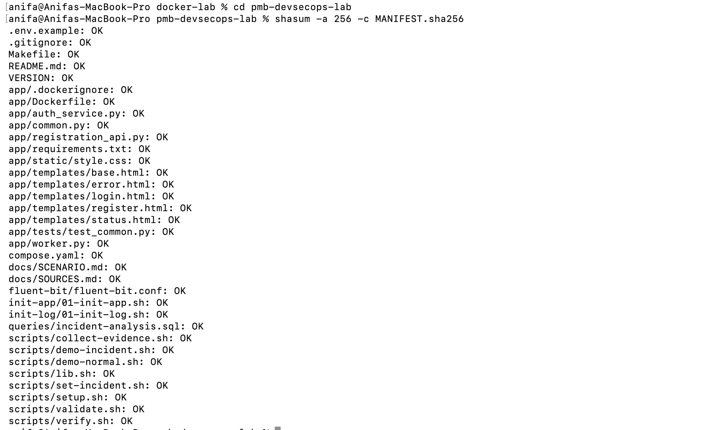

---

## Halaman PDF 17

file .env dibuat berdasarkan .env.example dengan mengganti lima nilai change-me

menggunakan nilai acak. Karena script setup.sh menggunakan sintaks GNU sed -i yang

tidak kompatibel dengan macOS, konfigurasi dilakukan menggunakan alternatif perintah

perl. Selanjutnya, permission .env dibatasi dan scripts/validate.sh dijalankan. Berdasarkan

Gambar 21, konfigurasi dan tiga unit test awal berhasil divalidasi.

Gambar 21. Permission .env, hasil grep change-me, dan hasil validate.sh

### 3.18 Menjalankan Stack PMB

Gambar 22. docker compose ps seluruh service PMB

Gambar 23. Health portal PMB dan Fluent Bit

**Gambar/ilustrasi pada halaman ini:**

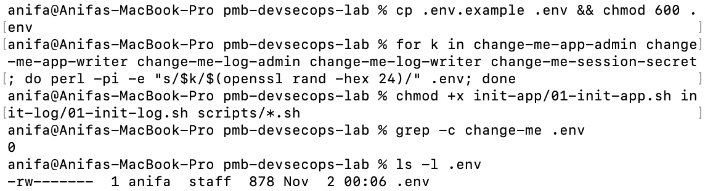

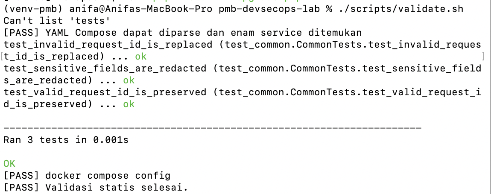

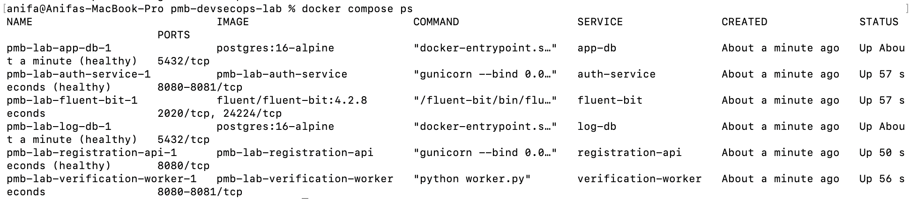

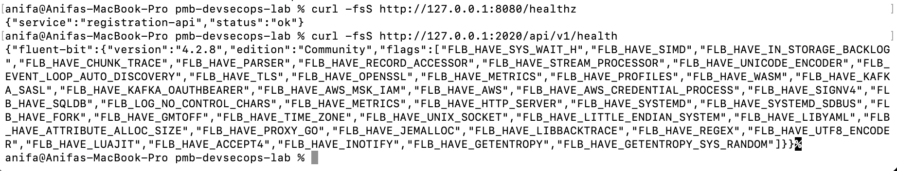

---

## Halaman PDF 18

Seluruh service dijalankan menggunakan Docker Compose. Berdasarkan Gambar 22,

keenam service berhasil dijalankan. Pemeriksaan endpoint health aplikasi dan monitoring

Fluent Bit pada Gambar 23 menunjukkan kondisi sesuai konfigurasi. Service yang

memiliki healthcheck berstatus healthy, sedangkan Fluent Bit berstatus started.

### 3.19 Skenario A: Baseline (Alur Normal)

Gambar 24. Keluaran demo-normal.sh (Request ID dan status VERIFIED)

Pengujian baseline dilakukan menggunakan script demo-normal.sh untuk menjalankan

login dan pendaftaran dengan data sintetis. Berdasarkan Gambar 24, pendaftaran berhasil

dengan status VERIFIED dan attempt 1. Urutan event yang dihasilkan meliputi

registration_submitted, http_request, verification_started, dan verification_completed.

Request ID digunakan untuk menelusuri seluruh aktivitas tersebut.

### 3.20 Skenario B: Failure Injection (Timeout Dependency)

Gambar 25. Keluaran demo-incident.sh

Pengujian dilakukan dengan mengubah incident_mode menjadi timeout melalui script

demo-incident.sh. Kondisi ini mensimulasikan kegagalan dependency pada proses

verifikasi. Berdasarkan Gambar 25, transaksi berakhir dengan status FAILED, kode

VERIFY-TIMEOUT, dan attempt 3. Log mencatat event retry hingga dependency_timeout

dengan severity ERROR.

### 3.21 Rekonstruksi Kronologi dengan Request ID

**Gambar/ilustrasi pada halaman ini:**

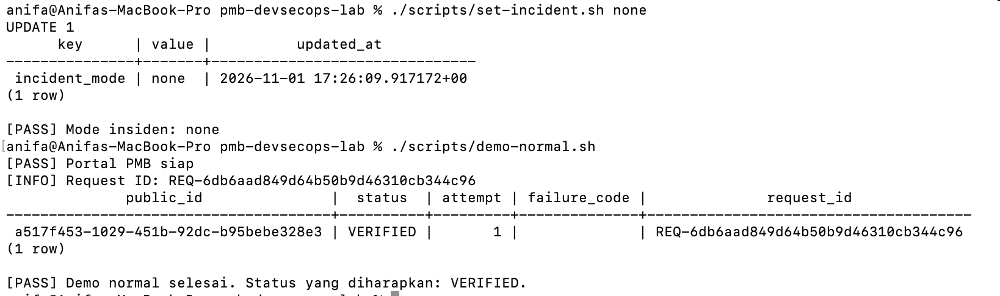

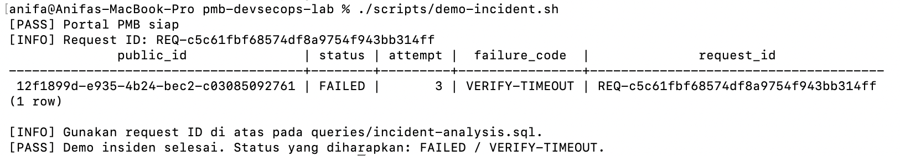

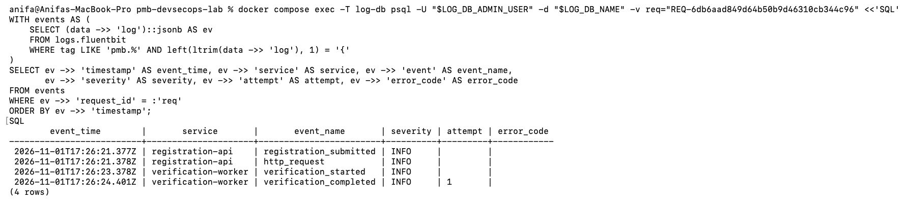

---

## Halaman PDF 19

Gambar 26. Kronologi Request ID baseline

Gambar 27. Kronologi Request ID insiden

Gambar 28. Jumlah event per tag dan jumlah WARN/ERROR per services

Rekonstruksi dilakukan menggunakan Request ID untuk menampilkan urutan event

transaksi baseline dan insiden. Gambar 26 dan 27 menunjukkan kronologi masing-masing

transaksi. Berdasarkan Gambar 28, terdapat 370 event dari registration-api, 182 dari

auth-service, dan 8 dari verification-worker. Analisis severity juga menunjukkan adanya

tiga event WARN dan satu event ERROR pada verification-worker.

### 3.22 Skenario C: Recovery

Gambar 29. Daftar registrations: transaksi baru VERIFIED, transaksi insiden tetap

FAILED

Pengujian recovery dilakukan dengan mengubah incident_mode menjadi none, kemudian

menjalankan pendaftaran baru. Berdasarkan Gambar 29, transaksi baru berhasil mencapai

**Gambar/ilustrasi pada halaman ini:**

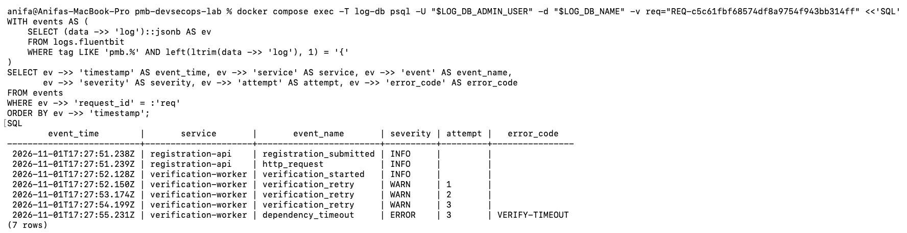

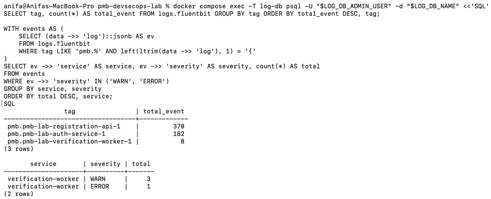

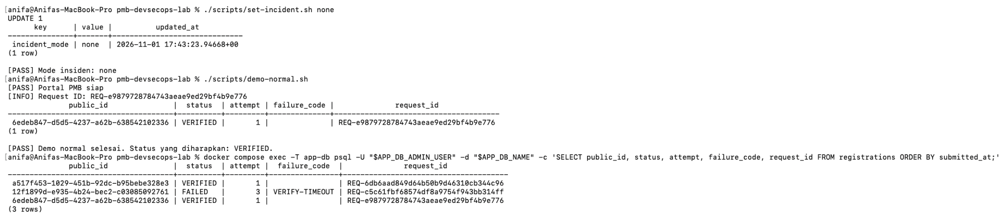

---

## Halaman PDF 20

status VERIFIED pada attempt 1, sedangkan transaksi sebelumnya tetap berstatus

FAILED. Hasil ini menunjukkan bahwa aplikasi dapat kembali memproses pendaftaran

secara normal setelah gangguan dihentikan.

### 3.23 Skenario D: Resilience Logging (log-db Dihentikan)

Gambar 30. Jumlah record sebelum dan sesudah, serta log retry Fluent Bit

Gambar 31. Hasil query pemeriksaan duplikasi

Pengujian dilakukan dengan menghentikan log-db sementara, menghasilkan event aplikasi,

kemudian menjalankan kembali database. Berdasarkan Gambar 30, Fluent Bit melakukan

retry ketika database tidak tersedia dan melanjutkan pengiriman log setelah koneksi pulih.

Pemeriksaan pada Gambar 31 tidak menemukan record duplikat berdasarkan atribut yang

diuji. Namun, mekanisme buffering belum menjamin pengiriman log secara exactly-once.

### 3.24 Pemeriksaan Kerahasiaan Data dan Unit Test

Gambar 32. Hasil verify.sh, unit test, dan query pemeriksaan secret

Pemeriksaan dilakukan menggunakan scripts/verify.sh untuk memvalidasi konfigurasi,

pipeline logging, dan kerahasiaan data. Berdasarkan Gambar 32, tiga unit test berhasil

dijalankan, termasuk pengujian validasi Request ID, redaksi field sensitif, dan

pemeliharaan Request ID yang valid.

**Gambar/ilustrasi pada halaman ini:**

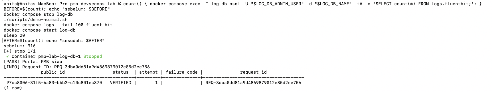

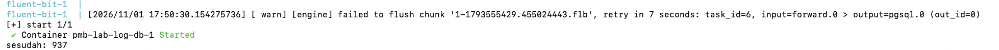

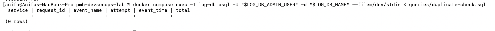

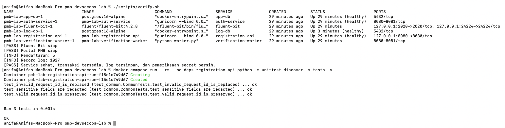

---

## Halaman PDF 21

### 3.25 Pengumpulan Evidence

Gambar 33. Isi direktori reports/ dan config-sha256.txt

Pengumpulan evidence dilakukan menggunakan scripts/collect-evidence.sh. Berdasarkan

Gambar 33, proses berhasil menghasilkan beberapa file pada direktori reports/, termasuk

hasil pemeriksaan service, metrics Fluent Bit, analisis insiden, dan status pendaftaran. File

checksum SHA-256 juga dibuat untuk memeriksa integritas konfigurasi.

### 3.26 Cleanup Bagian B

Gambar 34. Hasil cleanup Bagian B

Cleanup dilakukan menggunakan docker compose down --remove-orphans dan docker

compose down --volumes --remove-orphans. Berdasarkan Gambar 34, seluruh container,

network, dan volume berhasil dihapus. Penghapusan volume dilakukan setelah evidence

dikumpulkan karena dapat menghilangkan data transaksi, log, dan buffer.

**Gambar/ilustrasi pada halaman ini:**

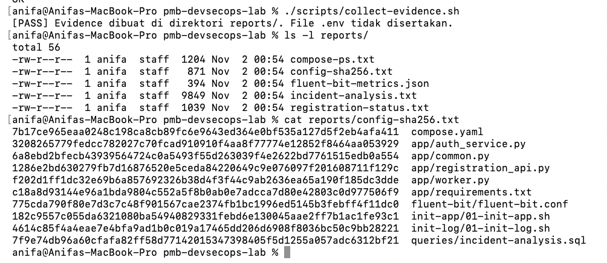

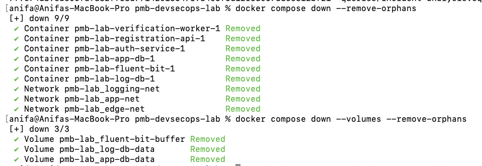

---

## Halaman PDF 22

### 4. Verifikasi dan Skenario Pengujian

### 4.1 Checklist Verifikasi

[v] PostgreSQL berjalan dengan volume pg-data.

[v] Tabel students dibuat otomatis dari init script.

[v] pgAdmin dapat login dan terkoneksi ke database.

[v] Backup menghasilkan file dump di direktori host.

[v] Restore sudah diuji, bukan hanya diasumsikan berhasil.

### 4.2 Pemetaan Bukti Pengujian

Tabel berikut memetakan kriteria keberhasilan pengujian pada Bagian A dan Bagian B

berdasarkan evidence yang diperoleh selama praktikum.

No.

Kriteria Pengujian

Bukti

Bagian A – Pipeline Log Generator

1

Struktur direktori dan konfigurasi lingkungan berhasil

disiapkan.

Gambar 1–3

2

File .gitignore dan konfigurasi Docker Compose berhasil

dibuat.

Gambar 4–5

3

Init script PostgreSQL berhasil dikonfigurasi.

Gambar 6

4

Konfigurasi Fluent Bit dan query analisis berhasil dibuat.

Gambar 7–8

5

Script generator log dan pengujian buffering berhasil dibuat.

Gambar 9–10

6

Validasi sintaks, Docker Compose, dan konfigurasi Fluent Bit

berhasil dilakukan.

Gambar 11–12

7

Pipeline berjalan dan seluruh generator menghasilkan log.

Gambar 13

---

## Halaman PDF 23

8

Monitoring Fluent Bit menunjukkan bahwa endpoint health

dan metrics dapat diakses.

Gambar 14

9

Record berhasil disimpan dan dianalisis pada PostgreSQL.

Gambar 15–16

10

Buffering dan pemulihan pengiriman log berhasil diuji.

Gambar 17–18

11

Port PostgreSQL tidak dipublikasikan ke host.

Gambar 19

12

Seluruh resource Bagian A berhasil dibersihkan.

Gambar 20

Bagian B – Implementasi Aplikasi PMB

13

Konfigurasi lingkungan dan validasi berhasil dijalankan.

Gambar 21

14

Seluruh service PMB berhasil dijalankan.

Gambar 22

15

Health aplikasi dan Fluent Bit dapat diperiksa.

Gambar 23

16

Pendaftaran normal berhasil dengan status VERIFIED.

Gambar 24

17

Failure injection menghasilkan status FAILED.

Gambar 25

18

Rekonstruksi kronologi berdasarkan Request ID berhasil

dilakukan.

Gambar 26–27

19

Agregasi event dan severity berhasil dilakukan.

Gambar 28

20

Aplikasi berhasil memproses transaksi setelah recovery.

Gambar 29

21

Fluent Bit melakukan retry dan mengirimkan log setelah

database pulih.

Gambar 30

22

Pemeriksaan duplikasi record berhasil dilakukan.

Gambar 31

---

## Halaman PDF 24

23

Pemeriksaan kerahasiaan data dan unit test berhasil.

Gambar 32

24

Evidence dan checksum konfigurasi berhasil dikumpulkan.

Gambar 33

25

Seluruh resource Docker berhasil dibersihkan.

Gambar 34

Berdasarkan pemetaan tersebut, pengujian pada Bagian A berhasil memverifikasi pipeline

pengiriman dan penyimpanan log menggunakan Fluent Bit dan PostgreSQL. Sementara

itu, Bagian B menguji penerapan pipeline pada aplikasi PMB melalui skenario normal,

kegagalan, recovery, dan resilience logging.

### 5. Evaluasi dan Latihan Mandiri

### 1. Mengapa init script tidak dijalankan ulang saat volume lama masih ada?

Image

PostgreSQL

resmi

hanya

mengeksekusi

berkas

.sql

dan

.sh

pada

/docker-entrypoint-initdb.d ketika direktori data masih kosong, yaitu pada saat klaster basis

data pertama kali diinisialisasi. Bila volume pg-data sudah berisi klaster, proses inisialisasi

dilewati sehingga perubahan pada init script tidak berpengaruh. Perubahan skema

berikutnya sebaiknya dilakukan lewat migrasi (misalnya menjalankan berkas SQL dengan

psql). Menghapus volume hanya boleh dilakukan bila datanya memang tidak diperlukan

lagi.

### 2. Apa risiko menaruh password database pada docker-compose.yml?

Password tertulis sebagai teks polos pada berkas yang mudah ikut ter-commit ke repository,

dibagikan, atau dibaca pengguna lain. Nilainya juga mudah terlihat melalui docker

compose config, docker inspect, atau daftar proses, dan dapat bocor ke log. Mitigasinya

adalah menyimpan nilai pada .env yang dikecualikan dari Git (seperti pada praktikum ini),

menggunakan Docker secrets atau secret manager pada lingkungan produksi, serta

merotasi kredensial secara berkala.

### 3. Bagaimana cara membuktikan backup dapat dipulihkan?

Dengan melakukan restore ke basis data atau instance terpisah, bukan menimpa basis data

sumber. Pada praktikum ini dump dipulihkan ke labdb_restore_test setelah checksum

diverifikasi, lalu jumlah dan isi baris tabel students dibandingkan dengan basis data

sumber. Versi PostgreSQL dan waktu restore juga dicatat. Keberadaan berkas dump saja

bukan bukti.

---

## Halaman PDF 25

### 4. Apa bedanya logical backup pg_dump dan backup filesystem volume mentah?

Logical backup oleh pg_dump mengekstrak isi basis data (skema dan data) secara

konsisten melalui sebuah snapshot transaksi, dapat dipulihkan secara selektif, dan relatif

portabel antarversi, tetapi memerlukan waktu lebih lama pada basis data besar. Salinan

filesystem volume mentah bersifat fisik, seperti menyalin berkas data apa adanya, terikat

pada versi mayor dan arsitektur PostgreSQL, serta berisiko tidak konsisten atau rusak bila

diambil saat server berjalan tanpa mekanisme yang tepat (misalnya server dihentikan

terlebih dahulu atau memakai pg_basebackup dan arsip WAL).

### 5. Apa dampak docker compose down -v terhadap database?

Command ini menghapus container, network, dan named volume seperti pg-data dan

pgadmin-data, sehingga data database dan konfigurasi pgAdmin hilang. Saat dijalankan

kembali, PostgreSQL diinisialisasi ulang. Data pada bind mount host, seperti folder

backup/, tetap tersimpan.

### 7. Kesimpulan

1.​ Centralized logging memindahkan log dari container yang ephemeral ke

penyimpanan terpusat sehingga dapat dicari dan diaudit. Pipeline stdout, Docker

fluentd driver, Fluent Bit, dan PostgreSQL JSONB berhasil diimplementasikan

pada log generator dan aplikasi PMB.

2.​ Structured log dengan field konsisten dan request_id memungkinkan satu transaksi

PMB ditelusuri lintas registration-api, auth-service, dan verification-worker;

redaksi data sensitif serta minimisasi data menjaga log bebas dari kredensial dan

data pribadi pendaftar.

3.​ Status container yang sehat tidak membuktikan fungsi bisnis yang sehat. Gangguan

timeout pada verifikasi hanya dapat didiagnosis dari event WARN dan ERROR

pada log terpusat, bukan dari status proses.

4.​ Buffer filesystem Fluent Bit memungkinkan pemulihan setelah database log

berhenti, tetapi pipeline belum menjamin exactly-once; duplikasi dan kehilangan

event tetap mungkin.

5.​ PostgreSQL sesuai sebagai backend laboratorium. Untuk produksi diperlukan TLS,

secret manager, kebijakan retensi, kontrol akses, dan evaluasi log backend yang

lebih sesuai untuk volume besar.

---
